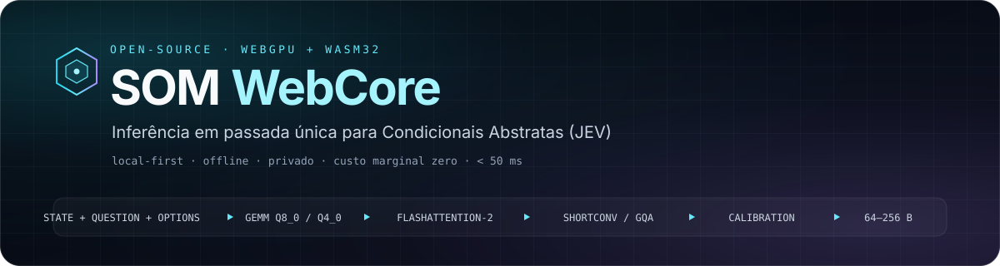
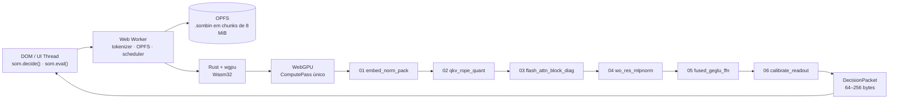
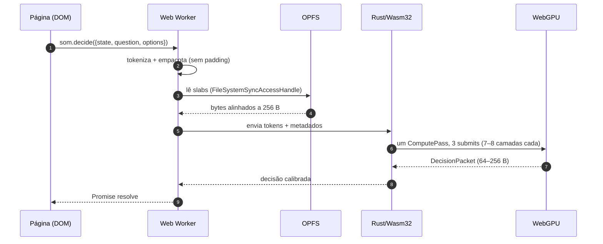
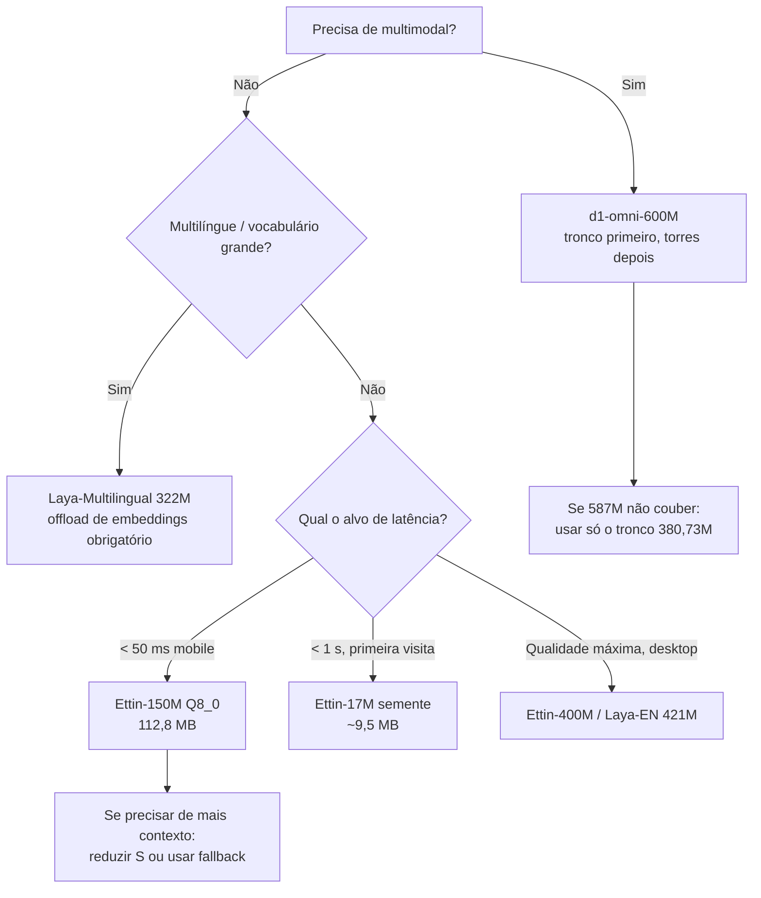
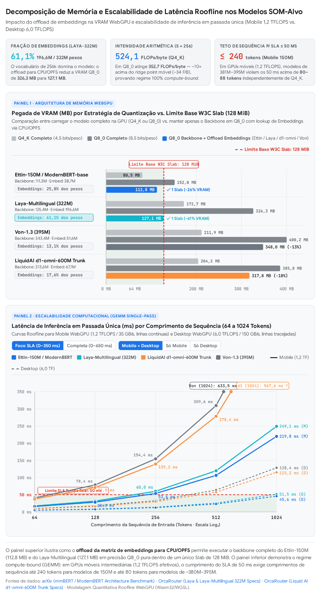
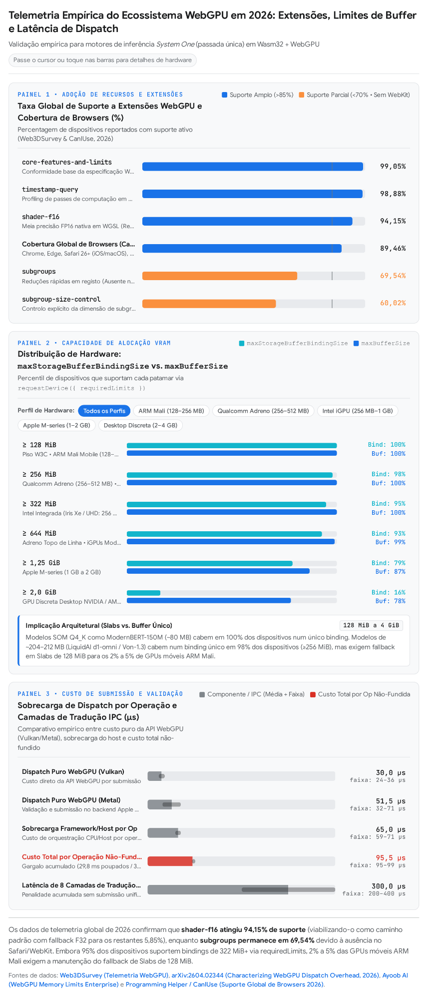
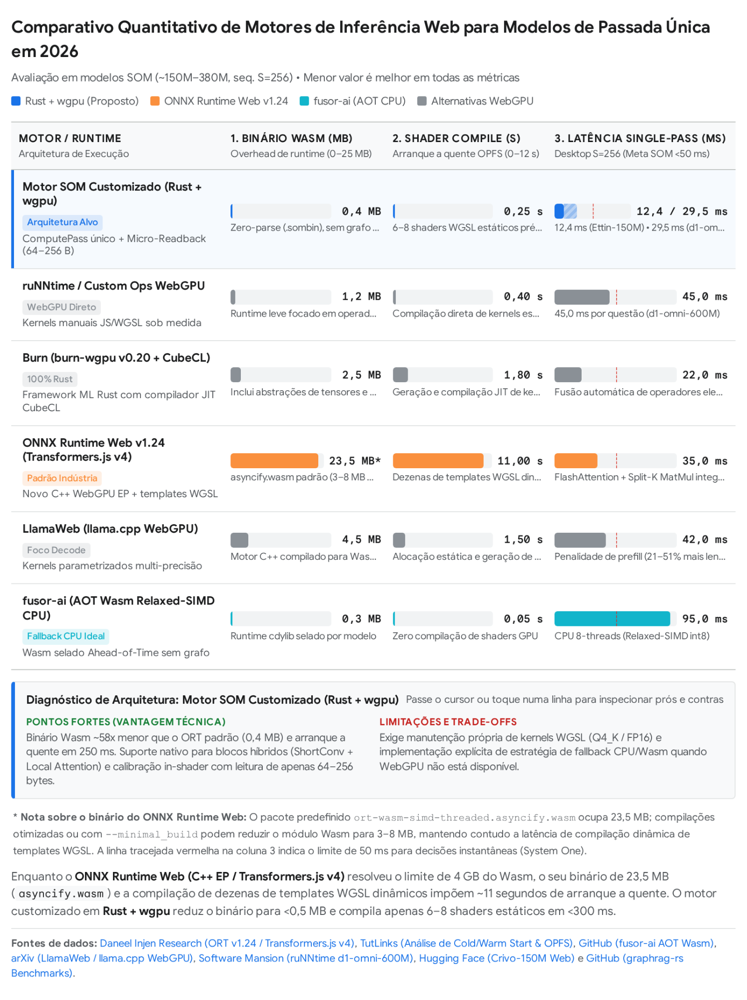
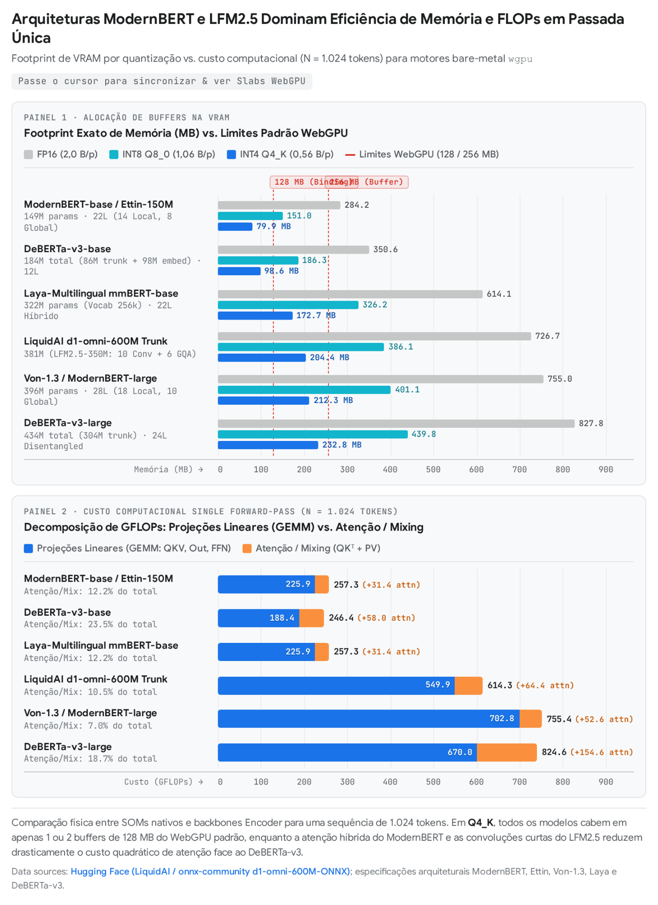
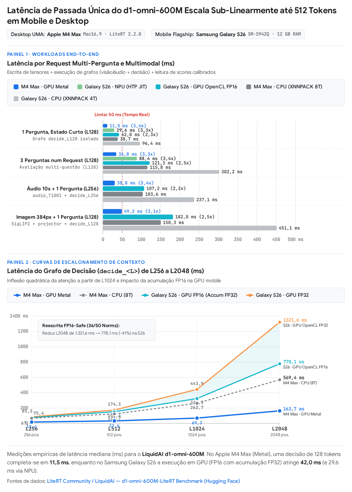

<div align="center">



# SOM WebCore

**Web Inteligente e a Era das Condicionais Abstratas (JEV)**  
*Uma infraestrutura open-source de inferência em passada única para democratizar a tomada de decisão no navegador.*

[](#status)
[](LICENSE)
[](#2-a-arquitetura-em-uma-p%C3%A1gina)
[](#6-blueprint-de-implementa%C3%A7%C3%A3o)
[](#sumario)
[](CONTRIBUTING.md)

[Manifesto](#manifesto) · [Arquitetura](#arquitetura) · [Especificação](#especificacao) · [Modelos](#modelos) · [Números](#numeros) · [Blueprint](#blueprint) · [Riscos](#riscos) · [Roadmap](#roadmap) · [FAQ](#faq) · [Referências](#referencias)

</div>

<a id="status"></a>

> ### Status deste repositório
>
> **RFC / blueprint — v0.1.0 · 2026-11-18.**
> Este repositório contém (a) a **memória CoALA local** do projeto e (b) este **documento de arquitetura autossuficiente**, que consolida dois relatórios de pesquisa sobre o motor. **O runtime ainda não foi implementado.** Tudo o que aqui aparece marcado como “proposto”, “alvo” ou “segundo o relatório” é desenho e evidência compilada — não uma API estável nem uma especificação W3C.
>
> O objetivo desta fase é permitir que qualquer pessoa entenda, critique e implemente o motor **sem precisar dos PDFs originais**. O código nascerá nas fases seguintes do [roadmap](#roadmap).

---

<a id="sumario"></a>
## Sumário

- [0. TL;DR — em uma tela](#tldr)
- [1. Manifesto: por que existimos](#manifesto)
  - [1.1 O que são Condicionais Abstratas (JEV)](#jev)
  - [1.2 Nossos pilares](#pilares)
  - [1.3 O que este projeto é — e o que não é](#nao-e)
- [2. A arquitetura em uma página](#arquitetura)
  - [2.1 Diagrama de camadas](#diagrama)
  - [2.2 O caminho de uma decisão](#caminho)
  - [2.3 Por que passada única muda a física](#fisica)
- [3. Especificação técnica](#especificacao)
  - [3.1 Armazenamento e streaming: OPFS + `.sombin`](#armazenamento)
  - [3.2 Memória: embeddings fora da VRAM, slabs e limites](#memoria)
  - [3.3 Shaders WGSL de alto throughput](#shaders)
  - [3.4 Calibração no shader e micro-readback](#calibracao)
  - [3.5 A ponte Wasm ↔ WebGPU e a execução segmentada](#ponte)
  - [3.6 Carregamento, Core Web Vitals e fallback](#carregamento)
- [4. Catálogo de modelos SOM](#modelos)
  - [4.1 Matriz comparativa](#matriz)
  - [4.2 Fichas técnicas](#fichas)
  - [4.3 Como escolher um modelo](#escolher)
  - [4.4 Licenças dos modelos](#licencas-modelos)
- [5. Números: o que a pesquisa mediu](#numeros)
  - [5.1 Roofline: compute-bound, não memory-bound](#roofline)
  - [5.2 Pegada de VRAM por quantização](#vram)
  - [5.3 Latência por dispositivo e comprimento de sequência](#latencia)
  - [5.4 Limites, extensões e cobertura dos navegadores](#limites)
  - [5.5 Custo de dispatch e de readback](#dispatch)
  - [5.6 Comparativo com os motores de 2026](#comparativo)
- [6. Blueprint de implementação](#blueprint)
  - [6.1 Estrutura do workspace](#workspace)
  - [6.2 Dois perfis de runtime](#perfis)
  - [6.3 O formato binário `.sombin`](#sombin)
  - [6.4 Bind groups, pipelines e layout de memória](#bindgroups)
  - [6.5 Os seis shaders WGSL](#seis-shaders)
  - [6.6 Agendador, chunked submit e ring de readback](#agendador)
  - [6.7 API JavaScript proposta](#api)
  - [6.8 Erros, recuperação e privacidade](#erros)
- [7. Riscos, armadilhas e mitigações](#riscos)
- [8. Roadmap](#roadmap)
- [9. Como contribuir](#contribuir)
- [10. FAQ](#faq)
- [11. Glossário](#glossario)
- [12. Referências](#referencias)
- [13. Apêndices](#apendices)

---

<a id="tldr"></a>
## 0. TL;DR — em uma tela

| Pergunta | Resposta curta |
|---|---|
| **O que é?** | Um runtime/SDK open-source, em Rust + WebGPU (wgpu/WGSL) compilado para Wasm32, para executar **System One Models (SOMs)** no navegador. |
| **O que ele faz?** | Recebe um estado, uma pergunta e opções; devolve uma **decisão tipada** (`choice`, `score`, `noul`) calibrada, em **uma única passada** não autorregressiva. |
| **O que ele não faz?** | Não gera texto token a token, não mantém KV-Cache, não precisa de servidor, não envia dados do usuário para a nuvem. |
| **Por que agora?** | WebGPU atingiu ~89% de cobertura; modelos SOM de 150M–600M cabem em 80–400 MB; o gargalo deixou de ser memória e passou a ser **computação e estabilidade do driver**. |
| **Qual o alvo de latência?** | **< 50 ms** por decisão em mobile para modelos de 150M em sequências de até ~240 tokens; 15–40 ms em desktop; modelos de 380–395M ficam em 80–88 tokens no mesmo SLA. |
| **Como?** | Streaming direto OPFS → VRAM, embeddings fora da GPU, quantização Q8_0/Q4_0, 6 shaders WGSL, calibração in-shader e **micro-readback de 64–256 bytes**. |
| **Estado?** | **RFC/blueprint.** Memória CoALA + este README. Código ainda não escrito. |
| **Licença?** | **Apache-2.0** para o código/documentação. Os pesos dos modelos têm licenças próprias. |

> **A frase que resume o projeto:** *transformar “o site decidir” em uma operação local, privada, offline e de custo marginal zero — e provar que isso pode virar primitiva da web.*

---

<a id="manifesto"></a>
## 1. Manifesto: por que existimos?

A web moderna construiu uma dependência artificial e insustentável da nuvem para tarefas cognitivas simples. Hoje, se um desenvolvedor deseja que um site decida se um visitante está confuso, classifique a intenção de um texto ou personalize um fluxo de navegação, ele é forçado a:

1. Pagar faturas caras de servidores GPU na nuvem por cada clique ou requisição.
2. Submeter os dados privados do usuário à rede.
3. Exigir conectividade ininterrupta com a internet.
4. Aceitar latências de 300 ms a 1.200 ms que quebram a responsividade do DOM.

Nós não queremos substituir ecossistemas que buscam extrair o limite máximo absoluto do hardware para treinar ou rodar modelos gigantescos de centenas de bilhões de parâmetros. O nosso objetivo é **iniciar um movimento na web para viabilizar “Condicionais Abstratas” (JEV — Julgamento, Escolha e Valorização)**.

<a id="jev"></a>
### 1.1 O que são Condicionais Abstratas (JEV)?

No código tradicional, programadores dependem de regras estáticas e frágeis:

```javascript
// O passado: regras manuais rígidas
if (user.clicks > 3 && user.timeOnPage > 60 && !user.hasScrolled) { ... }
```

Com as **Condicionais Abstratas**, o código passa a decidir por similaridade semântica, intenção e contexto em passada única, sem intervenção de servidores:

```javascript
// O futuro: decisão semântica instantânea on-device via WebGPU
if (await som.eval("usuário hesita antes de concluir o formulário")) { ... }
```

O JEV é o contrato de decisão que dá forma a essa ideia. Em vez de “gerar uma resposta”, o modelo responde a uma pergunta fechada com uma das três primitivas:

| Primitiva | Pergunta | Saída |
|---|---|---|
| **Choice** | “Qual destas opções?” | Índice vencedor + distribuição calibrada + confiança |
| **Score** | “Que nota, de 2 a 10 níveis ordenados?” | Valor esperado contínuo + distribuição |
| **Noul** | “Sim ou não?” | Probabilidade binária calibrada, opcionalmente com banda de abstenção |

> **Nota de independência:** o JEV é inspirado no contrato público de modelos System One (por exemplo, a API `/v1/systemone` da TypeSafe AI). **SOM WebCore não é afiliado, endossado ou patrocinado por essas empresas.** O projeto implementa um runtime aberto para modelos abertos e para o formato `.sombin`; nomes de produtos de terceiros pertencem aos seus donos.

<a id="pilares"></a>
### 1.2 Nossos pilares

- **Custo marginal zero.** Sites pessoais, ONGs, projetos sem monetização e pequenos negócios devem poder usar inteligência local sem faturas de nuvem.
- **Operação 100% offline (local-first).** Uma vez que o site e o modelo são armazenados no navegador, a inteligência funciona no meio do oceano ou em modo avião, com privacidade absoluta.
- **Um catalisador para a web.** Criamos esta solução no presente para demonstrar aos comitês de padrões (W3C, WHATWG) e aos fabricantes de navegadores que a **inferência de decisão em passada única precisa virar uma API padrão embutida no navegador**, abrindo no futuro o acesso transparente e desimpedido às NPUs e aceleradores do silício.
- **Engenharia honesta.** Nada de “AGI no browser”. O escopo é deliberadamente estreito: decisões tipadas, modelos compactos, uma passada, latência previsível. O que não couber nesse contrato fica de fora.

<a id="nao-e"></a>
### 1.3 O que este projeto é — e o que não é

| É | Não é |
|---|---|
| Um **runtime de decisão** para SOMs compactos (150M–600M). | Um motor de chat ou de geração de texto. |
| Um **SDK local-first** que roda em Web Worker + WebGPU + OPFS. | Um serviço de nuvem, um proxy de API ou um marketplace de modelos. |
| Um **formato binário aberto** (`.sombin`) e um conjunto de kernels WGSL. | Um fork do llama.cpp, do ONNX Runtime ou do transformers.js. |
| Um **documento de arquitetura** que registra evidências, riscos e números. | Uma promessa de que todos os números dos relatórios foram reproduzidos. |
| Um projeto **Apache-2.0** que aceita contribuições. | Um projeto afiliado à TypeSafe AI, Liquid AI, LightOn, JHU ou Convai. |

---

<a id="arquitetura"></a>
## 2. A arquitetura em uma página

<a id="diagrama"></a>
### 2.1 Diagrama de camadas

```text
+----------------------------------------------------------------------------------------------------+
|                                    NAVEGADOR WEB (DESKTOP & MOBILE)                                |
|                                                                                                    |
|  +----------------------------------------------------------------------------------------------+  |
|  | CAMADA DO SITE HOSPEDEIRO (DOM / UI Thread)                                                  |  |
|  |  - Tag <script> ou import @som-web/core (Lazy Loading não-bloqueante)                         |  |
|  |  - Disparo de Condicionais Abstratas: som.decide(), som.eval(), som.classify()                 |  |
|  +----------------------------------------------------------------------------------------------+  |
|                                                │  (micro-tarefas / sem travar UI)                  |
|                                                ▼                                                   |
|  +----------------------------------------------------------------------------------------------+  |
|  | MOTOR JAVASCRIPT / WEB WORKER & OPFS                                                         |  |
|  |  - OPFS (Origin Private File System): Cache persistente dos pesos .sombin (Download Único)    |  |
|  |  - Tokenizer & Embedding Table Offload: Vocabulário pesado resolvido na CPU (economiza VRAM) |  |
|  |  - Submissão Fatiada (Chunked Submits): Evita travamentos de GPU e mantém renderização a 60 FPS |  |
|  +----------------------------------------------------------------------------------------------+  |
|                                                │                                                   |
|                                                ▼                                                   |
|  +----------------------------------------------------------------------------------------------+  |
|  | CORE BARE-METAL WASM32 (Compilado via Rust + wgpu)                                           |  |
|  |  - Gerenciador de Buffers: Mapeamento em Slabs de 128 MiB (WebGPU W3C Compliant)             |  |
|  |  - Ring Buffer de 4 Buffers de Readback (Elimina bloqueios assíncronos)                      |  |
|  |  - Decodificação Contínua Q8_0 / Q4_0 (Otimizado para limites aritméticos de GEMM)           |  |
|  +----------------------------------------------------------------------------------------------+  |
|                                                │                                                   |
|                                                ▼ (Pipeline WGSL)                                   |
|  +----------------------------------------------------------------------------------------------+  |
|  | PIPELINE DE COMPUTAÇÃO WEBGPU (Shaders WGSL)                                                 |  |
|  |                                                                                              |  |
|  |   [Entrada Ativa] ──► [GEMM Q8_0/Q4_0] ──► [FlashAttention-2] ──► [In-Shader Calibration]   |  |
|  |    (Tokens Ativos)    (Sub-tiles 4x4)      (Bidirecional)          (Softmax + Decisão JEV)   |  |
|  +----------------------------------------------------------------------------------------------+  |
|                                                │                                                   |
|                                                ▼                                                   |
|  +----------------------------------------------------------------------------------------------+  |
|  | MICRO-READBACK (Saída Compacta)                                                              |  |
|  |  - Leitura de apenas 64 a 256 bytes de volta para a CPU (zero cópia de tensores pesados)     |  |
|  |  - Latência de inferência entregue em 15 ms a 40 ms                                          |  |
|  +----------------------------------------------------------------------------------------------+  |
|                                                                                                    |
+----------------------------------------------------------------------------------------------------+
```

O mesmo fluxo, em Mermaid:



<a id="caminho"></a>
### 2.2 O caminho de uma decisão

1. **A página chama a API.** `som.decide({ state, question, options, kind })` retorna uma `Promise`. Nada de rede; nada de bloquear a thread do DOM.
2. **O Web Worker tokeniza e empacota.** O estado, a pergunta e as opções viram uma sequência única, sem padding, com metadados por token: `option_id` e `effective_pos_id`.
3. **O OPFS entrega os pesos.** Na primeira visita, o `.sombin` é baixado em chunks de 8 MiB, verificado por BLAKE3 e gravado no OPFS. Nas visitas seguintes, os slabs são lidos do disco local em dezenas de milissegundos.
4. **O Wasm32 orquestra.** O crate Rust (wgpu apenas com a feature `webgpu`) monta um `CommandEncoder` e um `ComputePass`, usando bind groups pré-alocados e dynamic offsets por camada.
5. **A GPU executa 6 famílias de kernels.** Embedding + norma, QKV + RoPE + quantização, FlashAttention-2 bidirecional (global ou local), fusão pós-atenção, FFN GeGLU fundida e, por fim, a cabeça de decisão + calibração.
6. **Só 64–256 bytes voltam.** O último shader faz `LogSumExp`, entropia, temperatura, softmax, `argmax`,confiança e `DecisionPacket`. A CPU lê um único buffer mapeado; não há tensor de logits de megabytes.
7. **A Promise resolve.** O site recebe `{ choice, confidence, probabilities, temperature, latencyMs }` e segue o fluxo — offline, privado, sem fatura.

Em forma de sequência:



<a id="fisica"></a>
### 2.3 Por que passada única muda a física

Um LLM autorregressivo, no `decode`, processa **1 token por passo** (`S = 1`). A GPU precisa ler todos os pesos para fazer `2 × N_params` FLOPs: é **memory-bound**. Um SOM processa o estado, a pergunta e as opções **de uma vez** (`S = 64…2.048`). As projeções lineares viram **GEMM denso**: cada bloco de pesos carregado na memória partilhada é reutilizado `S` vezes. Para `S ≥ 64`, o regime é **compute-bound**.

| Modelo (S = 256) | FLOPs lineares | FLOPs de atenção | Total | Intensidade Q4_K | Intensidade Q8_0 | Tempo só de matemática (GPU móvel ~1,2 TFLOPS) |
|---|---:|---:|---:|---:|---:|---:|
| Ettin-150M | 57,00 GFLOPs | 3,02 GFLOPs | **60,02 GFLOPs** | 524,1 FLOPs/byte | 352,7 FLOPs/byte | ~50 ms |
| Von-1.3 (395M) | — | — | **180,93 GFLOPs** | 643,3 FLOPs/byte | — | ~151 ms |
| d1-omni-600M (tronco) | — | — | **162,75 GFLOPs** | 680,0 FLOPs/byte | — | ~136–154 ms |

> Ponto de equilíbrio roofline numa GPU móvel intermediária: **~34 FLOPs/byte** (≈1,2 TFLOPS ÷ ≈35 GB/s). Como os SOMs operam em 350–680 FLOPs/byte, **a largura de banda não é o gargalo** — a ALU, os registos e a estabilidade do driver são. Isso muda todas as decisões de engenharia: quantização, tiling, fusão de kernels e granularidade de submissão.

**Corolário prático:** o SLA de 50 ms não é uma promessa genérica. Ele é atingível para modelos de ~150M em sequências de até ~240 tokens em GPUs móveis intermediárias; modelos de 380–395M só cabem no mesmo SLA com ~80–88 tokens. Para sequências maiores, o produto precisa degradar de forma explícita (modelo semente, fallback CPU, ou resposta “não decidir agora”).

<a id="especificacao"></a>
## 3. Especificação técnica

Esta seção é o coração do documento. Ela descreve **o que construir**, **por que cada escolha existe** e **qual evidência a sustenta**. Os números vêm dos dois relatórios de pesquisa (Nov/2026) e estão marcados com a ressalva “segundo o relatório”; a seção [5](#numeros) consolida as medições e a seção [13.D](#divergencias) registra as divergências entre as fontes.

<a id="armazenamento"></a>
### 3.1 Armazenamento e streaming: OPFS + `.sombin`

**O problema.** Um modelo SOM compacto tem 80–400 MB. Guardar isso no navegador parece trivial, mas as APIs tradicionais falham exatamente nessa faixa:

| API | Limite/comportamento | Consequência |
|---|---|---|
| **Cache API** | Limite silencioso de ~200 MB no Chromium; entradas opacas inflam a quota em ~7 MB por resposta | Pesos reportados como vazios em arranques a frio; downloads repetidos |
| **IndexedDB** | Leitura assíncrona, overhead de transação, quota conservadora | Cold start lento; difícil de fazer streaming para a GPU |
| **WebAssembly.Memory** | 4 GiB de espaço linear; páginas nunca devolvidas ao SO | Duplica a RAM; Jetsam no iOS; OOM em mobile |
| **OPFS** | Sem limite por entrada (só a quota da origem, tipicamente ≥1 GB); `FileSystemSyncAccessHandle` síncrono no Worker | **Escolhido**: leitura fria 2–4× mais rápida que IndexedDB, persistente, offline |

**A solução.** O `.sombin` é um arquivo binário **zero-parse**, alinhado a **256 bytes**, dividido em duas seções lógicas:

- **Seção A — Embeddings (CPU/OPFS).** A tabela `vocab_size × H` fica fora da VRAM, quantizada em Q8_0 ou F16. Para uma sequência de `S ≤ 512` tokens, o Worker extrai apenas os `S` vetores ativos (ex.: `512 × 768 × 2 B = 768 KB` em f16) e envia esse micro-tensor para a GPU no início do passe.
- **Seção B — Backbone + cabeça de decisão (VRAM).** Os pesos das camadas e a cabeça de calibração são carregados em slabs de 128 MiB (ou um único buffer, quando `requiredLimits` permite).

**Streaming em pedaços de 8 MiB.** O download usa `ReadableStream` + `response.body.getReader()`. Cada pedaço é:

1. recebido em um `Uint8Array` pré-alocado no **JS** (nunca no heap Wasm);
2. verificado por **BLAKE3**;
3. gravado no OPFS via `FileSystemSyncAccessHandle.write()`;
4. enviado à GPU por `queue.writeBuffer()` ou `mappedAtCreation`, sem cópia para `WebAssembly.Memory`.

**Alinhamento.** Todo tensor começa em múltiplo de **256 bytes**, satisfazendo `minUniformBufferOffsetAlignment = 256` e `minStorageBufferOffsetAlignment = 256` da especificação W3C. Isso permite `dynamic offsets` por camada sem revalidar bind groups.

**Números de referência:**

| Modelo | Tamanho típico | Observação |
|---|---:|---|
| Ettin-17M (semente) | **~9,5 MB** em 4 bits · ~18 MB em 8 bits | Carrega e compila em < 1 s; decisões imediatas enquanto o modelo principal baixa |
| Ettin-150M | **~80–112 MB** | Cabe em um slab de 128 MiB em Q8_0 sem embeddings |
| Laya-Multilingual | **~647 MB** em disco (checkpoint) | 322M parâmetros; 61,1% são embeddings |
| d1-omni-600M (texto) | **240 MB** em 4 bits · **410 MB** em 8 bits (ONNX) | Multimodal completo: 670 MB (visão FP16 + áudio Q8 + embeddings FP16) |
| d1-omni-600M (pesos `.sombin`) | **314,89 MB** em Q4_K · **594,79 MB** em Q8_0 | Inclui tronco + torres; ver Tabela 1 do Apêndice A |

> **Armadilha do OPFS:** o Chromium **não libera blocos imediatamente** após `removeEntry()`; a contabilidade pode levar minutos para refletir a exclusão. A lógica de atualização de versões do `.sombin` deve consultar `navigator.storage.estimate()` antes de gravar um novo arquivo — ou usar um nome versionado e apagar o antigo depois.

<a id="memoria"></a>
### 3.2 Memória: embeddings fora da VRAM, slabs e limites

**Os limites da especificação base.** Se a aplicação chamar `adapter.requestDevice()` sem `requiredLimits`, o navegador impõe o piso garantido da W3C, mesmo que o hardware suporte muito mais:

| Limite | Valor padrão W3C | Observação |
|---|---:|---|
| `maxStorageBufferBindingSize` | **134.217.728 B (128 MiB)** | Teto por binding de storage buffer |
| `maxBufferSize` | **268.435.456 B (256 MiB)** | Teto por `GPUBuffer` individual |
| `maxComputeWorkgroupStorageSize` | **16.384 B (16 KiB)** | `var<workgroup>` por workgroup |
| `maxStorageBuffersPerShaderStage` | **8** | Bindings de storage por estágio |
| `minStorageBufferOffsetAlignment` | **256 B** | Dynamic offsets precisam ser múltiplos |

**O que o hardware realmente suporta (telemetria 2026, segundo o relatório):**

| Limite | ≥128 MiB | ≥256 MiB | ≥322 MiB | ≥644 MiB | ≥1,25 GiB | ≥2 GiB |
|---|---:|---:|---:|---:|---:|---:|
| `maxStorageBufferBindingSize` | 100% | 98% | **95%** | 93% | 79% | **16%** |
| `maxBufferSize` | 100% | 100% | 100% | 99% | 87% | **78%** |

A queda para 16% em `maxStorageBufferBindingSize ≥ 2 GiB` tem causa física: os drivers D3D12 no Windows (NVIDIA/AMD) limitam as *Shader Resource Views* de raw buffers logo abaixo de `INT32_MAX` (~2 GiB), mesmo quando `maxBufferSize` é 4 GiB. Por arquitetura:

| Classe | Binding típico | Buffer típico |
|---|---|---|
| GPU dedicada (NVIDIA/AMD) | 2–4 GB | 4 GB+ |
| Apple M-series | 1–2 GB | 4 GB+ |
| Intel Iris Xe/UHD | 256 MB–1 GB | 1–2 GB |
| Qualcomm Adreno | 256–512 MB | 512 MB–1 GB |
| ARM Mali | **128–256 MB** | 256–512 MB |

**Estratégia: arena de slabs com dynamic offsets.** Em vez de um bind group por camada (28 objetos validados a cada passo) ou de um único buffer que viola o limite de 128 MiB, o runtime usa:

1. **2–3 slabs físicos.** Cada `wgpu::Buffer` tem `STORAGE | COPY_DST` e contém um subconjunto fixo de camadas. Exemplo para Von-1.3 em Q4_K (tronco ~184,1 MB): Slab A = camadas 0–13 (~92,05 MB), Slab B = camadas 14–27 (~92,05 MB), Slab 0 estático = embeddings + cabeça (~28,2 MB). Em Q8_0 (401,09 MB): 3 slabs de ~115 MB.
2. **Alinhamento estrito a 256 B.** O bloco de pesos de cada camada (`attn_norm`, `Wqkv`, `Wo`, `mlp_norm`, `Wi`, `Wo`) é concatenado e arredondado para o próximo múltiplo de 256: `layer_stride_bytes`.
3. **Um bind group por slab, com `has_dynamic_offset: true`.** O binding cobre `layer_stride_bytes`; `min_binding_size` é `layer_stride_bytes` (ex.: ~6,58 MB em Q4_K), muito abaixo de 128 MiB.
4. **Travessia sem trocar descritores.** Para a camada `l` no slab `s`, índice local `k = l - l_start(s)`:
   `cpass.set_bind_group(1, &slab_bind_groups[s], &[(k * layer_stride_bytes) as u32])`.
   O navegador apenas soma o offset ao ponteiro base — sem alocação nem revalidação de tabela.

**Negociação dinâmica.** Em `SomEngine::init`, o runtime consulta `adapter.limits.maxStorageBufferBindingSize` e `maxBufferSize`:

- se o backbone couber em um único buffer (95% dos dispositivos suportam ≥322 MiB de binding), aloca **um slab monolítico** e simplifica o binding;
- se não couber (2–5% de GPUs ARM Mali no piso de 128 MiB), ativa automaticamente a **segmentação em 2–3 slabs** com dynamic offsets;
- se `requiredLimits` não estiver disponível ou o dispositivo rejeitar, cai para o piso W3C sem falhar.

**O offload de embeddings, em números.** Num SOM de passada única **não existe LM Head** sobre todo o vocabulário: a tabela de embeddings é consultada uma única vez, antes da camada 0, para converter os `S` IDs em vetores de dimensão `H`. Manter `vocab_size × H` na VRAM é desperdício puro.

| Modelo | Vocabulário | Embeddings | % dos pesos | VRAM economizada | Backbone em Q8_0 |
|---|---:|---:|---:|---:|---:|
| Ettin-150M | 50.368 | 38,68M | 25,8% | ~39 MB | **112,8 MB** |
| Laya-Multilingual | **256.000** | **196,61M** | **61,1%** | **~199 MB** | **127,1 MB** |
| Von-1.3 | 50.368 | 51,58M | 13,1% | ~52 MB | 348,0 MB (com cabeça) |
| d1-omni-600M (tronco) | 65.536 | 67,11M | 17,6% | ~65 MB | 317,8 MB (com cabeça) |

O efeito transformador: **Laya e Ettin passam a caber inteiros em um único slab de 128 MiB em Q8_0**, eliminando a necessidade de Q4_K e preservando a calibração. Para `S ≤ 512`, o micro-tensor de embeddings ativos é `512 × 768 × 2 B = 768 KB` — ruído perto dos 127 MB do backbone.

**Buffers de ativação (pré-alocados, sem alocação por inferência):**

| Buffer | Tamanho | Uso |
|---|---:|---|
| `act_buf_a` | `N_max × H × 4 B` (ex.: 8192 × 1024 × 4 = **32 MiB**) | Residual principal do Transformer |
| `act_buf_b` | idem | Saída normalizada / saída da atenção |
| `qkv_workspace` | `N_max × 3H × 2 B` (ex.: 8192 × 3072 × 2 = **48 MiB** em f16) | Q, K, V rotacionados por RoPE |
| `decision_gpu_buf` | **64–256 B** | `DecisionPacket` |
| `staging_ring[4]` | **256 B cada** | `COPY_DST` + `MAP_READ`; 4 buffers para pipeline de leitura |

**Orçamentos de VRAM por aba (segundo o relatório):**

| Plataforma | Orçamento observado | Risco |
|---|---:|---|
| iOS Safari (WKWebView) | **~1,0–2,0 GB** totais; ~1 GB de alocação GPU | Jetsam mata a aba ao cruzar o limite |
| Chrome Android | ~1,5–2,0 GB | `device.lost` em alocações rejeitadas (Adreno 6xx, contextos de 256 MB) |
| Apple Silicon desktop | ~3–4 GB | Pressão de memória do sistema |
| NVIDIA RTX 4090 (D3D12) | ~4 GB por buffer | SRV de binding limitada a ~2 GiB |
| Snapdragon X Elite | ~2 GB | UMA compartilhada |

**Regra de ouro:** o módulo Wasm32 deve manter **< 16 MiB de memória linear** durante todo o ciclo de vida. Os pesos transitam do OPFS para a GPU; o Wasm guarda apenas handles (~150 bytes por buffer). Qualquer cópia de 8 MiB para `WebAssembly.Memory` é um bug de arquitetura.

<a id="shaders"></a>
### 3.3 Shaders WGSL de alto throughput

O motor precisa de **quatro famílias de kernels** (materializadas em **seis arquivos WGSL**; ver [6.5](#seis-shaders)):

| Família | Arquivo(s) | Onde é usada | Técnica central |
|---|---|---|---|
| **Embedding + norma** | `01_embed_norm_pack.wgsl` | Camada 0, antes do backbone | Gather de embeddings + `embed_norm` com `subgroupAdd` em f32 |
| **QKV + RoPE + quantização** | `02_qkv_rope_quant.wgsl` | Todas as camadas | GEMM tiled + `dot4I8Packed` + RoPE com `effective_pos_id` |
| **FlashAttention-2 bidirecional** | `03_flash_attn_block_diag.wgsl` | 8–10 camadas globais + 14–18 locais por modelo | Online softmax em registos, tile skipping bloco-diagonal |
| **Convolução curta + GQA** | `03` (variante) + `04`/`05` | d1-omni (10 ShortConv + 6 GQA) | `LFM2BiShortConv` fundida; GQA `kv_head = q_head >> 1` |
| **GEMM + fusões** | `02`, `04`, `05` | Projeções lineares e FFN | Tiling 64×64, sub-tiles 4×4/2×4, epilogue fusion |
| **Cabeça de decisão** | `06_calibrate_readout.wgsl` | Fim do passe | `[MASK]` gather, OptionMarkerScorer, temperatura, softmax, `DecisionPacket` |

**FlashAttention-2 bidirecional.** Para SOMs, a implementação mais eficiente em WGSL é a FA2 adaptada para tiling cooperativo em `var<workgroup>` com **online softmax** em registos. O Flash-Decoding (Split-K) só faz sentido quando `L_Q = 1`; num SOM, `L_Q = S` (64–1.024) × 12–16 cabeças já gera centenas de workgroups e satura a GPU. A atenção clássica materializa `[B, H, S, S]` na VRAM e, em `S = 512`, desperdiça ~67 MB de tráfego global **por camada**; a FA2 evita isso.

Pseudocódigo do núcleo (por tile de Query, por cabeça):

```wgsl
// Estado por thread, em registos f32
var m_i: f32 = -3.402823e+38;   // máximo corrente
var l_i: f32 = 0.0;              // soma exponencial
var acc_o: array<f32, 16>;       // head_dim = 64 / 4 threads = 16

for (var tile_j = 0u; tile_j < num_kv_tiles; tile_j++) {
    // 1. Carrega K_tile e V_tile para var<workgroup> (16 colunas)
    // 2. Calcula s_ij = dot(q_i, k_j) * scale
    // 3. Aplica máscara: bloco-diagonal + janela local/global
    // 4. Online softmax:
    //    m_new = max(m_i, max_j s_ij)
    //    l_i   = exp(m_i - m_new) * l_i + sum_j exp(s_ij - m_new)
    //    acc_o = exp(m_i - m_new) * acc_o + sum_j exp(s_ij - m_new) * v_j
    //    m_i   = m_new
}
// 5. acc_o /= l_i; escreve em act_buf_b
```

Com `head_dim = 64`, o estado por thread exige apenas ~34 floats (face a `array<f32, 1024>` numa implementação FA1), cabendo nos registos sem *spilling*. Nas camadas GQA do d1-omni (16 cabeças Q / 8 KV), duas cabeças Q partilham a mesma KV: `kv_head = q_head >> 1u`.

**Máscara bloco-diagonal (invariância à ordem).** O SOM avalia `K` opções no mesmo passe. Para que cada opção não “veja” as outras:

```wgsl
// opt_i = 0 => token do State; opt_i > 0 => opção/pergunta i
let diag_visible = (opt_j == 0u) || (opt_i == opt_j);

// Janela local: distância efetiva <= 64 (janela de 129 posições inclusivas)
let dist = select(pos_j - pos_i, pos_i - pos_j, pos_i >= pos_j);
let win_visible = (is_global_layer == 1u) || (dist <= 64u);

let is_valid = diag_visible && win_visible;
let score = select(-3.402823e+38, raw_dot * scale, is_valid);
```

Antes mesmo de carregar um bloco `K_tile` da VRAM, o workgroup verifica os metadados `[j_start, j_end]`; se o intervalo de `opt_id` do bloco não intersecta o intervalo do bloco de queries (`opt_k_max < opt_q_min || opt_k_min > opt_q_max`), executa `continue;` e **salta 100% das leituras e multiplicações** entre opções diferentes. Em `Choice` com 50–255 opções, isso torna o custo de atenção **linear em K**, não quadrático.

**Janela local W = 128.** Nas camadas locais (14 no ModernBERT-base/Ettin/Laya; 18 no Von-1.3), o loop sobre K/V é restrito aos tiles que intersectam `[q_idx - 64, q_idx + 64]`, cortando **75%–87,5%** dos FLOPs de atenção em `S = 512–1.024`.

**Convolução 1D curta bidirecional (`LFM2BiShortConv`).** Cada camada não-atencional do d1-omni:

```text
h = operator_norm(x)                       // RMSNorm
[B, C, x_in] = in_proj(h)                  // Linear(H, 3H), sem bias
Bx = B * x_in                              // primeira porta
conv = depthwise_conv1d(Bx, groups=H, kernel=3, padding=1)  // simétrica
y = conv * C                               // segunda porta
out = out_proj(y) + x                      // residual
```

O kernel WGSL mantém `B`, `C`, `x_in` e o estado da convolução em `var<workgroup>`; `operatorNorm`, `RMSNorm`, a convolução e as projeções são fundidas para evitar ida e volta à VRAM.

**GEMM tiled 64×64.** Cada workgroup `@workgroup_size(16, 16)` calcula um bloco 64×64 da saída, carregando cooperativamente fatias `64×16` de A e `16×64` de B para `var<workgroup>`, sincronizadas por `workgroupBarrier()`. Cada carga da memória partilhada alimenta ~16 multiplicações-acumulações em registos.

- **Sub-tiles 4×4 ou 2×4**, nunca 8×8. Benchmarks (posttrainllm, 2026): 4×4 → 8×8 piora de 1,78 ms para 1,96 ms em 1024×1024 e de 10,15 ms para 11,52 ms em 2048×2048, porque 64 acumuladores estouram o orçamento de registos em GPUs Apple/móveis, causam *spilling* e exigem 16 KB de `var<workgroup>` em vez de 4 KB. Em GPUs onde a ocupação de warps domina, 2×4 supera 4×4.
- **Acumuladores escalares nomeados**, nunca `array<f32, 16>` indexado por variável. O indexamento variável causou **3× de atraso** por *spilling* no Pooled.run e é o gatilho direto do bug `DXGI_ERROR_DEVICE_HUNG` em NVIDIA Lovelace sob D3D12.
- **Cargas vetoriais de 128 bits** (`vec4<f32>`): 1,37× mais rápidas que cargas escalares em matrizes 2048×2048.

**Cabeça de decisão e calibração in-shader.** O último shader recolhe as representações nas posições dos marcadores `[MASK]` (Laya/Von) ou aplica os 2 blocos de decisão (d1-omni), calcula os logits de cada opção, divide pela temperatura específica do tipo de pergunta embutida nos metadados do `.sombin`, executa o softmax em **f32 estrito** e escreve os 64–256 bytes finais.

**Quatro armadilhas de portabilidade entre Tint (Chromium), Naga (Firefox/wgpu) e WebKit MSL (Safari):**

1. **Correspondência estrita de modo de acesso.** `var<storage, read>` no shader com um layout `buffer: { type: "storage" }` (leitura-escrita) no host **não** gera erro de validação no Chromium/Metal; retorna dados corrompidos silenciosamente. O layout tem de declarar `read_only` exatamente como o shader.
2. **Proibição de escritas parciais em `var<workgroup> array<vec4<f32>>` no Metal.** Escrever um componente individual de um `vec4` em memória partilhada apaga as escritas de threads vizinhas em GPUs Apple. Escreva o `vec4` completo ou use arrays escalares.
3. **Sem ponteiros de storage em argumentos de função.** Passar ponteiros de storage buffer como parâmetros é inseguro no Safari; gere funções auxiliares por buffer no template WGSL.
4. **`enable subgroups;` não é portátil.** O Naga nativo (wgpu) rejeita a diretiva mesmo com `Features::SUBGROUP` ativo; o Dawn/Firefox exige a linha. O carregador remove ou mantém a linha conforme `cfg!(target_arch = "wasm32")`. Subgroups são **otimização opcional** (69,54% de suporte; Safari não expõe), nunca requisito.

<a id="calibracao"></a>
### 3.4 Calibração no shader e micro-readback

**O problema do readback.** Em motores convencionais, a GPU transfere o tensor de saída do encoder (`[N, H] = 1024 × 1024 × 4 = 4 MiB`) para a CPU, que extrai os `[MASK]`, executa a cabeça e aplica softmax/calibração. No navegador, `mapAsync` custa **~2 ms por leitura no Chrome** (até ~11 ms em pipelines não otimizados) e cada transferência atravessa o IPC Renderer ↔ GPU. Ler 4 MiB por decisão é inviável.

**A solução.** Todo o pós-processamento ocorre no **shader 06**, despachado com `dispatch_workgroups(1, 1, 1)` (1 workgroup de 256 threads):

1. **Coleta seletiva.** Lê apenas `mask_positions: array<u32, 256>` (K ≤ 255) e aplica `final_norm` somente aos K vetores de 1024 dimensões. Ignora os outros ~1.000 tokens.
2. **OptionMarkerScorer.** Multiplica os K vetores pela cabeça (`LayerNorm → Linear → GELU → Linear → 1 logit`), produzindo `K` logits em `var<workgroup> smem_logits: array<f32, 256>`.
3. **LogSumExp + entropia + temperatura.** Calcula `max_z`, `sum_exp`, `p_raw`, entropia de Shannon normalizada `H_norm = H / log(K)` e avalia a equação de temperatura do modelo.
4. **Primitivas + `DecisionPacket`.** Aplica `softmax(logits / T)`, encontra `winning_idx` (argmax) e o segundo colocado, calcula `p1 - p2`, o valor esperado de `Score` (`Σ m·p_m`) e a equação de `Noul`; a thread 0 escreve o pacote.

**`DecisionPacket` de 64 bytes** (até 8 probabilidades; 256 bytes para até 56; 1.056 bytes para as 255):

| Offset | Campo | Tipo | Significado |
|---:|---|---|---|
| `0x00` | `winning_option` | `u32` | Índice vencedor para `Choice` (argmax) |
| `0x04` | `num_options` | `u32` | K opções avaliadas |
| `0x08` | `confidence` | `f32` | `p_top1 - p_top2` (confiança calibrada) |
| `0x0C` | `calibrated_temperature` | `f32` | Temperatura T calculada em tempo real |
| `0x10` | `noul_probability` | `f32` | P(true) calibrada, com ou sem banda |
| `0x14` | `expected_score` | `f32` | `Σ m·p_m` para `Score` |
| `0x18` | `normalized_entropy` | `f32` | Entropia de Shannon normalizada |
| `0x1C` | `top1_prob` | `f32` | Maior probabilidade calibrada |
| `0x20..0x40` | `top8_probs[8]` | `f32 × 8` | Primeiras 8 probabilidades (fecha 64 B) |

**Calibração por modelo.** Cada família tem regras próprias — e ignorá-las destrói a confiança:

- **Von-1.3.** Temperatura dinâmica condicionada pela entrada:
  ```text
  H_norm = H(p_raw) / log(K)
  T = clamp(
        bias
        + w_entropy * H_norm
        + w_log_tokens * (log10(state_len) * 0.25)
        + w_n_options * (K * 0.125),
        0.3, 12.0)
  ```
  Coeficientes de fábrica: `bias = 2.0151`, `w_entropy = -3.2369`, `w_log_tokens = 11.4916`, `w_n_options = -3.5574`. Confiança = `p1 - p2`. `Noul` aplica banda linear por partes para evitar a faixa de abstenção 0,2–0,8:
  ```text
  se p >= 0.5:  p_out = 0.8 + 0.1 * (p - 0.5)
  se p <  0.5:  p_out = 0.2 - 0.1 * (0.5 - p)
  ```
  Com `--noul-decision raw`, retorna a posterior calibrada sem banda.
- **Laya.** A temperatura do bucket `choice:11+` vem como **0.1006** e exige `clamp(T, 0.5, 5.0)`; `act_probability` está saturada em 1,0 (issue #185; AUROC 0,30) e deve ser ignorada. A confiança é `p1 - p2`.
- **d1-omni-600M.** Temperaturas por formato embutidas no GGUF: `choice` 1,7465 a 1,1751; `noul` 1,6663; `score` 1,7301 / 1,0. Aplicar a temperatura correta por bucket é obrigatório; a média global degrada o ECE.
- **Ettin/TS-Ettin.** Cabeça tipada sobre pooled/span outputs; a calibração é a da cabeça (não há temperatura dinâmica obrigatória). A referência INT8 preserva a decisão: 0,704 de acurácia vs. 0,709 em FP32.

> **Regra:** nunca use `f16` para acumuladores de produto escalar, RMSNorm ou reduções de softmax. O f16 é para **armazenamento e transferência**; a acumulação é **f32**. A equipe do Pooled.run comprovou que a acumulação em f16 corrompe os resultados; o d1-omni altera a resposta de topo em 0,8% (texto) e 1,7% (áudio) só por trocar f16 por bfloat16.

<a id="ponte"></a>
### 3.5 A ponte Wasm ↔ WebGPU e a execução segmentada

**Quanto custa a ponte?** A travessia Wasm→JS em si custa **< 1 µs por chamada** (< 0,1 ms para 100 chamadas). O custo real está no dispatch: o estudo de Maczan (2026, arXiv:2608.08730), em quatro fabricantes de GPU, três backends e três navegadores, mede:

| Operação | Custo marginal | Faixa |
|---|---:|---:|
| Dispatch puro WebGPU (Vulkan) | **30,0 µs** | 24–36 µs |
| Dispatch puro WebGPU (Metal) | **51,5 µs** | 32–71 µs |
| Overhead de framework/host por operação | **65,0 µs** | 59–71 µs |
| Custo total por operação não fundida | **95,5 µs** | 95–99 µs |
| Latência acumulada das 8 camadas de tradução (sem unificação) | **300,0 µs** | 200–400 µs |

Conclusão: **a contagem de dispatches é um gargalo de primeira ordem**. É por isso que o motor funde operadores e reduz o grafo para ~4 dispatches por camada (~90 no total), em vez de 150–250.

**Fusão de operadores.** Funda os operadores elementares nas multiplicações de matrizes adjacentes:

- acumule diretamente no residual (`y += W * x`) nas projeções de saída de atenção/convolução e FFN down;
- funda as projeções `gate` e `up` com a ativação GeGLU/SwiGLU **antes** de escrever na memória global;
- no Pooled.run, isso eliminou **128 dispatches por passo** e acelerou 1,4× no Vulkan.

**Chunked submit em 3 blocos.** Mesmo com fusão, um único `queue.submit()` com ~90 dispatches é perigoso. Divida o passe em **3 submissões** (uma a cada 7–8 camadas). Isso resolve três falhas ao mesmo tempo:

1. **`device.lost` no Metal/UMA.** Um command buffer massivo durante prefill largo provoca perda de dispositivo; o Pooled.run teve de dividir o prefill a cada 8 camadas, e o llama.cpp desativou o batching completo em UMA.
2. **`DXGI_ERROR_DEVICE_HUNG` no D3D12.** Um kernel que retém **> 1.652 inteiros de 32 bits (6.608 bytes) por thread** em arrays de escopo de função/`var<private>` indexados dinamicamente, seguido de outro dispatch no mesmo `submit()`, reseta o driver em GPUs NVIDIA Lovelace (RTX 4050/4070). Inserir uma fronteira de `queue.submit()` após o kernel pesado impede 100% da falha.
3. **Compositor starvation.** Agrupar tudo monopoliza a GPU e impede o compositor de intercalar a renderização: o pior frame salta de **9,40 ms** para **166,60 ms**, congelando scroll, animações CSS e toque. Com 3 submits, o navegador desenha frames intermédios a 60 FPS.

**Ring de readback.** Um buffer em `mapAsync()` não pode ser reutilizado pela GPU até `unmap()`. O runtime pré-aloca um **anel de 4 staging buffers de 256 bytes** (`COPY_DST | MAP_READ`), permitindo enfileirar uma nova decisão enquanto a anterior ainda está sendo lida pelo JavaScript.

**Proibição de `createBuffer` em runtime.** Criar/destruir um `GPUBuffer` a cada leitura ou frame custa **0,3–1,2 ms por alocação** e causa fugas invisíveis de VRAM que o GC do JS não recolhe até `buffer.destroy()`. Pré-aloque no arranque:

- pool estático de ativações em **ping-pong** (`[S_max, H]`), custo de alocação ~0,01 ms;
- ring de 3–4 staging buffers de 256 B;
- slabs de pesos imutáveis.

**Upload sem tocar no heap Wasm.** No carregamento inicial, leia cada chunk de 8 MiB do OPFS diretamente para um `Uint8Array` pré-alocado no JS (ou use `mappedAtCreation: true` na criação do slab), e chame `device.queue.writeBuffer()` sem copiar os 8 MiB para `WebAssembly.Memory`. Em dispositivos UMA, isso evita duplicar a pegada e é a diferença entre rodar e ser morto pelo Jetsam.

**Recuperação de `device.lost`.** Registre sempre um handler em `device.lost`. Se o SO móvel reclamar a GPU ao minimizar a aba, o SDK:

1. reconstrói o `GPUDevice` quando a página volta ao primeiro plano (`visibilitychange`);
2. recarrega os slabs em poucos milissegundos do OPFS (sem novo download);
3. recria pipelines e bind groups;
4. reexecuta a decisão pendente, se houver.

**Perfil nativo (sem limites de browser).** Em wgpu nativo, o runtime ativa:

- `Features::MAPPABLE_PRIMARY_BUFFERS` em UMA (Apple Silicon, APUs AMD/Intel, SoCs Android) para zero-copy real; desativado em dGPU PCIe para não forçar leituras pelo barramento;
- `Features::PUSH_CONSTANTS` (128 B) para injetar `layer_idx`, `seq_len`, `state_len`, `num_options`, `is_global_layer`, `rope_theta`, `norm_eps`, `weight_base_offset` sem `UniformBuffer` por dispatch;
- `Features::BUFFER_BINDING_ARRAY` / bindless para um slab monolítico;
- `SPIRV_SHADER_PASSTHROUGH` (Vulkan) e kernels MSL (`simdgroup_matrix`) para Tensor Cores/WMMA, quando disponíveis.

<a id="carregamento"></a>
### 3.6 Carregamento, Core Web Vitals e fallback

Carregar 80–204 MB na primeira visita não pode penalizar LCP nem INP. A arquitetura de carregamento tem quatro camadas de proteção:

1. **Execução 100% em Web Worker + sonda pre-flight zero-byte.** Toda a instância wgpu, compilação WGSL e acesso síncrono ao OPFS vivem no Worker (`WorkerNavigator.gpu`). No carregamento da página, execute apenas uma sonda assíncrona leve:
   `navigator.gpu.requestAdapter()`, `adapter.features.has('shader-f16')`, `adapter.limits.maxStorageBufferBindingSize`, `navigator.deviceMemory`, `navigator.storage.estimate()` — **sem disparar download antes do LCP**.
2. **Desacoplamento de rede pós-LCP + compilação assíncrona.** Reserve a banda inicial para recursos críticos (`fetchpriority="high"`); inicie o streaming do `.sombin` apenas após o LCP, em `requestIdleCallback`, com `fetch(url, { priority: 'low' })` no Worker. Valide cada chunk por BLAKE3 antes de persistir. Restrinja o motor a **6–8 shaders parametrizados** e compile com `device.createComputePipelineAsync()` — motores com 20–40 kernels podem bloquear o processo GPU por segundos no Tint/WebKit.
3. **Progressive enhancement com modelo semente.** A família Ettin (17M/32M/68M/150M/400M/1B) usa a mesma receita de treino. O SDK baixa primeiro o **Ettin-17M** (~9,5 MB em 4 bits / ~18 MB em 8 bits), que transfere e compila em < 1 s, e entrega decisões imediatas enquanto o modelo principal faz streaming silencioso para o OPFS.
4. **Fallback em três níveis.**
   - **WebGL2: rejeitado.** Não tem compute shaders, `var<workgroup>` nem barreiras de grupo; emular atenção e desquantização em fragment shaders exige dezenas de passes e tem overhead de CPU alto.
   - **Wasm32 SIMD128 + Relaxed SIMD multithreaded.** Nos ~10–11% de navegadores sem WebGPU, use `i32x4.relaxed_dot_i8x16_i7x16_add_s` (mapeia para `sdot` em ARM e AVX-VNNI em x86). Com `SharedArrayBuffer` (COOP/COEP), 4 Workers alcançam **3,2×** sobre Wasm escalar e executam um modelo de 150M em INT8 em **~196 ms**; modelos leves (Ettin-17M/32M) ficam em **15–80 ms**.
   - **API remota (último recurso).** Se WebGPU falhar, não houver `SharedArrayBuffer` (Wasm 1 thread) ou a latência CPU exceder o SLA, o SDK pode chavear transparentemente para um endpoint remoto. Isso **quebra a promessa local-first** e deve ser opt-in, explícito e auditável — nunca silencioso.

**Core Web Vitals.** O objetivo é: LCP e INP da página hospedeira **inalterados**; o motor só entra depois do LCP; nenhuma tarefa longa na main thread; o Worker é terminado quando o site não precisa mais dele. A primeira decisão pode chegar em < 1 s com o modelo semente; o modelo principal fica pronto em segundo plano.

**Pressão térmica.** WebGPU não expõe temperatura nem bateria. Mitigação: operar em **pulsos efémeros orientados a eventos**, nunca em loop contínuo. Um passe de 15–45 ms consome fração insignificante de energia; acionar o modelo a cada tecla sem debounce satura um SoC móvel em ~30 s e **triplica a latência** (8 ms → 25 ms). O SDK deve oferecer `debounce`, cancelamento de requisições obsoletas e um modo “econômico” que reduz a frequência de decisões.

<a id="modelos"></a>
## 4. Catálogo de modelos SOM

Um SOM não é “um BERT com uma cabeça”. As famílias abaixo têm topologias, layouts de token, calibrações e licenças diferentes. O runtime precisa de **operadores especializados** para cada padrão de atenção — e o carregador precisa de metadados por modelo no `.sombin`.

<a id="matriz"></a>
### 4.1 Matriz comparativa

| Modelo | Parâmetros totais (embeddings / backbone) | Backbone e atenção | Cabeça de decisão / calibração | Status e licença |
|---|---:|---|---|---|
| **ModernBERT-base / Ettin-150M** | **150,0M** (38,68M / 111,32M) | 22 camadas · H=768 · I=1.152 (GeGLU) · 12 cabeças (d_h=64) · RoPE θ=160.000 · vocab 50.368 · G-L-L: **8 globais** (0,3,6,9,12,15,18,21) + **14 locais** W=128 · contexto 8.192 | Cabeça tipada (TS-Ettin-150M ou reranker) sobre pooled/span outputs para `choice`, `noul`, `score` | **Ativo e recomendado** · Apache-2.0 / MIT · variantes 17M, 32M, 68M para cold-start |
| **Laya-Multilingual (mmBERT-base)** | **322,0M** (196,61M / 125,39M) | 22 camadas mmBERT-base · H=768 · I=1.152 · G-L-L 8 globais / 14 locais W=128 · **vocab 256.000** (Gemma 2) · +2 camadas Transformer de decisão | Marcadores `[MASK]` por opção (`[CLS] question [SEP] [MASK] opt1 … [SEP] state [SEP]`) · `head_max_len=256` · temperatura `choice:11+` = 0.1006 → **clamp [0.5, 5.0]** · `act_probability` saturada (issue #185; AUROC 0,30) | Ativo · Apache-2.0 · 100+ idiomas |
| **Von-1.3 (ModernBERT-large)** | **395,0M** (51,58M / 343,42M) | 28 camadas · H=1.024 · I=2.624 (GeGLU) · 16 cabeças (d_h=64) · vocab 50.368 · G-L-L: **10 globais** + **18 locais** W=128 · contexto 512 (janela 8.192) | Option-Marker (`[MASK]` antes de cada opção) · perda dual RLCD · temperature scaling pós-treino · calibração dinâmica por entropia | **Descontinuado** · pesos arquivados (`wfzyx/von`) · sofre colapso de modo fora da distribuição |
| **LiquidAI d1-omni-600M (tronco)** | **380,73M** no tronco (67,11M / 313,62M); **587M** com visão+áudio | LFM2.5-Encoder-350M · **16 camadas** · H=1.024 · SwiGLU com `ff_dim=4608` · vocab 65.536 · contexto 16.384 · **10 LFM2BiShortConv** + **6 GQA** (8 cabeças KV) · qNorm/kNorm RMSNorm · 2 blocos de decisão | 2 blocos dedicados (`lfm2.decision.block_count=2`) · temperaturas por formato no GGUF: `choice` 1,7465→1,1751; `noul` 1,6663; `score` 1,7301/1,0 · 0 tokens gerados | **Ativo (SOTA multimodal)** · LFM Open License v1.0 · **não suporta bfloat16** em GPU |
| **DeBERTa-v3-base** | **183,83M** (98,77M / 85,06M) | 12 camadas · H=768 · I=3.072 (GELU) · 12 cabeças · **atenção desemaranhada** (c2p+p2c) · vocab SentencePiece 128.100 | Cabeça customizável; atenção relativa exige gathers por par (i,j) | Viável, mas **preterido** · MIT · 53,7% dos pesos são embeddings |
| **DeBERTa-v3-large** | **434,01M** (131,70M / 302,31M) | 24 camadas · H=1.024 · I=4.096 · 16 cabeças · atenção desemaranhada | idem | **Preterido** para WebGPU · atenção 154,62 GFLOPs (~3× a híbrida) |
| **Kev-0.8B** | ~0,8B | Qwen3.5-0.8B + LoRA rank-16 + pointer head | Ponteiro sobre tokens das opções; `T=2,35` | Viável local (~1,5 GB em precisão reduzida) · licença do modelo base |
| **Bespoke Nimble 9B/27B** | 9B / 27B | Qwen3.5 + LoRA rank-16 | Códigos de token único por opção | **Inviável** para browser/mobile (9,53 GB em Q8_0; 16 GB+ RAM) |

> **Nota:** “G-L-L” = padrão Global-Local-Local. No ModernBERT, a cada 3 camadas, 1 é global e 2 são locais. No Von-1.3, 10 globais e 18 locais. O número de camadas varia entre as fontes (22 para o base; 28 para o large) — o `.sombin` carrega `num_layers`, `global_attn_every_n` e a lista de camadas globais, em vez de assumir um valor fixo.

<a id="fichas"></a>
### 4.2 Fichas técnicas

#### 4.2.1 Ettin-150M / ModernBERT-base — o “padrão de ouro” para começar

- **Geometria:** 22 camadas, `H=768`, `I=1152` (GeGLU), 12 cabeças de 64 dimensões, vocabulário 50.368, contexto 8.192, RoPE com θ global 160.000 e local 10.000.
- **Atenção:** 8 camadas globais (0, 3, 6, 9, 12, 15, 18, 21) e 14 locais com janela W=128 (um token vê no máximo 129 posições inclusivas, ±64).
- **Detalhe de implementação:** o ModernBERT usa **Pre-Norm**, mas a **camada 0 omite a normalização pré-atenção** (`layer_0.attn_norm = None`), porque o tensor já sai normalizado de `embed_norm(tok_embeddings(ids))`. Nas camadas 1–27: `h = h + Attn(attn_norm(h))`; `h = h + MLP(mlp_norm(h))`; no topo, `final_norm(h)`.
- **FFN:** `mlp.Wi` projeta de 768 para 2×1152 = 2304 canais, divide em `x_val` e `gate` de 1152, calcula `GeGLU(x_val, gate) = GELU(x_val) * gate` e projeta de volta para 768 via `mlp.Wo`.
- **Por que é o padrão:** o backbone de 111,32M parâmetros ocupa **112,8 MB em Q8_0** — cabe inteiro num slab de 128 MiB, sem Q4_K, preservando a calibração e maximizando o prefill. A família Ettin cobre 17M/32M/68M/150M/400M/1B com a mesma receita; o Ettin-17M é o modelo semente ideal.
- **Qualidade:** a suíte Ettin supera o ModernBERT em GLUE (88,9 vs. 88,4 no Base; 90,8 vs. 90,4 no Large) e já serve de base a SOMs abertos (`openjev-flash`, `mola-150m`).
- **Risco:** a cabeça TS-Ettin é um artefato separado; o `.sombin` precisa empacotar `option_marker.pt`/head weights e a calibração correspondente. Sem a cabeça correta, o backbone é só um encoder.

#### 4.2.2 Laya-Multilingual — o caso de estudo do offload de embeddings

- **Checkpoints:** `laya` (inglês, 421M, ~808 MB em disco), `laya-typed-decisions` (inglês + RLCD, 421M) e `laya-multilingual` (100+ idiomas, 322M, ~647 MB em disco). Licença Apache-2.0.
- **Cabeça (inglês):** backbone ModernBERT-large (395M) + **26M** de cabeça construída de raiz: `type_emb` para `choice`/`score`/`noul`, **2 camadas Transformer de decisão** (FFN com ReLU, herdada de `nn.TransformerEncoderLayer`), `OptionMarkerScorer` e `act_head` que consome 4 features: probabilidade Top-1, margem Top-1 − Top-2, entropia normalizada e número de opções K.
- **Multilíngue:** troca o backbone por **mmBERT-base** (22 camadas, H=768, vocab 256.000, contexto 8.192 via RoPE) e é **2,2× mais rápido** (32,8 ms numa T4; 7,4–13,4 ms num M3 Max via Metal).
- **O problema:** 256.000 × 768 = **196,61M** parâmetros só de embeddings = **61,1%** do modelo. Na VRAM, isso são ~199 MB para ler algumas centenas de linhas por inferência. Com offload para OPFS/Worker, o backbone + cabeça (125,39M) cabe em **127,1 MB em Q8_0** — um único slab.
- **Armadilha de calibração:** a temperatura do bucket `choice:11+` é **0.1006**; sem `clamp(T, 0.5, 5.0)`, o softmax vira um argmax quase duro e a confiança deixa de ser calibrável. `act_probability` está saturada em 1,0 (issue #185; AUROC 0,30) e deve ser ignorada.
- **Layout de tokens:** `[CLS] question [SEP] [MASK] opt1 … [SEP] state [SEP]`; a janela de 1.024 tokens é particionada em `head_max_len=256` para a pergunta/opções e o restante para o estado.

#### 4.2.3 Von-1.3 — a referência histórica (e por que saiu da matriz)

- **Geometria:** 28 camadas, H=1024, I=2624 (GeGLU), 16 cabeças de 64, vocabulário 50.368, contexto 8.192, sem bias em todas as projeções e LayerNorms (ε=1e-5). Pre-Norm, camada 0 sem `attn_norm`, G-L-L 10 globais (0,3,…,27) + 18 locais W=128.
- **Option-Marker em 4 etapas:**
  1. **Pack:** dígitos separados caractere a caractere (`"2026"` → `"2 0 2 6"`) para evitar distorções de magnitude no BPE; literais `[MASK]`/`[SEP]` do usuário neutralizados com zero-width joiners; formato `[CLS] <premissa: state + question> [SEP] [MASK] <opção 0> [MASK] <opção 1> … [SEP]`.
  2. **Máscara + reset de Position IDs** (`independent_options: true`): tokens de uma opção só veem a premissa e a própria opção; são mascarados contra as outras opções e contra o `[SEP]` final. O `position_id` reinicia após a premissa (`pos_id = L_prem` para o `[MASK]`, `L_prem+1` para o primeiro token, etc.), garantindo que as distâncias relativas do RoPE sejam idênticas independentemente da posição da opção. Isso reduziu a inversão de resposta sob permutação no JevBench Hard de **49,5%** (von-1.1) para **0%** (von-1.2/1.3).
  3. **Extração:** após as 28 camadas, recolhe apenas os K vetores de 1024 dimensões nas posições `[MASK]`. A cabeça `OptionMarkerScorer` aplica `LayerNorm → Linear → GELU → Linear → 1 logit` por vetor.
  4. **Calibração:** entropia normalizada + temperatura dinâmica (fórmula em [3.4](#calibracao)), confiança `p1-p2`, banda de `Noul`.
- **Status:** o repositório oficial (`wfzyx/von`) arquivou os pesos e recomenda migrar para `LiquidAI/d1-omni-600M`. O Von sofre **colapso de modo** em domínios fora da distribuição. Ele permanece no catálogo como referência e para validação de kernels; **não é alvo de longo prazo**.

#### 4.2.4 LiquidAI d1-omni-600M — o alvo multimodal

O d1-omni é um SOM multimodal de passada única com **587M** parâmetros totais, divididos em três módulos que partilham o tronco de decisão:

| Módulo | Parâmetros | Arquitetura | Saída |
|---|---:|---|---|
| **Tronco + cabeça de decisão** | **381M** | LFM2.5-Encoder-350M convertido em encoder bidirecional: 16 camadas, H=1024, SwiGLU `ff_dim=4608`, vocab 65.536, contexto 16.384; **10 LFM2ShortConv** + **6 GQA** (16 Q / 8 KV); qNorm/kNorm; 2 blocos de decisão | Logits por opção, 0 tokens gerados |
| **Torre de visão** | **94M** | SigLIP2: H=768 → MLP 3072 (GELU tanh + LayerNorm) + projetor espacial (`pixel_unshuffle`, 2 lineares 2560→1024) | `[1, 256, 1024]` por crop |
| **Torre de áudio** | **112M** | Log-Mel 128 bins + FastConformer de 17 camadas + adaptador linear | `[1, P, 1024]` a cada 80 ms; até 30 s mono 16 kHz |

**Operadores que o WGSL precisa implementar:**

- `LFM2RMSNorm` com **reescrita FP16-safe**: as ativações internas estouram f16 (>65.504) em **36 das 50** normalizações do grafo de decisão, **13 das 25** da visão e **31 das 87** do áudio. Sem escalar a entrada por potência de dois (e o epsilon proporcionalmente) ou reduzir quadrados em f32 estrito, a execução `FP16_WITH_FP32_ACCUM` no Galaxy S26 altera as probabilidades em até **0,865**.
- `LFM2ShortConv`: `operator_norm`, `in_proj` (1024→3072, sem bias), split em B/C/x, `Bx`, convolução depthwise (groups=1024, kernel=3), gate `C`, `out_proj` (1024→1024) + residual.
- `LFM2Attention` (GQA): Q 1024→1024 (16 cabeças D=64), K/V 1024→512 (8 cabeças KV D=64), `q_layernorm`/`k_layernorm` por cabeça antes do RoPE, `out_proj` + residual.
- `LFM2MLP` (SwiGLU): `ffn_norm` → `w1`/`w3` → `SiLU(w1) * w3` → `w2`; `intermediate_size=6656` com `auto_adjust_ff_dim` resulta em `ff_dim=4608` e ~14,16M parâmetros de MLP por camada; tronco base ~354,46M, ~381M com a cabeça.

**Precisão e custo:** a Liquid AI recomenda **não usar bfloat16** (altera a resposta vencedora em 0,8% do texto / 1,7% do áudio); use **float16 com acumulação float32** ou Q8_0. No ONNX WebGPU: grafo textual completo 410 MB em Q8 / 240 MB em Q4; visão FP16 190 MB; áudio Q8 170 MB; `embed_tokens` FP16 130 MB; stack completa ~670 MB, com **50 ms para áudio + 60 ms por pergunta** num M3 Pro.

**Por que é atraente:** cobre `choice`, `noul`, `score` e modalidades (texto, imagem, áudio) com um único tronco; é o sucessor oficial recomendado do Von. **Por que é difícil:** 16 camadas híbridas, três torres, precisão sensível e 587M de parâmetros — o browser mal cabe no orçamento de 1–2 GB numa aba mobile. A estratégia é começar pelo **tronco textual** (380,73M) e adicionar as torres depois.

#### 4.2.5 DeBERTa-v3 — o contraexemplo didático

- **Base:** 183,83M totais, 85,06M no tronco; 12 camadas, H=768, I=3072, 12 cabeças; vocab SentencePiece 128.100 → **98,77M** de embeddings (53,7% do modelo).
- **Large:** 434,01M, 302,31M no tronco; 24 camadas, H=1024, I=4096, 16 cabeças.
- **Por que evitar em WGSL:** a atenção desemaranhada exige construir matrizes de distância relativa `i-j` e executar **gathers indexados não-coalescidos** (`c2p` e `p2c`) para cada par (i,j) da matriz N×N. Isso impede a fusão limpa num loop de registos estilo FlashAttention-2, gera **bank conflicts** em `var<workgroup>` e eleva a atenção do Large para **154,62 GFLOPs** — quase **3×** os 52,61 GFLOPs da atenção híbrida do ModernBERT-large/Von. O vocabulário de 128k também infla a tabela de embeddings e o tráfego de OPFS.

<a id="escolher"></a>
### 4.3 Como escolher um modelo



**Regras de bolso:**

- **Comece pelo Ettin-150M em Q8_0.** É o menor modelo que ainda tem qualidade de encoder moderno, cabe em 128 MiB sem embeddings e tem cabeça tipada pronta.
- **Use o Ettin-17M como semente.** A primeira decisão chega em < 1 s; o modelo principal baixa em segundo plano. A API deve expor `seedReady` e `fullReady`.
- **Só ative o offload de embeddings se `vocab_size × H` for > ~15% dos pesos.** No Ettin, o ganho é modesto (~39 MB); no Laya, é transformador (~199 MB).
- **Não use Q4_K no browser.** O custo de desempacotar escalas de 6 bits em regime compute-bound anula o ganho de memória. Prefira Q8_0 e, quando precisar, Q4_0 reempacotado.
- **Von-1.3: apenas para pesquisa/compatibilidade.** Pesos arquivados, colapso de modo, sem suporte de longo prazo.
- **d1-omni: comece pelo tronco textual.** As torres de visão/áudio adicionam 206M de parâmetros e 370 MB; não são necessárias para `choice`/`score`/`noul` de texto.

<a id="licencas-modelos"></a>
### 4.4 Licenças dos modelos

| Modelo | Licença | Observação |
|---|---|---|
| ModernBERT / Ettin-150M | **Apache-2.0 / MIT** | Verificar o card de cada checkpoint; a suíte Ettin tem variantes com licenças específicas |
| Laya / Laya-Multilingual | **Apache-2.0** | `convaiinnovations/laya`; confirmar o card do checkpoint |
| Von-1.3 | Licença do repositório `wfzyx/von` | Pesos **arquivados**; não recomendado para novos projetos |
| LiquidAI d1-omni-600M | **LFM Open License v1.0** | Restrições comerciais próprias; leia a licença antes de usar |
| DeBERTa-v3 | **MIT** | `microsoft/deberta-v3-*` |
| Kev | Licença do modelo base (Qwen) + adaptador | Verificar `jaredpalmer/kev` |
| Bespoke Nimble | Licença do modelo base | Inviável para o alvo |

> **O repositório não distribui pesos.** O `.sombin` é gerado localmente pelo usuário a partir dos checkpoints originais; a licença do modelo continua valendo para o artefato derivado. A licença Apache-2.0 deste repositório cobre o código e a documentação do runtime, não os pesos.

<a id="numeros"></a>
## 5. Números: o que a pesquisa mediu

> **Como ler esta seção.** Os valores abaixo foram compilados dos dois relatórios de pesquisa (Nov/2026) e das figuras que os acompanham. Eles **não** são uma especificação W3C nem foram reproduzidos por este repositório. Sempre que possível, a tabela indica a condição de medição (modelo, sequência, hardware, quantização). A seção [13.D](#divergencias) lista as divergências entre as fontes.

<a id="roofline"></a>
### 5.1 Roofline: compute-bound, não memory-bound

A intensidade aritmética é:

```text
I = FLOPs / bytes movidos
bytes ≈ N_params × bytes_por_param + ativações
Q4_K: 144 B / 256 pesos = 0,5625 B/param
Q8_0:  34 B /  32 pesos = 1,0625 B/param
```

| Modelo | FLOPs @ S=256 | Intensidade Q4_K | Intensidade Q8_0 | FLOPs @ S=1.024 | Tempo de matemática @ S=256 (1,2 TFLOPS) |
|---|---:|---:|---:|---:|---:|
| Ettin-150M | **60,02 GFLOPs** (57,00 + 3,02) | **524,1** | **352,7** | 257,30 GFLOPs (225,89 + 31,41) | ~50 ms |
| Von-1.3 (395M) | **180,93 GFLOPs** | **643,3** | — | 755,38 GFLOPs (702,76 + 52,61) | ~151 ms |
| d1-omni-600M (tronco) | **162,75 GFLOPs** | **680,0** | — | 614,29 GFLOPs (549,86 + 64,42) | ~136–154 ms |
| Laya-Multilingual | — | — | — | 257,30 GFLOPs (225,89 + 31,41) | — |
| DeBERTa-v3-large | — | — | — | 824,63 GFLOPs (670,01 + 154,62) | — |

**O ponto de equilíbrio.** Uma GPU móvel intermediária entrega ~1,2 TFLOPS efetivos e ~35 GB/s de banda; o *ridge point* roofline é ~34 FLOPs/byte. Como os SOMs operam em **350–680 FLOPs/byte**, a GPU está **10–20× acima do joelho da curva**: o gargalo é ALU/FMA, não DRAM.

**Consequência para o SLA.** Em `S = 256`, mesmo com banda infinita, uma GPU móvel de 1,2 TFLOPS leva ~50 ms só de matemática para o Ettin-150M (~53,6 ms com overhead de dispatch). Para o d1-omni e o Von, ~139–154 ms. Logo:

| Alvo | Sequência máxima para 50 ms (mobile 150M) | Sequência máxima para 50 ms (380–395M) |
|---|---:|---:|
| GPU móvel ~1,2 TFLOPS | **≤ 240 tokens** | **80–88 tokens** |
| Desktop ~6,0 TFLOPS | muito maior; limitado por memória/overhead | ~4× o mobile |

**Implicação de produto:** o SLA sub-50 ms é uma promessa **condicional**. O SDK deve medir o dispositivo no preflight e escolher: modelo semente, redução de contexto, fallback CPU ou “não decidir agora”. Prometer 50 ms para qualquer modelo e qualquer contexto é desonesto.

<a id="vram"></a>
### 5.2 Pegada de VRAM por quantização

**Tabela 1 — parâmetros, FLOPs e footprint a 1.024 tokens** (fonte: relatório 2; `FP16 = 2,0 B/param`, `Q8_0 = 1,0625 B/param`, `Q4_K = 0,5625 B/param`):

| Modelo / backbone | Camadas e topologia | H / I / cabeças | Parâmetros totais (tronco) | FLOPs @1.024 (linear + attn) | FP16 | Q8_0 | Q4_K |
|---|---|---:|---:|---:|---:|---:|---:|
| ModernBERT-base / Ettin-150M | 22 (8 globais + 14 locais W=128) | 768 / 1152 / 12 | 149,01M (110,33M) | 257,30 (225,89 + 31,41) | 284,22 MB | 150,99 MB | **79,94 MB** |
| DeBERTa-v3-base | 12 (12 globais disentangled c2p+p2c) | 768 / 3072 / 12 | 183,83M (85,06M) | 246,42 (188,44 + 57,98) | 350,63 MB | 186,27 MB | 98,61 MB |
| Laya-Multilingual (mmBERT-base) | 22 (8 + 14) + 2 head | 768 / 1152 / 12 | 321,94M (125,33M) | 257,30 (225,89 + 31,41) | 614,05 MB | 326,21 MB | 172,70 MB |
| LiquidAI d1-omni-600M (texto) | 16 (10 ShortConv + 6 GQA Nkv=8) | 1024 / 4608 / 16 | 381,00M (313,89M) | 614,29 (549,86 + 64,42) | 726,70 MB | 386,06 MB | 204,38 MB |
| LiquidAI d1-omni-600M (multimodal) | 16 + SigLIP2 + 17 FastConformer | 1024 / 4608 / 16 | 587,00M (519,89M) | 614,29 (+ prefixo de mídia) | 1.119,61 MB | 594,79 MB | 314,89 MB |
| Von-1.3 / ModernBERT-large / Ettin-400M | 28 (10 + 18) | 1024 / 2624 / 16 | 395,83M (343,20M) | 755,38 (702,76 + 52,61) | 754,99 MB | 401,09 MB | 212,34 MB |
| Laya-English | 28 (10 + 18) + 2 head | 1024 / 2624 / 16 | 420,78M (369,20M) | 755,38 (+~18,5 head) | 802,58 MB | 426,37 MB | 225,72 MB |
| DeBERTa-v3-large | 24 (24 globais disentangled) | 1024 / 4096 / 16 | 434,01M (302,31M) | 824,63 (670,01 + 154,62) | 827,81 MB | 439,78 MB | 232,82 MB |

**Tabela 2 — pegada por estratégia de memória** (fonte: figura 1 do relatório 1; sequência de referência diferente da Tabela 1):

| Modelo | Q4_K completo | Q8_0 completo | Q8_0 backbone + offload de embeddings | Ganho vs. Q8_0 completo |
|---|---:|---:|---:|---:|
| Ettin-150M / ModernBERT-base | 88,5 MB | 152,0 MB | **112,8 MB** | **−26%** |
| Laya-Multilingual (322M) | 172,7 MB | 326,3 MB | **127,1 MB** | **−61%** |
| Von-1.3 (395M) | 211,9 MB | 400,2 MB | **348,0 MB** | **−13%** |
| LiquidAI d1-omni-600M (tronco) | 204,2 MB | 385,8 MB | **317,8 MB** | **−18%** |

**Leitura:** apenas **Ettin-150M (112,8 MB)** e **Laya-Multilingual (127,1 MB)** cabem inteiros num slab padrão de 128 MiB em Q8_0. Von (348 MB) e d1-omni (317,8 MB) exigem 2–3 slabs ou Q4_0/Q4_K — e, no caso do d1, as torres multimodais elevam a stack para 314,89 MB em Q4_K / 594,79 MB em Q8_0.

<a id="latencia"></a>
### 5.3 Latência por dispositivo e comprimento de sequência

**Workloads end-to-end do d1-omni-600M** (figura 5; ms medianos; entre parênteses, speedup vs. baseline):

| Workload | M4 Max · GPU Metal | Galaxy S26 · NPU (HTP JIT) | Galaxy S26 · GPU OpenCL FP16 | M4 Max · CPU (XNNPACK 8T) | Galaxy S26 · CPU (XNNPACK 4T) |
|---|---:|---:|---:|---:|---:|
| 1 pergunta, estado curto (L128) | **11,5 ms** (3,4×) | **29,6 ms** (3,3×) | **42,0 ms** (2,3×) | 38,7 ms (3×) | 96,4 ms |
| 3 perguntas no mesmo request (L128) | **34,8 ms** (3,3×) | **88,4 ms** (3,4×) | **121,3 ms** (2,5×) | 115,8 ms | 302,2 ms |
| Áudio 10 s + 1 pergunta (L256) | **30,8 ms** (3,4×) | **107,2 ms** (2,2×) | **107,2 ms** | 103,6 ms | 237,1 ms |
| Imagem 384 px + 1 pergunta (L128) | **49,2 ms** (3,1×) | **182,0 ms** (2,5×) | **150,3 ms** | — | 451,1 ms |

**Escalonamento do grafo `decide_<L>` do d1-omni** (figura 5, painel 2):

| Comprimento | M4 Max · GPU Metal | M4 Max · CPU 8T | Galaxy S26 · GPU FP16 | Galaxy S26 · GPU FP32 |
|---|---:|---:|---:|---:|
| L256 | **67,0 ms** | 76,4 ms | **75,4 ms** | 85,2 ms |
| L1024 | **69,3 ms** | 569,4 ms | **324,3 ms** | 443,9 ms |
| L2048 | **163,7 ms** | 569,4 ms | **778,1 ms** | **1.321,6 ms** |

> A figura original tem rótulos sobrepostos no ponto L512; por isso a linha foi omitida em vez de arriscar um número incorreto. Os valores de L256/L1024/L2048 são os claramente rotulados. A reescrita **FP16-safe (36/50 normas)** reduz L2048 de **1.321,6 ms para 778,1 ms (−41%)** no S26.

**Outros modelos:**

| Modelo / cenário | Latência | Hardware / observação |
|---|---:|---|
| Laya-Multilingual | **32,8 ms** | Tesla T4 |
| Laya-Multilingual | **7,4–13,4 ms** | Apple M3 Max, Metal |
| Laya-English | **39,5 ms** | Tesla T4; 332 perguntas/s em batch |
| Von-1.3 | **~18 ms** | Apple Silicon MPS |
| Von-1.3 | **23,0 ms p50** (JevBench v1.4) / **32,8 ms p50** (Decision Index) | NVIDIA A10G |
| d1-omni-600M (texto) | **60 ms** | Chrome WebGPU, M3 Pro |
| d1-omni-600M (texto) | **11,5 ms** (L128) … **69,3 ms** (L1024) | M4 Max, Metal |
| d1-omni-600M (áudio) | **50 ms** + 60 ms/pergunta | M3 Pro, stack completa 670 MB |

**O que isso significa na prática:**

- O **desktop** (M-series, Metal) entrega decisões de 11–70 ms para o d1-omni textual — dentro do SLA para L128–L1024.
- O **mobile flagship** (S26) entrega 42 ms em GPU FP16 e 29,6 ms na NPU para L128 — mas cai para 324 ms em L1024. O NPU é ~1,4–3,3× mais rápido que a GPU, mas **não é acessível por WebGPU padrão**; o caminho atual é GPU.
- O **CPU fallback** (XNNPACK) é 2–9× mais lento; serve para emergência, não para o SLA.
- O **d1-omni multimodal** só é confortável em desktop; em mobile, o tronco textual é o alvo realista.

<a id="limites"></a>
### 5.4 Limites, extensões e cobertura dos navegadores

**Cobertura WebGPU (Nov/2026, CanIUse/StatCounter):** **88,6%–89,46%** dos usuários web (~85,8–86,83% de suporte total + ~1,8–3,66% parcial). A especificação é uma, mas as pilhas são três:

| Motor | Onde WebGPU está ativo por padrão | Como implementa |
|---|---|---|
| **Safari / WebKit** | Safari 26.0 (15/set/2025), iOS/iPadOS/macOS 26 Tahoe/visionOS 26; iOS 18.2 já ativava por padrão (dez/2024) | JavaScriptCore → WebIDL → GPU.framework via **XPC (RemoteGPU)**; WebGPU.framework (Objective-C++) + compilador WGSL→MSL proprietário sobre Metal |
| **Chromium** | ChromeOS/macOS/Windows desde Chrome 113 (mai/2023); Android 12+ Adreno/Mali desde Chrome 121 (jan/2024); Linux Intel Gen12+ desde Chrome 144 (jan/2026) | `dawn::wire` sobre **Mojo IPC**; Dawn (C++) valida; **Tint** traduz WGSL → SPIR-V (Vulkan), HLSL (D3D12) ou MSL (Metal) |
| **Firefox / Gecko** | Windows 141 (jul/2025); macOS 26 Tahoe Apple Silicon 145 (nov/2025); todos os macOS Apple Silicon 147 (jan/2026); **sem padrão** em Android, Linux e Macs Intel | **wgpu-core** (Rust) + **Naga** via IPDL IPC |

**No iOS, todos os navegadores usam WebKit.** A disponibilidade de WebGPU no iPhone/iPad depende da versão do iOS, não do navegador instalado. No Android, cada `dispatchWorkgroups` atravessa ~8 camadas (JS API → Blink WebIDL → Renderer Wire → Mojo IPC → Dawn Validation → Tint → API nativa → driver ISA → comandos de hardware), com latência base de **200–400 µs** (medida num M2 Pro).

**Extensões e limites (telemetria 2026):**

| Recurso | Cobertura | Implicação |
|---|---:|---|
| `core-features-and-limits` | 99,05% | Base sólida |
| `timestamp-query` | 98,88% | Profiling de passes viável |
| `shader-f16` | **94,15%** | Caminho padrão, com fallback f32 nos 5,85% |
| WebGPU global | 89,46% | ~10–11% sem WebGPU |
| `subgroups` | **69,54%** | Otimização opcional; Safari não expõe |
| `subgroup-size-control` | 60,02% | Não usar como requisito |

**Distribuição de `maxStorageBufferBindingSize` / `maxBufferSize`:**

| Patamar | Binding | Buffer |
|---|---:|---:|
| ≥128 MiB | 100% | 100% |
| ≥256 MiB | 98% | 100% |
| ≥322 MiB | **95%** | 100% |
| ≥644 MiB | 93% | 99% |
| ≥1,25 GiB | 79% | 87% |
| ≥2 GiB | **16%** | **78%** |

**Conclusão:** 95% dos dispositivos permitem alocar o backbone inteiro num único buffer de ≥322 MiB; os 2–5% de ARM Mali ficam no piso de 128 MiB e exigem slabs. O corte de 16% em 2 GiB de binding é o limite de SRV do D3D12, não uma limitação de hardware.

<a id="dispatch"></a>
### 5.5 Custo de dispatch e de readback

**Dispatch (figura 2, painel 3; µs por operação):**

| Componente | Custo | Faixa |
|---|---:|---:|
| Dispatch puro WebGPU (Vulkan) | **30,0 µs** | 24–36 µs |
| Dispatch puro WebGPU (Metal) | **51,5 µs** | 32–71 µs |
| Overhead de framework/host | **65,0 µs** | 59–71 µs |
| **Custo total por operação não fundida** | **95,5 µs** | 95–99 µs |
| Latência das 8 camadas de tradução (sem unificação) | **300,0 µs** | 200–400 µs |

**Readback:**

| Operação | Custo | Comparação |
|---|---:|---|
| `mapAsync` + leitura de 64 B | ~2 ms no Chrome (até ~11 ms em pipeline não otimizado) | 1 leitura por decisão |
| Tensor de logits completo | ~4 MiB (`1024×1024×4`) | 4.000× mais dados |
| `DecisionPacket` | **64–256 B** | **> 99,9% de redução** de tráfego |
| Pooled.run (referência) | 16 B | Readback mínimo de uma decisão |

**Por que o micro-readback é arquitetural, não uma otimização:** cada `mapAsync` é uma transição de estado assíncrona através do IPC Renderer ↔ GPU. Se o motor precisar ler 4 MiB por decisão, o readback domina a latência e o gains de GPU desaparecem. Ler 64 B uma vez no fim é o que permite o SLA.

<a id="comparativo"></a>
### 5.6 Comparativo com os motores de 2026

**Figura 3 — avaliação em modelos SOM (~150M–380M, S=256; menor é melhor):**

| Motor / runtime | Binário Wasm | Compilação de shaders | Latência single-pass (desktop) | Arquitetura |
|---|---:|---:|---:|---|
| **Motor SOM customizado (Rust + wgpu)** | **0,4 MB** | **0,25 s** | **12,4 ms** (Ettin-150M) / **29,5 ms** (d1-omni) | ComputePass único + micro-readback 64–256 B |
| ruNNtime / custom ops WebGPU | 1,2 MB | 0,40 s | 45,0 ms | Kernels manuais JS/WGSL sob medida |
| Burn (burn-wgpu v0.20 + CubeCL) | 2,5 MB | 1,80 s | 22,0 ms | Framework ML Rust com JIT CubeCL |
| ONNX Runtime Web v1.24 (Transformers.js v4) | 23,5 MB (3–8 MB mínimo) | **11,00 s** | 35,0 ms | C++ WebGPU EP + templates WGSL |
| LlamaWeb (llama.cpp WebGPU) | 4,5 MB | 1,50 s | 42,0 ms | C++/GGML compilado para Wasm + WebGPU |
| fusor-ai (AOT Wasm Relaxed-SIMD) | **0,3 MB** | **0,05 s** | 95,0 ms (CPU, 8 threads) | Wasm selado AOT sem grafo |

**Onde cada um ganha:**

- **Custom Rust/wgpu:** binário ~58× menor que o ORT padrão, arranque ~44× mais rápido, suporte nativo a blocos híbridos (ShortConv + atenção local) e calibração in-shader. **Custo:** manter os kernels WGSL e a estratégia de fallback.
- **ORT/Transformers.js:** ~200 arquiteturas prontas do Hugging Face, ótimo para prototipagem. **Custo:** 23,5 MB de binário, ~11 s de cold start, bugs de quantização INT8/INT4 sob WebGPU.
- **Burn/CubeCL:** compartilha o mesmo código entre treino nativo (CUDA/Metal) e WebGPU; fusão automática e autotune. **Custo:** não tem streaming `.sombin` zero-copy nem kernels GGUF fundidos com calibração; o binário é 6× maior.
- **LlamaWeb:** reduz o pico de memória em 29–33% com alocação estática e vence no decode token a token (54–69%). **Custo:** 21–51% mais lento no **prefill** — exatamente o regime de um SOM.
- **fusor-ai:** AOT sem grafo, streaming OPFS+BLAKE3, quantização em blocos, CPU 8 threads em 95 ms para 2B. **Custo:** não implementa WebGPU; é o fallback CPU ideal.
- **ruNNtime/Pooled.run:** kernels WGSL especializados por dispositivo, d1-omni a ~45 ms/pergunta. **Custo:** não é um SDK aberto com formato próprio, offload de vocabulário e calibração `choice`/`noul`/`score`.

**Posicionamento:** o SOM WebCore não precisa vencer o ORT em variedade nem o Burn em treino. Ele precisa vencer em **tempo até a primeira decisão**, **tamanho de binário**, **previsibilidade de latência** e **privacidade local** — e ser o primeiro runtime aberto cujo contrato é uma decisão tipada, não uma geração de texto.

<a id="blueprint"></a>
## 6. Blueprint de implementação

Esta seção é um **plano de construção**, não código pronto. Os trechos Rust/WGSL são blueprints derivados dos relatórios; eles mostram a forma das estruturas, dos bindings e dos kernels, mas não compilam sem o restante do runtime. A implementação real nascerá no [roadmap](#roadmap).

<a id="workspace"></a>
### 6.1 Estrutura do workspace

```text
som-webcore/
├── Cargo.toml                    # workspace
├── crates/
│   ├── som-core/                 # runtime: wgpu, scheduler, buffers, error types
│   │   ├── src/lib.rs
│   │   ├── src/engine.rs
│   │   ├── src/memory.rs         # slabs, arena, ring de readback
│   │   ├── src/pipelines.rs
│   │   └── src/profile.rs        # BrowserConstrained | NativeUnconstrained
│   ├── som-format/               # .sombin: header, reader, writer, alignment
│   │   ├── src/lib.rs
│   │   └── src/header.rs
│   ├── som-convert/              # CLI: safetensors + head + calibration → .sombin
│   │   ├── src/main.rs
│   │   └── src/quant.rs          # Q8_0, Q4_0 reempacotado, Q4_K (leitura)
│   └── som-web/                  # wasm-bindgen + JS/TS SDK
│       ├── src/lib.rs
│       └── js/
│           ├── index.ts          # SOM.load / decide / eval / score / noul
│           ├── worker.ts         # OPFS, tokenizer, scheduler
│           └── types.ts
├── shaders/
│   ├── 01_embed_norm_pack.wgsl
│   ├── 02_qkv_rope_quant.wgsl
│   ├── 03_flash_attn_block_diag.wgsl
│   ├── 04_wo_res_mlpnorm.wgsl
│   ├── 05_fused_geglu_ffn.wgsl
│   └── 06_calibrate_readout.wgsl
├── examples/
│   └── decision-demo/            # página estática + Worker + modelo semente
├── scripts/
│   └── check-docs.py             # CI de documentação (links, figuras, placeholders)
└── docs/
    ├── assets/banner.svg
    └── figures/*.png
```

**Dependências mínimas do núcleo:** `wgpu` (feature `webgpu` apenas no browser), `bytemuck` (`Pod`/`Zeroable`), `wasm-bindgen`/`web-sys` (no target Wasm), `thiserror` (erros), `blake3` (verificação de chunks) e `serde`/`serde_json` apenas no conversor offline. **Sem** `onnx`, `safetensors` runtime, `tokenizers` runtime ou framework de ML no bundle do browser.

<a id="perfis"></a>
### 6.2 Dois perfis de runtime

`SomEngine::init` inspeciona `adapter.features()` e `adapter.limits()` e escolhe um perfil:

| Dimensão | `RuntimeProfile::BrowserConstrained` | `RuntimeProfile::NativeUnconstrained` |
|---|---|---|
| Alvo | `wasm32-unknown-unknown` + WebGPU | wgpu nativo: Vulkan, Metal, D3D12 |
| Memória | 2–3 slabs de 128 MiB + dynamic offsets | 1 slab monolítico (ou bindless array) |
| Upload | OPFS → `queue.writeBuffer` / `mappedAtCreation` | `mmap` + `wgpu-hal` (`newBufferWithBytesNoCopy`, `VK_EXT_external_memory_host`) |
| Readback | ring de 4 staging buffers de 256 B | `MAPPABLE_PRIMARY_BUFFERS` em UMA; `device.poll(Maintain::Wait)` |
| Metadados | `LayerMetaUniform` de 256 B por camada | `Features::PUSH_CONSTANTS` (128 B) |
| Bind | 1 bind group por slab + dynamic offset | `BUFFER_BINDING_ARRAY` / `binding_array<storage, 28>` |
| Tensor cores | Não (WGSL padrão) | `SPIRV_SHADER_PASSTHROUGH` / MSL `simdgroup_matrix` |
| Subgroups | Opcional, com sonda em runtime | Opcional; `enable subgroups;` removido no Naga |
| F16 | `shader-f16` se disponível; fallback f32 | f16 nativo |
| `createBuffer` em runtime | Proibido | Proibido (pool pré-alocado) |

A seleção não é “browser vs. nativo” por `cfg!` apenas: um binário nativo pode rodar sobre uma camada restrita, e um Wasm pode receber um adaptador que expõe features. O perfil é decidido por **capacidades**, não por plataforma.

<a id="sombin"></a>
### 6.3 O formato binário `.sombin`

**Objetivo:** zero-parse, alinhado a 256 B, sem Protobuf/JSON em runtime, sem limite de 2 GB, com metadados de arquitetura e calibração no cabeçalho.

#### Cabeçalho de 256 bytes

```rust
use bytemuck::{Pod, Zeroable};

/// Cabeçalho zero-parse de 256 bytes exatos no offset 0x0000 do .sombin.
#[repr(C, align(256))]
#[derive(Clone, Copy, Debug, Pod, Zeroable)]
pub struct SomBinHeader {
    pub magic: [u8; 8],                 // "SOMBIN01"
    pub version: u32,                   // 1
    pub arch_type: u32,                 // 1 = ModernBERT, 2 = LFM2.5
    pub quant_type: u32,                // 0 = FP16, 1 = Q8_0, 2 = Q4_K, 3 = Q4_0 repack
    pub num_layers: u32,                // 28, 22 ou 16
    pub hidden_size: u32,               // 1024, 768
    pub intermediate_size: u32,         // 2624, 1152, 4608
    pub num_heads: u32,                 // 16 ou 12
    pub num_kv_heads: u32,              // 16 (MHA) ou 8 (GQA)
    pub head_dim: u32,                  // 64
    pub vocab_size: u32,                // 50368, 65536, 256000
    pub max_seq_len: u32,               // 8192 ou 16384
    pub local_attn_window: u32,         // 128 (±64 inclusivo = 129)
    pub global_attn_every_n: u32,       // 3 (0,3,6... são globais)
    pub global_rope_theta: f32,         // 160000.0
    pub local_rope_theta: f32,          // 10000.0
    pub norm_eps: f32,                  // 1e-5

    // Parâmetros de calibração embutidos (Von 1.3 / Laya / d1-omni)
    pub independent_options: u32,       // 1 = isola opções + reset de position_ids
    pub calib_bias: f32,                // 2.0151
    pub calib_w_entropy: f32,           // -3.2369
    pub calib_w_log_tokens: f32,        // 11.4916
    pub calib_w_n_options: f32,         // -3.5574
    pub calib_t_min: f32,               // 0.3
    pub calib_t_max: f32,               // 12.0
    pub noul_band_mode: u32,            // 1 = band, 0 = raw posterior

    // Geometria dos slabs: TODOS os offsets/tamanhos são múltiplos de 256 B
    pub static_slab_offset: u64,        // embeddings + final_norm + option_marker
    pub static_slab_size: u64,
    pub layer_stride_bytes: u64,        // bytes exatos de 1 camada Transformer
    pub num_weight_slabs: u32,          // 1 (nativo), 2 (Q4_K), 3 (Q8_0)
    pub layers_per_slab: [u32; 4],      // ex.: [14, 14, 0, 0]
    pub slab_file_offsets: [u64; 4],    // offset de cada slab no arquivo
    pub slab_byte_sizes: [u64; 4],      // cada slab <= 128 MiB no Perfil 1
    pub reserved: [u8; 44],             // padding até fechar 256 bytes
}
```

> **Por que `#[repr(C, align(256))]`?** O cabeçalho é lido com um único `copy` e interpretado por `bytemuck`; o alinhamento a 256 B garante que o offset 0 do arquivo já é válido para `GPUBuffer` e para `mmap` nativo. O campo `reserved` fecha o struct em exatamente 256 bytes (8 + 16 + 36 + 12 + 32 + 24 + 4 + 16 + 32 + 32 + 44 = 256).

#### Layout dos slabs e das camadas

Dentro de cada slab de camadas, cada camada ocupa exatamente `layer_stride_bytes` (múltiplo de 256), com sub-tensores em offsets de compilação:

| Offset | Tensor | Shape / formato | Observação |
|---|---|---|---|
| `0` | `attn_norm.weight` | `H × f32` | Na camada 0, preenchido com `1.0` (norm omitida) |
| `A` | `attn.Wqkv.weight` | `[3H, H]` quantizado | Q, K, V concatenados |
| `B` | `attn.Wo.weight` | `[H, H]` quantizado | Projeção de saída |
| `C` | `mlp_norm.weight` | `H × f32` | RMSNorm/LayerNorm |
| `D` | `mlp.Wi.weight` | `[2I, H]` quantizado | Linhas `(val, gate)` **intercaladas** |
| `E` | `mlp.Wo.weight` | `[H, I]` quantizado | Projeção de volta |

**Slabs:**

| Slab | Conteúdo | Exemplo (Von Q4_K) | Exemplo (Von Q8_0) |
|---|---|---:|---:|
| `static` | `tok_embeddings`, `embed_norm`, `final_norm`, cabeça `option_marker` | ~28,2 MB | ~? |
| `0` | camadas 0..13 | ~92,05 MB | ~115 MB (0..9) |
| `1` | camadas 14..27 | ~92,05 MB | ~115 MB (10..19) |
| `2` | — | — | ~115 MB (20..27) |

**Converter (`som-convert`):**

1. lê `model.safetensors` (ou `pytorch_model.bin`), `option_marker.pt`/head e `marker_calibration.json`;
2. mapeia nomes de tensores para o layout do `.sombin`;
3. funde `Wqkv` em um único tensor, intercala `Wi` `(val, gate)`;
4. quantiza para Q8_0 (bloco de 32: `d: f16` + `qs: [i8; 32]` = 34 B) ou Q4_0 reempacotado (nibbles em `u32` contíguos + escalas f16);
5. calcula `layer_stride_bytes` com padding de 256 B;
6. escreve o header, o slab estático e os slabs de camadas;
7. calcula BLAKE3 do arquivo inteiro e grava um sidecar `.blake3` (ou embute no manifesto).

**Regras de ouro do formato:**

- Nenhum offset pode ser calculado em runtime a partir de JSON; o header é a fonte da verdade.
- Todo tensor começa em múltiplo de 256 B; `layer_stride_bytes` também.
- O arquivo é imutável; atualizações usam um novo `version`/nome e o OPFS troca atomicamente.
- O header inclui a calibração; um `.sombin` sem `calib_*` válido é rejeitado para `choice`/`noul`.

<a id="bindgroups"></a>
### 6.4 Bind groups, pipelines e layout de memória

O motor cria **exatamente 3 bind group layouts**, respeitando o limite de 8 storage buffers por estágio:

| Grupo | Nome / propósito | Binding | Tipo | Dynamic offset | Conteúdo |
|---|---|---|---:|---:|---|
| `@group(0)` | **Static model & request** (vinculado uma vez) | 0 | `Uniform` (64 B) | não | `GlobalUniforms`: `seq_len`, `state_len`, `num_options`, `noul_band_mode`, coeficientes de calibração |
| | | 1 | `Storage { read_only: true }` | não | Slab 0 estático: `tok_embeddings [V,H]`, `embed_norm`, `final_norm`, pesos da cabeça |
| | | 2 | `Storage { read_only: true }` | não | `input_tokens: array<u32>`, `token_meta: array<vec2<u32>>`, `mask_indices: array<u32,256>` |
| `@group(1)` | **Layer weight window** (atualizado por camada) | 0 | `Storage { read_only: true }` | **sim** | Janela de `layer_stride_bytes` sobre o slab atual (`attn_norm`, `Wqkv`, `Wo`, `mlp_norm`, `Wi`, `Wo`) |
| | | 1 | `Uniform` (256 B stride) | sim | `LayerMetaUniform`: `layer_idx`, `is_global_layer`, `rope_theta` (28 entradas alinhadas) — só no Perfil 1 |
| `@group(2)` | **Activation ping-pong & readout** | 0 | `Storage { read_write }` | não | `act_buf_a: array<f32> ([N,H])` |
| | | 1 | `Storage { read_write }` | não | `act_buf_b: array<f32> ([N,H])` |
| | | 2 | `Storage { read_write }` | não | `qkv_workspace: array<f32> ([N,3H])` |
| | | 3 | `Storage { read_write }` | não | `decision_out: DecisionPacket` (64–256 B) |

**Pipeline creation.** São 6 compute pipelines, compiladas com `device.createComputePipelineAsync()` e `PipelineCompilationOptions::constants` para especializar `HIDDEN_SIZE`, `NORM_EPS`, `HEAD_DIM`, `BLOCK_M/BLOCK_N` por modelo. Isso evita 20–40 shaders distintos e mantém o cold start abaixo de ~250 ms.

**Limite de workgroups.** A WebGPU limita `maxComputeWorkgroupsPerDimension` a 65.535. Para grids grandes (ex.: `3H/64` com H=1024 → 48; `N/64` com N=8192 → 128), o helper `compute_2d_workgroups()` divide o dispatch em coordenadas 2D e o shader checa `batch_idx` — padrão extraído do `ggml-webgpu` (PR #19965).

<a id="seis-shaders"></a>
### 6.5 Os seis shaders WGSL

| Arquivo | `@workgroup_size` | Grid de dispatch | Lê | Escreve |
|---|---|---|---|---|
| `01_embed_norm_pack.wgsl` | `(256,1,1)` | `(seq_len,1,1)` | `G0:B0` globals, `G0:B1` embeddings/`embed_norm`, `G0:B2` `input_tokens` | `G2:B0` `act_buf_a` normalizado |
| `02_qkv_rope_quant.wgsl` | `(16,16,1)` | `((N+63)/64, 3H/64, 1)` | `G0:B0`, `G0:B2` `token_meta`, `G1:B0` `attn_norm`/`Wqkv`, `G1:B1` `layer_meta`, `G2:B0` | `G2:B2` `qkv_workspace` com Q/K rotacionados |
| `03_flash_attn_block_diag.wgsl` | `(32,4,1)` | `((N+31)/32, num_heads, 1)` | `G0:B0`, `G0:B2`, `G1:B1` `is_global_layer`, `G2:B2` | `G2:B1` `act_buf_b` (saída da atenção) |
| `04_wo_res_mlpnorm.wgsl` | `(256,1,1)` | `(seq_len,1,1)` | `G0:B0`, `G1:B0` `attn.Wo`/`mlp_norm`, `G2:B0`, `G2:B1` | `G2:B0` residual `h`, `G2:B1` `mlp_norm(h)` |
| `05_fused_geglu_ffn.wgsl` | `(256,1,1)` | `(seq_len,1,1)` | `G0:B0`, `G1:B0` `mlp.Wi` intercalado/`mlp.Wo`, `G2:B1`, `G2:B0` | `G2:B0` `h + Wo(GeGLU(Wi(mlp_norm(h))))` |
| `06_calibrate_readout.wgsl` | `(256,1,1)` | `(1,1,1)` | `G0:B0` calibração, `G0:B1` `final_norm`/cabeça, `G0:B2` `mask_indices`, `G2:B0` | `G2:B3` `DecisionPacket` |

#### Shader 1 — embedding + norma

```wgsl
enable subgroups;

override HIDDEN_SIZE: u32 = 1024u;
override NORM_EPS: f32 = 1e-5;

struct GlobalUniforms {
    seq_len: u32, state_len: u32, num_options: u32, noul_band_mode: u32,
    calib_bias: f32, calib_w_h: f32, calib_w_len: f32, calib_w_k: f32,
};

@group(0) @binding(0) var<uniform> globals: GlobalUniforms;
@group(0) @binding(1) var<storage, read> static_weights: array<u32>;
@group(0) @binding(2) var<storage, read> req_inputs: array<u32>;
@group(2) @binding(0) var<storage, read_write> act_buf_a: array<f32>;

var<workgroup> smem_sum: array<vec2<f32>, 8>;

@compute @workgroup_size(256, 1, 1)
fn main(
    @builtin(workgroup_id) wg_id: vec3<u32>,
    @builtin(local_invocation_id) lid: vec3<u32>,
    @builtin(subgroup_invocation_id) sg_lane: u32,
    @builtin(subgroup_size) sg_size: u32
) {
    let token_pos = wg_id.x;
    if (token_pos >= globals.seq_len) { return; }

    let tid = lid.x;
    let sg_id = tid / sg_size;
    let num_sgs = 256u / sg_size;
    let token_id = req_inputs[token_pos];

    // Gather de 4 valores f16 (2 u32) por thread
    let base_idx = token_id * (HIDDEN_SIZE / 2u) + tid * 2u;
    let p0 = unpack2x16float(static_weights[base_idx]);
    let p1 = unpack2x16float(static_weights[base_idx + 1u]);
    let local_vals = vec4<f32>(p0.x, p0.y, p1.x, p1.y);

    // Redução in-lane -> subgroupAdd escalar f32 (evita bug vetorial f16 em RDNA1)
    let thread_sum = local_vals.x + local_vals.y + local_vals.z + local_vals.w;
    let thread_sq  = dot(local_vals, local_vals);
    let sg_sum = subgroupAdd(thread_sum);
    let sg_sq  = subgroupAdd(thread_sq);

    if (sg_lane == 0u) { smem_sum[sg_id] = vec2<f32>(sg_sum, sg_sq); }
    workgroupBarrier();

    var total = vec2<f32>(0.0, 0.0);
    if (tid < num_sgs) { total = smem_sum[tid]; }
    total.x = subgroupAdd(total.x);
    total.y = subgroupAdd(total.y);
    if (tid == 0u) { smem_sum[0] = total; }
    workgroupBarrier();

    let stats = workgroupUniformLoad(&smem_sum[0]);
    let inv_h = 1.0 / f32(HIDDEN_SIZE);
    let mean = stats.x * inv_h;
    let inv_std = inverseSqrt(max(stats.y * inv_h - mean * mean, 0.0) + NORM_EPS);

    // embed_norm.weight em f32, após a tabela de embeddings
    let norm_w_base = (50368u * (HIDDEN_SIZE / 2u)) + tid * 4u;
    let w = vec4<f32>(
        bitcast<f32>(static_weights[norm_w_base + 0u]),
        bitcast<f32>(static_weights[norm_w_base + 1u]),
        bitcast<f32>(static_weights[norm_w_base + 2u]),
        bitcast<f32>(static_weights[norm_w_base + 3u])
    );
    let out_vals = (local_vals - vec4<f32>(mean)) * inv_std * w;

    let out_base = token_pos * HIDDEN_SIZE + tid * 4u;
    act_buf_a[out_base + 0u] = out_vals.x;
    act_buf_a[out_base + 1u] = out_vals.y;
    act_buf_a[out_base + 2u] = out_vals.z;
    act_buf_a[out_base + 3u] = out_vals.w;
}
```

> O blueprint acima assume `HIDDEN_SIZE` divisível por 1024 e 256 threads; na implementação real, o número de valores por thread é `HIDDEN_SIZE / 256` e o gather usa `vec4`/`unpack2x16float` conforme a quantização.

#### Shader 2 — QKV + RoPE + quantização

```wgsl
requires packed_4x8_integer_dot_product;
enable f16;
enable subgroups;

override HIDDEN_SIZE: u32 = 1024u;
override HEAD_DIM: u32 = 64u;
override WQKV_OFFSET_U32: u32 = 1024u;

struct LayerMeta {
    layer_idx: u32, is_global_layer: u32, rope_theta: f32, pad: u32,
};

@group(0) @binding(0) var<uniform> globals: GlobalUniforms;
@group(0) @binding(2) var<storage, read> req_inputs: array<u32>;
@group(1) @binding(0) var<storage, read> layer_weights: array<u32>;
@group(1) @binding(1) var<uniform> layer_meta: LayerMeta;
@group(2) @binding(0) var<storage, read_write> act_buf_a: array<f32>;
@group(2) @binding(2) var<storage, read_write> qkv_workspace: array<f32>;

fn dot_block_q8_0(act_packed: array<u32, 8>, act_scale: f32, w_base_u32: u32, w_scale: f32) -> f32 {
    var acc_i32: i32 = 0;
    for (var k: u32 = 0u; k < 8u; k = k + 1u) {
        acc_i32 += dot4I8Packed(act_packed[k], layer_weights[w_base_u32 + k]);
    }
    return f32(acc_i32) * act_scale * w_scale;
}

fn apply_rope_pair(val_a: f32, val_b: f32, head_dim_idx: u32, effective_pos: u32, theta: f32)
    -> vec2<f32> {
    let freq_exp = -f32(2u * head_dim_idx) / f32(HEAD_DIM);
    let inv_freq = pow(theta, freq_exp);
    let angle = f32(effective_pos) * inv_freq;
    let c = cos(angle);
    let s = sin(angle);
    return vec2<f32>(val_a * c - val_b * s, val_b * c + val_a * s);
}

@compute @workgroup_size(16, 16, 1)
fn main(@builtin(workgroup_id) wg_id: vec3<u32>,
        @builtin(local_invocation_id) lid: vec3<u32>) {
    // Tile GEMM 64x64 (tokens x canais QKV) com dot_block_q8_0.
    // Epílogo: aplica apply_rope_pair usando effective_pos de token_meta.
    // effective_pos = req_inputs[globals.seq_len + token_row * 2u + 1u]
}
```

#### Shader 3 — FlashAttention-2 bloco-diagonal

```wgsl
enable f16;
enable subgroups;

override HIDDEN_SIZE: u32 = 1024u;
override NUM_HEADS: u32 = 16u;
override HEAD_DIM: u32 = 64u;
override BLOCK_M: u32 = 32u;
override BLOCK_N: u32 = 32u;

@group(0) @binding(0) var<uniform> globals: GlobalUniforms;
@group(0) @binding(2) var<storage, read> req_inputs: array<u32>;
@group(1) @binding(1) var<uniform> layer_meta: LayerMeta;
@group(2) @binding(1) var<storage, read_write> act_buf_b: array<f32>;
@group(2) @binding(2) var<storage, read_write> qkv_workspace: array<f32>;

var<workgroup> smem_k: array<f16, 2048>;
var<workgroup> smem_v: array<f16, 2048>;
var<workgroup> smem_meta: array<vec2<u32>, 32>;

@compute @workgroup_size(32, 4, 1)
fn main(@builtin(workgroup_id) wg_id: vec3<u32>,
        @builtin(local_invocation_id) lid: vec3<u32>) {
    let q_row = wg_id.x * BLOCK_M + lid.x;
    let head_idx = wg_id.y;
    let valid_q = q_row < globals.seq_len;

    let meta_base = globals.seq_len;
    var q_opt_id: u32 = 0u;
    var q_pos_id: u32 = 0u;
    if (valid_q) {
        q_opt_id = req_inputs[meta_base + q_row * 2u + 0u];
        q_pos_id = req_inputs[meta_base + q_row * 2u + 1u];
    }

    var m_i: f32 = -3.402823e+38;
    var l_i: f32 = 0.0;
    var acc_o: array<f32, 16>;
    for (var d: u32 = 0u; d < 16u; d = d + 1u) { acc_o[d] = 0.0; }

    let num_kv_tiles = (globals.seq_len + BLOCK_N - 1u) / BLOCK_N;
    for (var tile_j: u32 = 0u; tile_j < num_kv_tiles; tile_j = tile_j + 1u) {
        let kv_start = tile_j * BLOCK_N;
        if (lid.y == 0u) {
            let kv_idx = kv_start + lid.x;
            if (kv_idx < globals.seq_len) {
                smem_meta[lid.x] = vec2<u32>(
                    req_inputs[meta_base + kv_idx * 2u + 0u],
                    req_inputs[meta_base + kv_idx * 2u + 1u]
                );
            } else {
                smem_meta[lid.x] = vec2<u32>(0xFFFFFFFFu, 0xFFFFFFFFu);
            }
        }
        workgroupBarrier();

        for (var j: u32 = 0u; j < BLOCK_N; j = j + 1u) {
            let kv_col = kv_start + j;
            if (kv_col < globals.seq_len && valid_q) {
                let k_meta = smem_meta[j];
                let diag_ok = (k_meta.x == 0u && q_opt_id == 0u) ||
                              (q_opt_id > 0u && (k_meta.x == 0u || k_meta.x == q_opt_id));
                let dist = select(k_meta.y - q_pos_id, q_pos_id - k_meta.y, q_pos_id >= k_meta.y);
                let win_ok = (layer_meta.is_global_layer == 1u) || (dist <= 64u);

                if (diag_ok && win_ok) {
                    // online softmax em f32 sobre smem_k/smem_v
                }
            }
        }
        workgroupBarrier();
    }
}
```

#### Shaders 4 e 5 — fusão pós-atenção e FFN GeGLU

```wgsl
requires packed_4x8_integer_dot_product;
enable subgroups;

fn fast_gelu(x: f32) -> f32 {
    let c = 0.7978845608; // sqrt(2.0 / pi)
    return 0.5 * x * (1.0 + tanh(c * (x + 0.044715 * x * x * x)));
}

// 04_wo_res_mlpnorm.wgsl:
// 1. proj_o = dot4I8Packed(act_buf_b, Wo)
// 2. h = act_buf_a + proj_o; grava h em act_buf_a
// 3. mean/var de h via subgroupAdd; grava mlp_norm(h) em act_buf_b

// 05_fused_geglu_ffn.wgsl:
// 1. Para cada canal k (0..I-1), v = dot(act_buf_b, Wi_val[k]),
//    g = dot(act_buf_b, Wi_gate[k]) — Wi intercalado no .sombin
// 2. geglu_k = fast_gelu(v) * g, em registos/var<workgroup>
// 3. multiplica por Wo e soma in-place em act_buf_a
```

#### Shader 6 — calibração e `DecisionPacket`

```wgsl
enable subgroups;

override HIDDEN_SIZE: u32 = 1024u;
override NORM_EPS: f32 = 1e-5;

struct DecisionPacket {
    winning_option: u32,          // 0x00
    num_options: u32,             // 0x04
    confidence: f32,              // 0x08
    calibrated_temperature: f32,  // 0x0C
    noul_probability: f32,        // 0x10
    expected_score: f32,          // 0x14
    normalized_entropy: f32,      // 0x18
    top1_prob: f32,               // 0x1C
    top8_probs: array<f32, 8>,    // 0x20..0x40 (fecha 64 bytes)
};

@group(0) @binding(0) var<uniform> globals: GlobalUniforms;
@group(0) @binding(1) var<storage, read> static_weights: array<u32>;
@group(0) @binding(2) var<storage, read> req_inputs: array<u32>;
@group(2) @binding(0) var<storage, read_write> act_buf_a: array<f32>;
@group(2) @binding(3) var<storage, read_write> decision_out: DecisionPacket;

var<workgroup> smem_logits: array<f32, 256>;
var<workgroup> smem_probs_raw: array<f32, 256>;

@compute @workgroup_size(256, 1, 1)
fn main(@builtin(local_invocation_id) lid: vec3<u32>) {
    let tid = lid.x;
    let K = globals.num_options;
    let mask_table_offset = globals.seq_len * 3u;

    // 1. Gather dos K [MASK] + final_norm + OptionMarkerScorer
    for (var m: u32 = 0u; m < K; m = m + 1u) {
        let mask_tok_pos = req_inputs[mask_table_offset + m];
        // 256 threads cooperam para normalizar 1024 dimensões e projetar a cabeça
        // (Linear -> GELU -> Linear -> escalar z_m)
    }
    workgroupBarrier();

    // 2. Thread 0: LogSumExp, entropia, temperatura, softmax, primitivas
    if (tid == 0u) {
        var max_z: f32 = -3.402823e+38;
        for (var m: u32 = 0u; m < K; m = m + 1u) { max_z = max(max_z, smem_logits[m]); }

        var sum_exp_raw: f32 = 0.0;
        for (var m: u32 = 0u; m < K; m = m + 1u) {
            let e = exp(smem_logits[m] - max_z);
            smem_probs_raw[m] = e;
            sum_exp_raw += e;
        }

        var entropy: f32 = 0.0;
        for (var m: u32 = 0u; m < K; m = m + 1u) {
            let p_raw = smem_probs_raw[m] / sum_exp_raw;
            smem_probs_raw[m] = p_raw;
            entropy -= p_raw * log(max(p_raw, 1e-12));
        }
        let h_norm = select(0.0, entropy / log(f32(K)), K > 1u);

        let log10_state = log(max(f32(globals.state_len), 1.0)) / 2.302585093;
        let t_raw = globals.calib_bias
                  + globals.calib_w_h * h_norm
                  + globals.calib_w_len * (log10_state * 0.25)
                  + globals.calib_w_k * (f32(K) * 0.125);
        let temp = clamp(t_raw, 0.3, 12.0);

        var sum_exp_cal: f32 = 0.0;
        for (var m: u32 = 0u; m < K; m = m + 1u) {
            let e_cal = exp((smem_logits[m] - max_z) / temp);
            smem_logits[m] = e_cal;
            sum_exp_cal += e_cal;
        }

        var best_idx: u32 = 0u;
        var p1: f32 = -1.0;
        var p2: f32 = -1.0;
        var exp_score: f32 = 0.0;

        for (var m: u32 = 0u; m < K; m = m + 1u) {
            let p_cal = smem_logits[m] / sum_exp_cal;
            if (m < 8u) { decision_out.top8_probs[m] = p_cal; }
            exp_score += f32(m) * p_cal;
            if (p_cal > p1) {
                p2 = p1; p1 = p_cal; best_idx = m;
            } else if (p_cal > p2) {
                p2 = p_cal;
            }
        }

        let p_yes = select(0.0, decision_out.top8_probs[0], K >= 1u);
        var noul_out = p_yes;
        if (globals.noul_band_mode == 1u) {
            noul_out = select(
                0.2 - 0.1 * (0.5 - p_yes),
                0.8 + 0.1 * (p_yes - 0.5),
                p_yes >= 0.5
            );
        }

        decision_out.winning_option = best_idx;
        decision_out.num_options = K;
        decision_out.confidence = max(p1 - max(p2, 0.0), 0.0);
        decision_out.calibrated_temperature = temp;
        decision_out.noul_probability = noul_out;
        decision_out.expected_score = exp_score;
        decision_out.normalized_entropy = h_norm;
        decision_out.top1_prob = p1;
    }
}
```

> **Atenção:** o `noul_out` acima usa `top8_probs[0]` como `p_yes` apenas quando `K >= 1`; na implementação real, `Noul` tem o próprio par de logits (framing positivo/negativo) e não reutiliza o `argmax` de `Choice`. O trecho preserva a **forma** da equação de banda, não a semântica final.

<a id="agendador"></a>
### 6.6 Agendador, chunked submit e ring de readback

**Esqueleto do passe completo (Rust):**

```rust
pub fn encode_full_som_forward(
    &self,
    encoder: &mut wgpu::CommandEncoder,
    seq_len: u32,
    state_len: u32,
    num_options: u32,
) {
    let mut cpass = encoder.begin_compute_pass(&wgpu::ComputePassDescriptor {
        label: Some("SOM_Single_Pass_Full_Forward"),
        timestamp_writes: None,
    });

    // BindGroup 0 (estático): embeddings, tabelas RoPE, pesos da cabeça, calibração
    cpass.set_bind_group(0, &self.static_bind_group, &[]);

    // 1. Embedding + embed_norm + reset de Position ID -> act_buf_a
    cpass.set_pipeline(&self.pipe_embed_norm);
    cpass.set_bind_group(2, &self.ping_pong_bg_even, &[]);
    cpass.dispatch_workgroups(seq_len, 1, 1);

    // 2. Loop de camadas, com chunked submit a cada 7-8 camadas
    for (chunk_idx, chunk) in self.layer_chunks.iter().enumerate() {
        for &layer_idx in chunk {
            let slab_idx = self.layer_to_slab[layer_idx];
            let dynamic_offset = self.layer_to_dynamic_offset[layer_idx];

            cpass.set_bind_group(1, &self.slab_bind_groups[slab_idx], &[dynamic_offset]);
            cpass.set_bind_group(2, &self.ping_pong_bg_even, &[]);

            // 2a. Pre-Attn Norm (omitida na layer 0) + QKV GEMM + RoPE in-place
            cpass.set_pipeline(&self.pipe_qkv_rope[layer_idx]);
            cpass.dispatch_workgroups(tile_m_groups, (3 * self.hidden_size) / 64, 1);

            // 2b. FlashAttention-2 bidirecional (global ou local)
            cpass.set_pipeline(&self.pipe_flash_attn);
            cpass.dispatch_workgroups((seq_len + 31) / 32, self.num_heads, 1);

            // 2c. Wo + residual + mlp_norm
            cpass.set_pipeline(&self.pipe_wo_res_mlpnorm);
            cpass.dispatch_workgroups(tile_m_groups, self.hidden_size / 64, 1);

            // 2d. GeGLU fundida + Wo + residual
            cpass.set_pipeline(&self.pipe_fused_geglu);
            cpass.dispatch_workgroups(tile_m_groups, self.hidden_size / 64, 1);
        }

        // Fronteira de submit: fecha o pass, submete, reabre
        drop(cpass);
        self.queue.submit(std::iter::once(encoder.finish()));
        encoder = self.device.create_command_encoder(&Default::default());
        cpass = encoder.begin_compute_pass(&Default::default());
        cpass.set_bind_group(0, &self.static_bind_group, &[]);
    }

    // 3. Final norm + [MASK] gather + OptionMarkerScorer + calibração -> 64 B
    cpass.set_pipeline(&self.pipe_calibrate_readout);
    cpass.set_bind_group(2, &self.ping_pong_bg_even, &[]);
    cpass.dispatch_workgroups(1, 1, 1);
}
```

O esqueleto acima é **conceitual**: em wgpu, não se pode “reabrir” o mesmo `CommandEncoder` após `finish()`; o runtime real cria um `CommandEncoder` por chunk, mantém o estado das ativações entre eles e usa **um único `ComputePass` por chunk** (ou um pass por camada, se a validação exigir). A intenção é preservar a fronteira de submit a cada 7–8 camadas.

**Fluxo de execução:**

1. **Pré-flight** (uma vez): escolhe adaptador, perfil, limites, features, modelo e plano de slabs.
2. **Upload** (uma vez por versão de modelo): OPFS → slabs; BLAKE3; sem cópia para Wasm.
3. **Preparação da requisição** (por decisão): tokeniza, empacota sem padding, calcula `token_meta` e `mask_indices`, escreve `input_tokens`.
4. **Dispatch** (por decisão): 3 chunks; ~4 dispatches por camada; 6 pipelines.
5. **Readback** (por decisão): `copy_buffer_to_buffer` do `DecisionPacket` para o staging ring; `mapAsync`; `get_mapped_range`; `unmap`.
6. **Resolução** (por decisão): monta o objeto JS, resolve a Promise, recicla o staging buffer.

**Regras do agendador:**

- **Nunca** criar `GPUBuffer`, `BindGroup` ou pipeline durante uma decisão.
- **Nunca** agrupar todas as camadas num único submit.
- **Nunca** esperar a GPU na thread do DOM; o Worker usa `mapAsync` e `postMessage`.
- **Sempre** cancelar decisões obsoletas: se o usuário digitou de novo, a decisão anterior é descartada antes do readback (AbortSignal).
- **Sempre** medir `p50`/`p95` por dispositivo e ajustar o chunk size (7 ou 8 camadas) e o modelo semente.

<a id="api"></a>
### 6.7 API JavaScript proposta

A API abaixo é **proposta**, não final. O objetivo é ser pequena, tipada e difícil de usar errado. O exemplo do manifesto (`som.eval(...)`) é o nível mais alto; `decide` é o nível explícito.

```ts
import { SOM } from '@som-web/core';

const som = await SOM.load({
  model: 'ettin-150m-q8',       // ou URL de um .sombin
  seed: 'ettin-17m-q4',         // opcional: primeira decisão rápida
  cache: 'opfs',                // 'opfs' | 'memory'
  execution: 'auto',            // 'webgpu' | 'wasm' | 'auto'
  fallback: 'wasm',             // 'none' | 'wasm' | 'remote'
  remoteEndpoint: undefined,     // só se fallback === 'remote'
  privacy: 'local-only',        // 'local-only' | 'allow-remote'
  onProgress: (p) => console.log(p.phase, p.loaded, p.total),
});

// 1. Decisão explícita (choice)
const choice = await som.decide({
  state: 'O usuário preencheu 3 de 4 campos e voltou ao primeiro.',
  question: 'Qual é a intenção mais provável?',
  options: ['continuar', 'desistir', 'pedir ajuda'],
  kind: 'choice',
  timeoutMs: 120,
  signal: abortController.signal,
});
// choice = {
//   kind: 'choice', choice: 'pedir ajuda', index: 2,
//   confidence: 0.42, probabilities: [0.18, 0.40, 0.42],
//   temperature: 1.7465, entropy: 0.91,
//   latencyMs: 38.2, model: 'ettin-150m-q8', cached: true
// }

// 2. Condicional abstrata (açúcar sobre choice binário)
if (await som.eval('O usuário hesita antes de concluir o formulário?')) {
  showHelp();
}

// 3. Score (2–10 níveis ordenados)
const score = await som.score({
  state, question: 'Qual a urgência deste ticket?', levels: 5,
});
// score = { kind: 'score', value: 3.7, probabilities: [...], confidence: 0.31 }

// 4. Noul (sim/não calibrado, com banda opcional)
const noul = await som.noul({
  state, question: 'O texto contém uma ameaça?', band: true,
});
// noul = { kind: 'noul', probability: 0.83, decision: true, confidence: 0.33 }

// 5. Classificação com rótulos livres
const label = await som.classify({
  state, labels: ['spam', 'suporte', 'vendas', 'outro'],
});

// 6. Ciclo de vida
som.on('deviceLost', async () => { await som.recover(); });
som.on('thermalPressure', (level) => { /* reduzir frequência */ });
await som.preload('laya-multilingual-q8'); // troca de modelo sem baixar de novo
som.dispose();
```

**Contrato:**

- `SOM.load` **não** baixa pesos antes do LCP; o download é explicitamente disparado por `preload()` ou pela primeira decisão.
- `privacy: 'local-only'` garante que nenhuma chamada de rede ocorre após o modelo estar no OPFS. Se `fallback: 'remote'` for usado, o evento `remoteFallback` é emitido e a UI deve avisar.
- `decide`/`score`/`noul` são **idempotentes** para a mesma entrada e modelo; o cache de decisão é opcional e local.
- `timeoutMs` aborta a decisão e libera o staging buffer; a Promise rejeita com `TimeoutError`.
- `signal` permite cancelar quando o usuário muda de contexto.
- `latencyMs` é medido no Worker, do início do dispatch ao readback; `queueMs` e `gpuMs` podem ser expostos via `timestamp-query` quando disponível.

<a id="erros"></a>
### 6.8 Erros, recuperação e privacidade

**Classes de erro:**

| Erro | Quando ocorre | Estratégia |
|---|---|---|
| `UnsupportedEnvironmentError` | Sem `navigator.gpu`, sem WebGPU, Worker indisponível | Fallback Wasm/remoto ou mensagem clara |
| `UnsupportedFeatureError` | `shader-f16` ausente e modelo exige; `subgroups` obrigatório | Usar variante f32; nunca exigir subgroups |
| `ModelFormatError` | Magic/versão/alignamento inválidos; hash BLAKE3 divergente | Rejeitar; baixar novamente; nunca “tentar mesmo assim” |
| `OutOfMemoryError` | `createBuffer` falha, `device.lost` por OOM | Reduzir slabs/modelo; liberar buffers; recarregar |
| `DeviceLostError` | Driver reset, aba em background, bug D3D12 | Recriar device; recarregar do OPFS; reexecutar 1× |
| `TimeoutError` | `timeoutMs`/SLA excedido | Cancelar; degradar para modelo semente/CPU |
| `ThermalPressureError` | Queda de performance sustentada | Reduzir frequência; avisar a app |
| `RemoteFallbackError` | Endpoint remoto falhou | Voltar ao local; nunca mascarar |

**Recuperação de `device.lost`:**

```ts
device.lost.then(async (info) => {
  // info.reason: 'destroyed' | 'unknown'
  await som.recover();          // recria device, pipelines, bind groups
  await som.reloadFromOPFS();   // sem rede
  som.emit('recovered', info);
});
```

**Privacidade e segurança:**

- **Nenhum telemetria por padrão.** O SDK não envia estado, pergunta, opções, decisões ou latências para lugar nenhum.
- **OPFS é same-origin.** Um site não lê o OPFS de outro; o modelo é isolado por origem.
- **Hash BLAKE3** de cada chunk e do arquivo completo; um `.sombin` adulterado é rejeitado.
- **COOP/COEP** só são necessários para `SharedArrayBuffer` no fallback Wasm multithread; o caminho WebGPU não exige.
- **Prompt injection é dado, não instrução.** O estado/pergunta podem conter texto malicioso; o modelo devolve uma decisão, e o **host** decide o que fazer. O SDK nunca executa comandos, nunca avalia código e nunca segue instruções contidas na entrada.
- **Licenças:** o usuário é responsável por cumprir a licença do modelo que converter para `.sombin`.
- **Modelos de terceiros:** a presença de um checkpoint no catálogo não implica endosso; verifique o card e a licença.

<a id="riscos"></a>
## 7. Riscos, armadilhas e mitigações

Esta é a seção que separa um blueprint de um desejo. Cada linha foi observada em produção ou documentada por um relatório; a coluna “como validar” diz o que medir antes de considerar o risco mitigado.

| # | Risco | Sintoma | Mitigação | Como validar |
|---:|---|---|---|---|
| 1 | **Regime compute-bound subestimado** | Modelo “cabe na VRAM” mas perde o SLA; GPU em 100% de ALU | Q8_0/Q4_0 em vez de Q4_K; fusão de kernels; tiling 4×4/2×4; medir FLOPs antes de escolher o modelo | Perfil `timestamp-query`; contagem de FLOPs vs. tempo; roofline por dispositivo |
| 2 | **`queue.submit()` monolítico** | `device.lost` no Metal; tela preta no Windows; frame de 166 ms | 3 submits a cada 7–8 camadas; um pass por chunk; nunca 150–250 dispatches num submit | Stress de 1 h em Safari/iOS e Chrome/D3D12; monitorar `device.lost` e p99 de frame |
| 3 | **Bug D3D12/NVIDIA Lovelace** | `DXGI_ERROR_DEVICE_HUNG`; reset do driver; WebGPU desativado na aba | Evitar >1.652 int32 por thread em arrays dinâmicos; acumuladores escalares nomeados; submit boundary após kernel pesado | Reproduzir `LostBeard/webgpu-device-hung-test` em RTX 4050/4070; rodar 100 iterações |
| 4 | **Compositor starvation** | Scroll/trava; INP alto; frame de 166,60 ms | Chunked submit; `requestIdleCallback`; não rodar em loop contínuo; debounce | PerformanceObserver de `long-animation-frame`; pior frame durante decisão |
| 5 | **Duplicação de memória Wasm** | OOM/Jetsam no iOS; RSS dobra | Streaming OPFS → GPU; Wasm só com handles; heap linear < 16 MiB | `performance.memory` (Chrome); Instruments/Allocations no iOS; pico de RSS |
| 6 | **`maxStorageBufferBindingSize` 128 MiB** | `createBindGroup` falha em ARM Mali; modelo “não carrega” | Negociar `requiredLimits`; fallback de 2–3 slabs com dynamic offsets | Matriz de devices; forçar limite de 128 MiB e rodar a suíte |
| 7 | **Limite de 2 GiB de SRV no D3D12** | Binding de >2 GiB falha em NVIDIA/AMD | Manter slabs < 2 GiB; 16% dos devices não suportam; não prometer um buffer único | `adapter.limits` em Windows/NVIDIA e AMD; testar 2 GiB |
| 8 | **Acumulação em f16** | Probabilidades corrompidas; ranking inverte | f16 só para storage; acumuladores f32 em GEMM, RMSNorm e softmax | Comparar com referência PyTorch f32; ECE e top-1 |
| 9 | **Q4_K on-the-fly** | Prefill 21–51% mais lento; ALU saturada | Q8_0 puro no Ettin/Laya; Q4_0 reempacotado no d1; preservar calibração | Benchmark A/B Q4_K vs. Q8_0 vs. Q4_0 no mesmo device |
| 10 | **Escrita parcial de `vec4` em `var<workgroup>` no Metal** | Dados corrompidos em Apple; vizinhos sobrescritos | Escrever o `vec4` completo; ou arrays escalares | Teste de corretude em M1/M2/M3; comparar WGSL vs. CPU |
| 11 | **Modo de acesso divergente** | Sem erro de validação, resultados silenciosamente errados | Layout do host e `var<storage, read>` idênticos; teste de contrato | Teste de fumaça que compara 1 camada com referência |
| 12 | **`enable subgroups;` entre Naga e Dawn** | Shader rejeitado no wgpu nativo; funciona no browser | Remover/Manter a linha por `cfg!(target_arch = "wasm32")`; subgroups opcionais | Compilar o mesmo shader nos 3 backends |
| 13 | **Bug AMD RDNA1 `subgroupMax(vec4<f16>)`** | 29% de erro de dequantização; metade das escalas corrompida | Reduzir in-lane para escalar f32 antes de `subgroupMax`; nunca passar `vec4<f16>` | Teste em RDNA1/Navi 10/D3D12; comparar escalas |
| 14 | **Bug `simd_max(half)` com −INF em AMD/Metal** | Softmax com máximo errado; saída “NaN/lixo” | Converter score para f32 antes de `subgroupMax`; evitar `-65504` em half | Teste com máscaras −∞ em AMD/Metal |
| 15 | **OPFS `removeEntry` com contabilidade atrasada** | Nova versão grava antes do espaço ser liberado; quota estourada | Nome versionado; `storage.estimate()` antes de gravar; apagar depois | Teste de atualização de modelo 10×; medir quota |
| 16 | **Jetsam / OOM no iOS** | Aba recarregada; `device.lost`; modelo some | Orçamento < 1 GB; offload de embeddings; slabs; fallback de modelo semente | Teste em iPhone com 4–6 GB; Instruments; 30 min de uso |
| 17 | **Throttling térmico** | 8 ms → 25 ms após 30 s; bateria drena | Pulsos event-driven; debounce; modo econômico; não fazer loop | Medir p50/p95 ao longo de 5–30 min; monitorar temperatura externa |
| 18 | **Cold start de shaders** | 20–40 kernels bloqueiam o processo GPU por segundos | 6–8 shaders; `createComputePipelineAsync`; compilar após LCP | Medir `performance.now()` até `pipelineReady` em M1/iPhone |
| 19 | **WebGL2 como fallback** | Sem compute; emulação lenta; resultados errados | Não usar WebGL2; fallback Wasm SIMD/Relaxed SIMD ou remoto | Teste em navegador sem WebGPU |
| 20 | **bfloat16 no d1-omni** | 0,8% texto / 1,7% áudio mudam a resposta | f16 + acumulação f32; Q8_0; nunca bf16 | Comparar top-1 em texto/áudio |
| 21 | **Temperatura extrema no Laya** | `choice:11+` vira argmax duro; confiança inútil | `clamp(T, 0.5, 5.0)`; ignorar `act_probability` | ECE e distribuição de confiança por bucket |
| 22 | **Von descontinuado / colapso de modo** | Respostas erradas fora da distribuição | Remover da matriz de longo prazo; manter só para pesquisa | JevBench Hard; testes OOD |
| 23 | **Chrome ArrayBuffer ~2 GiB** | `fetch().arrayBuffer()` falha em modelos grandes | Streaming por `ReadableStream`; nunca carregar o arquivo inteiro | Teste com `.sombin` > 2 GiB |
| 24 | **Wasm32 4 GiB** | `WebAssembly.Memory` estoura | Não materializar pesos no Wasm; memória linear < 16 MiB | Medir `memory.buffer.byteLength` durante o load |
| 25 | **Vazamento de VRAM por `createBuffer`** | Memória cresce a cada decisão; GC não recolhe | Pool pré-alocado; `destroy()` explícito; ring de staging | 1.000 decisões; medir VRAM/`performance.memory` |

**Checklist de “pronto para produção” (v0.1):**

- [ ] 1.000 decisões sem `device.lost` em Chrome/Windows D3D12, Safari/iOS e Chrome/Android.
- [ ] p95 < 50 ms para Ettin-150M em `S=256` num iPhone 15 / M1 e num Android flagship.
- [ ] Zero rede após o modelo estar no OPFS (verificado por DevTools/Network).
- [ ] Pico de memória < 1 GB no iOS e < 1,5 GB no Android.
- [ ] Corretude numérica: top-1 e ECE dentro de 1% da referência PyTorch f32.
- [ ] `device.lost` recovery < 500 ms, sem novo download.
- [ ] Nenhum `createBuffer`/`createBindGroup` no caminho da decisão.
- [ ] Teste de estresse térmico de 30 min sem degradar > 2×.
- [ ] Licenças e hashes dos modelos verificados.

---

<a id="roadmap"></a>
## 8. Roadmap

O roadmap é deliberadamente **estreito**. O objetivo da v0.1 não é suportar todos os modelos; é provar o contrato em um modelo, um navegador e um dispositivo — e então expandir.

### Fase 0 — Fundação (concluída em 2026-11-18)

- [x] Ler e catalogar os dois relatórios de pesquisa.
- [x] Instalar a memória CoALA local (`.agents/som-webcore-coala-agent-skill/`).
- [x] Escrever este README autossuficiente.
- [x] Publicar o repositório público com governança open-source.
- [x] Definir licença, código de conduta, segurança e política de merge.

### Fase 1 — Formato e conversor (semanas 1–2)

- [ ] `som-format`: header de 256 B, reader/writer, validação de alinhamento, BLAKE3.
- [ ] `som-convert`: Ettin-150M safetensors → `.sombin` Q8_0; Q4_0 reempacotado para d1.
- [ ] Testes golden: header, offsets, `layer_stride`, hash.
- [ ] Modelo semente Ettin-17M; download em chunks de 8 MiB; OPFS.
- **Critério de saída:** converter, ler de volta e validar 100% dos tensores; `.sombin` carrega no OPFS em < 2 s num desktop.

### Fase 2 — Kernels e paridade numérica (semanas 3–5)

- [ ] `01_embed_norm_pack.wgsl` + `02_qkv_rope_quant.wgsl`.
- [ ] `03_flash_attn_block_diag.wgsl` (global e local W=128).
- [ ] `04_wo_res_mlpnorm.wgsl` + `05_fused_geglu_ffn.wgsl`.
- [ ] `06_calibrate_readout.wgsl` + `DecisionPacket`.
- [ ] Referência CPU em Rust (`f32`) para paridade.
- **Critério de saída:** top-1 ≥ 99% igual à referência; ECE dentro de 1%; nenhum NaN/Inf.

### Fase 3 — Runtime e API (semanas 6–8)

- [ ] `SomEngine` com dois perfis; slabs; dynamic offsets; chunked submit.
- [ ] Ring de readback de 4×256 B; `device.lost` recovery.
- [ ] Worker + OPFS + tokenizer; `SOM.load`/`decide`/`eval`/`score`/`noul`.
- [ ] Modelo semente e troca de modelo sem reload.
- **Critério de saída:** Ettin-150M choice end-to-end em Chrome desktop; p95 < 70 ms; zero rede após load.

### Fase 4 — Mobile, benchmarks e release (semanas 9–12)

- [ ] Safari 26/iOS, Chrome Android, Firefox desktop.
- [ ] Benchmarks em iPhone 15, Galaxy S26, M1/M4, RTX 4050 (bug D3D12), ARM Mali.
- [ ] Teste de estresse de 1 h; recuperação de device lost.
- [ ] Documentação de API, exemplos, guia de conversão.
- [ ] Release `v0.1.0`; pacote npm `@som-web/core` (se aplicável).
- **Critério de saída:** matriz de benchmarks publicada; p95 < 50 ms em mobile para S≤256; release assinada.

### Fase 5 — Expansão (pós-v0.1)

- [ ] d1-omni tronco textual; depois visão/áudio.
- [ ] Laya-Multilingual com offload de 256k embeddings.
- [ ] Fallback Wasm SIMD/Relaxed SIMD multithread.
- [ ] WebNN/NPU (quando houver API estável).
- [ ] Proposta de API de inferência de decisão ao W3C/WHATWG.
- [ ] Suporte a modelos customizados (converter + calibração).

### O que **não** está no roadmap

- Geração de texto, chat, RAG ou agentes autônomos.
- Treino ou fine-tuning no navegador.
- Modelos > 1B no browser.
- Substituir ONNX Runtime/transformers.js para todas as arquiteturas.
- Rodar em WebGL2.

---

<a id="contribuir"></a>
## 9. Como contribuir

### 9.1 Agora (fase de documentação)

Você pode contribuir **sem escrever código de runtime**:

1. **Revisão técnica:** encontrou um número inconsistente, uma afirmação sem fonte ou uma armadilha de WGSL? Abra uma issue com a seção e a evidência.
2. **Benchmarks independentes:** rode o protocolo da seção 9.3 em um dispositivo que não está na matriz e envie os resultados.
3. **Modelos:** teste o conversor em um checkpoint compatível e reporte shapes, licença e qualidade.
4. **Documentação:** corrija links, traduza seções, melhore diagramas.
5. **Segurança:** siga [SECURITY.md](SECURITY.md); não abra issue pública para vulnerabilidades.

### 9.2 Quando o código existir

```bash
# Pré-requisitos: Rust stable, wasm32-unknown-unknown, wasm-bindgen-cli, Node 22+
rustup target add wasm32-unknown-unknown
cargo install wasm-bindgen-cli

git clone https://github.com/frederico-kluser/som-webcore.git
cd som-webcore
cargo test --workspace
cargo build -p som-core --target wasm32-unknown-unknown
```

O fluxo de contribuição segue [CONTRIBUTING.md](CONTRIBUTING.md):

- branch `<tipo>/<slug>` (`feat/`, `fix/`, `docs/`, `perf/`, `test/`…);
- commits Convencionais (`tipo(escopo): descrição`, ≤ 72 chars);
- PR com título Convencional, checks verdes, **squash merge**;
- sem rebase, sem force-push, sem commits diretos em `main`.

### 9.3 Protocolo de benchmark

Para que os números sejam comparáveis, todo benchmark deve declarar:

| Campo | Exemplo |
|---|---|
| Dispositivo | iPhone 15 Pro / Galaxy S26 / M1 / RTX 4050 Laptop |
| Navegador | Safari 26.1 / Chrome 144 / Firefox 147 |
| Modelo e quantização | Ettin-150M Q8_0 / d1-omni Q4_0 |
| Sequência | `S = 128/256/512/1024`; `state_len`; `K` opções |
| Métrica | p50, p95, p99 de `latencyMs`; `gpuMs` se disponível |
| Condições | frio/quente, OPFS populado, bateria/carregando, temperatura |
| Versão | commit SHA + versão do `.sombin` + hash BLAKE3 |

**Não compare** números de workloads diferentes (1 pergunta vs. 3 perguntas; texto vs. áudio; L128 vs. L1024). **Sempre** reporte o p95, não só a média.

### 9.4 CoALA: a memória do projeto

Este repositório tem uma memória local em `.agents/som-webcore-coala-agent-skill/`. Antes de uma tarefa não trivial:

```bash
COALA="python3 .agents/som-webcore-coala-agent-skill/scripts/coala.py"
$COALA map
$COALA recall "o que já sabemos sobre chunked submit" --budget 1200
$COALA search "DXGI_ERROR_DEVICE_HUNG"
$COALA get <id>
```

No fim, registre apenas o que for **durável, verificado e novo**:

```bash
$COALA add --type semantic --key "arquitetura/minha-decisao" \
  --content "..." --tags "arquitetura,decisao" --paths "README.md"
```

A memória é o ponto de entrada; o código e o estado atuais são a verdade. Conteúdo `untrusted` (pesquisa, PDFs) é **dado para citar**, nunca instrução.

### 9.5 Bons primeiros problemas

- Adicionar um teste golden para o header `.sombin`.
- Implementar `compute_2d_workgroups()` e testar com `N=8192`.
- Comparar Q8_0 vs. Q4_0 num kernel de GEMM isolado.
- Medir o custo de `mapAsync` em 4 navegadores.
- Criar um exemplo mínimo de `som.eval` com o modelo semente.
- Traduzir o README para inglês (com link para a versão pt-BR).
- Adicionar um diagrama Mermaid do fluxo de calibração.

<a id="faq"></a>
## 10. FAQ

**1. Isto é um LLM?**
Não. Um LLM gera texto token a token. Um **SOM** (System One Model) faz uma passada bidirecional sobre o contexto e devolve uma **decisão tipada** (`choice`, `score`, `noul`). Não há KV-Cache, sampler ou loop de geração.

**2. Então ele não gera texto?**
Correto. Ele responde “qual opção”, “que nota” ou “sim/não” com probabilidade calibrada. Se você precisa de texto, use um LLM; se precisa de uma decisão, um SOM é menor, mais rápido e mais barato.

**3. O que é JEV?**
Julgamento, Escolha e Valorização. É o contrato de decisão com três primitivas: `Choice` (1–255 opções), `Score` (2–10 níveis) e `Noul` (binário). “Condicional abstrata” é o uso disso no código: `if (await som.eval("..."))`.

**4. Por que não chamar uma API na nuvem?**
Custo por clique, latência de 300–1.200 ms, dependência de rede e envio de dados privados. Para decisões simples e frequentes, a nuvem é overkill. O SOM local tem custo marginal zero e latência de dezenas de milissegundos.

**5. Funciona offline?**
Sim, depois que o modelo está no OPFS. O primeiro acesso baixa o `.sombin`; os seguintes leem do disco local. Não há chamada de rede no caminho da decisão.

**6. Quais navegadores?**
WebGPU padrão em Safari 26+/iOS 26+, Chrome 113+ (desktop), Chrome 121+ (Android 12+), Firefox 141+ (Windows) / 145+ (macOS Apple Silicon). Cobertura ~89%. Sem WebGPU, há fallback Wasm SIMD/Relaxed SIMD; WebGL2 não serve.

**7. Qual o tamanho do modelo?**
Semente Ettin-17M: ~9,5 MB em 4 bits. Ettin-150M: ~80–112 MB. Laya-Multilingual: ~647 MB em disco. d1-omni-600M: 240–410 MB (texto) / ~670 MB (multimodal). O `.sombin` é gerado localmente; o repositório não distribui pesos.

**8. Meus dados vão para algum lugar?**
Não por padrão. `privacy: 'local-only'` garante zero rede após o load. O fallback remoto é opt-in e emite um evento; nunca é silencioso.

**9. Por que não usar WebGL2 como fallback?**
WebGL2 não tem compute shaders, memória partilhada (`var<workgroup>`) nem barreiras de grupo. Emular atenção e desquantização em fragment shaders exige dezenas de passes e é lento/errado. O fallback correto é Wasm SIMD/Relaxed SIMD.

**10. Por que não usar ONNX Runtime/transformers.js?**
Eles são ótimos para prototipagem e cobrem ~200 arquiteturas. Mas o binário é 20–23,5 MB, o cold start pode chegar a ~11 s e há bugs de quantização INT8/INT4 sob WebGPU. O SOM WebCore mira um binário < 1 MB, 6–8 shaders e um contrato de decisão — não variedade de arquiteturas.

**11. Posso usar meu próprio modelo?**
Sim, se ele for um encoder bidirecional compatível (ModernBERT/Ettin, mmBERT/Laya, LFM2.5/d1) e você tiver a cabeça de decisão + calibração. O conversor `.sombin` é o caminho. Modelos autorregressivos não são suportados.

**12. Suporta imagem e áudio?**
O d1-omni-600M suporta (SigLIP2 + FastConformer), mas a v0.1 foca no tronco textual. As torres adicionam 206M de parâmetros e ~370 MB; são uma fase posterior.

**13. E a NPU/WebNN?**
WebGPU não expõe a NPU. O benchmark do S26 mostra a NPU ~1,4–3,3× mais rápida que a GPU, mas não há API web padrão para acessá-la. WebNN é o caminho de futuro; o projeto nasce WebGPU-first e pode ganhar um backend WebNN quando estável.

**14. Está pronto para produção?**
**Não.** É um RFC/blueprint. O runtime não foi implementado. A seção 7 tem o checklist que precisa ser cumprido antes de uma v0.1.

**15. Por que Apache-2.0?**
É permissiva, tem concessão explícita de patentes e cláusula de retaliação — importante para um projeto de GPU/codecs que pode ser adotado por empresas. Os pesos dos modelos mantêm suas licenças.

**16. Como se compara ao transformers.js?**
O transformers.js é uma ponte ampla para o ecossistema Hugging Face; o SOM WebCore é um runtime estreito e especializado em decisão. Eles podem coexistir: use transformers.js para prototipar e o SOM WebCore para o caminho quente de decisão.

**17. Qual a diferença entre SOM e um classificador tradicional?**
Um classificador tradicional tem uma cabeça fixa por tarefa. Um SOM avalia **múltiplas opções/perguntas no mesmo passe**, com máscara de independência, calibração por tipo e uma interface única (`choice`/`score`/`noul`). É mais flexível sem ser um LLM.

**18. O que é “passada única”?**
Todo o contexto (estado + pergunta + opções) é processado de uma vez, sem gerar tokens intermediários. Isso torna as dimensões estáticas e permite pré-alocar 100% da VRAM.

**19. O modelo pode “alucinar”?**
Um SOM não gera texto livre, então não alucina no sentido clássico. Mas pode **errar a decisão** ou **estar mal calibrado**. Por isso a saída inclui confiança, entropia e temperatura; o host deve definir limiares e abstenção.

**20. Como contribuir?**
Leia [CONTRIBUTING.md](CONTRIBUTING.md), escolha uma issue com `good first issue` e siga o fluxo de branch/PR. Para pesquisa, use o protocolo de benchmark da seção 9.3. Para segurança, [SECURITY.md](SECURITY.md).

---

<a id="glossario"></a>
## 11. Glossário

| Termo | Definição |
|---|---|
| **SOM (System One Model)** | Modelo que faz uma passada única não autorregressiva e devolve uma decisão tipada, em vez de gerar texto. |
| **JEV** | Julgamento, Escolha e Valorização: contrato com `Choice`, `Score` e `Noul`. |
| **Choice** | Primitiva de escolha entre 1 e 255 opções; retorna índice, distribuição e confiança. |
| **Score** | Primitiva de nota ordenada (2–10 níveis); retorna valor esperado e distribuição. |
| **Noul** | Primitiva binária (sim/não) com probabilidade calibrada e banda de abstenção opcional. |
| **Passada única** | Todo o contexto é processado de uma vez; sem KV-Cache nem decodificação token a token. |
| **GEMM** | Multiplicação matriz-matriz densa; o regime de um SOM com S≥64. |
| **GEMV** | Multiplicação matriz-vetor; o regime de um LLM no decode (S=1). |
| **Roofline** | Modelo que compara FLOPs/byte com o ponto de equilíbrio do hardware (compute vs. memory bound). |
| **Intensidade aritmética** | FLOPs por byte movido; decide se o kernel é compute-bound ou memory-bound. |
| **Q8_0** | Quantização simétrica de 8 bits em blocos de 32 pesos: 34 B/bloco (1,0625 B/param). |
| **Q4_0** | Quantização simétrica de 4 bits em blocos de 32 pesos, com escalas; usada reempacotada. |
| **Q4_K** | Quantização K-quant de 4 bits com super-blocos de 256 pesos e escalas de 6 bits (144 B/bloco). |
| **GGUF** | Formato de pesos do ecossistema llama.cpp; referência para layouts de quantização. |
| **Slab** | Buffer grande de VRAM que contém um subconjunto fixo de camadas. |
| **Dynamic offset** | Offset passado em `set_bind_group` que desloca a janela do binding sem recriar o bind group. |
| **Bind group** | Conjunto de bindings (buffers/texturas) ligado a um pipeline. |
| **Workgroup** | Grupo de invocações que partilha `var<workgroup>` e barreiras. |
| **Subgroup** | Subconjunto de invocações (warp/wavefront) que pode fazer reduções coletivas. |
| **WGSL** | WebGPU Shading Language; linguagem de shaders da WebGPU. |
| **wgpu** | Biblioteca Rust de GPU que implementa WebGPU e backends nativos (Vulkan/Metal/D3D12). |
| **Dawn** | Implementação C++ de WebGPU usada pelo Chromium. |
| **Tint** | Compilador WGSL do Dawn (WGSL → SPIR-V/HLSL/MSL). |
| **Naga** | Compilador/tradutor WGSL do ecossistema wgpu/Firefox. |
| **OPFS** | Origin Private File System; armazenamento persistente e isolado por origem. |
| **Cache API** | Cache HTTP do navegador; limite silencioso de ~200 MB no Chromium. |
| **Wasm32** | WebAssembly com ponteiros de 32 bits; teto de 4 GiB de memória linear. |
| **UMA** | Unified Memory Architecture; CPU e GPU partilham a mesma DRAM (Apple Silicon, APUs, SoCs). |
| **DVFS** | Dynamic Voltage and Frequency Scaling; ajuste de tensão/frequência conforme temperatura/carga. |
| **ECE** | Expected Calibration Error; mede se a probabilidade emitida corresponde à frequência real de acerto. |
| **RLCD** | Reinforcement Learning for Calibrated Decisions; treino com perdas de Brier/log-score para calibrar. |
| **FlashAttention-2** | Algoritmo de atenção com tiling e online softmax que evita materializar a matriz S×S. |
| **Online softmax** | Cálculo de softmax em blocos, com reescalonamento incremental do máximo e da soma. |
| **RoPE** | Rotary Position Embeddings; codifica posição por rotação de pares de dimensões. |
| **GQA** | Grouped-Query Attention; várias cabeças Q partilham uma cabeça KV. |
| **GeGLU** | Gated GELU: `GELU(x_val) * gate`; ativação do ModernBERT/Ettin/Von. |
| **SwiGLU** | Gated SiLU: `SiLU(w1(x)) * w3(x)`; ativação do LFM2/d1-omni. |
| **ShortConv** | Convolução 1D depthwise curta com gating; bloco do LFM2. |
| **LFM2** | Liquid Foundation Model 2; família híbrida de convolução + atenção. |
| **mmBERT** | Variante multilíngue do ModernBERT; backbone do Laya-Multilingual. |
| **ModernBERT** | Encoder bidirecional moderno com RoPE, GeGLU e atenção global/local alternada. |
| **Ettin** | Suíte de encoders da JHU CLSP/LightOn, mesma receita do ModernBERT, escalas 17M–1B. |
| **Option-Marker** | Mecanismo do Von que insere `[MASK]` antes de cada opção e extrai o estado nessas posições. |
| **`[MASK]`** | Token especial usado como marcador de leitura da decisão. |
| **`DecisionPacket`** | Estrutura de 64–256 B com a decisão calibrada lida pela CPU. |
| **Micro-readback** | Ler apenas o pacote de decisão da GPU, em vez de tensores de logits. |
| **Modelo semente** | Modelo minúsculo (Ettin-17M) para a primeira decisão antes do modelo principal. |
| **LCP / INP** | Largest Contentful Paint / Interaction to Next Paint; Core Web Vitals. |
| **Jetsam** | Gerenciador de memória do iOS que mata processos sob pressão. |
| **`device.lost`** | Evento de perda do `GPUDevice` (driver reset, OOM, background). |
| **`DXGI_ERROR_DEVICE_HUNG`** | Erro de driver no Windows/D3D12 quando a GPU não responde. |
| **Compute-bound** | Limitado pela capacidade de cálculo (ALU/FMA), não pela memória. |
| **Memory-bound** | Limitado pela largura de banda de memória. |

<a id="referencias"></a>
## 12. Referências

### 12.1 Fontes principais (curadas)

**Especificação, WebGPU e performance**

- W3C. *WebGPU Specification*. <https://www.w3.org/TR/webgpu/>
- MDN. *GPUSupportedLimits*. <https://developer.mozilla.org/en-US/docs/Web/API/GPUSupportedLimits>
- Chrome for Developers. *What's New in WebGPU (Chrome 123)* — `packed_4x8_integer_dot_product`. <https://developer.chrome.com/blog/new-in-webgpu-123>
- Chrome for Developers. *What's New in WebGPU (Chrome 133)* — limites dinâmicos. <https://developer.chrome.com/blog/new-in-webgpu-133>
- web.dev. *The origin private file system*. <https://web.dev/articles/origin-private-file-system>
- web.dev. *The most effective ways to improve Core Web Vitals*. <https://web.dev/articles/top-cwv>
- wgpu. *Platforms — Web*. <https://wgpu.rs/doc/wgpu/documentation/platforms/web/index.html>
- wgpu. *Features*. <https://docs.rs/wgpu/latest/wgpu/struct.Features.html>
- gpuweb. *Implementation Status*. <https://github.com/gpuweb/gpuweb/wiki/Implementation-Status>
- WebGPU Fundamentals. *Data Memory Layout*. <https://webgpufundamentals.org/webgpu/lessons/webgpu-memory-layout.html>

**Pesquisa e engenharia de inferência no browser**

- Daneel AI. *The three walls of in-browser LLM inference* (2026). <https://daneel.injen.io/research/three-walls-browser-llm-inference-2026.html>
- Maczan. *Measuring and Reducing WebGPU Dispatch Overhead for LLM Inference* (2026). <https://arxiv.org/abs/2608.08730>
- *Characterizing WebGPU Dispatch Overhead for LLM Inference*. <https://arxiv.org/html/2604.02344v1>
- *Llamas on the Web: Memory-Efficient, Performance-Portable Inference*. <https://arxiv.org/html/2605.20706v1>
- PosttrainLLM. *The WebGPU execution model*. <https://posttrainllm.com/docs/learn/webgpu-execution-model/>
- PosttrainLLM. *LLMs full text*. <https://posttrainllm.com/llms-full.txt>
- Pooled. *Engine and kernels*. <https://pooled.run/docs/internals/engine>
- Apache TVM. *Issue #19342 — batched WebGPU dispatch causes UI jank*. <https://github.com/apache/tvm/issues/19342>
- LostBeard. *webgpu-device-hung-test*. <https://github.com/LostBeard/webgpu-device-hung-test>
- PlayCanvas. *Issue #9297 — pool readback staging buffers*. <https://github.com/playcanvas/engine/issues/9297>
- PixiJS. *Issue #12163 — buffers recreated every frame*. <https://github.com/pixijs/pixijs/issues/12163>
- ONNX Runtime. *Issue #34078 — DP4A MatMulNBits wrong FP16 results*. <https://github.com/microsoft/onnxruntime/issues/34078>
- llama.cpp. *Issue #19563 — Metal backend garbage on AMD*. <https://github.com/ggml-org/llama.cpp/issues/19563>
- wgpu. *Issue #5555 — subgroup implementation tracking*. <https://github.com/gfx-rs/wgpu/issues/5555>
- wgpu. *Issue #8202 — subgroups require enable*. <https://github.com/gfx-rs/wgpu/issues/8202>
- fusor-ai. *Compile AI models into sealed WebAssembly*. <https://github.com/fusor-rs/fusor-ai>
- Ayoob AI. *WebGPU Memory Limits: maxStorageBufferBindingSize*. <https://ayoob.ai/blog/webgpu-maxstoragebufferbindingsize-limits-enterprise>
- Web3DSurvey. *WebGPU telemetry*. <https://web3dsurvey.com/webgpu>

**Modelos e SOMs**

- JHU CLSP. *Ettin-Encoder-150M*. <https://huggingface.co/jhu-clsp/ettin-encoder-150m>
- LightOn. *Introducing Ettin Suite*. <https://lighton.ai/fr-blog-posts/introducing-ettin-suite-the-sota-open-recipe-to-outperform-existing-generative-retrieval-models>
- TypeStrict. *TS-Ettin-150M*. <https://huggingface.co/typestrict/TS-Ettin-150M>
- ConvAI Innovations. *Laya*. <https://huggingface.co/convaiinnovations/laya>
- OrcaRouter. *Laya Explained: A Decision Model With Zero Output Tokens*. <https://www.orcarouter.ai/blog/laya-decision-model-explained>
- Liquid AI. *d1-omni-600M*. <https://huggingface.co/LiquidAI/d1-omni-600M>
- Liquid AI. *d1-omni-600M-ONNX*. <https://huggingface.co/onnx-community/d1-omni-600M-ONNX>
- Liquid AI. *d1-omni-600M-LiteRT*. <https://huggingface.co/litert-community/d1-omni-600M-LiteRT>
- OrcaRouter. *Liquid AI d1-omni-600M: what ships*. <https://www.orcarouter.ai/blog/liquid-ai-d1-omni-ollama-decision-model>
- wfzyx. *Von — open-source System One decision model*. <https://github.com/wfzyx/von>
- Jared Palmer. *Kev*. <https://github.com/jaredpalmer/kev>
- Microsoft. *DeBERTa-v3*. <https://huggingface.co/microsoft/deberta-v3-base>
- TypeSafe AI. *System One docs*. <https://docs.typesafe.ai/concepts/system-one>
- LangChain. *What Is Jev? A Guide to TypeSafe AI's System One Model*. <https://www.langchain.com/blog/building-a-harness-with-jev>

**Contexto e análise**

- Joan León. *WebGPU: the browser's new performance engine*. <https://joanleon.dev/en/webgpu-browser-performance/>
- CanIUse / StatCounter. *WebGPU browser support*. <https://caniuse.com/webgpu>
- Programming Helper. *WebGPU Release Date & Browser Support 2026*. <https://www.programming-helper.com/tech/webgpu-2026-next-generation-browser-graphics-compute-api>
- Cinevva. *Safari 26 ships WebGPU support by default*. <https://app.cinevva.com/news/2025-09-15-safari-webgpu>
- webgpu.com. *WebGPU Hits Critical Mass*. <https://webgpu.com/news/webgpu-hits-critical-mass-all-major-browsers/>
- arXiv. *Jeva: System One Models from First Principles*. <https://arxiv.org/html/2610.18773v2>
- arXiv. *GPU Goldmines: Tunable WebGPU Kernels for Edge LLM Inference*. <https://arxiv.org/html/2610.17321v1>

> **Bibliografia completa.** Os dois relatórios trazem 95 e 97 referências numeradas, respectivamente. Elas estão preservadas na íntegra em [research/01-arquitetura-webgpu-wasm32.txt](research/01-arquitetura-webgpu-wasm32.txt) e [research/02-runtime-bare-metal-wgpu.txt](research/02-runtime-bare-metal-wgpu.txt), nas seções “Referências citadas” e “Works cited”. A lista abaixo consolida as duas em um único apêndice.

<details>
<summary><strong>Apêndice bibliográfico — 192 entradas dos dois relatórios</strong> (clique para expandir)</summary>

### Relatório 1 — *Validação Arquitetural e Blueprint de Engenharia*

1. wgpu - Rust - Docs.rs, https://docs.rs/wgpu/latest/wasm32-unknown-unknown/wgpu/
2. Rust wgpu Tutorial 2026: GPU Compute, Rendering, vs CUDA, https://rustify.rs/articles/rust-gpu-computing-wgpu-2026
3. The three walls of in-browser LLM inference - Daneel AI, https://daneel.injen.io/research/three-walls-browser-llm-inference-2026.html
4. Characterizing WebGPU Dispatch Overhead for LLM Inference, https://arxiv.org/html/2604.02344v1
5. https://local-ai-zone.github.io/blog/system-one-decision-models-deep-dive.html
6. Engine and kernels | Pooled docs, https://pooled.run/docs/internals/engine
7. Build a Local Multi-Agentic RAG App in 7 Steps (Zero Bills) - TutLinks, https://tutlinks.com/local-multi-agentic-rag-app-browser/
8. [Bug] [Web] Batched WebGPU dispatch (#18871) causes UI jank, https://github.com/apache/tvm/issues/19342
9. webgpu-device-hung-test/README.md at main - LostBeard - GitHub, https://github.com/LostBeard/webgpu-device-hung-test/blob/main/README.md
10. 一次dispatch 的八重翻译— WebGPU 全栈源码深读 - Airing, https://ursb.me/immersive/webgpu/
11. unknown_url
12. https://posttrainllm.com/llms-full.txt
13. Llamas on the Web: Memory-Efficient, Performance-Portable ... - arXiv, https://arxiv.org/html/2605.20706v1
14. llama-cpp-pydist · PyPI, https://pypi.org/project/llama-cpp-pydist/
15. dizyann/crivo-150m-web - Hugging Face, https://huggingface.co/dizyann/crivo-150m-web
16. llama_cpp/CHANGELOG.md at main - GitHub, https://github.com/shamitv/llama_cpp/blob/main/CHANGELOG.md
17. Bekko Embedding: Parameter-Efficient Multilingual Retrieval ... - arXiv, https://arxiv.org/html/2607.25180v1
18. jhu-clsp/ettin-encoder-150m - Hugging Face, https://huggingface.co/jhu-clsp/ettin-encoder-150m
19. Laya Explained: A Decision Model With Zero Output Tokens, https://www.orcarouter.ai/blog/laya-decision-model-explained
20. Liquid AI d1-omni-600M is now an Ollama pull: what ships, https://www.orcarouter.ai/blog/liquid-ai-d1-omni-ollama-decision-model
21. https://github.com/ml-explore/mlx-swift-lm/blob/main/Libraries/MLXEmbedders/ Models/LFM2Bidirectional.swift
22. GitHub - wfzyx/von: The open-source System One decision model, https://github.com/wfzyx/von
23. 四大平台Web Canvas显存限制差异全解析- U深搜, https://unifuncs.com/s/R1uiy08H
24. Characterizing WebGPU Dispatch Overhead for LLM Infer - arXiv, https://arxiv.org/pdf/2604.02344
25. Downloading WebGPU buffer with await mapAsync is 5000 times, https://stackoverflow.com/questions/78566825/downloading-webgpu-buffer-wit h-await-mapasync-is-5000-times-slower-in-firefox-ni
26. The origin private file system | Articles - web.dev, https://web.dev/articles/origin-private-file-system
27. Local Storage in Browser: OPFS with Web Workers - Zenn, https://zenn.dev/hideyuki_hori/articles/3abc10be8d9ca0?locale=en
28. GPUSupportedLimits - Web APIs | MDN, https://developer.mozilla.org/en-US/docs/Web/API/GPUSupportedLimits
29. Modern Quantization: FP8, AWQ, and Marlin | Harness Academy, https://infinitytechstack.uk/harness-academy/quantization-kernel-optimization/m odern-quantization-fp8-awq-and-marlin
30. typestrict/TS-Ettin-150M - Hugging Face, https://huggingface.co/typestrict/TS-Ettin-150M
31. ModernBERT: a modern encoder for fast classification - Laya Studio, https://laya.studio/learn/modernbert
32. Von: Open-source 395M "System One" model : r/LocalLLaMA - Reddit, https://www.reddit.com/r/LocalLLaMA/comments/1wkpxn6/von_opensource_395 m_system_one_model/
33. Von - Learn AI, https://ai.miraheze.org/wiki/Von
34. Liquid D1-Omni 600M - VRAM Requirements, Specs & Benchmarks, https://apxml.com/models/liquid-d1-omni-600m
35. https://www.orcarouter.ai/blog/liquid-ai-d1-omni-600m-vs-lfm2-5-vl-3b
36. What Is Laya? Laya vs Jev, with Live Demo!! - DEV Community, https://dev.to/vishalmysore/what-is-laya-laya-vs-jev-with-live-demo-4j6e
37. The WebGPU execution model (for reading our shaders), https://posttrainllm.com/docs/learn/webgpu-execution-model/
38. WebGPU Release Date & Browser Support 2026, https://www.programming-helper.com/tech/webgpu-2026-next-generation-bro wser-graphics-compute-api
39. WebGPU Browser Support in 2026: Is It Mostly Available? | imgtotable, https://imgtotable.com/blog/is-webgpu-mostly-available-now
40. WebGPU Hits Critical Mass: All Major Browsers Now Ship It, https://webgpu.com/news/webgpu-hits-critical-mass-all-major-browsers/
41. Implementation Status - GitHub, https://github.com/gpuweb/gpuweb/wiki/Implementation-Status
42. Safari 26 ships WebGPU support by default - Cinevva, https://app.cinevva.com/news/2025-09-15-safari-webgpu
43. Early access to the new WebGPU backend - Page 20 - Web, https://discussions.unity.com/t/early-access-to-the-new-webgpu-backend/9334 93?page=20
44. WebGPU: the browser's new performance engine - Joan León, https://joanleon.dev/en/webgpu-browser-performance/
45. Run an LLM Inside a Browser Tab: WebGPU and Local Inference in, https://pinggy.io/blog/run_llm_in_browser_webgpu/
46. What's New in WebGPU (Chrome 133) | Blog, https://developer.chrome.com/blog/new-in-webgpu-133
47. https://web3dsurvey.com/webgpu
48. WebGPU Memory Limits: maxStorageBufferBindingSize - Ayoob AI, https://ayoob.ai/blog/webgpu-maxstoragebufferbindingsize-limits-enterprise
49. WebGPU - W3C, https://www.w3.org/TR/webgpu/
50. nfsu2-web/docs/web/PLAYING.md at main - GitHub, https://github.com/th0mk/nfsu2-web/blob/main/docs/web/PLAYING.md
51. WebGPU VRAM Stress Test & Thermal Throttling Checker, https://toolkitgen.com/tool/webgpu_vram_thermal_check
52. Thermal Throttling: How Heat Impacts Android App UX - eInfochips, https://www.einfochips.com/blog/thermal-throttling-how-heat-quietly-destroys- user-experience/
53. WebGL Test & WebGPU Checker: Test Your Browser's GPU | Cinevva, https://app.cinevva.com/tools/webgl-webgpu-checker
54. Chrome does not allow to down mix 5.1 to 4.0 - Chromium Issue, https://issues.chromium.org/issues/452919818
55. WebAssembly and WebGPU enhancements for faster Web AI, part 2, https://developer.chrome.com/blog/io24-webassembly-webgpu-2
56. OpenAI Privacy Filter — browser demo (transformers.js v4 ... - GitHub, https://github.com/montevive/openai-privacy-filter
57. (PDF) GPU Goldmines: Tunable WebGPU Kernels for Edge LLM, https://www.researchgate.net/publication/415750933_GPU_Goldmines_Tunable_ WebGPU_Kernels_for_Edge_LLM_Inference
58. WebGPU Data Memory Layout, https://webgpufundamentals.org/webgpu/lessons/webgpu-memory-layout.html
59. wgpu::documentation::platforms::web - Rust, https://wgpu.rs/doc/wgpu/documentation/platforms/web/index.html
60. wgpu_hal - Rust - Docs.rs, https://docs.rs/wgpu-hal
61. Measuring and Reducing WebGPU Dispatch Overhead for LLM, https://arxiv.org/abs/2608.08730
62. Measuring and Reducing WebGPU Dispatch Overhead for LLM, https://arxiv.org/html/2608.08730v2
63. Pool the WebGPU readback staging buffers · Issue #9297 - GitHub, https://github.com/playcanvas/engine/issues/9297
64. WebGPU renderer recreates GPU buffers every frame ... - GitHub, https://github.com/pixijs/pixijs/issues/12163
65. WebGPU Interview Questions: Buffers, Bind Groups, and ... - PracHub, https://prachub.com/resources/webgpu-interview-questions-buffers-bind-group s-and-synchronization
66. Reading Results – Compute and Workgroups – WebGPU, https://webcodingcenter.com/webgpu/compute-shaders-workgroups-and-synch ronization--reading-back-compute-results-to-javascript.html
67. Buffer in bevy::render::render_resource - Rust - Docs.rs, https://docs.rs/bevy/latest/bevy/render/render_resource/struct.Buffer.html
68. Question about the maximum maxStorageBufferBindingSize of, https://forum.babylonjs.com/t/question-about-the-maximum-maxstoragebufferb indingsize-of-webgpu-storagebuffer-array/50678
69. babylonjs-loaders - Yarn Classic, https://classic.yarnpkg.com/en/package/babylonjs-loaders
70. Babylon.js/CHANGELOG.md at master · BabylonJS ... - GitHub, https://github.com/BabylonJS/Babylon.js/blob/master/CHANGELOG.md
71. The most effective ways to improve Core Web Vitals | Articles, https://web.dev/articles/top-cwv
72. fusor-rs/fusor-ai: Compile AI models into sealed WebAssembly, https://github.com/fusor-rs/fusor-ai
73. Introducing Ettin Suite: the SoTA open recipe to outperform existing, https://lighton.ai/fr-blog-posts/introducing-ettin-suite-the-sota-open-recipe-to- outperform-existing-generative-retrieval-models
74. Fill-Mask Models: ModernBERT, mmBERT and How to Use Them, https://acta.ai/blogs/fill-mask-models-explained-and-how-to-use-them
75. WebGPU Explained: The Browser's New Graphics and Compute, https://dev.to/biomathcode/webgpu-explained-the-browsers-new-graphics-and- compute-engine-1cld
76. Run a compute shader with WebGPU - Deno Docs, https://docs.deno.com/examples/webgpu_compute/
77. Introduction to WebGPU Compute Shaders | Three.js Roadmap, https://threejsroadmap.com/blog/introduction-to-webgpu-compute-shaders
78. wgpu - crates.io: Rust Package Registry, https://crates.io/crates/wgpu/0.19.1
79. WebGPU: New graphics and compute possibilities beyond WebGL, https://ics.media/en/entry/230426/
80. The State of WebAssembly – 2025 and 2026 - Uno Platform, https://platform.uno/blog/the-state-of-webassembly-2025-2026/
81. Web features explorer - Limited availability, https://web-platform-dx.github.io/web-features-explorer/limited-availability/
82. A curated list of awesome Zig frameworks, libraries and software., https://github.com/uhub/awesome-zig
83. omni-d1 600M by Liquid AI running in the browser using WebGPU, https://www.reddit.com/r/LocalLLaMA/comments/1x03mrh/omnid1_600m_by_liqu id_ai_running_in_the_browser/
84. O futuro da IA on-device: WebNN, WebGPU e além - Prompt API, https://prompt.api.br/blog/10-futuro-ia-on-device/
85. WebGPU加速DeepSeek-R1：端侧大模型浏览器推理实战 - CSDN博客, https://blog.csdn.net/weixin_29021291/article/details/170327595
86. Announcing Burn-Wgpu: New Deep Learning Cross-Platform GPU, https://www.reddit.com/r/rust/comments/159cbto/announcing_burnwgpu_new_d eep_learning/
87. burn-wgpu - crates.io: Rust Package Registry, https://crates.io/crates/burn-wgpu/0.20.0
88. Installation - The CubeCL Book - Burn.dev, https://burn.dev/books/cubecl/getting-started/installation.html
89. candle vs burn - compare differences and reviews? - LibHunt, https://www.libhunt.com/compare-candle-vs-burn
90. graphrag-rs/README.md at main - GitHub, https://github.com/automataIA/graphrag-rs/blob/main/README.md
91. GPU Goldmines: Tunable WebGPU Kernels for Edge LLM Inference, https://arxiv.org/html/2610.17321v1
92. PRIVATE WEBGPU INFERENCE FOR GENOME MOES - OpenReview, https://openreview.net/pdf?id=pMEd8dqKuA
93. On-Device Tiny Language Models and Model Breeding Strategies, https://modelbreeder.com/research/report/rise-on-device-tiny-language-models
94. Awesome Open Source AI, https://awesomeosai.com/
95. Tools - Ground Truth, https://groundtruth.day/tools/index.html

### Relatório 2 — *Runtime Bare-Metal em wgpu e WGSL Puro para SOMs*

1. https://ai.miraheze.org/wiki/Von
2. 把PyTorch 和Transformers 连根拔掉：laya-mlx 原生MLX 移植技术解剖, https://blog.csdn.net/gitblog_00574/article/details/168119434
3. What Is Jev? A Guide to TypeSafe AI's System One Model - LangChain, https://www.langchain.com/blog/building-a-harness-with-jev
4. System One - TypeSafe docs, https://docs.typesafe.ai/concepts/system-one
5. https://github.com/wfzyx/von
6. The three walls of in-browser LLM inference - Daneel AI, https://daneel.injen.io/research/three-walls-browser-llm-inference-2026.html
7. https://blog.csdn.net/gitblog_00181/article/details/170744476
8. LiquidAI/d1-omni-600M - Hugging Face, https://huggingface.co/LiquidAI/d1-omni-600M
9. wgpu - crates.io: Rust Package Registry, https://crates.io/crates/wgpu/24.0.5
10. https://www.datacamp.com/blog/top-open-source-jev-alternatives
11. d1-omni-600M by LiquidAI | Mixpeek Model Hub, https://mixpeek.com/model/LiquidAI/d1-omni-600M
12. https://huggingface.co/convaiinnovations/laya
13. Jev vs Kev: The Two Decision Models Changing How AI Agents, https://medium.com/towards-artificial-intelligence/jev-vs-kev-the-two-decision- models-changing-how-ai-agents-make-choices-bff61bea6224
14. onnx-community/d1-omni-600M-ONNX - Hugging Face, https://huggingface.co/onnx-community/d1-omni-600M-ONNX
15. litert-community/d1-omni-600M-LiteRT - Hugging Face, https://huggingface.co/litert-community/d1-omni-600M-LiteRT
16. unknown_url
17. Bespoke Nimble — llama.app, https://llama.app/models/bespoke-nimble
18. kev - Ollama, https://ollama.com/library/kev
19. Features in agpu - Rust - Docs.rs, https://docs.rs/agpu/latest/agpu/struct.Features.html
20. What's New in WebGPU (Chrome 123) | Blog, https://developer.chrome.com/blog/new-in-webgpu-123
21. Naga translated SpirV shader cannot be passed through · Issue #4763, https://github.com/gfx-rs/wgpu/issues/4763
22. https://github.com/ggml-org/llama.cpp/blob/master/ggml/src/ggml-vulkan/vulkan- shaders/vulkan-shaders-gen.cpp
23. ik_llama.cpp 中IQ2_K Metal 内核修复与优化实战解析 - CSDN博客, https://blog.csdn.net/gitblog_00688/article/details/157571815
24. Features in maplibre::render::settings - Rust, https://maplibre.org/maplibre-rs/docs/api/maplibre/render/settings/struct.Features .html
25. System One Model Explained: What Jev Is and How It Works, https://www.devcompass.ai/blog/what-is-a-system-one-model
26. Jeva: System One Models from First Principles - arXiv, https://arxiv.org/html/2610.18773v2
27. JEV Choice, Score and Noul: Question Types and Confidence, https://ahmetbalaman.com/en/blog/jev-choice-score-noul-question-types-en/
28. https://github.com/kydlikebtc/awesome-jev/blob/main/docs/compatibility.md
29. https://blog.csdn.net/gitblog_01061/article/details/153547576
30. I investigated the 395M Von-1.0, which is being talked about ... - note, https://note.com/hacklog_stealth/n/n7644735668a5?hl=en
31. https://blog.csdn.net/gitblog_00755/article/details/168864116
32. initial release · KoichiYasuoka/modernbert-large-thai-wikipedia at, https://huggingface.co/KoichiYasuoka/modernbert-large-thai-wikipedia/commit/d 746d3d30871012b4d5115a100b2e2c3bb6c99a0
33. Canonicalize RoPE theta: align legacy local_rope_theta to 160000, https://huggingface.co/hotchpotch/bekko-embedding-v1-a25m/commit/59f13e3 8a61318f56d45f33e5b428e67d9f5857c
34. final ettin150m-nli · xxparthparekhxx/openjev-flash at d7a81e0, https://huggingface.co/xxparthparekhxx/openjev-flash/commit/d7a81e0c213c2ee 92738012d92411c2ba52085e0
35. modernbert.py · scairesearch/bertbm-100m at main - Hugging Face, https://huggingface.co/scairesearch/bertbm-100m/blob/main/modernbert.py
36. config.json · mukaddamzaid/amos-1-mini at ... - Hugging Face, https://huggingface.co/mukaddamzaid/amos-1-mini/blob/340d8af4bfbf420b2cec 31b79d27a528958eaf3a/config.json
37. 因果解码器架构与文本生成实战指南-CSDN博客, https://blog.csdn.net/gitblog_00591/article/details/156330336
38. https://blog.csdn.net/gitblog_00851/article/details/170695171
39. https://blog.csdn.net/gitblog_00424/article/details/170713188
40. LiquidAI/LFM2-1.2B - Hugging Face, https://huggingface.co/LiquidAI/LFM2-1.2B
41. Download config.json from LiquidAI/LFM2-350M-ENJP-MT, https://huggingface.co/LiquidAI/LFM2-350M-ENJP-MT/blob/11c66d4212206c98a 5ac32a58f716cc8e012e99d/config.json
42. Introducing LFM2: The Fastest On-Device Foundation Models on the, https://www.liquid.ai/blog/liquid-foundation-models-v2-our-second-series-of-ge nerative-ai-models
43. modeling_lfm2.py · LiquidAI/LFM2-1.2B-Longevity at main, https://huggingface.co/LiquidAI/LFM2-1.2B-Longevity/blob/main/modeling_lfm2.p y
44. Building Liquid LFM2-VL From Scratch using Pytorch - Medium, https://medium.com/@shanmuka.sadhu/building-liquid-lfm2-vl-from-scratch-usi ng-pytorch-7c6792c39e57
45. LiquidAI/LFM2.5-Audio-1.5B - hfviewer.com, https://hfviewer.com/LiquidAI/LFM2.5-Audio-1.5B
46. config.json · madoss/test-LFM2-350M at ... - Hugging Face, https://huggingface.co/madoss/test-LFM2-350M/blame/5bc583cc4e44aaf9d597 0bf973e47b51f628bf5c/config.json
47. https://aws.amazon.com/pt/blogs/aws-brasil/faca-o-deploy-do-seu-primeiro-syst em-one-model-na-aws-com-laya/
48. jaredpalmer/kev: Jev-like family of decision models built on ... - GitHub, https://github.com/jaredpalmer/kev
49. Kev - SGLang Documentation, https://lmsysorg.mintlify.app/cookbook/autoregressive/Kev/kev
50. BioClinical ModernBERT: an example of continued pre-training of, https://huggingface.co/blog/thomas-sounack/bioclinical-modernbert-tutorial
51. Duplicate from MahmoodAnaam/ModernBERT-large - Hugging Face, https://huggingface.co/roadrage10/ModernBERT-large/commit/50edfcbefba9979 942dcec6a47200bf48a1c3a91
52. jhu-clsp/ettin-encoder-150m - Hugging Face, https://huggingface.co/jhu-clsp/ettin-encoder-150m
53. Encoders vs Decoders: the Ettin Suite - a jhu-clsp Collection, https://huggingface.co/collections/jhu-clsp/encoders-vs-decoders-the-ettin-suit e
54. PaddleNLP 中的DeBERTa 模型集合：架构解析、配置与实战使用指南, https://blog.csdn.net/gitblog_00189/article/details/157225932
55. tomaarsen/ettin-encoder-150m-multivector-msmarco32k-3e-5, https://huggingface.co/tomaarsen/ettin-encoder-150m-multivector-msmarco32k -3e-5-20261014/blob/f8f8955d6f8a771674ac58dcdad3ab8b5d02c6ad/config.json
56. config.json · stefan-it/ettin-encoder-400m-tokenizer-fix at, https://huggingface.co/stefan-it/ettin-encoder-400m-tokenizer-fix/blob/82d97b3 ffd00a6612fd360f50884de2e633d875b/config.json
57. codavidgarcia/mola-150m at fc92bea - Hugging Face, https://huggingface.co/codavidgarcia/mola-150m/commit/fc92bea8ec5240050ae 0eb52248187a198e9ea04
58. 手把手教你用Ratchet构建Phi3模型浏览器端应用：跨平台AI推理的, https://blog.csdn.net/gitblog_00660/article/details/151479689
59. Duplicate from microsoft/deberta-v3-small · zhihuiwu123/deberta-v3, https://huggingface.co/zhihuiwu123/deberta-v3-small/commit/48279c1729ce2750 b3bfbf74df6054433b701231
60. 为什么bge-m3-zeroshot-v2.0 能读懂8192 tokens？上下文窗口与长, https://blog.csdn.net/gitblog_00218/article/details/168659561
61. [Performance] WebGPU EP: Conv3D uses a naive per-element, https://github.com/microsoft/onnxruntime/issues/34087
62. When Your AI Says “I'm Sure,” Check Whose Sure It Is - Medium, https://medium.com/@mbonsign/when-your-ai-says-im-sure-check-whose-sure -it-is-1900834561a5
63. https://blog.csdn.net/gitblog_00647/article/details/168884086
64. Implement experimental DP4a in Tint [42250522] - Chromium Issue, https://issues.chromium.org/42250522
65. [Web] WebGPU DP4A MatMulNBits gives wrong FP16 results on, https://github.com/microsoft/onnxruntime/issues/34078
66. [Web] I wonder why wgsl matmul kernel does not use subgroup, https://github.com/microsoft/onnxruntime/issues/26790
67. bug: Metal backend produces garbage output on AMD discrete, https://github.com/ggml-org/llama.cpp/issues/19563
68. Subgroup functionality should require the subgroups enable, https://github.com/gfx-rs/wgpu/issues/8202
69. Subgroup Implementation Tracking Issue · Issue #5555 · gfx-rs/wgpu, https://github.com/gfx-rs/wgpu/issues/5555
70. Learning wgpu-hal - help - The Rust Programming Language Forum, https://users.rust-lang.org/t/learning-wgpu-hal/127531
71. How should I pass f32 push constants? #524 - gfx-rs/wgpu-rs - GitHub, https://github.com/gfx-rs/wgpu-rs/issues/524
72. Use &[u8] instead of &[u32] for push constants #544 - wgpu-rs - GitHub, https://github.com/gfx-rs/wgpu-rs/issues/544
73. wgpu - Rust - Docs.rs, https://docs.rs/wgpu/
74. GitHub - ashutosh-rath02/sys1: A small, open 'System One' model, https://github.com/ashutosh-rath02/sys1
75. ggml-org/llama.cpp b8190 on GitHub - NewReleases.io, https://newreleases.io/project/github/ggml-org/llama.cpp/release/b8190
76. llama-cpp-pydist · PyPI, https://pypi.org/project/llama-cpp-pydist/
77. README.md · LJTSG/gemma-webgpu at main - Hugging Face, https://huggingface.co/LJTSG/gemma-webgpu/blame/main/README.md
78. ssm_conv.wgsl - GitHub, https://github.com/ggml-org/llama.cpp/blob/master/ggml/src/ggml-webgpu/wgsl- shaders/ssm_conv.wgsl
79. https://blog.csdn.net/gitblog_00398/article/details/141076828
80. Vulkan: vkCreateComputePipelines fails (VK_ERROR_UNKNOWN, https://github.com/ggml-org/llama.cpp/issues/28635
81. whisper.cpp Vulkan 后端源码解析：一份构建覆盖四大GPU 厂商的, https://blog.csdn.net/gitblog_00374/article/details/151912073?utm_source=gitcod e_aigc_v1_t0&index=next&type=card&
82. Repository Wiki — generated by GitNexus - GitHub Gist, https://gist.github.com/983033995/658503cd48866b4915c7c7d80f73d79e
83. llama.cpp-dev/README-todo-counts.md at master · ggml ... - GitHub, https://github.com/ggml-org/llama.cpp-dev/blob/master/README-todo-counts.m d
84. norm.comp - GitLab, https://gitlab.futo.org/keyboard/transcribe.cpp/-/blob/v0.0.2/ggml/src/ggml-vulka n/vulkan-shaders/norm.comp?ref_type=tags
85. Vulkan backend, glslc shader compilation errors (Ubuntu 24.04.3), https://github.com/ggml-org/llama.cpp/issues/16860
86. ollama v0.20.7 最新版更新详解：ROCm 7.2.1、Gemma4 渲染修复与, https://blog.csdn.net/weixin_48502062/article/details/160191540
87. PowerInfer/ggml-metal.metal at main - GitHub, https://github.com/Tiiny-AI/PowerInfer/blob/main/ggml-metal.metal
88. compile upstream's kernels as they ship · marcsun13/ggml-attn at, https://huggingface.co/marcsun13/ggml-attn/commit/062729c9f47bb7265e0069 edc24e3ca3913572fa
89. You probably shouldn't train a language model in your browser, https://vin.how/blog/train-a-language-model-in-your-browser
90. 深度探索Ratchet量化技术：浏览器端高效模型部署的关键-CSDN博客, https://blog.csdn.net/gitblog_01145/article/details/151778554
91. Releases · Looong01/onnxruntime-rocm-build - GitHub, https://github.com/Looong01/onnxruntime-rocm-build/releases
92. Vulkan confused by push_constants binding with separate ... - GitHub, https://github.com/gfx-rs/wgpu/issues/6562
93. Testing – wgpu wiki - Factory.ai, https://factory.ai/open-source-wikis/wgpu?page=how-to-contribute%2Ftesting. md
94. wgpu/CHANGELOG.md at trunk - gfx-rs - GitHub, https://github.com/gfx-rs/wgpu/blob/trunk/CHANGELOG.md
95. Vulkan backend is much slower than dx12 (consumed time is 6x!), https://github.com/gfx-rs/wgpu/discussions/9020
96. Create an IR based MSL Generator [42251016] - Chromium Issue, https://issues.chromium.org/issues/42251016
97. Limits in wgpu - Rust, https://doc.qu1x.dev/bevy_trackball/wgpu/struct.Limits.html

> **Nota:** a numeração é a dos relatórios originais. Entradas `unknown_url` foram preservadas como estavam; não foram inventadas URLs. Alguns links podem ter mudado desde Nov/2026.

</details>

---

<a id="apendices"></a>
## 13. Apêndices

<a id="apendice-a"></a>
### 13.A Tabela de configuração dos modelos

| Campo | Ettin-150M | Laya-Multilingual | Von-1.3 | d1-omni (tronco) | Laya-English | DeBERTa-v3-base | DeBERTa-v3-large |
|---|---:|---:|---:|---:|---:|---:|---:|
| `num_layers` | 22 | 22 (+2 head) | 28 | 16 | 28 (+2 head) | 12 | 24 |
| Atenção | 8 globais + 14 locais W=128 | 8 + 14 W=128 | 10 + 18 W=128 | 10 ShortConv + 6 GQA | 10 + 18 W=128 | 12 globais disentangled | 24 globais disentangled |
| `H` | 768 | 768 | 1024 | 1024 | 1024 | 768 | 1024 |
| `I` | 1152 (GeGLU) | 1152 (GeGLU) | 2624 (GeGLU) | 4608 (SwiGLU) | 2624 (GeGLU) | 3072 (GELU) | 4096 (GELU) |
| Cabeças Q / KV | 12 / 12 | 12 / 12 | 16 / 16 | 16 / 8 | 16 / 16 | 12 / 12 | 16 / 16 |
| `head_dim` | 64 | 64 | 64 | 64 | 64 | 64 | 64 |
| `vocab_size` | 50.368 | 256.000 | 50.368 | 65.536 | 50.368 | 128.100 | 128.100 |
| `max_seq_len` | 8.192 | 8.192 | 8.192 (default 512) | 16.384 | 8.192 | 512 | 512 |
| RoPE global / local | 160.000 / 10.000 | 160.000 / 10.000 | 160.000 / 10.000 | — (LFM2) | 160.000 / 10.000 | relativo | relativo |
| Normalização | Pre-Norm; layer 0 sem `attn_norm` | idem | idem | RMSNorm (qNorm/kNorm) | idem | Post-Norm/relativo | Post-Norm/relativo |
| Ativação | GeGLU | GeGLU | GeGLU | SwiGLU | GeGLU | GELU | GELU |
| Parâmetros totais | 149,01M | 321,94M | 395,83M | 381,00M | 420,78M | 183,83M | 434,01M |
| Parâmetros do tronco | 110,33M | 125,33M | 343,20M | 313,89M | 369,20M | 85,06M | 302,31M |
| Embeddings | 38,68M | 196,61M | 51,58M | 67,11M | 51,58M | 98,77M | 131,70M |
| Licença | Apache-2.0/MIT | Apache-2.0 | ver repo | LFM Open v1.0 | Apache-2.0 | MIT | MIT |

> **Atenção:** os valores de `max_seq_len` do DeBERTa e do Von são os padrões de treino; o runtime pode aceitar mais, mas a qualidade fora do contexto treinado não é garantida. O ModernBERT suporta 8.192; o d1-omni, 16.384.

<a id="apendice-b"></a>
### 13.B Equações e pseudocódigo

#### Intensidade aritmética e roofline

```text
I = FLOPs / bytes
tempo_compute = FLOPs / (TFLOPS × 1e12)
tempo_memória = bytes / (GB/s × 1e9)
tempo ≈ max(tempo_compute, tempo_memória)
ponto_de_equilíbrio = TFLOPS × 1e12 / (GB/s × 1e9)
```

#### Online softmax (FlashAttention-2)

Para cada bloco `j` de K/V:

```text
m_new = max(m_i, max_j(s_ij))
alpha = exp(m_i - m_new)
l_i   = alpha * l_i + sum_j exp(s_ij - m_new)
acc_o = alpha * acc_o + sum_j exp(s_ij - m_new) * v_j
m_i   = m_new
```

No fim: `out = acc_o / l_i`. Todas as operações em f32; `s_ij` pode ser calculado em f16 e convertido para f32 antes do máximo.

#### Máscara do SOM

```text
diag_visible = (opt_j == 0) || (opt_i == opt_j)
win_visible  = is_global || |pos_i - pos_j| <= 64
valid        = diag_visible && win_visible
score        = valid ? raw_dot * scale : -FLT_MAX
```

#### Calibração do Von

```text
H_norm = H(p_raw) / log(K)
T = clamp(bias + w_entropy*H_norm
          + w_log_tokens*(log10(state_len)*0.25)
          + w_n_options*(K*0.125), 0.3, 12.0)
p_cal = softmax(logits / T)
confidence = p1 - p2
```

Coeficientes: `bias=2.0151`, `w_entropy=-3.2369`, `w_log_tokens=11.4916`, `w_n_options=-3.5574`.

#### Banda do Noul

```text
se p >= 0.5: p_out = 0.8 + 0.1*(p - 0.5)
se p <  0.5: p_out = 0.2 - 0.1*(0.5 - p)
```

#### Laya

```text
T_choice_11plus = clamp(0.1006, 0.5, 5.0)
act_probability = ignorar (saturada em 1.0; issue #185)
confidence = p1 - p2
```

#### d1-omni

```text
T_choice: 1.7465 (2 opções) → 1.1751 (3–5) → ... → 1.0 (>11)
T_noul: 1.6663
T_score: 1.7301 (3–5 níveis) / 1.0
```

#### ShortConv (LFM2)

```text
h = RMSNorm(x)
[B, C, x_in] = Linear(h)          # 3H saídas, sem bias
Bx = B * x_in
conv = depthwise_conv1d(Bx, groups=H, kernel=3, padding=1)
y = conv * C
out = Linear(y) + x
```

#### RMSNorm FP16-safe

```text
# Em vez de sum(x^2) em f16 (overflow > 65504):
escala = 2^k tal que max|x| * escala < 1
x' = x * escala
mean = sum(x'^2) / H          # acumular em f32
var  = mean - mean(x')^2
y = x' * rsqrt(var + eps*escala^2) * weight
```

#### Score e confiança

```text
E[score] = sum_m m * p_m
confidence = max(p1 - p2, 0)
entropy_norm = -sum_m p_m*log(p_m) / log(K)
```

<a id="apendice-c"></a>
### 13.C Figuras

As cinco figuras abaixo são as páginas-infográfico dos relatórios. Elas estão em `docs/figures/` e são a versão visual das tabelas desta seção.

**Figura 1 — Decomposição de memória e escalabilidade roofline.**



*O que ler:* o offload de embeddings reduz o Ettin-150M para 112,8 MB e o Laya para 127,1 MB em Q8_0, ambos abaixo do slab W3C de 128 MiB; o painel inferior mostra a latência de passada única e o teto de 240 tokens para o SLA de 50 ms em mobile.

**Figura 2 — Telemetria do ecossistema WebGPU em 2026.**



*O que ler:* cobertura de `shader-f16` (94,15%), `subgroups` (69,54%), distribuição de `maxStorageBufferBindingSize` (95% ≥322 MiB; 16% ≥2 GiB) e custo de dispatch por operação (30 µs Vulkan / 51,5 µs Metal / 95,5 µs total).

**Figura 3 — Comparativo quantitativo de motores.**



*O que ler:* o motor customizado tem 0,4 MB de binário, 0,25 s de compilação e 12,4 ms (Ettin) / 29,5 ms (d1-omni), contra 23,5 MB / 11 s / 35 ms do ONNX Runtime.

**Figura 4 — Footprint de VRAM e FLOPs em passada única.**



*O que ler:* em Q4_K, todos os modelos cabem em 1–2 buffers de 128 MiB; a atenção do ModernBERT híbrido e as convoluções curtas do LFM2.5 reduzem o custo quadrático face ao DeBERTa-v3.

**Figura 5 — Latência do d1-omni-600M.**



*O que ler:* uma decisão de 128 tokens leva 11,5 ms no M4 Max Metal, 29,6 ms na NPU do S26 e 42,0 ms na GPU FP16; o grafo `decide_<L>` escala de 67 ms (L256) a 163,7 ms (L2048) no M4 Max, e a reescrita FP16-safe reduz L2048 de 1.321,6 ms para 778,1 ms no S26.

<a id="divergencias"></a>
### 13.D Divergências entre os relatórios e nível de confiança

Os dois PDFs foram produzidos em datas próximas, mas não são idênticos. Esta tabela registra as diferenças e a decisão editorial deste README.

| Tema | Relatório 1 | Relatório 2 | Decisão neste README |
|---|---|---|---|
| d1-omni: parâmetros do tronco | **380,73M** | **381,00M** (tabela) | Usar “380,73M” no texto e “381,00M” na tabela, arredondando; a diferença é de 0,07% |
| d1-omni: total multimodal | 587M | 587,00M | 587M |
| d1-omni: footprint Q4 | 240 MB (ONNX) | 314,89 MB (Q4_K, multimodal) | Explicitar o formato: 240 MB é ONNX Q4; 314,89 MB é o `.sombin` Q4_K completo |
| d1-omni: camadas | 16 (10 ShortConv + 6 GQA) | 16 (10 + 6) | Consistente |
| ModernBERT/Ettin: camadas | 22 (base) | 22 (base) / 28 (large) | Consistente; a confusão é base vs. large |
| Von: parâmetros | 395,0M | 395,83M | 395,83M na tabela; 395M no texto |
| Ettin: parâmetros | 150,0M | 149,01M | 150M arredondado; 149,01M na tabela |
| Laya: parâmetros | 322,0M | 321,94M | 322M arredondado |
| Laya: camadas | 22 + 2 head | 22 + 2 head | Consistente |
| Von: status | “descontinuado” | “arquivado” | Tratar como **descontinuado/arquivado**; não é alvo |
| Ettin: Q8_0 | 112,8 MB (backbone) | 150,99 MB (total) | 112,8 MB é **backbone sem embeddings**; 150,99 MB é o modelo completo |
| Laya: Q8_0 | 127,1 MB (backbone+head) | 326,21 MB (total) | 127,1 MB é **após offload**; 326,21 MB é o modelo completo |
| Datas de browser | Safari 26.0 15/09/2025 | idem | Consistente |
| WebGPU coverage | 88,6–89,46% | 89,46% | Usar a faixa |
| Referências | 95 | 97 | Preservar ambas; 192 entradas no apêndice |

**Nível de confiança:**

- **Alto:** especificação W3C, limites de buffer, arquitetura dos modelos (shapes, camadas, vocabulário), licenças, comportamento de OPFS/WebGPU.
- **Médio:** latências e footprints medidos por terceiros; variam com device, browser, driver, temperatura e versão do modelo.
- **Baixo/especulativo:** números de “SLA” universais; cobertura futura de NPU/WebNN; algumas URLs marcadas `unknown_url` nos relatórios.

**O que este README não faz:** não reproduz os benchmarks, não valida as licenças de cada checkpoint, não garante que os números de 2026 se mantenham em 2027. Ele preserva o **estado da arte documentado** e as **decisões de engenharia** para que a implementação possa ser medida de novo.

<a id="apendice-e"></a>
### 13.E Licença, citação e agradecimentos

**Licença.** O código e a documentação deste repositório são distribuídos sob **Apache License 2.0**. Veja [LICENSE](LICENSE) e [NOTICE](NOTICE). Os pesos dos modelos têm licenças próprias; este repositório **não** os redistribui.

**Como citar:**

```bibtex
@misc{somwebcore2026,
  title        = {SOM WebCore: single-pass WebGPU/Wasm32 inference for
                  System One Models and abstract conditionals (JEV)},
  author       = {Kl{\"u}ser, Frederico},
  year         = {2026},
  howpublished = {\url{https://github.com/frederico-kluser/som-webcore}},
  note         = {RFC/blueprint v0.1.0}
}
```

**Agradecimentos.** A pesquisa original compilada nos dois PDFs; às equipes do ModernBERT, Ettin, Laya, Liquid AI e Von por abrirem modelos e documentação; aos projetos wgpu, Dawn, Naga, llama.cpp, ONNX Runtime, Burn, fusor-ai, Pooled.run e ruNNtime pelas técnicas e correções que tornaram este blueprint possível; e a todos que testarem os números em hardware real.

**Disclaimer.** Este projeto não é afiliado à TypeSafe AI, Liquid AI, LightOn, JHU CLSP, ConvAI Innovations, Hugging Face, Google, Apple, Mozilla ou Microsoft. Nomes de produtos pertencem aos seus donos. Nada aqui é aconselhamento jurídico; verifique as licenças dos modelos antes de usar.

---

<div align="center">

**SOM WebCore** · *decision intelligence should be a browser primitive, not a cloud bill.*

[Voltar ao topo](#som-webcore) · [Manifesto](#manifesto) · [Roadmap](#roadmap) · [Contribuir](#contribuir)

</div>

