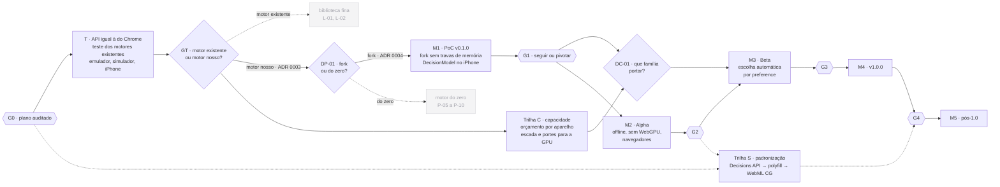
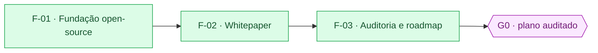
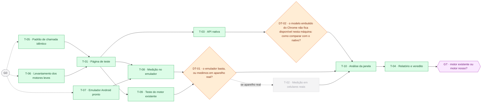
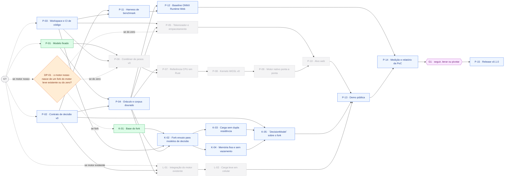
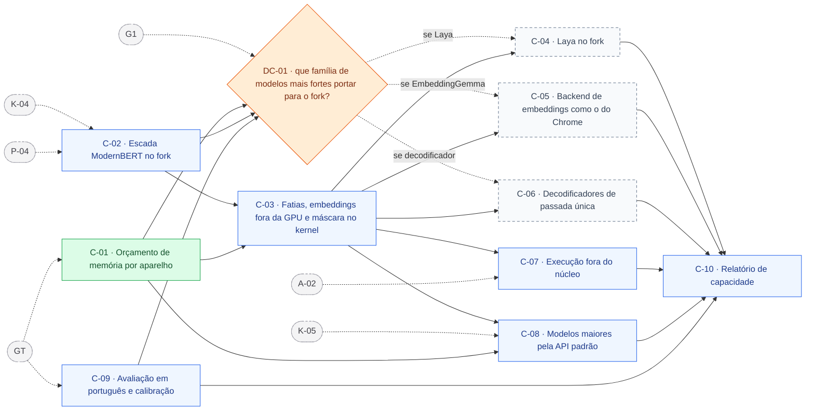
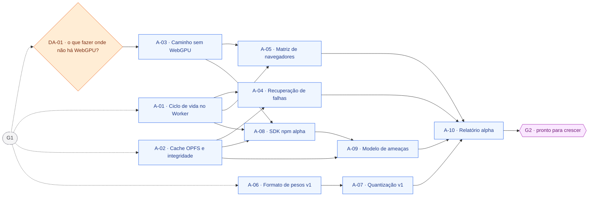
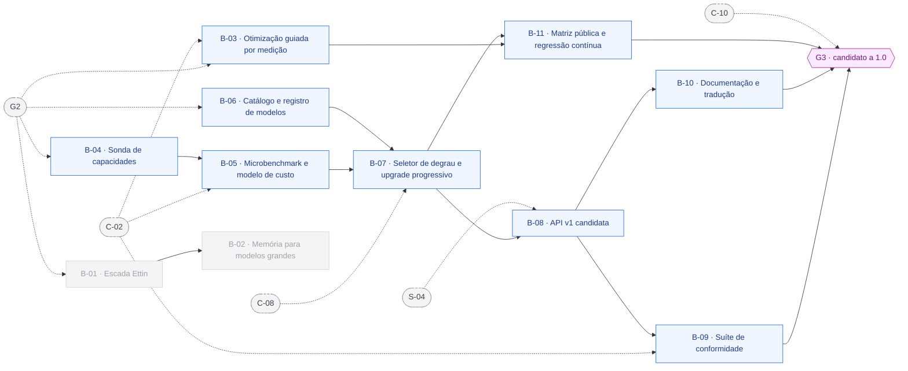
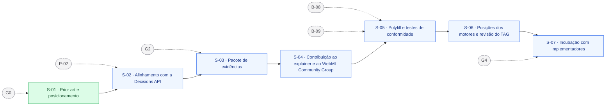
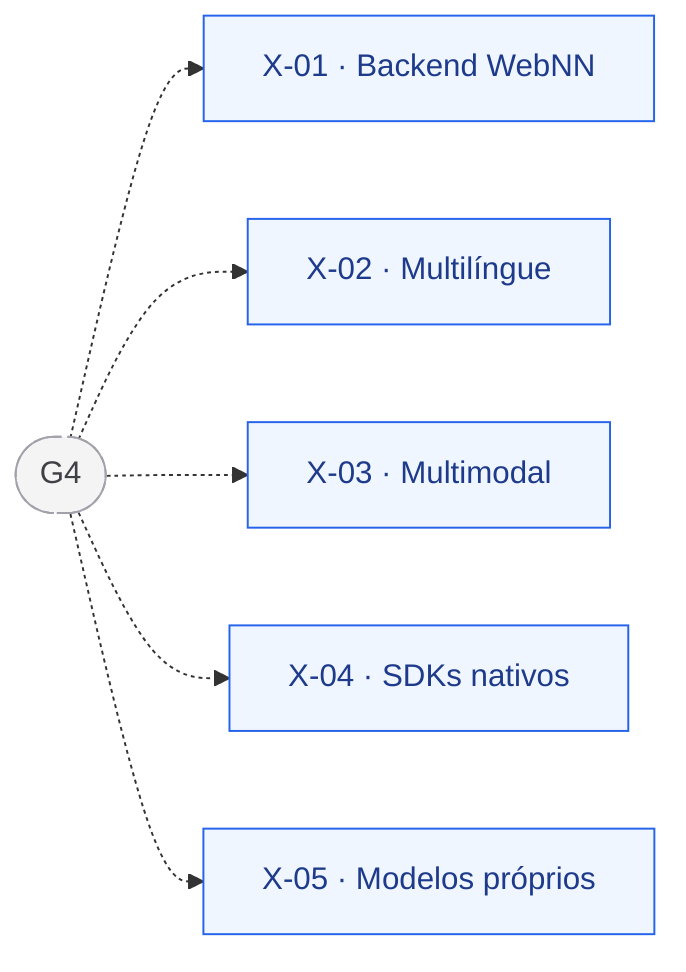

# Roadmap — SOM WebCore

> **Revisão de 2026-11-23** ([ADR 0005](docs/adr/0005-replanejamento-capacidade-e-memoria.md)). Este documento é a fonte da verdade do planejamento e substitui o roadmap por semanas que existia na seção 8 do README.
> **Celular primeiro, API igual à do Chrome — e o modelo mais forte que o aparelho aguenta.** O [marco T](#mt) fixou a API idêntica à Decisions API e escolheu um motor nosso em WebGPU, nascido de um fork do motor leve. Esta revisão ([o que mudou](#correcoes-2026-11-23)) faz o fork nascer **sem travas de memória**, aplica o comportamento do Chrome, não só a forma ([o padrão na prática](#padrao-pratica)), e abre a [trilha C](#trilha-c) para modelos maiores: o teto passa a ser o orçamento medido de cada aparelho, não um número de parâmetros. Cada bifurcação passa por [consulta ao usuário](#bifurcacoes).
> As atividades formam um **grafo acíclico dirigido (DAG)**: cada uma declara de quais depende, o que entrega e como se prova que terminou.
> As tabelas são a fonte; os grafos Mermaid, as ondas de execução e o caminho crítico são **gerados** por `python3 scripts/roadmap.py render` e validados na CI.

**Atalhos:** [Valor](#valor) · [Como ler](#como-ler) · [Marcos](#marcos) · [Onde estamos e o que falta](#correcoes) · [M0](#m0) · [Padrão de chamada](#padrao-chamada) · [O padrão na prática](#padrao-pratica) · [Ambiente](#ambiente) · [Bifurcações](#bifurcacoes) · [T — Teste](#mt) · [Prompts](#prompts) · [M1 — PoC](#m1) · [Trilha C — Capacidade](#trilha-c) · [M2 — Alpha](#m2) · [M3 — Beta](#m3) · [M4 — v1.0.0](#m4) · [Trilha S — Padronização](#trilha-s) · [M5](#m5) · [Critérios globais](#dod) · [Riscos](#riscos-do-plano) · [Fora do roadmap](#fora) · [Manutenção](#manutencao)

Documentos irmãos: [metodologia](docs/METHODOLOGY.md) · [estrutura do repositório](docs/STRUCTURE.md) · [como contribuir](CONTRIBUTING.md) · [governança](GOVERNANCE.md) · [errata da pesquisa](research/ERRATA.md).

---

<a id="valor"></a>
## 1. Para que existimos

**Decidir é uma primitiva da web — e deve ser tão fácil quanto `fetch`.**

O SOM WebCore existe para provar, com software aberto e medições reproduzíveis, que decisões tipadas em passada única (`boolean`, `choice`, `score`) rodam no dispositivo de quem navega — e para usar essa prova como argumento para que a capacidade passe a vir embutida em **todo motor de navegador**, acessível a **todo programador**.

O sucesso deste projeto é medido pela sua **dispensabilidade**: no dia em que `if (await decide(...))` funcionar nativamente em Chromium, WebKit e Gecko, a biblioteca vira um polyfill fino — e teremos cumprido a missão.

| Valor | O que significa na prática |
|---|---|
| **Padrão antes de produto** | A API pública é **idêntica** à Decisions API do Chrome ([padrão de chamada](#padrao-chamada)): o mesmo código roda sobre o nativo e sobre a nossa biblioteca. Nada na API prende alguém ao nosso motor ou ao nosso formato. |
| **Para todo programador** | Um import, uma chamada, resposta tipada, padrões sensatos. Dispositivo, modelo e backend ficam escondidos — mas inspecionáveis. |
| **Celular primeiro** | O celular é a prioridade: é onde a API nativa não está prevista e onde menos se mediu. Do aparelho de entrada ao desktop, com degradação explícita e honesta — nunca silenciosa. |
| **Evidência antes de afirmação** | Todo número é rotulado como medido, reportado, alvo ou hipótese. Erros de pesquisa viram errata pública, não rodapé. |
| **Privacidade por construção** | O estado do usuário não sai do dispositivo. Sem telemetria. Rede só para baixar pesos, e isso é visível. |
| **Abertura real** | Apache-2.0, governança pública, catálogo de modelos com licença declarada, neutralidade em relação a fornecedores. |

**Não estamos sozinhos — e isso muda o nosso papel.** Desde 30 de setembro de 2026 existe um explainer público da **Decisions API** (`window.DecisionModel`), escrito pelo time de Built-in AI do Chrome: perguntas tipadas `boolean`, `choice` e `score`, respondidas em passada única, com probabilidades por opção — a mesma tríade do JEV. Há um protótipo em Chromium e uma prévia no Edge Canary, atrás de flag. É um rascunho inicial: não está aprovado para lançamento, não tem posição de WebKit nem de Mozilla, e trata pesos fornecidos pelo desenvolvedor como não-objetivo (fontes e datas em [research/ERRATA.md](research/ERRATA.md#decisions-api)). Em 2026-11-23 o quadro era o mesmo: nenhum commit novo no explainer, “Proposed” no chromestatus, sem origin trial — e, no Android, a API responde sempre `"unavailable"` **[REPORTADO]**.

Portanto não vamos propor um padrão concorrente — nem fingir que somos os únicos: já existem um polyfill dessa API no npm e uma biblioteca (`crivo-web`) que roda esses modelos no navegador. O nosso papel é cobrir **o que falta**, com o celular em primeiro lugar:

- **Celular primeiro.** Nem a proposta nem a prévia do Edge falam de Android ou de iOS, muitos celulares não têm WebGPU, e o motor genérico que as bibliotecas usam não foi feito para eles. É onde a decisão local mais faz falta e onde menos se mediu.
- **Evidência.** Medições públicas em celulares reais: o que funciona, quanto pesa, quanto demora.
- **Escolha automática do modelo** para cada aparelho, com licença declarada e atenção ao português.
- **Modelos mais fortes, sem travar o aparelho.** O Chrome roda um modelo por navegador, e só no desktop. No celular, o modelo mais forte que couber — escolhido pela própria API, com `preference` — e nunca uma aba morta por falta de memória ([trilha C](#trilha-c)).
- **Conformidade.** Vetores de teste neutros e a mesma forma de API da proposta, para que o código de quem usa não mude quando o nativo chegar.

**Por que isso precisa virar padrão, e não só biblioteca.** Uma biblioteca resolve o problema de um site; só o navegador resolve o da web:

1. **Download duplicado.** O armazenamento do navegador é particionado por origem: cada site que usa o mesmo modelo baixa a sua própria cópia. Só o navegador pode guardar um modelo uma vez para todas as origens.
2. **Aceleradores fora de alcance.** NPUs e caminhos nativos de ML não estão expostos à WebGPU; o navegador pode usá-los.
3. **Energia e calor.** A página não vê temperatura nem bateria; o navegador vê e pode agendar.
4. **Custo de entrada.** Uma API nativa elimina o bundle, o Worker, o cache e a escolha de modelo — o programador só decide.

---

<a id="como-ler"></a>
## 2. Como ler este roadmap

- **Atividade** = um nó do DAG. Tem um ID estável, dependências, um entregável e um critério de aceite verificável. Nenhuma atividade começa antes de todas as suas dependências estarem feitas.
- **Portão** (`G0`, `GT`, `G1`…`G4`) = um nó de decisão no fim de cada marco. Fecha-se com evidência contra uma lista de critérios e fica registrado numa ADR. Um portão pode mandar **seguir**, **iterar** ou **pivotar**.
- **Bifurcação** (`DT-01`, `DP-01`, `DC-01`, `DA-01` e os próprios portões) = ponto em que o caminho se divide. Nenhuma atividade depois dela começa sem a [consulta ao usuário](#bifurcacoes). No grafo aparece como losango.
- **Ramo opcional** = atividade que só acontece se uma bifurcação escolher aquele caminho. Aparece com `(se …)` na coluna “Depende de” e com seta tracejada e rotulada no grafo. As atividades dos ramos não escolhidos passam ao estado `descartada`.
- **Prompt e validação** = toda atividade do marco em execução, e toda atividade já desbloqueada, tem um prompt pronto para entregar ao agente e uma lista de validação ([seção de prompts](#prompts)). Atividade sem prompt não começa.
- **Prefixos:** `F` fundação · `T` teste · `P` prova de conceito · `L` biblioteca sobre o motor existente · `K` fork do motor existente · `C` capacidade — modelos maiores sem travas de memória · `A` alpha · `B` beta · `V` v1.0.0 · `S` padronização · `X` pós-1.0 · `DT`, `DP`, `DC` e `DA` bifurcações.
- **Tamanho** (esforço ideal de uma pessoa): `S` até 2 dias · `M` até 1 semana · `L` até 3 semanas · `XL` mais que isso — tem de ser dividida antes de começar. Tamanho não é prazo: o projeto tem um mantenedor e não promete datas.
- **Estado:** `feito` · `em curso` · `a fazer` · `descartada` (ramo que uma bifurcação não escolheu, ou atividade substituída num replanejamento registrado em ADR — a linha fica, como registro, e diz quem a substituiu).
- **Rótulos de evidência** (definidos na [metodologia](docs/METHODOLOGY.md#rotulos)): **[MEDIDO]** por este projeto, com relatório · **[REPORTADO]** por terceiros, com fonte e data · **[ALVO]** que queremos atingir · **[HIPÓTESE]** ainda sem dados.
- **Tolerâncias de paridade** usam “erro absoluto de probabilidade” (`Δp`): a maior diferença, em módulo, entre a probabilidade de uma opção no nosso motor e na implementação de referência.

**Números do grafo (gerado):**

<!-- dag:begin:critical -->
- **Nós:** 95 (21 feitos, 11 descartados) · **arestas:** 160.
- **Esforço relativo:** 36/302 pontos concluídos, sem contar as descartadas (S=1, M=3, L=8, XL=13; portões=0).
- **Caminho mais longo até o último portão**, sem as atividades descartadas e com o ramo mais caro em cada bifurcação aberta (103 pontos): `F-01` → `F-02` → `F-03` → `G0` → `T-05` → `T-01` → `T-03` → `DT-02` → `T-10` → `T-04` → `GT` → `P-02` → `P-04` → `K-02` → `K-04` → `K-05` → `P-13` → `P-14` → `G1` → `DA-01` → `A-03` → `A-05` → `A-10` → `G2` → `B-04` → `B-05` → `B-07` → `B-08` → `B-09` → `G3` → `V-01` → `V-05` → `G4`.
<!-- dag:end:critical -->

---

<a id="marcos"></a>
## 3. Visão geral dos marcos



| Marco | Versão | Pergunta que responde | Resultado para quem usa | Portão |
|---|---|---|---|---|
| **M0 — Fundação e auditoria** | documentação | O plano e a pesquisa estão corretos? | Whitepaper, errata e este roadmap | `G0` · feito |
| **T — API igual à do Chrome e teste do motor existente** | — | Com a API idêntica à do Chrome, o motor leve que já existe serve no celular — ou há uma janela para um motor nosso? | Especificação da API, medições no emulador, no simulador e num iPhone real; veredito: fork do motor leve em WebGPU | `GT` · feito |
| **M1 — Prova de conceito** | `v0.1.0` | O fork decide certo com um modelo de 17M, pelo `DecisionModel`, no iPhone e no desktop — sem prender memória? | Demo pública: uma decisão local, verificada contra a referência, com a API idêntica à do Chrome | `G1` |
| **Trilha C — Capacidade** | contínua, até o G3 | Qual é o modelo mais forte que cada aparelho comporta, sem travar a aba? | Orçamento medido por aparelho, escada de modelos maiores, portes de novas arquiteturas para a GPU, `preference: "capability"` | entra no `G3` |
| **M2 — Alpha** | `v0.2`–`v0.4` | Funciona offline, sem WebGPU e nos três motores de navegador? | Pacote npm alpha, cache OPFS, caminho sem WebGPU, recuperação de falhas | `G2` |
| **M3 — Beta** | `v0.5`–`v0.9` | A biblioteca escolhe sozinha o melhor modelo para cada máquina, pela API padrão? | Seleção por `preference`, análise do dispositivo, API candidata, conformidade | `G3` |
| **M4 — v1.0.0** | `v1.0.0` | É estável, auditado e pronto para produção? | Biblioteca estável com SemVer, catálogo auditado | `G4` |
| **Trilha S — Padronização** | contínua | A decisão local chega a todos os motores? | Alinhamento com a Decisions API, polyfill, evidências e testes | — |
| **M5 — Pós-1.0** | `v1.x` | Para onde cresce? | WebNN, multilíngue, multimodal, SDKs nativos | — |

---

<a id="correcoes"></a>
## 4. Onde estamos, o que falta e o que mudou no plano

<a id="estado"></a>
### 4.1 Onde estamos (2026-11-23)

**O que já existe**, tudo em `main`:

- a superfície da Decisions API fixada e conferida contra o Chrome 157 e o 160, com 72 casos de validação comparados ([especificação](docs/spec/decisions-api-surface.md));
- a bancada (`bench/spike-mobile/`): a página de teste escrita só com a Decisions API, os adaptadores do ONNX Runtime Web e do `@johnhenry`, a referência em Python e os executores do emulador Android, do simulador de iOS e do desktop;
- o laboratório de aparelho, com QR e HTTPS local, que já mediu um iPhone real em três rodadas ([relatório, seção 9](docs/reports/teste-mobile.md#9-iphone-real-pelo-laboratório-de-aparelho-complemento-2026-11-22));
- as decisões do marco T: motor nosso em WebGPU, nascido de um fork do `@johnhenry` ([ADRs 0001 a 0004](docs/adr/)).

**O que os logs mostram** **[MEDIDO]** (`bench/results/2026-11-22-iphone-*` e o [relatório do marco T](docs/reports/teste-mobile.md)):

1. No iPhone, a única configuração que acerta e cumpre o alvo de 150 ms é o `@johnhenry` em WebGPU com pesos `f32`: p95 de 70 ms e máx. |Δp| de 1,3e-6. Em CPU, o mesmo motor tem p95 de 1,5 s.
2. A memória do Wasm do ONNX Runtime fica presa no processo do Safari: em cada processo, as 3 primeiras inicializações passam e todas a partir da 4ª falham com `RangeError: Out of memory` (15 de 15 e 26 de 26), até o Safari ser fechado. A exceção sai da criação da memória Wasm compartilhada de 4 GiB de máximo, antes de o modelo entrar: arquivos de 17 a 68 MB passaram e falharam igual. Iframes, uma página por etapa e `window.open` não resolvem. Não é morte da aba: no mesmo processo, o motor em JS + WebGPU seguiu rodando o `f32` de 67,48 MB, inclusive 200 decisões ([análise forense](docs/reports/forense-iphone-2026-11-22.md)).
3. A aba só morreu com o ONNX Runtime em WebGPU (variante `q8emb32-f16`, de 23,37 MB): duas vezes, no meio da inferência, depois de 40 e de 128 decisões. A causa — limite de memória do iOS ou queda do WebKit — não está determinada, porque o Safari não dá à página nenhuma medida de memória. No desktop, o mesmo backend errou mesmo com pesos FP32 (|Δp| de 4,8e-2).
4. O adaptador do iPhone aceita buffers e bindings de 1 GiB, e a origem tem 41,2 GB de quota. Ele expõe `shader-f16` e o produto escalar de 8 bits do WGSL (`packed_4x8_integer_dot_product`), mas **não** `subgroups`.
5. O `@johnhenry` ainda baixa só pesos `f32` (67,48 MB), o caminho `f16` calcula em f16 e erra 1,5e-3 a 1,7e-3, e o heap cresce 50,09 MiB em 200 decisões na WebGPU do desktop.
6. **Orçamento de memória do iPhone (`C-01`, 2026-11-23)** ([relatório](docs/reports/orcamento-memoria.md)): a aba morre por volta de **1,7–2,0 GiB**, numa conta só para GPU, `ArrayBuffer` e Wasm (GPU sozinha: 1.664–1.792 MiB confirmados; host: 1.856–1.984 MiB), sem erro nem `device.lost`. O streaming do OPFS para a GPU em blocos de 4 MiB passa **1 GiB em ~0,36 s por passada** (2.983 MB/s; desktop: 0,25 s), enquanto carregar 1 GiB inteiro num `Uint8Array` derruba a aba. Só as memórias Wasm compartilhadas de máximo grande param em 3 por processo; as não compartilhadas passam de 16.

<a id="falta"></a>
### 4.2 O que falta para rodar modelos mais fortes sem travas de memória

| Lacuna | Por que importa | Onde se resolve |
|---|---|---|
| Não há código de produto: o `DecisionModel` só existe na bancada | o padrão da Decisions API só vale na prática quando uma aplicação o usa sem mudar nada | `P-02`, `P-03`, `K-05` |
| O fork ainda não existe; o upstream tem um mantenedor e nunca rodou num navegador de verdade na sua CI **[REPORTADO]** | daqui em diante, o motor é nosso | `K-01`, `K-02` |
| O motor lê o arquivo de pesos inteiro, o `writeBuffer` copia de novo, e o pool guarda até 1 GiB de buffers ociosos | no iPhone, tudo isso conta contra a memória da aba, que morre sem aviso | `K-03`, `K-04` |
| O heap cresce a cada decisão, e o adaptador lê `[B, L, H]` inteiro de volta | sessões longas param | `K-04` |
| Não se sabe quanto cada aparelho comporta, nem o que matou a aba no iPhone: o Safari não dá à página nenhuma medida de memória **[MEDIDO]** | sem orçamento medido, um modelo maior mata a aba | `C-01` |
| Modelos maiores que o teto da aba | no iPhone, toda `GPUBuffer` é cobrada da aba, e o streaming só na carga não aumenta o teto **[REPORTADO]** ([pesquisa sobre o limite da aba](research/04-streaming-de-pesos-e-o-limite-da-aba.md)) | `C-07` |
| A escada parava no 150M, e nada portava outras arquiteturas | os modelos com licença permissiva mais fortes que o TS-Ettin vão de 150M a 2B e, acima de 150M, mudam de arquitetura **[REPORTADO]** | `C-02` a `C-07`, `DC-01` |
| A escolha do modelo passava por uma API própria (`SOM.load`, `SOM.recommend()`) | contradiz a regra da API idêntica | `preference` e `availability()` ([o padrão na prática](#padrao-pratica)), `C-08`, `B-07` |
| Não há medida de qualidade em português | o Decision Index só mede inglês | `C-09` |
| Nenhum Android real medido | o emulador não tem WebGPU, e 26% dos Android têm binding de 128 MiB **[REPORTADO]** | `C-01`, `P-14`, `A-05` |
| Não há caminho decidido para aparelhos sem WebGPU | o Wasm prende memória no iPhone, o ONNX Runtime saiu do GitHub **[REPORTADO]** e o CPU do fork é ~6× mais lento **[MEDIDO]** | `DA-01`, `A-03` |

<a id="correcoes-2026-11-23"></a>
### 4.3 O que a revisão de 2026-11-23 corrigiu

Gatilho: o pedido do dono — modelos mais potentes no navegador, sem travas de memória, mesmo que seja preciso portá-los para a GPU ou manter um fork, e a Decisions API aplicada na prática. A evidência são os nossos logs e a [pesquisa de 2026-11-23](research/03-modelos-maiores-sem-travas-de-memoria.md); a decisão está na [ADR 0005](docs/adr/0005-replanejamento-capacidade-e-memoria.md).

| # | O plano dizia | O que é verdade | Consequência no roadmap |
|---:|---|---|---|
| 21 | M1 a M3 descreviam o motor do zero em Rust: Cargo, `crates/`, `wasm32`, `som-ref`, `.sombin` e memória linear do Wasm | a `DP-01` escolheu o fork, em JavaScript + WGSL ([ADR 0004](docs/adr/0004-dp-01-fork-do-motor-leve.md)) | `P-03`, `A-03`, `A-06`, `A-09`, `B-04` e os critérios de G1, G2 e G4 reescritos para o fork; `docs/STRUCTURE.md` e a cadeia de oráculos da metodologia revistos na `P-03` e na `K-01` |
| 22 | Escada até 150M; “modelos acima de 1B” fora do roadmap | o dono quer modelos mais potentes; os candidatos com licença permissiva e qualidade bem acima do TS-Ettin vão de 150M a 2B **[REPORTADO]** | [trilha C](#trilha-c): o teto é o orçamento medido de cada aparelho; `B-01` e `B-02` passam à trilha (`C-02`, `C-03`) |
| 23 | A memória era um problema do Wasm, resolvido com memória linear pequena | no iPhone, a memória do Wasm fica presa no processo **[MEDIDO]**, e o teto real é a memória da aba, que inclui a da GPU **[REPORTADO]** | GPU sem Wasm; sessões seguidas sem `Out of memory` no iPhone como critério de G1 e G2 |
| 24 | O fork corrigiria a “memória” em geral | o motor tem travas concretas: arquivo inteiro no JS, cópias do `writeBuffer`, pool de 1 GiB, readback de `[B, L, H]`, máscara densa | `K-03`, `K-04` e `C-03` |
| 25 | A escolha de modelo por `SOM.load({ model: 'auto' })` e `SOM.recommend()` (`B-07`, G4) | contradiz a regra da API idêntica; a implementação do Chrome já tem `preference` | a escolha vai por `preference` e `availability()`; o resto, no ponto de configuração separado |
| 26 | No ramo do fork, nenhuma atividade expunha o `DecisionModel` — a `L-01` era do outro ramo | sem ela, o fork não chega à API | `K-05` |
| 27 | O G1 media só no desktop | o laboratório já mede um iPhone real | o G1 inclui o iPhone |
| 28 | Os prompts do marco em execução (M1) não estavam escritos | “atividade sem prompt não começa” | prompts de todo o M1, da `C-01`, da `C-09` e das bifurcações abertas; o check passa a exigir o prompt de toda atividade desbloqueada |
| 29 | `S-04` e `S-06` abriam issues e PRs em repositórios de terceiros | regra do dono: fora do repositório, o agente não fala em nome dele | as contribuições ficam prontas em `docs/standards/`, e o dono envia |
| 30 | README 3.2 e 5.4: o piso de 128 MiB de binding vem de 2–5% de GPUs ARM Mali; 16% dos aparelhos com binding ≥ 2 GiB | o piso de 128 MiB é de 26% dos Android, quase todos Adreno 7xx (94% delas); as Mali passam de 256 MiB em 97–99%; os “16%” são artefato de faixa — o Windows reporta 2.147.483.642–644 B **[REPORTADO, web3dsurvey]** | conferir e registrar na errata (`C-01`) |
| 31 | Decision Index “0.4” e “0.3” nas tabelas do README | a edição atual é a 0.4.1 (2026-10-21); os números “0.3” de Crivo, Amber e outros são a coluna do índice público, não a nota Full; o TS-moBERTo-150M é o Dinah-1 renomeado (Full 16,36) **[REPORTADO]** | catálogo (`B-06`) e errata |
| 32 | d1-omni com contexto de 16.384 tokens | o `config.json` do modelo diz 128.000 **[REPORTADO]** | conferir na errata antes da `X-03` |

### 4.4 O que a revisão de 2026-11-21 corrigiu

A auditoria de 2026-11-21 conferiu os dois relatórios de pesquisa e o README contra fontes primárias (`config.json` e cartões dos modelos no Hugging Face, código de referência, documentação de APIs, repositórios e artigos citados). O detalhe, com fonte por item, está em [research/ERRATA.md](research/ERRATA.md). O que mudou no **plano**:

| # | O plano dizia | O que é verdade | Consequência no roadmap |
|---:|---|---|---|
| 1 | Começar por Ettin-150M, com formato binário, quantização Q8 e seis shaders fundidos ao mesmo tempo | Isso acumula cinco riscos novos antes da primeira passada correta | **PoC com TS-Ettin-17M**, kernels simples em f32, um risco de cada vez (`P-07` → `P-08` → `P-09`) |
| 2 | “Ettin-17M” como modelo semente | `jhu-clsp/ettin-encoder-17m` é só um encoder MLM; não decide nada | A semente é um **checkpoint de decisão**: `typestrict/TS-Ettin-17M` (Apache-2.0) — `P-01` |
| 3 | RoPE local com θ = 10.000 em toda a família | Só ModernBERT-base/large usa 10.000; **Ettin e mmBERT usam 160.000** nas camadas locais | θ vem sempre do manifesto do checkpoint; teste de paridade por camada (`P-07`) |
| 4 | Máscara bloco-diagonal e reset de posições para todos os modelos | É específico do Von (`independent_options`); TS-Ettin e Crivo usam atenção conjunta sobre as opções | A máscara é uma opção por modelo, desligada na PoC |
| 5 | Calibração, softmax e confiança dentro do shader | Cada família calibra de um jeito; ler K vetores de volta custa o mesmo que ler 64 bytes | **Cabeça e calibração no host** na PoC; versão in-shader só se medir ganho (`B-03`) |
| 6 | Cabeçalho `.sombin` de “256 bytes exatos” | O struct tem **264 bytes** em `repr(C)` (512 com `align(256)`) e não aceita `Pod` | Contêiner v0 mínimo na PoC (`P-06`); formato v1 por RFC, com offsets explícitos (`A-06`) |
| 7 | Tokenizador não aparece no plano | Sem IDs idênticos aos da referência, nenhuma paridade é possível | Atividade própria, com teste de identidade (`P-05`) |
| 8 | “Primeiro runtime aberto de decisão tipada no navegador” | `crivo-web` (npm, ONNX Runtime Web, Wasm e WebGPU) já faz `choice`/`noul`/`score` no navegador | O diferencial tem de ser **medido contra esse baseline** (`P-12`, `G1`); se não houver ganho, pivotamos |
| 9 | Catálogo priorizava Laya, Von e d1-omni-600M | No Decision Index 0.4 (2026-11-21) esses três pontuam como modelos de 17M; a família Ettin cobre 17M → 1B com **uma só arquitetura** | Escada de modelos sobre a família Ettin (`B-01`); d1-omni fica como trilha multimodal pós-1.0 |
| 10 | v0.1.0 em 12 semanas, incluindo matriz mobile | Um mantenedor, nenhum código | Marcos por portão, sem datas; mobile entra no alpha (`A-05`) |
| 11 | Nomes de API do wgpu de 2025 (`PUSH_CONSTANTS`, `SPIRV_SHADER_PASSTHROUGH`) | O wgpu está na versão 30 e renomeou esses recursos (`IMMEDIATES`, shaders em passthrough) | Fixar a versão e validar o blueprint contra ela (`P-03`) |
| 12 | Nada sobre análise do dispositivo | É o requisito central da v1.0.0 | Sonda, microbenchmark, catálogo e seletor de tier (`B-04`–`B-07`) |
| 13 | “Propor uma API de decisão ao W3C”, como se nada existisse | Já existe o explainer da Decisions API (time de Built-in AI do Chrome), com protótipo em Chromium e prévia no Edge Canary | A trilha S **alinha-se e contribui** com essa proposta; o SDK tem forma de polyfill dela (`S-02`, `S-05`) |
| 14 | “Probabilidades calibradas” como propriedade do runtime | Calibração é propriedade do **modelo**; o TS-Ettin-17M é publicado sem calibração | O runtime aplica fielmente a calibração do checkpoint; o catálogo declara o estado de calibração de cada modelo (`B-06`) |
| 15 | WebGPU “ativa por padrão no iOS 18.2” e disponível em “Chrome 121+ no Android” | No Safari, só a partir da versão 26, nos sistemas 26; no Chromium, depende do sistema e do fabricante da GPU | Detecção de recurso sempre; matriz de navegadores com hardware real (`A-05`) |
| 16 | Primeiro “o motor próprio é necessário”, depois “o motor pronto resolve” — as duas vezes sem nenhuma medição em celular | O celular é a prioridade, e todas as medições disponíveis são de desktop | **Marco T**: testar o motor existente no Android antes de escolher o motor (portão `GT`) |
| 17 | O projeto como “o polyfill aberto” da Decisions API | Já existe um polyfill no npm (`built-in-ai-task-apis-polyfills`) | O papel do projeto é cobrir o que falta, com o celular em primeiro lugar |
| 18 | API própria (`som.decide`, `som.eval`, `noul`), com um “mapeamento” para a do Chrome | Para mostrar o trabalho ao time do Chrome e a pares, a API tem de ser a **mesma** | [Padrão de chamada](#padrao-chamada) idêntico à Decisions API (`T-05`); os nomes do JEV saem da superfície pública |
| 19 | Um único caminho depois do teste, decidido pelo agente | O caminho depende do que o teste mostrar, e a escolha é do usuário | [Bifurcações](#bifurcacoes) `DT-01`, `GT` e `DP-01`, com ramos opcionais, prompt e validação por atividade e consulta ao usuário em cada uma |
| 20 | “A flag do Chrome ainda não foi conferida”; a prévia só existiria no Edge Canary | A API está no Chrome estável 157 e no Canary 160, atrás da flag `decisions-api`; a implementação tem o membro `preference`, que o explainer não descreve, e num perfil novo o modelo aparece como indisponível | [Ambiente verificado](#ambiente); `T-05` captura a superfície da implementação; nova bifurcação `DT-02` |

---

<a id="m0"></a>
## 5. Marco M0 — Fundação e auditoria

| ID | Atividade | Depende de | Entregável | Critério de aceite | Tam. | Estado |
|---|---|---|---|---|:---:|---|
| `F-01` | **Fundação open-source** — licença, governança como código e CI de documentação | — | `LICENSE`, `SECURITY.md`, rulesets, `scripts/check-docs.py` | CI `build` verde; `main` só recebe PR com squash merge | M | feito |
| `F-02` | **Whitepaper** — README que consolida os dois relatórios de pesquisa | `F-01` | `README.md`, `docs/figures/` | contrato de documentação sem erros; divergências entre os relatórios registradas | L | feito |
| `F-03` | **Auditoria e roadmap** — pesquisa conferida em fontes primárias; DAG, metodologia, estrutura e contribuição definidas | `F-02` | `ROADMAP.md`, `research/ERRATA.md`, `docs/METHODOLOGY.md`, `docs/STRUCTURE.md`, `GOVERNANCE.md` | `scripts/roadmap.py check` verde; cada correção com fonte primária e data | L | feito |
| `G0` | **Portão G0** — plano auditado | `F-03` | este roadmap em `main` | critérios de [G0](#g0) | — | feito |

<!-- dag:begin:M0 -->


**Ondas de execução** (atividades da mesma onda não dependem entre si):

1. `F-01`
2. `F-02`
3. `F-03`
4. `G0`
<!-- dag:end:M0 -->

<a id="g0"></a>
**Critérios do portão G0** — todos cumpridos nesta revisão:

- [x] Os dois relatórios foram conferidos contra fontes primárias e os erros estão em [research/ERRATA.md](research/ERRATA.md), com marcação no próprio texto dos relatórios.
- [x] O README não contém afirmação conhecida como falsa; o que não pôde ser verificado está rotulado.
- [x] Existe um modelo leve, com licença permissiva e implementação de referência, para a prova de conceito.
- [x] O roadmap é um DAG válido, com critério de aceite por atividade e por portão.

---

<a id="padrao-chamada"></a>
## Padrão de uso e de chamada: idêntico ao do Chrome

**Regra.** A API pública deste projeto é a **Decisions API** do Chrome, sem nomes próprios e sem variações. Quem escreve código para a nossa biblioteca escreve, linha por linha, o mesmo código que roda na implementação nativa. É isso que dá peso para mostrar o trabalho ao time do Chrome e a pares: não é “parecido com”, é o mesmo contrato.

**Referência.** A referência é a **implementação do Chrome**; o explainer é a documentação dela. Conferido nesta máquina em 2026-11-21 **[MEDIDO]**: no Chrome estável 157 e no Chrome Canary 160, com a flag `chrome://flags/#decisions-api` (recurso `AIDecisionModelAPI`), o navegador expõe `DecisionModel` com `availability()` e `create()` estáticos e, na instância, `decide()`, `destroy()` e `preference` — este último **não aparece no explainer**. Explainer fixado: `explainers-by-googlers/decisions-api`, commit `5ce6e10a81f766efaec670282696c0c57ba2de50` (2026-11-11). Quando os dois divergem, vale a implementação, e a divergência fica registrada (`T-05`, `T-03`). Os detalhes estão em [Ambiente verificado](#ambiente).

```js
const schema = {
  expectedInputs: [{ type: "text", languages: ["pt", "en"] }],
  questions: [
    { id: "quer_reembolso", type: "boolean", prompt: "O cliente pede reembolso?" },
    {
      id: "assunto",
      type: "choice",
      prompt: "Qual é o assunto da mensagem?",
      options: [
        { label: "pagamento", description: "Cobrança, fatura ou estorno" },
        { label: "entrega", description: "Prazo, rastreio ou extravio" },
        { label: "outro", description: "Qualquer outro assunto" }
      ]
    },
    { id: "urgencia", type: "score", prompt: "De 1 (baixa) a 5 (alta), qual a urgência?" }
  ]
};

const status = await DecisionModel.availability(schema);
if (status === "available" || status === "downloadable") {
  const model = await DecisionModel.create(schema);
  const result = await model.decide("Fui cobrado duas vezes e preciso disso resolvido hoje.");
  // result.assunto  -> { id, label, confidence, probabilities }
  // result.urgencia -> { id, label, confidence, probabilities, expectedScore }
  model.destroy();
}
```

| Aspecto | Regra |
|---|---|
| Ponto de entrada | `DecisionModel`, com `availability()`, `create()`, `decide()` e `destroy()` — mesmos nomes, mesmos argumentos, mesmos valores de retorno |
| Perguntas | `boolean`, `choice` e `score`, com `id`, `prompt` e `options` (`label`, `description`). Limites da implementação: até 16 perguntas por esquema; `choice` com 2 a 26 opções; `score` com 2 a 9 níveis no Chrome 157 e 2 a 11 no 160; `boolean` sem opções (conferido no código-fonte e em execução, `T-05`) |
| Resultado | objeto indexado pelo `id` da pergunta, com `label`, `probabilities`, `confidence` e, em `score`, `expectedScore` |
| Nomes do JEV | `som.decide`, `som.eval` e `noul` saem da superfície pública; `noul` é `boolean` |
| O que é só nosso | escolha do modelo, orçamento de download, política de licença e diagnóstico ficam **fora** da superfície padrão, num ponto de configuração separado, que a aplicação pode remover sem mudar nenhuma chamada |
| Quando o explainer mudar | a referência fixada é atualizada por PR e a nossa API muda junto, mesmo antes da 1.0 |
| Perfil de versão | a superfície muda de build para build (157 e 158 aceitam `context`; o 160 o removeu; o `score` vai de 2–9 para 2–11 níveis), então a referência é **um build fixado do Chrome** — hoje o 160 —, com as diferenças dos outros documentadas na [especificação](docs/spec/decisions-api-surface.md) **[REPORTADO, tags do Chromium em 2026-11-23]**. Enquanto houver builds com `context`, a biblioteca o aceita e o ignora, como o 160 |
| Escolha do modelo | por `preference` e `availability()`, como o Chrome os expõe ([o padrão na prática](#padrao-pratica)); nada de API própria. O resto (catálogo, orçamento de download, licenças) fica no ponto de configuração separado |
| Quando o nativo existir | a biblioteca não se instala por cima: a aplicação usa o `DecisionModel` do navegador |

**Validação do padrão.** Uma única página de conformidade, escrita só com a API acima, roda **sem alteração** (1) sobre a implementação nativa, no Chrome com a flag `decisions-api` ligada, e (2) sobre a nossa biblioteca, em qualquer navegador. Diferença de forma entre as duas é bug nosso.

<a id="padrao-pratica"></a>
### O padrão na prática: o comportamento do Chrome, não só a forma

A forma idêntica é metade do contrato. A outra metade é o que a implementação do Chrome faz em volta dela — e é isso que a biblioteca copia. Lido no código do Chromium (commit `a9cb86f5`, o mesmo marco do Canary 160.0.8179.0) em 2026-11-23 **[REPORTADO]**, salvo onde diz **[MEDIDO]**; fontes no [relatório de pesquisa](research/03-modelos-maiores-sem-travas-de-memoria.md):

| O que o Chrome faz | Como a biblioteca aplica |
|---|---|
| **Um modelo para todas as sessões.** O serviço do backend padrão é único por navegador e atende às sessões de todas as origens; cada `create()` é uma sessão leve | um motor e um modelo por página, partilhados pelas sessões (contagem de referências); a memória não cresce com o número de `create()`. O polyfill do GoogleChromeLabs faz o contrário — cada `create()` abre um Worker com a sua cópia do modelo, de 842,6 MB no Laya padrão — e é isso que não repetimos |
| **Trabalho do esquema no `create()`.** O backend padrão codifica as opções uma vez no `create()` e, em cada `decide()`, só a entrada | o esquema é validado, traduzido e tokenizado uma vez no `create()`; cada `decide()` é uma passada |
| **Descarga por ociosidade.** Depois de 60 s sem trabalho, o modelo e o processo são liberados; aba oculta passa a 1 thread; três quedas seguidas bloqueiam novos lançamentos | o modelo sai da GPU depois de um tempo ocioso, em `pagehide` e com a aba oculta por muito tempo; volta do OPFS, sem rede; depois de quedas repetidas, a faixa desce (`C-08`) |
| **Download só com gesto.** `availability()` responde `"downloadable"`; o `create()` que dispara o download exige ativação do usuário e reporta o progresso pelo `monitor` **[MEDIDO na `T-03`]**; o pacote do backend padrão tem 223.016.322 B **[REPORTADO]** | igual: `"downloadable"` quando o modelo escolhido cabe no aparelho e ainda não está no OPFS; `"available"` quando a faixa está verificada no OPFS; `"unavailable"` quando não cabe — nunca uma aba morta |
| **Erro de cota, não truncamento.** O backend padrão aceita até 8.192 caracteres; acima disso, erro de cota | limite por modelo, em tokens, com `QuotaExceededError`; nada é truncado em silêncio |
| **Um só decodificador de resultados.** Notas negativas e NaN viram zero; o vetor é normalizado pela soma; o rótulo é a opção mais provável (a primeira, no empate); `confidence` é essa probabilidade; a nota de `score` é a média ponderada | o mesmo decodificador, para todos os modelos; a calibração (temperatura por tipo e número de opções) é de cada modelo |
| **`preference`** (`"auto"`, `"speed"`, `"capability"`) chega ao navegador e volta no atributo, mas nenhum backend o lê | a biblioteca o usa para escolher a faixa: `"speed"`, a menor que cumpre o alvo; `"capability"`, a maior que cabe no orçamento medido e na política de licenças; `"auto"`, a escolha por aparelho (`B-07`). Se o membro sair da implementação, a escolha fica só no ponto de configuração — o código da aplicação não muda |
| **Todos os backends de decisão rodam em CPU nativa**, multithread: o EmbeddingGemma em TFLite, o Gemma 4 do backend de linguagem (forçado à CPU por bugs de pontuação na GPU) e o Laya em int8, em LiteRT/XNNPACK | uma página não tem essa CPU: no iPhone, o mesmo encoder de 17M em JavaScript teve p95 de 1,5 s, contra 70 ms em WGSL **[MEDIDO]**. Para nós, a GPU não é opcional |
| **Nada no celular.** O código de decisão é compilado fora do Android, e um CL aberto diz “Decision models are not supported on Android”; para iOS não há sinal | é o espaço do projeto. O único runtime de decisão do Google no celular é o MediaPipe Decision Maker, com o mesmo algoritmo do EmbeddingGemma: serve de oráculo de concordância (`C-05`) |

**O que não se copia: os números.** As probabilidades do Chrome dependem do modelo, dos modelos de texto e da quantização dele; mesmo com o EmbeddingGemma, um polyfill desviaria. **API idêntica não quer dizer probabilidades idênticas** — a documentação da biblioteca diz isso com todas as letras.

**Mudanças pendentes** **[REPORTADO, 2026-11-23]:** o PR #8 do explainer e o CL 8788005 (abertos) renomeiam `expectedScore` para `score`, com 2 a 10 níveis em base 0; outros CLs ligam o Laya, agrupam a pontuação de opções e põem temperatura no backend de linguagem; a issue #9 mediu, sem resposta, que tirar o `context` piorou os acertos (78/116 para 68/116). O polyfill do GoogleChromeLabs (2.1.2) já segue o PR #8 e, por isso, difere do Chrome atual. **Regra:** a nossa superfície só muda quando a implementação mudar.

---

<a id="ambiente"></a>
## Ambiente verificado

O que foi conferido na máquina de desenvolvimento em 2026-11-21, antes de qualquer atividade — tudo **[MEDIDO]** nela —, mais as linhas acrescentadas depois, cada uma com a sua data e o seu rótulo (o iPhone do laboratório e as versões do Chrome). Nada aqui é resultado de teste do roadmap: é só o ponto de partida.

| Item | O que há | O que isso significa |
|---|---|---|
| Chrome estável | 157.0.8103.79 | Com `chrome://flags/#decisions-api` (ou `--enable-features=AIDecisionModelAPI`) expõe `DecisionModel`; sem a flag, não |
| Chrome Canary | 160.0.8174.2, instalado nesta revisão | Mesmo comportamento; o binário cita dois backends para a API: `embedding_gemma_v1` e `language_model` |
| Superfície observada | estáticos `availability` e `create`; na instância `decide`, `destroy` e `preference` | `preference` não está no explainer: a referência é a implementação (`T-05`) |
| Limites lidos no binário | até 16 perguntas por esquema; `choice` com 2 a 26 opções; `score` com 2 a 11 níveis; `boolean` sem opções | Valem para o Canary 160; no estável 157 o `score` vai de 2 a 9 níveis (`T-05`, [especificação](docs/spec/decisions-api-surface.md)) |
| Modelo embutido | `availability()` devolveu `unavailable` num perfil novo, em modo headless | **[MEDIDO na `T-05`]** no Canary 160, num perfil de teste com o interruptor “On-device AI” ligado, fica `downloadable`; com um gesto do usuário o `create()` baixa o modelo do backend padrão (`embedding-gemma-v1`, só inglês) e passa a `available`. No estável 157 continua `unavailable` ([especificação](docs/spec/decisions-api-surface.md#5-availability)) |
| Edge estável | 158.0.4370.33; o binário contém a mesma API | Não testado em execução; o Edge Canary não está instalado |
| Emulador Android | aceleração WHPX utilizável; aparelhos virtuais `jev_playstore_36`, `jev_google_36` e `jev_atd_36` (Android 36, x86_64) | Usar o `jev_playstore_36`. Na `T-07` a imagem de sistema do Android 36 estava ausente e foi reinstalada; o Chrome é o 133 da imagem, porque a Play Store pede uma conta Google que o emulador não tem ([EMULADOR.md](bench/spike-mobile/EMULADOR.md)). A `T-08` rodou no emulador arm64 do Mac mini, com o mesmo Chrome 133 ([MACMINI.md](bench/spike-mobile/MACMINI.md#7-emulador-android-no-mac-t-08)) |
| GPU do emulador | `hw.gpu.mode=swiftshader_indirect` — por software | **[MEDIDO na `T-07`]** sem WebGPU no Chrome do emulador: `requestAdapter()` devolve `null` com GPU por software e com `-gpu host`, com e sem `--enable-unsafe-webgpu`. No emulador arm64 do Mac mini, com as flags inseguras, o Chrome entrega adaptador, mas nenhum dispositivo |
| Simulador de iOS (Mac mini) | Mac mini M1 de 16 GB, macOS 27.2, Xcode 27.1; iOS 27.0 (24A434) com Mobile Safari 27.0 | **[MEDIDO em 2026-11-21, no Mac mini]** `navigator.gpu` existe, mas `requestAdapter()` devolve `null`; Wasm com SIMD e JSPI, threads só com isolamento de origem. Serve para o WebKit do iOS, não como latência de iPhone ([MACMINI.md](bench/spike-mobile/MACMINI.md)) |
| iPhone do dono, pelo laboratório (2026-11-22) | Safari 26.6.3 (o user agent diz `iPhone OS 18_7`); WebGPU `apple`, com `shader-f16`; `maxBufferSize` e `maxStorageBufferBindingSize` de 1.073.741.824 B; quota da origem de 41.231.686.042 B; Wasm com SIMD, threads só com isolamento de origem, sem JSPI nem relaxed SIMD | **[MEDIDO]** O 1 GiB é o teto do próprio WebKit, igual para todo iPhone recente **[REPORTADO]**. A memória do Wasm do ONNX Runtime fica presa no processo do Safari; o motor em JS + WebGPU segue ([relatório, seção 9](docs/reports/teste-mobile.md#9-iphone-real-pelo-laboratório-de-aparelho-complemento-2026-11-22)) |
| Chrome em 2026-11-23 | Canary 160.0.8179.0 · Dev 160.0.8171.0 · Beta 159.0.8154.13 · Stable 157, com o 158 em liberação gradual desde 19/11 | **[REPORTADO]** não há 161 antes do corte do M160, em 30/11; a Decisions API segue “Proposed”, em dev trial desde o 157 |
| Node, npm e bun | 22.23.1, 10.9.8 e 1.4.4 | Suficiente para a página de teste; TypeScript via `npx` |
| Python | 3.12.10, com `.venv` na raiz: torch 2.15.0 (CPU), transformers 5.24.0, onnxruntime 1.32.0 | Pronto para gerar as respostas de referência (`T-09`) |
| Rust | 1.99.1 | Só será usado se o portão `GT` escolher um motor nosso |
| GPU do computador | NVIDIA GeForce RTX 4070 Laptop e Intel UHD | É a família em que a pesquisa relata o travamento de driver em D3D12 — útil para reproduzi-lo, se o motor nosso existir |

**Como abrir o Chrome com a API ligada**, sem tocar no perfil do dia a dia:

```text
"%LOCALAPPDATA%\Google\Chrome SxS\Application\chrome.exe" --user-data-dir="%TEMP%\som-decisions" --enable-features=AIDecisionModelAPI http://localhost:8377/
```

A API só existe em contexto seguro: a página tem de ser servida em `http://localhost` ou em HTTPS.

---

<a id="bifurcacoes"></a>
## Bifurcações e consulta ao usuário

Uma **bifurcação** é um ponto em que o caminho se divide e a escolha é do usuário, não do agente. Os portões de marco (`GT`, `G1`…`G4`) também são bifurcações. Em todas vale o mesmo protocolo:

1. **Parar.** Ao chegar a uma bifurcação, o agente não inicia nenhuma atividade posterior — nem “para adiantar”.
2. **Reunir a evidência.** Um relatório com os dados brutos, todo número rotulado, e a lista do que **não** se sabe.
3. **Apresentar os ramos.** Para cada um: o que será feito, o esforço, o risco e o que se perde. E uma recomendação, com o motivo.
4. **Perguntar.** A consulta vai ao usuário num documento de decisão aberto no Plannotator (`plannotator annotate <arquivo> --gate`), com um bloco `:::question` por decisão. Sem Plannotator, pela ferramenta de perguntas do agente.
5. **Esperar.** Sem resposta, nada avança. Não existe ramo padrão por omissão, e uma resposta genérica como “vamos lá” não escolhe um ramo.
6. **Registrar.** A resposta vira ADR em `docs/adr/`. No mesmo PR, a bifurcação passa a `feito` e as atividades dos ramos não escolhidos passam a `descartada`.

| Bifurcação | Pergunta | Ramos | Evidência exigida |
|---|---|---|---|
| **DT-01** | Os resultados do emulador bastam para decidir? | (a) seguir só com o emulador · (b) medir também em aparelho real (`T-02`) | `T-08` e `T-09` |
| **DT-02** | O modelo embutido do Chrome não fica disponível nesta máquina: como comparar com o nativo? | (a) comparar só a forma da API · (b) instalar o Edge Canary e usar o modelo embutido dele · (c) deixar a comparação de respostas para outra máquina | `T-03`, com o valor de `availability()` num perfil real |
| **GT** | O motor existente serve, ou há uma janela para um motor nosso? | (a) motor existente, biblioteca fina (`L-01`, `L-02`) · (b) motor nosso em WebGPU (`DP-01`) · (c) só evidência e contribuições | `T-04`, com o veredito e a análise da janela |
| **DP-01** | O motor nosso nasce de um fork ou do zero? | (a) fork do motor leve existente (`K-01`, `K-02`) · (b) do zero (`P-05` a `P-10`) | `T-10` e as licenças levantadas em `T-06` |
| **DC-01** | Que família de modelos mais fortes portar para o fork? | (a) Laya, em inglês e multilíngue (`C-04`) · (b) EmbeddingGemma com o algoritmo do backend padrão do Chrome (`C-05`) · (c) decodificadores de passada única de até cerca de 1 GB (`C-06`) · (d) outro backbone de encoder, como o vela3-fast (atividade nova) · (e) nenhuma — ficar na escada ModernBERT. Um ou mais ramos podem ser escolhidos | `C-01`, `C-02`, `C-09`, o portão `G1` e as licenças lidas na fonte |
| **DA-01** | O que fazer onde não há WebGPU? | (a) ONNX Runtime Wasm só onde não prende memória · (b) backend CPU do fork, otimizado · (c) kernels Wasm SIMD próprios, com memória de tamanho fixo · (d) nenhum: `availability()` responde `"unavailable"` | marco T (o CPU do fork, ≈ 6× mais lento que o ONNX Runtime Wasm), `K-04`, `C-01` |

---

<a id="mt"></a>
## Marco T — API igual à do Chrome e teste do motor existente

**Objetivo.** Antes de escrever qualquer código de produto, responder, nesta ordem:

1. **Qual é exatamente a API?** Fixar o padrão de chamada idêntico ao do Chrome (`T-05`).
2. **O motor leve que já existe roda no Android?** Levantar os candidatos (`T-06`) e medi-los no nosso emulador Android, com a skill `/android-agent-skill` (`T-07`, `T-01`, `T-08`).
3. **Ele é satisfatório?** Testar se responde certo e aguenta, e anotar o veredito (`T-09`, `T-04`).
4. **Há uma janela?** Analisar se alguma limitação do motor existente com modelos de decisão abre espaço para um motor nosso (`T-10`).
5. **Decidir** (`GT`): seguir com o motor existente, ou criar o nosso em WebGPU — do zero ou como fork do motor leve existente (`DP-01`).

É uma investigação de prazo fixo (ver [metodologia](docs/METHODOLOGY.md#portoes)): o entregável é uma resposta escrita, com dados, e não um produto.

**O que o emulador mede — e o que não mede.** O emulador roda no processador do computador, não num processador de celular, e a sua placa de vídeo é emulada; o Chrome dele pode nem oferecer WebGPU. Por isso ele serve para saber **se funciona** no Chrome para Android, **quanto baixa**, **quanta memória** usa e para **comparar motores entre si** no mesmo ambiente. Não serve como latência de celular real. É para isso que existe a bifurcação `DT-01`. Nos aparelhos virtuais desta máquina a GPU é por software, de modo que o caminho WebGPU provavelmente só poderá ser avaliado em aparelho real.

**Por que este marco vem primeiro.** O celular é a prioridade, e é onde não temos dados: os 12,6 ms do motor existente foram medidos num Apple M4 **[REPORTADO]**; muitos celulares não têm WebGPU; só o runtime do motor existente custa 3,2 MB (CPU) ou 4,8 MB (WebGPU) comprimidos **[MEDIDO nos arquivos publicados do `onnxruntime-web` 1.31.1, em 2026-11-21]**, e em WebGPU ele só atingiu paridade com pesos em precisão cheia **[REPORTADO pelo `crivo-web`]**; e nem o explainer nem a documentação do Edge mencionam Android ou iOS.

**Modelos fixados do marco T.** `typestrict/TS-Ettin-17M` na revisão `026af312e41d24a1126f8d927bb6314fc2d5f592` (a da [seção 6.1](#m1)) e `typestrict/TS-Ettin-32M` na revisão `a0f7b67dc8618365792896f46d52ec4013b899de` (Apache-2.0, conferida em 2026-11-21). O tamanho e o SHA-256 de cada arquivo estão em [`bench/spike-mobile/models.json`](bench/spike-mobile/models.json); `bench/spike-mobile/fetch-models.py` baixa só dessas revisões e recusa arquivo com hash diferente.

| ID | Atividade | Depende de | Entregável | Critério de aceite | Tam. | Estado |
|---|---|---|---|---|:---:|---|
| `T-05` | **Padrão de chamada idêntico** — fixar a superfície da Decisions API em uma especificação e em declarações de tipos | `G0` | `docs/spec/decisions-api-surface.md`, `bench/spike-mobile/decision-model.d.ts` | cada membro da API do explainer está nas declarações, com o commit de origem; nenhum nome próprio do projeto na superfície pública | S | feito |
| `T-06` | **Levantamento dos motores leves** — listar os motores que já rodam modelos de decisão no navegador e escolher os candidatos | `G0` | `docs/reports/motores-existentes.md` | por candidato: licença, tamanho do runtime, backends, modelos e precisões aceitos, estado de manutenção, com fonte primária e data; 1 ou 2 candidatos escolhidos, com o motivo | S | feito |
| `T-07` | **Emulador Android pronto** — subir um aparelho virtual com Chrome pela skill `/android-agent-skill` e deixar reproduzível como servir a página e recolher os resultados | `G0` | `bench/spike-mobile/EMULADOR.md` | o Chrome do emulador abre uma página servida pelo computador e devolve um arquivo de resultado; versões registradas; presença ou ausência de WebGPU registrada | S | feito |
| `T-01` | **Página de teste** — página estática que usa só a API de `T-05` e faz as mesmas perguntas, em português e em inglês, a cada motor candidato | `T-05`, `T-06` | `bench/spike-mobile/` | registra latência (p50 e p95), tempo até a primeira resposta, bytes baixados, memória e as respostas; exporta um JSON; o que não rodar fica registrado como resultado | S | feito |
| `T-08` | **Medição no emulador** — rodar a página no Chrome do emulador Android, em Wasm e, se houver, em WebGPU | `T-01`, `T-07` | `bench/results/` (arquivos marcados como emulador) | modelos de 17M e de 32M; cada medição repetida duas vezes; nenhuma latência de emulador apresentada como latência de celular | S | feito |
| `T-09` | **Teste do motor existente** — conferir se responde certo e aguenta: respostas contra a referência do modelo, forma da API e 200 decisões seguidas | `T-01` | seção do relatório, `bench/results/` | mesmas respostas da referência, dentro da tolerância da variante; forma do resultado idêntica à de `T-05`; nenhuma falha nem crescimento de memória nas 200 decisões | S | feito |
| `T-03` | **API nativa** — rodar a página de conformidade na Decisions API do Chrome (flag `decisions-api`) e comparar forma e respostas | `T-01` | seção do relatório | diferenças de forma listadas e corrigidas em `T-05`; valor de `availability()` num perfil real registrado | S | feito |
| `DT-02` | **Bifurcação DT-02** — o modelo embutido do Chrome não fica disponível nesta máquina: como comparar com o nativo? | `T-03` | ADR com a decisão | [consulta ao usuário](#bifurcacoes) feita e respondida; se o modelo ficar disponível, fecha como “não se aplica” | — | feito |
| `DT-01` | **Bifurcação DT-01** — o emulador basta, ou medimos em aparelho real? | `T-08`, `T-09` | ADR com a decisão | [consulta ao usuário](#bifurcacoes) feita e respondida | — | feito |
| `T-02` | **Medição em celulares reais** — rodar a página em pelo menos um Android intermediário, um Android de entrada e um iPhone | `DT-01` (se aparelho real) | `bench/results/` | pelo menos 3 aparelhos; modelos de 17M e de 32M; cada medição repetida duas vezes; aparelho, sistema e navegador declarados | S | descartada |
| `T-10` | **Análise da janela** — listar as limitações do motor existente com modelos de decisão, e as dos próprios modelos, e dizer quais um motor nosso resolveria | `DT-02`, `DT-01`, `T-02` | seção do relatório | cada limitação com evidência medida, causa provável e se um fork ou um motor próprio a resolve; limitações de modelo separadas das de motor | S | feito |
| `T-04` | **Relatório e veredito** — o motor existente é satisfatório? Anotar o veredito, os limites e a janela | `T-10` | `docs/reports/teste-mobile.md` | veredito explícito contra cada critério de GT; dados brutos publicados; todo número rotulado; o que não se sabe, listado | S | feito |
| `GT` | **Portão GT** — motor existente ou motor nosso? | `T-04` | ADR com a decisão | [consulta ao usuário](#bifurcacoes) feita e respondida; critérios de [GT](#gt) | — | feito |

<!-- dag:begin:T -->


**Ondas de execução** (atividades da mesma onda não dependem entre si):

1. `T-05` · `T-06` · `T-07`
2. `T-01`
3. `T-08` · `T-09` · `T-03`
4. `DT-01` · `DT-02`
5. `T-02`
6. `T-10`
7. `T-04`
8. `GT`
<!-- dag:end:T -->

<a id="gt"></a>
**Critérios do portão GT.** Limiares iniciais, **[ALVO]** — podem ser ajustados pelo mantenedor **antes** da medição, nunca depois. Medidos com o modelo de 17M, no melhor caminho que cada ambiente oferecer. O motor existente é **satisfatório** se cumprir os quatro:

| Pergunta | Limiar | Onde vale |
|---|---|---|
| Acerta igual? | mesmas respostas da implementação de referência do modelo, dentro da tolerância da variante usada | emulador e aparelho real |
| A primeira visita é leve? | runtime, pesos e tokenizador somam até 25 MB | emulador e aparelho real |
| Aguenta? | 200 decisões seguidas sem a aba recarregar nem travar | emulador e aparelho real |
| A decisão é rápida? | p95 de até 150 ms no Android intermediário e no iPhone; até 300 ms no Android de entrada | só aparelho real — no emulador é apenas indicativo |

Os ramos do portão:

| Ramo | Quando | O que vem depois |
|---|---|---|
| **Motor existente** | cumpre os critérios e a análise não encontra janela | biblioteca fina sobre o motor existente (`L-01`, `L-02`); as atividades do motor nosso (`DP-01`, `K-01`, `K-02`, `P-05` a `P-10`) passam a `descartada` |
| **Motor nosso em WebGPU** | há uma limitação **medida** que um motor nosso resolve | bifurcação `DP-01`: fork do motor leve existente (`K-01`, `K-02`) ou do zero (`P-05` a `P-10`) |
| **Só evidência** | nada serve no Android, ou a API nativa já o cobre | o roadmap encolhe para a trilha S; os marcos de produto passam a `descartada` |

---

<a id="prompts"></a>
## Prompts e validação

Cada bloco é o texto a entregar ao agente de código, dentro deste repositório, para executar **uma** atividade. A lista de validação diz como conferir que ela terminou. Nenhuma atividade começa sem os dois; os prompts dos marcos seguintes são escritos quando o marco é desbloqueado.

**Regras comuns a todos os prompts** — o agente as segue mesmo que o prompt não as repita:

- Ler antes de começar: a linha da atividade no `ROADMAP.md`, `docs/METHODOLOGY.md` e `research/ERRATA.md`.
- Fazer só esta atividade e parar. Não começar a seguinte.
- Todo número leva rótulo (medido, reportado, alvo ou hipótese) e fonte.
- Ao chegar a uma bifurcação, parar e seguir o [protocolo de consulta](#bifurcacoes).
- Desenvolver no Acer; rodar e testar no Mac mini, com tudo no HD externo (regra do dono). Aparelho real só pelo laboratório (skill `som-webcore-device-lab`).
- Quem toca no caminho de carga ou de decisão mede a memória (critério global 10): heap JS, bytes de GPU e sessões seguidas no iPhone.
- Ao terminar: rodar a validação, mudar o estado da atividade na tabela, rodar `python3 scripts/roadmap.py render` e `python3 scripts/check-docs.py`, e abrir o PR conforme o `AGENTS.md`.

### Marco T e bifurcações já decididas

<!-- prompt:T-05 -->
#### `T-05` — Padrão de chamada idêntico

```text
Atividade T-05 do ROADMAP.md: fixar o padrão de chamada idêntico à Decisions API do Chrome.
1. Capture a superfície REAL: abra o Chrome com a Decisions API ligada (chrome.exe --enable-features=AIDecisionModelAPI, com um --user-data-dir próprio) numa página servida em http://localhost e enumere os membros de DecisionModel e de uma instância, os valores de availability() e as mensagens de erro de validação. Já se sabe que existe o membro preference, ausente do explainer, e que os limites são: 16 perguntas por esquema, choice com 2 a 26 opções, score com 2 a 11 níveis, boolean sem opções.
2. Leia o explainer github.com/explainers-by-googlers/decisions-api no commit 5ce6e10a81f766efaec670282696c0c57ba2de50 (ou o mais novo; registre o hash) e marque cada diferença entre ele e a implementação. Quando divergirem, vale a implementação.
3. Escreva docs/spec/decisions-api-surface.md, em inglês: cada membro da API (DecisionModel.availability, DecisionModel.create, decide, destroy, preference, o formato do schema, os tipos boolean, choice e score, os limites e o formato do resultado), com a origem de cada um: a implementação (versão do Chrome) e o trecho do explainer.
4. Escreva bench/spike-mobile/decision-model.d.ts com as declarações TypeScript dessa superfície, sem nenhum nome próprio do projeto. Confira com: npx -p typescript tsc --noEmit.
5. Liste numa tabela o que o explainer deixa em aberto, o que marca como instável e o que só existe na implementação.
Não invente membros: o que nem a implementação nem o explainer definem fica como "não definido".
```

**Validação:** cada membro das declarações aponta para a implementação (versão do Chrome) ou para um trecho do explainer no commit registrado · o membro `preference` e os limites estão documentados · a busca por `noul`, `som.` e `jev` nas declarações não devolve nada · o exemplo de uso deste roadmap compila contra as declarações.

<!-- prompt:T-06 -->
#### `T-06` — Levantamento dos motores leves

```text
Atividade T-06 do ROADMAP.md: levantar os motores leves que já rodam modelos de decisão no navegador.
1. Avalie, no mínimo: ONNX Runtime Web (via crivo-web e via Transformers.js) e o pacote npm built-in-ai-task-apis-polyfills. Procure outros e inclua os que rodarem um modelo de decisão em passada única. Registre também o que o próprio Chrome usa: o binário do Canary 160 cita dois backends para a Decisions API, embedding_gemma_v1 e language_model.
2. Para cada um registre, com fonte primária e data: licença, tamanho do runtime (bruto e comprimido), backends (Wasm, WebGPU), modelos e precisões aceitos em cada backend, estado de manutenção e como se instala.
3. Escolha 1 ou 2 candidatos para medir e justifique. Critério: o mais leve que rode o TS-Ettin-17M ou um modelo da mesma arquitetura.
Entregável: docs/reports/motores-existentes.md. Não meça desempenho aqui; isso é a T-08.
```

**Validação:** todo dado tem link para fonte primária e data de consulta · os tamanhos de runtime foram conferidos nos arquivos publicados, não em texto de terceiros · há 1 ou 2 candidatos escolhidos, com o motivo e com o que ficou de fora.

<!-- prompt:T-07 -->
#### `T-07` — Emulador Android pronto

```text
Atividade T-07 do ROADMAP.md: deixar pronto o emulador Android para os testes.
Use a skill /android-agent-skill para tudo o que tocar no Android.
1. Reutilize o aparelho virtual jev_playstore_36 (Android 36, x86_64, com Google Play), que já existe nesta máquina; não crie outro. Atualize o Chrome dele pela Play Store e registre a imagem, a versão do Android e a do Chrome. A aceleração WHPX já está instalada e utilizável.
2. Sirva uma página estática do computador para o emulador e abra-a no Chrome do emulador.
3. Faça a página gravar um resultado e recolha-o no computador, de forma repetível.
4. Verifique no Chrome do emulador se navigator.gpu existe e se requestAdapter devolve um adaptador. Os aparelhos virtuais desta máquina usam GPU por software (hw.gpu.mode=swiftshader_indirect): teste assim e também iniciando o emulador com -gpu host, e registre os dois resultados, com e sem flags do Chrome.
Entregável: bench/spike-mobile/EMULADOR.md com os comandos exatos. Não instale nada fora do que a skill prevê.
```

**Validação:** seguindo só o `EMULADOR.md`, uma segunda execução chega ao mesmo resultado · um arquivo de resultado de exemplo foi recolhido do emulador · a presença ou ausência de WebGPU no emulador está registrada.

<!-- prompt:T-01 -->
#### `T-01` — Página de teste

```text
Atividade T-01 do ROADMAP.md: construir a página de teste.
1. Página estática em bench/spike-mobile/, sem framework, que usa SOMENTE a API de docs/spec/decisions-api-surface.md.
2. Atrás dessa API, um adaptador para cada motor candidato escolhido na T-06, e um adaptador para a API nativa quando window.DecisionModel existir.
3. Conjunto fixo de perguntas em bench/spike-mobile/corpus.json: pelo menos 30 em português e 30 em inglês, cobrindo boolean, choice (de 2 a 8 opções) e score.
4. Meça, por motor: tempo até a primeira resposta, latência quente (p50 e p95 de pelo menos 100 decisões), bytes baixados e memória; guarde todas as respostas.
5. Exporte um JSON por execução, com o ambiente (navegador, sistema, navigator.gpu) e os resultados.
Use o modelo fixado no ROADMAP (TS-Ettin-17M). Se o motor não o aceitar, registre o motivo e use o modelo da mesma arquitetura que ele aceitar.
Nesta máquina há Node 22, npm 10 e bun 1.4. Sirva a página em http://localhost: a API só existe em contexto seguro.
```

**Validação:** a página roda no Chrome de desktop e produz o JSON · trocar de motor não exige mudar nenhuma chamada da página · o que não rodar aparece no JSON como falha, com a mensagem de erro.

<!-- prompt:T-08 -->
#### `T-08` — Medição no emulador

```text
Atividade T-08 do ROADMAP.md: medir os motores candidatos no emulador Android.
Use a skill /android-agent-skill e o procedimento de bench/spike-mobile/EMULADOR.md.
1. Rode a página de teste no Chrome do emulador para cada motor candidato, em Wasm e, se houver adaptador, em WebGPU; modelos de 17M e de 32M.
2. Repita cada medição duas vezes; se o p50 variar mais de 10%, repita de novo.
3. Guarde os JSON em bench/results/ com "emulador" no nome.
4. Escreva um resumo: o que rodou, o que não rodou, bytes baixados, memória e latência.
Marque toda latência como medida em emulador: ela não vale como latência de celular real. Se o Chrome do emulador não oferecer WebGPU, registre isso como resultado e meça só em Wasm.
```

**Validação:** há dois JSON por configuração · o resumo separa “funciona ou não” de “quanto demora” · nenhuma frase apresenta latência de emulador como latência de celular.

<!-- prompt:T-09 -->
#### `T-09` — Teste do motor existente

```text
Atividade T-09 do ROADMAP.md: testar se o motor existente responde certo e aguenta.
1. Gere as respostas de referência do conjunto de perguntas com a implementação do próprio modelo (dinah.py do repositório do modelo, PyTorch FP32, em CPU). O ambiente já existe: .venv na raiz do repositório, com torch 2.15.0 (CPU), transformers 5.24.0, onnxruntime 1.32.0, safetensors, huggingface_hub e numpy; use .venv/Scripts/python.exe.
2. Compare, por motor e por precisão, as probabilidades da página com as de referência: maior diferença absoluta e concordância da opção vencedora.
3. Confira que a forma do resultado é idêntica à de docs/spec/decisions-api-surface.md.
4. Rode 200 decisões seguidas e registre falhas e memória no início e no fim.
Entregável: os arquivos em bench/results/ e uma seção no relatório. Diga com clareza: satisfatório ou não, e em quê.
```

**Validação:** as respostas de referência são regeneráveis com um comando · a diferença máxima de probabilidade e a concordância da vencedora estão reportadas por motor e precisão · o veredito de corretude é explícito.

<!-- prompt:T-03 -->
#### `T-03` — API nativa

```text
Atividade T-03 do ROADMAP.md: rodar a página de conformidade na API nativa.
1. Abra o Chrome (estável 157 ou Canary 160, ambos instalados) com a Decisions API ligada: chrome://flags/#decisions-api, ou chrome.exe --enable-features=AIDecisionModelAPI com um --user-data-dir próprio. Registre versões e flags.
2. Num perfil real, não headless, chame DecisionModel.availability(). Num perfil headless novo o valor foi "unavailable"; registre o valor obtido. Se for "downloadable", peça ao usuário para autorizar o download do modelo. Se continuar "unavailable", pare e siga a bifurcação DT-02.
3. Rode a página de teste com o adaptador nativo e guarde o JSON.
4. Compare a forma (nomes, tipos, valores de availability, erros) com docs/spec/decisions-api-surface.md e liste cada diferença.
5. Corrija a especificação e as declarações da T-05 para ficarem iguais ao que a implementação nativa faz.
Os navegadores já estão instalados nesta máquina. O download do modelo embutido, se for pedido, precisa de uma pessoa: peça ao usuário e espere.
```

**Validação:** as versões e as flags usadas estão registradas · cada diferença entre a nossa superfície e a nativa está resolvida ou justificada · o valor de `availability()` num perfil real está registrado.

<!-- prompt:DT-02 -->
#### `DT-02` — Bifurcação: o modelo nativo não fica disponível

```text
Bifurcação DT-02 do ROADMAP.md: o modelo embutido do Chrome não fica disponível nesta máquina. Como comparar com o nativo?
Se availability() chegou a "available", registre isso, feche a bifurcação como "não se aplica" e siga.
Caso contrário, não inicie nenhuma atividade posterior e siga o protocolo de consulta do ROADMAP.
1. Registre o que foi tentado: versões do Chrome, flags, o valor de availability() e a mensagem de erro de create().
2. Monte o documento de decisão com os três ramos: (a) comparar só a forma da API, sem respostas nativas; (b) instalar o Edge Canary e usar o modelo embutido dele; (c) deixar a comparação de respostas para outra máquina.
3. Abra-o no Plannotator com um bloco :::question e espere a resposta.
4. Registre a resposta em docs/adr/ e atualize o ROADMAP.
```

**Validação:** existe a ADR com o que foi tentado, os ramos e a resposta do usuário — ou o registro de que o modelo ficou disponível · o estado de `DT-02` corresponde à resposta.

<!-- prompt:DT-01 -->
#### `DT-01` — Bifurcação: emulador ou aparelho real

```text
Bifurcação DT-01 do ROADMAP.md: o emulador basta, ou medimos em aparelho real?
Não inicie nenhuma atividade posterior. Siga o protocolo de consulta do ROADMAP.
1. Resuma a T-08 e a T-09: o que rodou, o que não rodou, e o que o emulador não permite concluir.
2. Monte o documento de decisão com os dois ramos: (a) seguir só com o emulador; (b) medir também em aparelho real (T-02). Dê o esforço de cada um e a sua recomendação.
3. Abra-o no Plannotator com um bloco :::question e espere a resposta.
4. Registre a resposta em docs/adr/ e atualize o ROADMAP: DT-01 feito; se o ramo for (a), a T-02 passa a "descartada".
```

**Validação:** existe a ADR com a pergunta, os ramos, a evidência e a resposta do usuário · os estados de `DT-01` e de `T-02` correspondem à resposta.

<!-- prompt:T-02 -->
#### `T-02` — Medição em celulares reais (ramo opcional)

```text
Atividade T-02 do ROADMAP.md, só se a DT-01 escolher aparelho real: medir em celulares reais.
Use a skill /android-agent-skill para os aparelhos Android ligados ao computador; o iPhone é aberto pelo usuário.
1. Pergunte ao usuário quais aparelhos estão disponíveis. O mínimo é um Android intermediário, um Android de entrada e um iPhone.
2. Rode a página de teste em cada um, em Wasm e, onde houver, em WebGPU; modelos de 17M e de 32M; duas repetições.
3. Guarde os JSON em bench/results/ com o aparelho, o sistema e o navegador.
```

**Validação:** pelo menos 3 aparelhos, cada um com duas execuções por configuração · aparelho, sistema, navegador e estado de energia declarados em cada JSON.

<!-- prompt:T-10 -->
#### `T-10` — Análise da janela

```text
Atividade T-10 do ROADMAP.md: analisar se existe uma janela para um motor nosso.
1. Liste cada limitação observada do motor existente com modelos de decisão: precisões que não rodam em WebGPU, tamanho do runtime, memória, tempo de preparo, falta de WebGPU no aparelho, erros.
2. Para cada uma: a evidência (arquivo de resultado), a causa provável, e se um fork do motor existente ou um motor próprio em WebGPU a resolveria — e a que custo.
3. Liste em separado as limitações dos MODELOS disponíveis (licença, calibração, português, tamanho): essas um motor novo não resolve.
4. Conclua com uma das três: há janela, não há janela, ou os dados não permitem saber.
Não recomende construir nada aqui: a decisão é do portão GT.
```

**Validação:** cada limitação aponta para um dado medido, não para uma expectativa · limitações de motor e de modelo estão em listas separadas · a conclusão é uma das três previstas.

<!-- prompt:T-04 -->
#### `T-04` — Relatório e veredito

```text
Atividade T-04 do ROADMAP.md: escrever o relatório e o veredito.
1. Junte a T-06, a T-08, a T-09, a T-03, a T-02 (se houve) e a T-10 em docs/reports/teste-mobile.md.
2. Para cada critério do portão GT, diga: cumpre, não cumpre ou não medido — com o dado.
3. Escreva o veredito numa frase: o motor existente é satisfatório no Android, sim ou não, e com que ressalvas.
4. Liste o que continua sem resposta.
```

**Validação:** os quatro critérios de GT têm resposta explícita · os dados brutos citados existem em `bench/results/` · nenhum número sem rótulo.

<!-- prompt:GT -->
#### `GT` — Portão: motor existente ou motor nosso

```text
Portão GT do ROADMAP.md: motor existente ou motor nosso?
Não inicie nenhuma atividade posterior. Siga o protocolo de consulta do ROADMAP.
1. A partir de docs/reports/teste-mobile.md, monte o documento de decisão com os três ramos: (a) motor existente, biblioteca fina; (b) motor nosso em WebGPU; (c) só evidência e contribuições.
2. Para cada ramo: o que será feito, o esforço, o risco e o que se perde. Dê uma recomendação e o motivo.
3. Abra-o no Plannotator com um bloco :::question e espere a resposta.
4. Registre a resposta em docs/adr/ e atualize o ROADMAP: GT feito; as atividades dos ramos não escolhidos passam a "descartada".
```

**Validação:** ADR com a evidência, os ramos, a recomendação e a resposta do usuário · os estados das atividades dos três ramos correspondem à resposta.

<!-- prompt:DP-01 -->
#### `DP-01` — Bifurcação: fork ou do zero (só se GT escolher o motor nosso)

```text
Bifurcação DP-01 do ROADMAP.md: o motor nosso nasce de um fork do motor leve existente ou do zero?
Não inicie nenhuma atividade posterior. Siga o protocolo de consulta do ROADMAP.
1. Para o motor leve escolhido na T-06: a licença, o que precisaria ser removido, o que precisaria ser reescrito para fechar a janela da T-10, e o custo de acompanhar o projeto original.
2. Para o motor do zero: as atividades P-05 a P-10 e o esforço estimado.
3. Monte o documento de decisão com os dois ramos e a sua recomendação; abra-o no Plannotator e espere a resposta.
4. Registre a resposta em docs/adr/ e atualize o ROADMAP: DP-01 feito; o ramo não escolhido passa a "descartada".
```

**Validação:** ADR com os dois ramos, as licenças conferidas na fonte e a resposta do usuário · os estados de `K-01`, `K-02` e de `P-05` a `P-10` correspondem à resposta.

<!-- prompt:L-01 -->
#### `L-01` — Integração do motor existente (só se GT escolher o motor existente)

```text
Atividade L-01 do ROADMAP.md: integrar o motor existente atrás da API idêntica à do Chrome.
1. Em packages/core, exponha DecisionModel exatamente como em docs/spec/decisions-api-surface.md, com o motor escolhido por baixo.
2. Quando o DecisionModel nativo existir no navegador, não o substitua.
3. Rode o conjunto de perguntas de referência (P-04) e compare com a implementação de referência do modelo.
```

**Validação:** paridade com a referência, dentro da tolerância da variante · a página de conformidade roda sem alteração sobre a biblioteca e sobre a API nativa · nenhum nome próprio do projeto na superfície pública.

### Marco M1 — prova de conceito, ramo do fork

<!-- prompt:P-01 -->
#### `P-01` — Modelo fixado

```text
Atividade P-01 do ROADMAP.md: fixar o modelo da PoC no catálogo.
1. Crie models/catalog.json com uma entrada para typestrict/TS-Ettin-17M na revisão 026af312e41d24a1126f8d927bb6314fc2d5f592: arquivos, tamanhos e SHA-256 (reaproveite bench/spike-mobile/models.json), licença SPDX (Apache-2.0) e a cadeia de origem (cross-encoder/ettin-reranker-17m-v1, Apache-2.0; jhu-clsp/ettin-encoder-17m, MIT), estado de calibração (não calibrado, segundo o cartão), idiomas declarados e a fonte datada da métrica de qualidade.
2. Escreva models/catalog.schema.json com esses campos e com a categoria de licença: permissiva, não comercial ou termos próprios.
3. Escreva tools/fetch_model.py a partir de bench/spike-mobile/fetch-models.py: baixa só da revisão fixada, confere o SHA-256 e recusa arquivo diferente. Pesos nunca entram no git.
4. Acrescente ao NOTICE a atribuição do modelo.
```

**Validação:** o download confere por SHA-256 e recusa arquivo alterado · a entrada valida contra o esquema · licença e atribuição no `NOTICE` · nenhum peso no git.

<!-- prompt:P-02 -->
#### `P-02` — Contrato de decisão v0

```text
Atividade P-02 do ROADMAP.md: escrever a RFC-0001, o contrato de decisão v0.
1. A superfície pública é a de docs/spec/decisions-api-surface.md, sem nenhum nome próprio. Copie da implementação do Chrome também o COMPORTAMENTO: validação e mensagens de erro (os 72 casos de bench/spike-mobile/surface.js); availability() com os quatro estados; create() que exige ativação do usuário enquanto o modelo é "downloadable" e reporta o download por monitor; preference ("auto", "speed", "capability"); QuotaExceededError para entrada grande demais; destroy() e AbortSignal.
2. Defina como a biblioteca usa preference para escolher o degrau (speed: o menor que cumpre o alvo; capability: o maior que cabe no orçamento medido e na política de licenças; auto: escolha por aparelho) e o ponto de configuração separado (catálogo, orçamento de download, política de licenças), que a aplicação pode remover sem mudar chamada nenhuma.
3. Defina o ciclo de vida da memória à moda do Chrome (seção "O padrão na prática" do ROADMAP): um modelo por página, partilhado pelas sessões; destroy() libera a sessão; o modelo sai da GPU quando a última sessão sai ou depois de um tempo ocioso; voltar não exige rede.
4. Documente a tradução de cada tipo de pergunta para o formato do TS-Ettin (bench/spike-mobile/README.md), para decision-ai/option-reader@1 e para /v1/systemone.
5. Liste as mudanças pendentes (PR #8 do explainer; CLs abertas no Chromium) e a regra: a superfície só muda quando a implementação mudar.
Escreva também os tipos TypeScript (a partir de bench/spike-mobile/decision-model.d.ts) e o JSON Schema do esquema de perguntas.
```

**Validação:** RFC com motivação, proposta, exemplos, alternativas, impacto e questões em aberto · os tipos compilam contra os exemplos do explainer e deste roadmap · nenhum nome próprio na superfície · cada comportamento aponta para a implementação do Chrome (versão) ou para o explainer (commit).

<!-- prompt:P-03 -->
#### `P-03` — Workspace e CI de código

```text
Atividade P-03 do ROADMAP.md: montar o workspace JavaScript e a CI de código do ramo do fork.
1. Workspace npm na raiz com packages/core (a API) e packages/engine (o fork, que a K-02 preenche); Node 22 fixado (engines e .nvmrc); lockfile versionado.
2. CI: lint, testes unitários em Node (backend CPU), testes de paridade WebGPU num adaptador de software (Dawn no Node ou Chrome com SwiftShader) e validação de todo WGSL por um compilador (Tint ou Naga). O job obrigatório continua a se chamar build; actions fixadas por SHA (oss-pin-actions.sh).
3. Revise docs/STRUCTURE.md para o ramo do fork: sem crates/, Cargo, wasm32 nem deny.toml; com packages/engine, packages/core e tools/ em Python.
Não traga código do motor; isso é a K-02.
```

**Validação:** CI verde em Linux, macOS e Windows · o job obrigatório chama-se `build` · um WGSL inválido de propósito faz a CI falhar · `docs/STRUCTURE.md` sem caminhos do ramo descartado.

<!-- prompt:P-04 -->
#### `P-04` — Oráculo e corpus dourado

```text
Atividade P-04 do ROADMAP.md: oráculo e corpus dourado do TS-Ettin-17M.
1. A partir de bench/spike-mobile/reference/run_reference.py, crie tools/reference/ com um comando único que roda o dinah.py do modelo (PyTorch FP32, CPU, uma thread; o .venv da raiz) e exporta ativações por camada, logits, probabilidades e respostas.
2. Amplie o corpus para ≥ 300 requisições: boolean, choice de 2 a 16 opções, score de 3 a 10 níveis, de 8 a 1.024 tokens, português e inglês, Unicode fora do BMP, instruções vazias; marque empates e quase-empates. As 156 perguntas atuais ficam contidas.
3. Grave as fixtures em tests/fixtures/ts-ettin-17m/ — as grandes viram comando que as gera —, com a revisão do modelo e as versões das bibliotecas.
```

**Validação:** duas execuções geram fixtures idênticas byte a byte · ≥ 300 requisições dentro dos limites pedidos · comando único documentado.

<!-- prompt:K-01 -->
#### `K-01` — Base do fork

```text
Atividade K-01 do ROADMAP.md: a base do fork do motor @johnhenry (repositório laya-js), com a auditoria de memória.
1. Confirme a licença na fonte (MIT nos backends; Apache-2.0 com NOTICE no modernbert) e as obrigações do fork: avisos, atribuição, marcação de mudanças, uso do nome.
2. Liste o que fica (tensor-backend, backend-webgpu, modernbert e backend-cpu como referência) e o que sai (a confirmar: backend-mlx*, laya-cli, laya-router, laya-presets, langdetect-lite, hf-cache, pyjson, laya-core, laya, laya-fixtures).
3. Audite a memória no código e diga, para cada trava, a evidência (arquivo:linha ou resultado em bench/results/) e a atividade que a resolve (K-02, K-03 ou K-04): o arquivo de pesos inteiro na memória do JS; as cópias do queue.writeBuffer; o pool de até 1 GiB de buffers ociosos (maxPooledBytes); o readback de [B, L, H] por decisão (bench/spike-mobile/engines/johnhenry.js); o caminho f16 que calcula em f16; o heap +50 MiB em 200 decisões.
4. Registre o estado do upstream (versões, último commit, mantenedores, CI em navegador, issues abertas) e o plano para acompanhá-lo: o que se mantém igual para continuar recebendo correções de kernels.
5. Escreva em docs/METHODOLOGY.md a cadeia de oráculos do ramo do fork: referência PyTorch FP32 → backend CPU do fork (f32) → kernels WGSL → navegador.
Entregáveis: docs/reports/base-do-fork.md e uma ADR. Não faça o fork ainda.
```

**Validação:** a licença foi lida na fonte e permite o fork e a redistribuição · cada trava de memória tem evidência e atividade · existe o plano para acompanhar o upstream · a cadeia de oráculos do fork está na metodologia.

<!-- prompt:K-02 -->
#### `K-02` — Fork enxuto e pesos de 8 bits/FP16

```text
Atividade K-02 do ROADMAP.md: o fork enxuto e o formato de pesos.
1. Traga para packages/engine só os pacotes que a K-01 manteve, com a origem registrada, os avisos de licença e o NOTICE; marque as mudanças (Apache-2.0).
2. Formato: embeddings em 8 bits (blocos de 32, como a q8emb32-f16 do marco T) e o resto em FP16, lidos na GPU com unpack2x16float e calculados em f32 — o caminho f16 do upstream calcula em f16 e fica fora da tolerância (1,5e-3 a 1,7e-3, medido). Conversor em tools/convert/ (Python), a partir do model.safetensors fixado.
3. A cabeça de decisão do TS-Ettin no host, a partir de bench/spike-mobile/engines/johnhenry.js.
4. Paridade contra as fixtures da P-04, no backend CPU e no WebGPU: pesos FP32 e FP16 com Δp ≤ 1e-3; o artefato padrão com Δp ≤ 0,03 e top-1 ≥ 99%.
5. Meça a primeira visita: runtime, pesos e tokenizador.
```

**Validação:** paridade nas tolerâncias, no CPU e no WebGPU · primeira visita ≤ 25 MB com o artefato que acerta · avisos de licença preservados · nenhum pacote que a decisão não usa.

<!-- prompt:K-03 -->
#### `K-03` — Carga sem dupla residência

```text
Atividade K-03 do ROADMAP.md: carregar os pesos sem dupla residência.
1. Leia o arquivo de pesos como stream (fetch e, quando houver cache, OPFS) em blocos de 1 a 4 MiB e escreva cada bloco direto no buffer da GPU, no offset certo (queue.writeBuffer com blocos abaixo de 4 MiB), reaproveitando um único buffer de trabalho; a cada poucas dezenas de MiB, espere onSubmittedWorkDone().
2. Confira a integridade por bloco (SHA-256) e o hash do arquivo no fim; arquivo errado aborta e libera tudo.
3. Tensores maiores que maxStorageBufferBindingSize vão para fatias (a C-03 generaliza).
4. Meça o pico do heap JS durante a carga (Chrome com --enable-precise-memory-info) e, pelo laboratório, carregue e descarte o modelo 10 vezes seguidas na mesma aba do iPhone.
Nunca segure o arquivo inteiro num ArrayBuffer, nem passe pesos pela memória do Wasm.
```

**Validação:** pico do heap JS na carga ≤ 2 blocos + 16 MiB · tensores idênticos, bit a bit, aos da carga de referência · 10 cargas seguidas no iPhone sem `Out of memory` nem recarga · arquivo corrompido rejeitado.

<!-- prompt:K-04 -->
#### `K-04` — Memória fixa e sem vazamento

```text
Atividade K-04 do ROADMAP.md: memória fixa por sessão e sem vazamento.
1. Arena de ativações criada no create(), dimensionada pelo modelo e pelo limite de tokens; nenhum GPUBuffer nem bind group por decisão; pool limitado ao tamanho da arena (nada de 1 GiB ocioso).
2. Coleta dos vetores [OPT] na GPU: o readback é de K × H floats, não de [B, L, H].
3. Um command buffer por passada (ou poucos milissegundos de trabalho cada), com 1 ou 2 em voo: o WebKit não junta passes nem command buffers.
4. destroy() destrói os buffers da sessão; o modelo sai da GPU quando a última sessão sai, depois de um tempo ocioso e em pagehide; voltar não exige rede.
5. Exponha estatísticas internas (bytes vivos, buffers criados) para os testes, fora da superfície pública.
6. Pelo laboratório, no iPhone: 5 ciclos create() → 200 decisões → destroy() na mesma aba, e 3 páginas seguidas no mesmo processo do Safari.
```

**Validação:** 1.000 decisões com heap JS em ± 1 MiB e bytes de GPU constantes · zero buffers criados por decisão depois do aquecimento · bytes vivos = 0 depois de `destroy()` · no iPhone, nenhum `Out of memory` nem recarga.

<!-- prompt:K-05 -->
#### `K-05` — `DecisionModel` sobre o fork

```text
Atividade K-05 do ROADMAP.md: expor DecisionModel sobre o fork, com o comportamento do Chrome.
1. Em packages/core, implemente a superfície da RFC-0001 (P-02) exatamente como em docs/spec/decisions-api-surface.md, com o fork por baixo, num Worker onde a WebGPU for exposta a workers.
2. Comportamento do Chrome: as mesmas mensagens de validação; availability() com os quatro estados; create() pede ativação do usuário enquanto o modelo é "downloadable" e reporta o download por monitor; QuotaExceededError acima do limite de tokens do modelo; AbortSignal em create() e decide().
3. Um modelo por página, partilhado pelas sessões (contagem de referências); destroy() e ociosidade liberam a GPU (K-04).
4. Se window.DecisionModel já existir, não o substitua.
5. Rode bench/spike-mobile/surface.html e a página de teste sem alteração sobre a biblioteca e sobre o nativo (Chrome com a flag) e compare com reference/compare_surface.py.
```

**Validação:** nenhuma diferença de forma não justificada contra o nativo · a página de teste roda sem mudar nenhuma chamada · a memória não cresce com o número de `create()` · o nativo, quando existe, não é substituído.

<!-- prompt:P-11 -->
#### `P-11` — Harness de benchmark

```text
Atividade P-11 do ROADMAP.md: o harness de benchmark, com memória e travas.
1. Generalize a página de bench/spike-mobile/ para bench/harness/: arranque frio, latência quente (p50, p95 e p99 com N ≥ 200), bytes por categoria, pior frame e memória — heap JS (Chrome), bytes vivos da GPU (estatísticas do motor), PSS no Android e RSS no simulador.
2. Acrescente a medida das travas: sessões seguidas na mesma aba e páginas seguidas no mesmo processo até a primeira falha (Out of memory, recarga ou device.lost).
3. Esquema em bench/schema/report.schema.json; os resultados atuais de bench/results/ validam ou ganham um conversor.
4. O laboratório de aparelho (bench/spike-mobile/lab/) roda o harness sem mudança.
```

**Validação:** coeficiente de variação do p50 ≤ 10% entre execuções · relatórios validam contra o esquema · uma rodada completa pelo laboratório no iPhone.

<!-- prompt:P-12 -->
#### `P-12` — Baseline ONNX Runtime Web

```text
Atividade P-12 do ROADMAP.md: o baseline ONNX Runtime Web no mesmo protocolo.
1. Rode o TS-Ettin-17M no onnxruntime-web 1.31.1 (Wasm e WebGPU) pelo harness da P-11, com o mesmo corpus e as variantes do marco T (fp32 e q8emb32-f16).
2. Fixe versões e hashes dos arquivos do runtime: o repositório-fonte do ONNX Runtime estava fora do ar em 2026-11-23 e a 1.32 não saiu no npm.
3. Meça as travas do iPhone com o protocolo de sessões seguidas.
```

**Validação:** `Δp` ≤ 1e-3 em FP32 no Wasm · relatório no esquema, com versões e hashes · travas do iPhone medidas e registradas.

<!-- prompt:P-13 -->
#### `P-13` — Demo pública

```text
Atividade P-13 do ROADMAP.md: demo pública sobre o DecisionModel da biblioteca.
1. examples/decision-demo/: página estática com editor de estado, pergunta e opções, escrita só com a Decisions API — o mesmo código roda no Chrome com a flag.
2. Pesos conferidos por hash; avisos de privacidade e da licença do modelo; o download mostra o progresso do monitor.
3. Teste automatizado: nenhuma requisição de rede durante decide().
4. Publique no GitHub Pages e abra no iPhone pelo laboratório.
```

**Validação:** zero rede em `decide()`, verificado por teste · roda no iPhone e no Chrome de desktop · o código da página não usa nenhum nome próprio da biblioteca.

<!-- prompt:P-14 -->
#### `P-14` — Medição e relatório da PoC

```text
Atividade P-14 do ROADMAP.md: medir a PoC e escrever o relatório.
1. Pelo harness, meça o motor (K-05) e o baseline (P-12) no iPhone (laboratório), no Chrome de desktop do Mac (Metal) e num Windows com GPU NVIDIA (D3D12). Pergunte ao usuário se há um Android com WebGPU para incluir.
2. Inclua as medidas de memória e de travas: carga, sessões seguidas, páginas seguidas, destroy().
3. Escreva docs/reports/poc-v0.1.0.md com uma conclusão explícita contra cada critério de G1.
```

**Validação:** dados brutos em `bench/results/` · ambiente declarado · todo número rotulado · cada critério de G1 com “cumpre”, “não cumpre” ou “não medido”.

<!-- prompt:G1 -->
#### `G1` — Portão: seguir, iterar ou pivotar

```text
Portão G1 do ROADMAP.md: seguir, iterar ou pivotar.
Não inicie nenhuma atividade posterior. Siga o protocolo de consulta do ROADMAP.
1. A partir de docs/reports/poc-v0.1.0.md, monte o documento de decisão com os três ramos: seguir; iterar (uma rodada de até 2 semanas); pivotar (motor de terceiros, mantendo contrato, catálogo, trilha C e padronização).
2. Para cada ramo: o que será feito, o esforço, o risco e o que se perde; uma recomendação e o motivo.
3. Abra-o no Plannotator com um bloco :::question e espere a resposta.
4. Registre a resposta em docs/adr/ e atualize o ROADMAP.
```

**Validação:** ADR com a evidência, os ramos, a recomendação e a resposta do usuário · os estados das atividades correspondem à resposta.

<!-- prompt:P-15 -->
#### `P-15` — Release v0.1.0

```text
Atividade P-15 do ROADMAP.md: release v0.1.0.
1. Calcule a versão com oss-version.py next e gere o changelog com oss-changelog.py --write.
2. Rode oss-gate.sh release --version 0.1.0; a tag anotada v0.1.0 só sai com o gate verde, porque tags não se desfazem.
3. Publique a demo e atualize o estado do README.
Peça a confirmação do dono antes de criar a tag e a release.
```

**Validação:** gate de release verde · changelog gerado · demo publicada · estado do README atualizado.

### Trilha C — o que já pode começar

<!-- prompt:C-01 -->
#### `C-01` — Orçamento de memória por aparelho

```text
Atividade C-01 do ROADMAP.md: medir quanto cada aparelho comporta antes de a aba cair.
Use a skill som-webcore-device-lab (tudo roda no Mac mini). Leia antes docs/reports/forense-iphone-2026-11-22.md, seção 7: as páginas de teste (X0 a X6) estão esboçadas lá.
0. Peça ao dono os Dados de Análise do iPhone de 2026-11-22, entre 02:46 e 02:48 (hora local). Um JetsamEvent de WebContent confirma que as duas quedas do ONNX Runtime WebGPU foram por memória e traz o limite do processo neste aparelho. Um .ips de WebContent ou de GPU indica queda.
1. Arrume o laboratório antes de medir: uma página neutra em / (hoje / roda o ONNX Runtime); a contagem de inicializações por processo, não por aba (window.open divide o processo); dispose() no fim de cada execução; um livro-caixa da GPU que embrulha os protótipos (requestAdapter, requestDevice, createBuffer, destroy), para ver também os buffers do ONNX Runtime.
2. Crie um perfil "memoria", com um processo novo do Safari por variante e um marcador gravado no servidor ANTES de cada passo arriscado — o Safari mata a aba sem aviso:
   (a) buffers de GPU em degraus de 64 MiB, com mappedAtCreation e escrita, até falhar; repita depois de comprometer 256 MiB num ArrayBuffer e numa memória Wasm, para saber se tudo soma no mesmo limite;
   (b) o mesmo com ArrayBuffers no host;
   (c) o contador de vagas Wasm, com os argumentos exatos do ONNX Runtime (16 MiB iniciais, 4 GiB de máximo, compartilhada) e as variantes não compartilhada, máximo de 1 GiB e 64 KiB. Decida se o limite é de contagem (3 "fast memories" por processo, pelo código do WebKit) ou de bytes, e o que devolve as vagas: coleta, navegação, Worker encerrado, fechar o Safari;
   (d) streaming de um arquivo de 512 MiB e de 1 GiB do OPFS para a GPU, em blocos de 4 MiB, por FileSystemSyncAccessHandle num Worker (confira se o Safari o expõe). Meça a vazão de leitura, a de writeBuffer e a de ponta a ponta, e compare com o caminho atual (arquivo inteiro na memória e depois writeBuffer);
   (e) os limites e os recursos do adaptador.
3. Rode no iPhone (Safari 26), no Chrome de desktop do Mac e, se houver aparelho, num Android com WebGPU.
4. Escreva docs/reports/orcamento-memoria.md: por aparelho, o maior total de GPU e de host que funcionou e onde caiu, e as vazões; a tabela de faixas por classe de aparelho, com margem, que a C-08 vai usar. O relato de 2.048 MB e o de menos de 500 MB por aba no iPhone divergem: a medição decide.
5. Confira os dois achados de pesquisa sobre o README (o piso de 128 MiB de binding é da Adreno 7xx, não da Mali; os "16% com binding ≥ 2 GiB" são artefato de faixa) e registre o resultado na errata.
A página vai cair de propósito: avise o dono antes de cada rodada e nunca a rode no perfil do dia a dia.
```

**Fechada em 2026-11-23** ([relatório](docs/reports/orcamento-memoria.md)): o dono dispensou a confirmação pelo `JetsamEvent` — as quedas ficam como morte sem aviso, medidas pelo marcador; o Android fica para quando houver aparelho (risco 16).

**Validação:** cada número com aparelho, sistema e navegador · o ponto de queda registrado pelo marcador · o resultado do `JetsamEvent` (ou a falta dele) para as quedas de 2026-11-22 · as vazões do OPFS, do `writeBuffer` e de ponta a ponta medidas com 1 GiB · a tabela de faixas pronta para a `C-08` · o teste das vagas Wasm decidindo entre contagem e bytes.

<!-- prompt:C-09 -->
#### `C-09` — Avaliação em português e calibração

```text
Atividade C-09 do ROADMAP.md: medir a qualidade das decisões em português, antes de portar qualquer modelo maior.
1. Monte em tools/eval-ptbr/ um conjunto de ≥ 300 decisões tipadas em pt-BR, com gabarito: boolean, choice (2 a 8 opções) e score; temas variados (atendimento, saúde, comércio, texto informal); licença do conjunto declarada. Escreva os itens à mão ou com ajuda, mas o gabarito passa pela revisão do dono antes de valer.
2. Rode na implementação de referência (Python, CPU), pelo .venv da raiz, os candidatos com licença permissiva da tabela da trilha C: TS-Ettin 17M a 150M, TS-moBERTo-150M, tasksource-decider-nano, jev-ettin-150m-v16, laya-multilingual e, se houver referência pública, um decodificador Qwen3.5-0.8B.
3. Para cada um: acurácia, ECE e, ajustadas no conjunto, as temperaturas por tipo e número de opções (validação cruzada, para não medir no que se ajustou).
4. Escreva docs/reports/avaliacao-ptbr.md. Pesos nunca entram no git; modelos só de revisões fixadas, com hash conferido.
```

**Validação:** ≥ 300 decisões com gabarito revisto pelo dono · acurácia e ECE por candidato, com intervalo de confiança · temperaturas publicadas · revisões e hashes dos modelos registrados.

### Bifurcações abertas

<!-- prompt:DC-01 -->
#### `DC-01` — Bifurcação: que família mais forte portar

```text
Bifurcação DC-01 do ROADMAP.md: que família de modelos mais fortes portar para o fork?
Não inicie nenhuma atividade posterior. Siga o protocolo de consulta do ROADMAP.
1. Junte a evidência: as faixas medidas (C-01), a escada ModernBERT no fork (C-02), a qualidade em português (C-09), o resultado do portão G1, a pesquisa de 2026-11-23 (research/03-modelos-maiores-sem-travas-de-memoria.md) e as licenças lidas na fonte.
2. Monte o documento de decisão com os ramos — um ou mais podem ser escolhidos: (a) Laya em inglês e laya-multilingual (mmBERT, a mesma família do fork; português; o Chrome tem backends Laya; nota baixa no Decision Index); (b) EmbeddingGemma com o algoritmo do backend padrão do Chrome (comportamento mais próximo do nativo; termos do Gemma no 300m, Apache-2.0 no EmbeddingGemma 2); (c) decodificadores Qwen3.5 de passada única, de até cerca de 1 GB (Adjudex-0.8B, GS1-0.8B: o salto de ~20 para ~33 no Decision Index; arquitetura nova no fork e nenhuma exportação para navegador publicada); (d) outro backbone de encoder, como o vela3-fast (29,27; UltraBERT-380M) — vira atividade nova se for escolhido; (e) nenhum — ficar na escada ModernBERT.
3. Para cada ramo: qualidade reportada, tamanho em 4 e 8 bits, licença e uso comercial, português, esforço, risco e o que se perde; uma recomendação.
4. Abra no Plannotator com um bloco :::question e espere; registre em docs/adr/ e atualize o ROADMAP.
```

**Validação:** ADR com os ramos, a evidência e a resposta do usuário · os estados de `C-04`, `C-05` e `C-06` correspondem à resposta.

<!-- prompt:DA-01 -->
#### `DA-01` — Bifurcação: o caminho sem WebGPU

```text
Bifurcação DA-01 do ROADMAP.md: o que fazer onde não há WebGPU?
Não inicie nenhuma atividade posterior. Siga o protocolo de consulta do ROADMAP.
1. Evidência: no marco T, o backend CPU em JavaScript do @johnhenry foi cerca de 6 vezes mais lento que o ONNX Runtime Wasm; no iPhone, a 4ª inicialização do ONNX Runtime no mesmo processo falha, porque a 1.31.1 só traz builds com memória Wasm compartilhada de 4 GiB de máximo (docs/reports/forense-iphone-2026-11-22.md); o teste de vagas da C-01 mediu que só as memórias compartilhadas de máximo grande (4 GiB e 1 GiB) param em 3 por processo, e que as não compartilhadas, de 64 KiB a 4 GiB de máximo, passam de 16 — escapam do limite [MEDIDO: docs/reports/orcamento-memoria.md, seção 2]; no Safari 26, o compilador otimizante de Wasm faz picos de vários GiB que o jetsam pune, e a WebKit liga isso às falhas do ONNX Runtime no iOS 26 (research/04-streaming-de-pesos-e-o-limite-da-aba.md); o repositório-fonte do ONNX Runtime está fora do ar; a K-04 e a C-01 dão os números de memória.
2. Ramos: (a) ONNX Runtime Wasm só onde não prende memória (Chrome no Android e no desktop); (b) backend CPU em JavaScript do fork, otimizado; (c) kernels Wasm SIMD próprios, pequenos, com uma memória de tamanho fixo por página; (d) nenhum: availability() responde "unavailable" sem WebGPU.
3. Para cada ramo: aparelhos cobertos, tamanho do runtime, latência esperada, risco de trava, esforço; uma recomendação.
4. Abra no Plannotator e espere; registre em docs/adr/ e atualize o ROADMAP.
```

**Validação:** ADR com os ramos e a resposta do usuário · o estado da `A-03` corresponde à resposta.

### Trilha S

<!-- prompt:S-01 -->
#### `S-01` — Prior art e posicionamento

```text
Atividade S-01 do ROADMAP.md: levantar o prior art e dizer o papel do projeto frente a cada item.
1. Cubra, com fonte primária e data de consulta: a Decisions API (explainer, implementação no Chrome, prévia no Edge Canary, polyfill do GoogleChromeLabs); as demais APIs de IA embutidas (Prompt, Summarizer, Writer, Rewriter, Proofreader, Translator, Language Detector); a WebNN; a Cross-Origin Storage; e as bibliotecas que já rodam modelos de decisão no navegador (docs/reports/motores-existentes.md).
2. Para cada item: o que é, em que estado está (rascunho, trial, enviado; em quais motores de navegador) e o que cobre ou não cobre do problema do projeto.
3. Escreva o papel do projeto frente a cada item numa frase.
Reaproveite o que a T-05 e a T-06 já conferiram; o resto, abra na fonte. O que não puder ser aberto fica fora.
Entregável: docs/standards/prior-art.md, em inglês.
```

**Validação:** cada item tem fonte primária e data de consulta · o papel do projeto frente a cada item cabe numa frase · nenhuma afirmação sem fonte.

---

<a id="m1"></a>
## 6. Marco M1 — Prova de conceito (`v0.1.0`)

> **Ramo escolhido: fork do motor leve `@johnhenry`** ([ADR 0003](docs/adr/0003-gt-motor-nosso-em-webgpu.md), [ADR 0004](docs/adr/0004-dp-01-fork-do-motor-leve.md)). Tronco comum: `P-01` a `P-04` e `P-11` a `P-15`. Ramo do fork: `K-01` a `K-05`. Os ramos não escolhidos — motor existente (`L-01`, `L-02`) e motor do zero (`P-05` a `P-10`) — ficam como `descartada`, por registro. **Revisto em 2026-11-23** ([ADR 0005](docs/adr/0005-replanejamento-capacidade-e-memoria.md)): o fork nasce sem travas de memória e já expõe o `DecisionModel`.

**Objetivo.** Uma página — no Safari do iPhone e no Chrome de desktop — cria o `DecisionModel` da biblioteca, com o fork por baixo, carrega o TS-Ettin-17M e responde `boolean`, `choice` e `score` **com as probabilidades da implementação de referência**, sem rede no caminho da decisão e **sem prender memória**: os pesos chegam à GPU em streaming, a memória da sessão é fixa e `destroy()` devolve tudo. Tudo medido lado a lado com o ONNX Runtime Web rodando o mesmo modelo.

A PoC responde a duas perguntas de engenharia, não a uma vontade de impressionar: *o fork vale a pena contra o baseline?* e *ele abre e fecha modelos no celular sem travar a aba?*

### 6.1 O modelo da PoC

| Campo | Valor | Fonte |
|---|---|---|
| Checkpoint | [`typestrict/TS-Ettin-17M`](https://huggingface.co/typestrict/TS-Ettin-17M), revisão `026af312e41d24a1126f8d927bb6314fc2d5f592` | Hugging Face, 2026-11-21 |
| Licença | Apache-2.0 (base: `cross-encoder/ettin-reranker-17m-v1`, Apache-2.0; encoder original `jhu-clsp/ettin-encoder-17m`, MIT) | cartões dos modelos |
| Arquitetura | ModernBERT/Ettin: 7 camadas, `H = 256`, `I = 384` (GeGLU), 4 cabeças de 64; camadas globais 0, 3 e 6; janela local 128; RoPE θ = 160.000 em todas as camadas | `config.json` |
| Vocabulário | 50.369 tokens (50.368 do Ettin + `[OPT]`, id 50368) | `config.json` |
| Parâmetros | ≈ 16,9M — dos quais ≈ 12,9M (76%) são a tabela de embeddings; o backbone tem ≈ 3,9M | `model.safetensors` (67.484.624 bytes em FP32) |
| Sequência | `[CLS] instruções [SEP] estado [SEP] [OPT] opção₁ [OPT] opção₂ …` | `dinah.py` |
| Cabeça | embedding do tipo de pergunta → em cada `[OPT]`: `LayerNorm → Linear → GELU → Linear → logit` | `dinah.py` |
| Calibração | temperatura por (tipo, número de opções 2–9) + confiança por MLP de 7 características + Platt; **hoje em valores-identidade** (o cartão avisa que a confiança ainda não é calibrada) | `config.json`, cartão |
| Qualidade | acurácia 0,529 (PyTorch) / 0,533 (ONNX int8) em decisões tipadas reservadas; 15,76 no painel público rodado pelos próprios autores — não é pontuação oficial do Decision Index, cuja edição atual é a 0.4.1 **[REPORTADO pelo autor; conferido em 2026-11-23]** | cartão |
| Arquivos de referência | `model.safetensors` (SHA-256 `c6a6876a8e7ad234454a7fe6ad44f5935c553f90968b828446ab6d4dddf57a76`), `onnx/model_int8.onnx` (17,2 MB), `dinah.py` | Hugging Face |

O modelo é fraco em qualidade — o próprio cartão diz que a menor base precisa de treino nos dados de quem usa. Isso é aceitável: a PoC prova o **runtime**, e o runtime só responde por **paridade** com a referência, não pela inteligência do checkpoint.

**Ponto de partida medido por terceiros [REPORTADO].** O projeto `crivo-web` publicou medições de um modelo com a mesma arquitetura (Crivo-17M) no ONNX Runtime Web 1.30.0, num Apple M4 com Chromium 154: **12,6 ms** de mediana em WebGPU/FP32 e **57,1 ms** em Wasm/FP32 de uma thread, por requisição de três perguntas; preparação da sessão a partir do cache em ≈ 0,2 s. É contra esse tipo de número que a PoC se mede.

**Ponto de partida medido por nós [MEDIDO].** No iPhone (Safari 26.6.3), o motor `@johnhenry` em WebGPU com pesos `f32` deu p50 de 10 ms e p95 de 70 ms, com máx. |Δp| 1,3e-6 — a única configuração que acerta e cumpre o alvo de 150 ms ([relatório, seção 9](docs/reports/teste-mobile.md#9-iphone-real-pelo-laboratório-de-aparelho-complemento-2026-11-22)). Falta-lhe o tamanho: 67,48 MB de pesos.

### 6.2 Decisões de arquitetura da PoC — ramo do fork

Cada decisão vira uma ADR em `docs/adr/` quando a atividade correspondente começar. As que vêm do desenho do motor do zero e continuam valendo estão marcadas “(do motor do zero)”.

1. **Um risco de cada vez.** Oráculo (PyTorch FP32) → backend CPU do fork, em JavaScript e f32 — já a 1,1e-6 da referência **[MEDIDO]** → kernels WGSL → navegador. Cada elo só avança com paridade.
2. **Pesos em FP16 e embeddings em 8 bits, aritmética em f32** (do motor do zero). Os pesos são decodificados com `unpack2x16float`, que é WGSL core. O caminho `f16` do upstream calcula em f16 e fica em 1,5e-3 a 1,7e-3, fora da tolerância de FP16 **[MEDIDO]**.
3. **Nada de pesos na memória do Wasm.** No iPhone, a memória do Wasm do ONNX Runtime fica presa no processo do Safari até o app ser fechado **[MEDIDO]**; o código do WebKit limita o iOS a 3 memórias Wasm “rápidas” por processo, cada uma reservando 4 GiB de espaço de endereços **[REPORTADO — explicação provável, a confirmar na `C-01`]**. O fork é JavaScript + WGSL, e o `@johnhenry` seguiu rodando no mesmo processo em que o ONNX Runtime falhava **[MEDIDO]**.
4. **Carga em streaming, sem dupla residência.** Blocos de 1 a 4 MiB, da rede ou do OPFS, direto para os buffers da GPU no offset certo, com uma pausa em `onSubmittedWorkDone()` a cada poucas dezenas de MiB. O arquivo nunca fica inteiro na memória do JS. Hoje o adaptador lê o `model.safetensors` inteiro, e o navegador ainda copia cada `writeBuffer` grande (no Chrome, escritas de 4 MiB ou mais passam por memória partilhada nova e por um staging do mesmo tamanho): são de 3 a 4 cópias do modelo durante a carga **[REPORTADO]**. `mappedAtCreation` não é cópia zero em nenhum dos dois navegadores **[REPORTADO]**.
5. **Memória fixa por sessão.** Arena de ativações dimensionada pelo modelo e pelo limite de tokens, criada no `create()`; nenhum `GPUBuffer` nem bind group por decisão; pool limitado à arena. O upstream guarda até 1 GiB de buffers ociosos (`maxPooledBytes`), que no iPhone contam contra a memória da aba.
6. **Readback mínimo.** Os vetores das posições `[OPT]` são coletados na GPU: volta `K × H` floats (8 KiB para 8 opções), e não `[B, L, H]`, como no adaptador da bancada.
7. **Cabeça e calibração no host** (do motor do zero): softmax, temperatura e confiança em JavaScript, onde a calibração de cada família é testável.
8. **Embeddings no host** (do motor do zero): a tabela fica na CPU; só as `S` linhas ativas sobem para a GPU.
9. **Uma passada por command buffer.** O WebKit não junta command buffers nem passes de computação, e muitos submits pequenos param a fila sem erro **[REPORTADO, bug 311598 do WebKit]**. Um command buffer por passada — ou poucos milissegundos de trabalho cada —, com 1 ou 2 em voo.
10. **Sem recurso opcional obrigatório.** `shader-f16` (em 100% dos relatos de iPhone) e `subgroups` (praticamente ausentes no Safari) só entram como otimização, na `B-03` **[REPORTADO]**.
11. **O ciclo de vida do Chrome.** Um modelo por página, partilhado pelas sessões; `destroy()` libera a sessão; o modelo sai da GPU quando a última sessão sai, ou depois de um tempo ocioso ([o padrão na prática](#padrao-pratica)).
12. **Baseline obrigatório.** Nenhuma afirmação de desempenho sem a medição equivalente no ONNX Runtime Web 1.31.1, na mesma máquina.
13. **Tokenizador upstream.** O Tokenizers.js, com teste de identidade de IDs, como na bancada (156/156 **[MEDIDO]**).

**Fora do escopo da PoC:** cache OPFS persistente (`A-02`), o caminho sem WebGPU (`DA-01`), Firefox, modelos acima de 17M ([trilha C](#trilha-c)), seleção automática (`B-07`), pacote npm publicado (`A-08`), otimizações de kernel (`B-03`).

### 6.3 Atividades

| ID | Atividade | Depende de | Entregável | Critério de aceite | Tam. | Estado |
|---|---|---|---|---|:---:|---|
| `P-01` | **Modelo fixado** — fixar o TS-Ettin-17M por revisão e hash; registrar licença e atribuição | `GT` | `models/catalog.json` (uma entrada) e o seu esquema, `tools/fetch_model.py` | download verificado por SHA-256; licença e atribuição no `NOTICE`; a entrada valida contra o esquema do catálogo, que já traz categoria de licença, estado de calibração e idiomas (`python3 tools/fetch_model.py --check`; testes em `tests/tools/`) | S | feito |
| `P-02` | **Contrato de decisão v0** — RFC-0001: a superfície pública é a da Decisions API, idêntica à fixada em `T-05`, **com o comportamento do Chrome** — validação, `availability()`, download com ativação do usuário e `monitor`, `preference`, erros e ciclo de vida da memória; por dentro, a tradução para o formato de cada modelo | `GT` | `docs/rfcs/0001-decision-contract.md`, tipos e JSON Schema | a página de conformidade roda sem alteração sobre a biblioteca e sobre a API nativa; os 72 resultados de validação de `compare_surface.py` iguais aos do Chrome; o uso de `preference` e o ponto de configuração separado definidos; tradução documentada para o formato `decision-ai/option-reader@1` e para a API `/v1/systemone`; RFC aceita | M | a fazer |
| `P-03` | **Workspace e CI de código** — workspace npm com `packages/core` e `packages/engine`, toolchains fixadas, testes em Node e em WebGPU (ramo do fork; finais de linha já normalizados no PR #26) | `GT` | `package.json` do workspace, `packages/`, jobs de CI, `docs/STRUCTURE.md` revisto | lint e testes verdes em Linux, macOS e Windows; paridade WebGPU num adaptador de software na CI; todo WGSL validado por um compilador (Tint ou Naga); o job obrigatório continua a se chamar `build`; `docs/STRUCTURE.md` sem `crates/`, Cargo nem `wasm32`, que eram do ramo descartado | M | a fazer |
| `P-04` | **Oráculo e corpus dourado** — rodar a referência upstream (PyTorch FP32, CPU) e exportar ativações por camada, logits e respostas | `P-01`, `P-02` | `tools/reference/`, `tests/fixtures/ts-ettin-17m/` | ≥ 300 requisições (`choice` com 2–16 opções, `boolean`, `score` com 3–10 níveis, 8–1.024 tokens, texto em pt-BR e Unicode); duas execuções geram fixtures idênticas; comando único documentado | M | a fazer |
| `P-05` | **Tokenizador e empacotamento** — BPE do Ettin, token `[OPT]` e montagem da sequência | `P-03`, `P-04`, `DP-01` (se do zero) | crate `som-tokenizer` | IDs idênticos aos da referência em ≥ 10.000 textos (100%); posições `[OPT]` idênticas às das fixtures; erro tipado acima do limite de tokens — nada é truncado | M | descartada |
| `P-06` | **Contêiner de pesos v0** — conversor de `safetensors` para `.sombin` v0 (FP16) e leitor | `P-01`, `P-03`, `DP-01` (se do zero) | `tools/convert/`, crate `som-format` (v0) | ida e volta de todos os tensores (FP32 exato; FP16 com erro de arredondamento ≤ 1 ULP); teste dourado com offsets explícitos em little-endian; arquivo truncado ou com assinatura errada é rejeitado | M | descartada |
| `P-07` | **Referência CPU em Rust** — passada completa em f32, sem GPU: embeddings, normas, atenção global e local, GeGLU, cabeça, calibração e confiança | `P-04`, `P-06` | crate `som-ref` | erro máximo por camada ≤ 1e-4 e `Δp` ≤ 1e-5 contra o oráculo (pesos FP32); top-1 idêntico em 100% do corpus; compila para nativo e `wasm32` | L | descartada |
| `P-08` | **Kernels WGSL v0** — normalização, GEMM, atenção com RoPE e janela local, GeGLU, residual e coleta dos `[OPT]` | `P-07` | `shaders/*.wgsl` e um teste de paridade por kernel | cada kernel com erro ≤ 1e-4 contra `som-ref`; aprovado em ≥ 2 backends nativos e num adaptador de software na CI; usa só WebGPU core | L | descartada |
| `P-09` | **Motor nativo ponta a ponta** — device, buffers pré-alocados, pipelines, agendamento por camada, readback e CLI | `P-08` | crates `som-core` e `som-cli` | `Δp` ≤ 1e-4 contra `som-ref` em todo o corpus; nenhum buffer ou bind group criado por decisão depois do aquecimento; 100 execuções repetidas idênticas bit a bit no mesmo dispositivo | M | descartada |
| `P-10` | **Alvo web** — `wasm32` + WebGPU em Web Worker; API mínima `load()` e `decide()` | `P-05`, `P-09` | crate `som-web`, `packages/core` (mínimo) | `Δp` ≤ 1e-3 contra a referência no Chrome estável; decisões não bloqueiam a thread principal; teste automatizado em navegador na CI | M | descartada |
| `L-01` | **Integração do motor existente** — `DecisionModel` idêntico ao do Chrome, com o motor escolhido por baixo | `GT` (se motor existente), `P-02`, `P-04` | `packages/core` | paridade com a referência; a página de conformidade roda sem alteração; não substitui a API nativa quando ela existe | M | descartada |
| `L-02` | **Carga leve em celular** — Worker, cache dos pesos e download mínimo sobre o motor existente | `L-01` | `packages/core` | primeira visita dentro do limite de download de GT; segunda visita sem rede; decisões fora da thread principal | M | descartada |
| `DP-01` | **Bifurcação DP-01** — o motor nosso nasce de um fork do motor leve existente ou do zero? | `GT` (se motor nosso) | ADR com a decisão | [consulta ao usuário](#bifurcacoes) feita e respondida | — | feito |
| `K-01` | **Base do fork** — licença, o que sai, o que muda, a auditoria de memória do motor e o plano para acompanhar o upstream | `DP-01` (se fork) | `docs/reports/base-do-fork.md`, ADR, cadeia de oráculos do fork em `docs/METHODOLOGY.md` | a licença permite o fork e a redistribuição; lista do que será removido; cada trava de memória (arquivo inteiro no JS, cópias do `writeBuffer`, pool de até 1 GiB, readback de `[B, L, H]`, cálculo em f16, heap +50 MiB em 200 decisões) com evidência e a atividade que a resolve; estado do upstream e plano para acompanhá-lo ([relatório](docs/reports/base-do-fork.md), [ADR 0006](docs/adr/0006-k-01-base-do-fork.md)) | S | feito |
| `K-02` | **Fork enxuto para modelos de decisão** — só os pacotes que a decisão usa; pesos com embeddings de 8 bits e o resto em FP16, aritmética em f32; cabeça do TS-Ettin no host | `K-01`, `P-03`, `P-04` | `packages/engine` (o fork, com os avisos de licença), conversor em `tools/convert/`, testes de paridade | paridade com a referência nas tolerâncias de G1; primeira visita — runtime, pesos e tokenizador — ≤ 25 MB com o artefato que acerta; `NOTICE` preservado e mudanças marcadas (Apache-2.0) | L | a fazer |
| `K-03` | **Carga sem dupla residência** — pesos em streaming, da rede ou do OPFS, direto para os buffers da GPU, em blocos de 1 a 4 MiB, com integridade por bloco; no Safari, o *staging* do `writeBuffer` fica no processo de GPU, que tem orçamento próprio: blocos pequenos e espera pela fila | `K-02` | módulo de carga em `packages/engine` | pico do heap JS durante a carga ≤ 2 blocos + 16 MiB **[ALVO]**; tensores idênticos, bit a bit, aos da carga de referência; arquivo corrompido rejeitado, com tudo liberado; no iPhone, 10 cargas seguidas na mesma aba sem `Out of memory`, recarga nem `device.lost` | M | a fazer |
| `K-04` | **Memória fixa e sem vazamento** — arena por sessão, pool limitado, coleta dos `[OPT]` na GPU, uma passada por command buffer, `destroy()` e ociosidade liberando a GPU — no Safari 26.6, a coleta não enxerga a memória de GPU, e só o `destroy()` explícito a devolve | `K-02` | gestor de memória em `packages/engine` | 1.000 decisões com heap JS em ± 1 MiB depois do aquecimento e bytes de GPU constantes; nenhum `GPUBuffer` nem bind group criado por decisão; bytes de GPU vivos = 0 depois de `destroy()`; no iPhone, 5 ciclos `create()` → 200 decisões → `destroy()` na mesma aba e 3 páginas seguidas no mesmo processo, sem `Out of memory` nem recarga | L | a fazer |
| `K-05` | **`DecisionModel` sobre o fork** — a superfície de `T-05` com o comportamento do Chrome, num Worker onde a WebGPU estiver exposta a workers, com um modelo por página partilhado pelas sessões | `P-02`, `K-03`, `K-04` | `packages/core` | a página de conformidade e a de teste rodam sem alteração sobre a biblioteca e sobre o nativo; `compare_surface.py` sem diferença não justificada; não substitui o `DecisionModel` nativo quando ele existe; a memória não cresce com o número de `create()` | M | a fazer |
| `P-11` | **Harness de benchmark** — protocolo, página de medição e esquema de relatório, com memória e travas | `P-02`, `P-03` | `bench/harness/`, `bench/schema/report.schema.json` | mede arranque frio, latência quente (p50, p95 e p99 com N ≥ 200), tamanho do bundle, pior frame e memória (heap JS, bytes de GPU, PSS ou RSS onde houver), e quantas sessões seguidas cabem antes da primeira falha; coeficiente de variação do p50 ≤ 10% entre execuções; relatórios validam contra o esquema; roda pelo laboratório de aparelho sem mudança | M | a fazer |
| `P-12` | **Baseline ONNX Runtime Web** — o mesmo checkpoint em ORT Web (Wasm e WebGPU), sob o mesmo protocolo | `P-04`, `P-11` | `bench/baseline-ort/` | reproduz as probabilidades da referência (`Δp` ≤ 1e-3 em FP32), exportando um ONNX de operadores padrão se o grafo publicado não rodar em WebGPU; relatório no esquema, com versões e hashes fixados — a 1.31.1, porque o repositório-fonte do ONNX Runtime estava fora do ar e a 1.32 não saiu no npm **[REPORTADO, 2026-11-23]**; as travas do iPhone medidas no mesmo protocolo | M | a fazer |
| `P-13` | **Demo pública** — página estática com editor de estado, pergunta e opções, escrita só com a Decisions API, sobre o `DecisionModel` da biblioteca | `P-10`, `K-05`, `L-02` | `examples/decision-demo/` (GitHub Pages) | zero requisições de rede durante `decide()`, verificado por teste; pesos conferidos por hash; avisos de privacidade e de licença do modelo; abre no iPhone | S | a fazer |
| `P-14` | **Medição e relatório da PoC** — motor e baseline no iPhone (laboratório), no Chrome do Mac (Metal), num Windows com GPU NVIDIA (D3D12) e, se houver aparelho, num Android com WebGPU | `P-12`, `P-13` | `docs/reports/poc-v0.1.0.md`, `bench/results/*.json` | dados brutos publicados, ambiente declarado, todo número rotulado; conclusão explícita contra cada critério de G1 | M | a fazer |
| `G1` | **Portão G1** — seguir, iterar ou pivotar | `P-14` | ADR com a decisão | critérios de [G1](#g1) | — | a fazer |
| `P-15` | **Release v0.1.0** — primeira tag do runtime | `G1` | tag `v0.1.0`, notas de release, demo publicada | gate de release verde; changelog gerado; estado do README atualizado | S | a fazer |

<!-- dag:begin:M1 -->


**Ondas de execução** (atividades da mesma onda não dependem entre si):

1. `P-01` · `P-02` · `P-03` · `DP-01`
2. `P-04` · `P-11` · `P-06` · `K-01`
3. `P-05` · `L-01` · `P-12` · `P-07` · `K-02`
4. `L-02` · `P-08` · `K-03` · `K-04`
5. `P-09` · `K-05`
6. `P-10`
7. `P-13`
8. `P-14`
9. `G1`
10. `P-15`
<!-- dag:end:M1 -->

<a id="g1"></a>
### 6.4 Portão G1 — critérios de aceite da PoC

> Revistos em 2026-11-23 ([ADR 0005](docs/adr/0005-replanejamento-capacidade-e-memoria.md)), **antes** de qualquer medição da PoC: os critérios próprios do motor em Rust (testes nativos, build `wasm32`, memória Wasm) deram lugar aos equivalentes do fork, e entraram os de memória e os do iPhone. Nenhum limiar foi afrouxado.

**Funcionais**

- [ ] `boolean`, `choice` e `score` com TS-Ettin-17M, de 2 a 16 opções, em sequências de até 1.024 tokens, pelo `DecisionModel` da biblioteca, com WebGPU, no Safari do iPhone (26 ou mais novo) e no Chrome estável de desktop.
- [ ] **Paridade:** no corpus dourado (≥ 300 requisições), com pesos FP32 e FP16, `Δp` ≤ 1e-3; com o artefato padrão (embeddings em 8 bits), `Δp` ≤ 0,03 e top-1 ≥ 99%; top-1 idêntico em 100% dos casos em que a margem da referência é ≥ 0,01; diferença do valor esperado de `score` ≤ 0,01; diferença de confiança ≤ 1e-3.
- [ ] **Forma:** a superfície e as mensagens de validação iguais às do Chrome (`compare_surface.py`), salvo as diferenças justificadas na [especificação](docs/spec/decisions-api-surface.md#differences).
- [ ] **Local:** nenhuma requisição de rede durante `decide()`; pesos conferidos por SHA-256 antes do uso.

**Sem travas de memória**

- [ ] **Carga:** o arquivo de pesos nunca fica inteiro na memória do host — pico do heap JS durante a carga ≤ 2 blocos de streaming + 16 MiB, no Chrome com memória precisa **[ALVO]**.
- [ ] **Sessão:** 1.000 decisões consecutivas sem `device.lost`, sem crescimento de memória (heap JS estável em ± 1 MiB e bytes de GPU constantes depois do aquecimento) e sem criação de `GPUBuffer` ou bind group por decisão.
- [ ] **Liberação:** depois de `destroy()`, os bytes de GPU da sessão voltam a zero; 10 ciclos `create()` → `destroy()` não acumulam memória.
- [ ] **iPhone:** 10 sessões seguidas na mesma aba e 3 páginas seguidas no mesmo processo do Safari, sem `Out of memory` nem recarga da página.

**Desempenho — sempre contra o baseline, na mesma máquina, com o mesmo modelo e corpus**

- [ ] Relatório com p50, p95 e p99 de latência quente, arranque frio, tamanho do bundle e memória, para o motor e para o ONNX Runtime Web, no iPhone e em ≥ 2 desktops.
- [ ] **No iPhone:** p95 quente ≤ 150 ms, o limiar do portão `GT` **[ALVO]**.
- [ ] **Seguir** se: latência quente p50 ≤ 2× a do baseline em WebGPU/FP32 **e** pelo menos uma vantagem estrutural medida — bundle (JS + Wasm, comprimido) ≤ 50% do baseline **ou** tempo até a primeira decisão, com pesos em cache, ≤ o do baseline.
- [ ] **Iterar** (uma rodada de otimização de até 2 semanas, depois reavaliar) se o p50 ficar entre 2× e 4× o do baseline e o perfil apontar uma causa corrigível.
- [ ] **Pivotar** se a paridade não fechar ou se o p50 continuar acima de 2× depois da iteração: o projeto mantém contrato, catálogo, trilha C, análise do dispositivo e trilha de padronização, e passa a usar um motor de terceiros. A decisão é registrada em ADR e o roadmap é refeito a partir de `G1`.

**Responsividade**

- [ ] Com o motor em Worker (onde a WebGPU estiver exposta a workers), o pior frame da página durante as decisões é ≤ 33 ms na máquina de referência.

**Engenharia**

- [ ] CI verde: lint, testes do backend CPU em Node, paridade WebGPU num adaptador de software, validação de todo WGSL e contrato de documentação.
- [ ] Todo kernel tem teste de paridade; nenhum recurso opcional da WebGPU é exigido.
- [ ] Do clone à demo local em ≤ 15 minutos, seguindo apenas o README de `examples/decision-demo`; fixtures regeneráveis com um comando.
- [ ] Relatório da PoC publicado, com dados brutos e todos os números rotulados.

---

<a id="trilha-c"></a>
## Trilha C — Capacidade: modelos maiores sem travas de memória

**Objetivo.** Rodar o modelo de decisão **mais forte que cada aparelho comporta**, pela mesma API — `DecisionModel.create({ ...esquema, preference: "capability" })` —, sem nunca prender nem estourar a memória da aba. O teto deixa de ser um número de parâmetros e passa a ser o **orçamento medido** de cada classe de aparelho. O que não couber responde `"unavailable"`: nunca uma aba morta.

A trilha nasceu do pedido do dono de 2026-11-23 ([ADR 0005](docs/adr/0005-replanejamento-capacidade-e-memoria.md)) e corre em paralelo aos marcos. O que mede o terreno começa já (`C-01`, `C-09`); a escada da família que o fork já executa vem logo depois da memória do fork (`C-02`, `C-03`); os portes de arquiteturas novas esperam o portão `G1` e a escolha do dono na `DC-01`. A pesquisa que fundamenta a trilha está em [research/03-modelos-maiores-sem-travas-de-memoria.md](research/03-modelos-maiores-sem-travas-de-memoria.md) e, sobre o limite da aba e o streaming de pesos, em [research/04-streaming-de-pesos-e-o-limite-da-aba.md](research/04-streaming-de-pesos-e-o-limite-da-aba.md), cruzada com a [análise forense dos logs do iPhone](docs/reports/forense-iphone-2026-11-22.md). O que vem dela aparece como **[REPORTADO]** — cada fato aponta para a fonte primária que o pesquisador abriu, com data — e passa pelo procedimento da [metodologia](docs/METHODOLOGY.md#pesquisa) antes de sustentar código ou decisão; explicações ainda não confirmadas ficam como **[HIPÓTESE]**.

**As travas e a resposta de cada uma:**

| Trava | iPhone (Safari 26) | Android (Chrome) | Resposta |
|---|---|---|---|
| Memória da aba | no iPhone do laboratório a aba morre por volta de 1,7–2,0 GiB, numa conta só para GPU, `ArrayBuffer` e Wasm, sem erro nem `device.lost`; 1 GiB carregado inteiro num `Uint8Array` a derruba, e o mesmo 1 GiB por streaming em blocos não **[MEDIDO: [orçamento de memória](docs/reports/orcamento-memoria.md)]**. Toda `GPUBuffer` e `GPUTexture` é cobrada da aba desde 2024-03, e o teto não sobe por *entitlement*: o modelo residente é limitado pela aba, não pela GPU **[REPORTADO, código do WebKit]** | sem teto documentado: valem a RAM e o *low-memory killer* | orçamento medido (`C-01`); faixas fixas e marcador para descer de faixa depois de uma queda (`C-08`); acima da faixa, só fora do núcleo (`C-07`) |
| Memória do Wasm | a 4ª inicialização do ONNX Runtime no mesmo processo falha, com qualquer tamanho de modelo; só as memórias compartilhadas de máximo grande param em 3 por processo — é contagem, não bytes —, as não compartilhadas passam de 16, e as vagas voltam quando a coleta destrói as memórias soltas **[MEDIDO: [orçamento de memória](docs/reports/orcamento-memoria.md)]**; cada memória “rápida” reserva 4 GiB + 8 MiB de endereços **[REPORTADO]**; o compilador otimizante de Wasm do Safari 26 faz picos de vários GiB que o jetsam pune; nenhum Memory64 estável **[REPORTADO]** | wasm32 até 4 GiB | caminho da GPU sem Wasm (`K-03`, `K-04`) |
| Buffer e binding | 1 GiB, o teto do WebKit **[MEDIDO]** | buffer ≥ 1 GiB; binding de só 128 MiB em 26% dos aparelhos (94% das Adreno 7xx) **[REPORTADO]** | fatias do tamanho do binding concedido (`C-03`) |
| Máscara de atenção | densa `[B, 1, L, L]` no upstream: 256 MiB a 8.192 tokens, pela conta **[REPORTADO]** | idem | máscara calculada no kernel (`C-03`) |
| Cópias na carga | arquivo inteiro no JS e cópias do `writeBuffer`: pico de ~3× os pesos **[REPORTADO]** | 3 a 4× | streaming em blocos < 4 MiB (`K-03`) |
| Processo de GPU | orçamento de jetsam próprio; o *staging* do `writeBuffer` fica nele, não na aba **[REPORTADO]** | não verificado | blocos pequenos e espera pela fila (`K-03`); rampa de `writeBuffer` na `C-01` |
| Coleta de lixo | no Safari 26.6, a coleta não enxerga a memória de GPU: o que não recebe `destroy()` continua cobrado da aba **[REPORTADO]** | não verificado | `destroy()` explícito e reutilização (`K-04`) |
| Recursos da GPU | `shader-f16` em 100% dos relatos; `subgroups` em 2,71% **[REPORTADO]**; no iPhone do laboratório, `shader-f16` e `packed_4x8_integer_dot_product` sim, `subgroups` não **[MEDIDO]** | `shader-f16` em 88,81% (31,54% nas Adreno 6xx); `subgroups` em 85,54%; só 256 invocações por workgroup são seguras nas Mali **[REPORTADO]** | f16 com redução em memória de workgroup no iPhone; fallback f32 nas Adreno 6xx; workgroups de até 256 invocações |

**Faixas de partida**, agora pela medição da `C-01` ([relatório](docs/reports/orcamento-memoria.md), seção 6): no iPhone do laboratório, teto de ~1,7 GiB **[MEDIDO]** e faixa residente candidata de ~800 MiB de pesos e ativações (50% do teto) **[HIPÓTESE: a margem é decisão da `C-08`]**; ~400 MB continuam sendo o piso seguro para iPhones com menos RAM, ainda não medidos; nunca perto de 2 GB. No Android e no desktop, a faixa sai da medição. Acima da faixa, a única saída no iPhone é a execução fora do núcleo (`C-07`), porque a memória de GPU conta na aba. Pela conta, um encoder de 150M cabe residente até em f32 (~0,6 GB), e um de ~1B só em int4 (~0,5 GB) ou, apertado, em int8 (~1 GB) **[HIPÓTESE]**.

**A escada candidata.** Qualidade no Decision Index 0.4.1 — um quadro comunitário, com a pontuação “Full” só de testes privados e só em inglês; o Jev 1.14, fechado, marca 60,24 **[REPORTADO]**. Licenças Apache-2.0 ou MIT:

| Faixa de pesos | Candidatos | Arquitetura | Português | Full | Como chega ao fork |
|---|---|---|---|---:|---|
| ≤ 25 MB, na primeira visita | TS-Ettin-17M em `q8emb32-f16` | ModernBERT (Ettin) | não declarado | — | M1 |
| ≤ 100 MB | TS-Ettin-32M e 68M | ModernBERT (Ettin) | não declarado | — | `C-02` |
| ≤ 400 MB | tasksource-decider-nano (284,2 MiB publicados) | ModernBERT | não declarado | 19,85 | `C-02`, mesmos kernels |
| ≤ 400 MB | jev-ettin-150m-v16; TS-Ettin-150M | ModernBERT (Ettin) | não declarado | 18,52 · — | `C-02` |
| ≤ 400 MB | TS-moBERTo-150M (o Dinah-1 renomeado; int8 de 143,7 MiB) | ModernBERT | **sim** (acurácia de 0,780 em pt, segundo os autores) | 16,36 | `C-02` |
| ≤ 400 MB | laya-multilingual em q8 (332,2 MB) | mmBERT, vocabulário de 256 mil | **sim** (51 idiomas) | sem nota (o Laya inglês: 9,21) | `DC-01` → `C-04` |
| ≤ 400 MB | vela3-fast (int8 de ~363 MiB, estimado) | UltraBERT-380M com adaptadores | não declarado | 29,27 | `DC-01` → atividade nova |
| ≤ 1 GB | Adjudex-0.8B v6; GS1-0.8B (q4 de ~0,45 a 0,55 GB, estimado; sem exportação para navegador) | decodificador Qwen3.5 com a cabeça de cada família | não declarado | 33,05 · 31,09 | `DC-01` → `C-06` |
| pouco acima de 1 GB | Stealth Sheep 2B (q4 de ~1,1 a 1,4 GB, estimado) | decodificador | não declarado | 41,09 | `C-06` e `C-07`, se couber |

Três leituras guiam a ordem **[REPORTADO]**. O salto que importa é de encoder (~20) para decodificador pequeno (~33); de 0,8B para 2B, o ganho é menor. Os modelos que o Chrome está ligando não são os mais fortes (o Laya marca 9,21; o adaptador do EmbeddingGemma 2, 7,41), e a API idêntica não obriga a usá-los. E nenhum candidato acima de 150M tem exportação para navegador publicada: cada faixa nova exige produzir e validar a sua. Fora da licença padrão, só por opção explícita no catálogo: CC BY-NC (Crivo, Amber, Meteor, entre outros), licenças com teto de faturamento (d1-omni, GLiDE) e os termos do Gemma (o EmbeddingGemma-300m do Chrome); o EmbeddingGemma 2 tem Apache-2.0. **O português é o ponto mais fraco da evidência:** o índice só mede inglês, e o único modelo com nota que declara pt é o TS-moBERTo-150M — daí a `C-09`.

| ID | Atividade | Depende de | Entregável | Critério de aceite | Tam. | Estado |
|---|---|---|---|---|:---:|---|
| `C-01` | **Orçamento de memória por aparelho** — medir, pelo laboratório, quanto uma página aloca (GPU e host) antes de falhar, a vazão do OPFS e do `writeBuffer`, e quantas memórias Wasm cabem num processo; antes, arrumar o laboratório para não confundir as duas falhas do iPhone ([análise forense](docs/reports/forense-iphone-2026-11-22.md)) | `GT` | perfil `memoria` do laboratório, `docs/reports/orcamento-memoria.md` | iPhone e desktop medidos — e um Android, se houver aparelho; por aparelho: maior alocação de GPU e de host que funcionou, ponto de queda registrado por marcador, vazão de leitura do OPFS, de `writeBuffer` e de ponta a ponta com 1 GiB, limites do adaptador; o limite das memórias Wasm decidido (contagem ou bytes; o que devolve as vagas); a causa das quedas de 2026-11-22 (`JetsamEvent` ou queda); a tabela de faixas por classe de aparelho, com margem | M | feito |
| `C-09` | **Avaliação em português e calibração** — um conjunto de decisões tipadas em pt-BR, com gabarito, para medir a qualidade e o ECE dos candidatos na implementação de referência, antes de portar | `GT` | `tools/eval-ptbr/`, `docs/reports/avaliacao-ptbr.md` | ≥ 300 decisões em pt-BR com gabarito, nos três tipos, com licença declarada; acurácia e ECE de cada candidato da escada e da `DC-01`; temperaturas por tipo e número de opções ajustadas e publicadas | M | a fazer |
| `C-02` | **Escada ModernBERT no fork** — os checkpoints de decisão da família que o fork já executa, cada um com a sua cabeça e a sua calibração: TS-Ettin 32M, 68M e 150M, TS-moBERTo-150M e, conforme licença e cabeça, tasksource-decider-nano e jev-ettin-150m-v16 | `K-04`, `P-04` | entradas no catálogo, conversões e fixtures por modelo | paridade em cada modelo, nas tolerâncias de G1; nenhuma dimensão fixa nos shaders; cada um medido no iPhone pelo laboratório: latência, memória e 10 sessões seguidas sem `Out of memory` | L | a fazer |
| `C-03` | **Fatias, embeddings fora da GPU e máscara no kernel** — tensores divididos no tamanho do binding concedido; tabela de embeddings no host ou no OPFS, com só as linhas ativas subindo; máscara de janela calculada no kernel | `C-02`, `C-01` | gestor de memória em `packages/engine` | o 150M roda com binding de 128 MiB e com o máximo do adaptador, com a mesma paridade; memória de GPU do modelo ≤ backbone + ativações; entrada de 8.192 tokens sem máscara densa; no iPhone, o maior modelo dentro da faixa medida na `C-01` | L | a fazer |
| `DC-01` | **Bifurcação DC-01** — que família de modelos mais fortes portar para o fork? | `G1`, `C-01`, `C-02`, `C-09` | ADR com a decisão | [consulta ao usuário](#bifurcacoes) feita e respondida | — | a fazer |
| `C-04` | **Laya no fork** — Laya em inglês e laya-multilingual (mmBERT, vocabulário de 256 mil), com a cabeça de marcadores `[MASK]`, a calibração por tipo e os embeddings fora da GPU | `DC-01` (se Laya), `C-03` | entradas no catálogo, cabeça e fixtures | paridade com a referência do Laya, na tolerância da variante; q8 na GPU; português no corpus de paridade e na avaliação da `C-09`; medido no iPhone | L | a fazer |
| `C-05` | **Backend de embeddings como o do Chrome** — EmbeddingGemma como bi-encoder (opções codificadas uma vez no `create()`) e o algoritmo do backend `embedding_gemma_v1`: centróide ponderado, norma RMS e softmax com T = 0,05 | `DC-01` (se EmbeddingGemma), `C-03` | backend de embeddings em `packages/engine` | concordância com o `DecisionModel` nativo do Chrome e com o MediaPipe Decision Maker, no mesmo corpus, medida e publicada — sem prometer probabilidades iguais, porque a quantização difere; licença do peso declarada no catálogo | L | a fazer |
| `C-06` | **Decodificadores de passada única** — arquitetura Qwen3.5 no fork (atenção causal, GQA, RMSNorm, SwiGLU) com a cabeça de cada família, pesos q4 desquantizados no kernel e exportação calibrada | `DC-01` (se decodificador), `C-03` | backend de decodificador em `packages/engine`, exportações no catálogo | paridade com a referência do modelo escolhido, na tolerância da variante; pico de memória dentro da faixa medida na `C-01`; medido no iPhone; dividida em atividades menores antes de começar | XL | a fazer |
| `C-07` | **Execução fora do núcleo** — investigação de prazo fixo: ler as camadas do OPFS a cada decisão, para modelos maiores que a faixa — no iPhone, a única forma de passar do teto da aba; janela residente de 2 ou 3 fatias criada uma vez, vários submits por passada, buffer duplo e decisões em lote ([pesquisa sobre o limite da aba](research/04-streaming-de-pesos-e-o-limite-da-aba.md)) | `C-03`, `A-02` | relatório e ADR; o modo, se compensar | vazão e latência medidas no iPhone e no desktop; se um modelo com o dobro da faixa ficar com p50 ≤ 10× o do mesmo modelo inteiro na GPU **[ALVO]**, o modo entra, só com `preference: "capability"`; senão, a ADR registra que, acima da faixa, `availability()` responde `"unavailable"` | M | a fazer |
| `C-08` | **Modelos maiores pela API padrão** — `preference: "capability"` escolhe o maior modelo que cabe na faixa do aparelho e na política de licenças; `"speed"`, o menor que cumpre o alvo; `availability()`, download com `monitor` para o OPFS e queda segura de faixa | `C-03`, `K-05`, `C-01` | seletor de faixa e modelos baixáveis em `packages/core` | o mesmo código de aplicação usa o modelo maior só trocando `preference`; `"available"` = faixa verificada no OPFS; nunca passa da faixa; depois de uma queda na carga, a página seguinte desce de faixa sozinha (marcador e `reload`); nunca sonda alocando no iOS; nenhum nome próprio na superfície | M | a fazer |
| `C-10` | **Relatório de capacidade** — o modelo mais forte que cada classe de aparelho roda, com paridade, qualidade em pt-BR, memória e latência | `C-04`, `C-05`, `C-06`, `C-07`, `C-08`, `C-09` | `docs/reports/capacidade.md`, `bench/results/` | por aparelho medido: modelos que rodam, pico de memória, p50 e p95, sessões seguidas sem `Out of memory`, acurácia e ECE em pt-BR; o que não roda e por quê; todo número rotulado | M | a fazer |

<!-- dag:begin:C -->


**Ondas de execução** (atividades da mesma onda não dependem entre si):

1. `C-01` · `C-09`
2. `C-02`
3. `C-03`
4. `C-08`
5. `DC-01`
6. `C-04` · `C-05` · `C-06` · `C-07`
7. `C-10`
<!-- dag:end:C -->

---

<a id="m2"></a>
## 7. Marco M2 — Alpha (`v0.2`–`v0.4`): robusto e portátil

**Objetivo.** O mesmo modelo de 17M, agora em condições reais: funciona offline na segunda visita, tem um caminho decidido para quando não há WebGPU (`DA-01`), recupera-se de falhas — inclusive da aba morta por falta de memória — e roda nos três motores de navegador. Sai um pacote npm alpha.

| ID | Atividade | Depende de | Entregável | Critério de aceite | Tam. | Estado |
|---|---|---|---|---|:---:|---|
| `DA-01` | **Bifurcação DA-01** — o que fazer onde não há WebGPU? | `G1` | ADR com a decisão | [consulta ao usuário](#bifurcacoes) feita e respondida | — | a fazer |
| `A-01` | **Ciclo de vida no Worker** — fila, cancelamento por `signal` (`AbortSignal`), `destroy()` e liberação por ociosidade, como no Chrome | `G1` | `packages/core` | 10.000 decisões sem crescimento de memória (heap JS e bytes de GPU); cancelar libera os recursos; nenhuma tarefa longa (> 50 ms) na thread principal atribuível à biblioteca; nenhum nome fora da Decisions API na superfície | M | a fazer |
| `A-02` | **Cache OPFS e integridade** — download em blocos e retomável (`Range`), hash por bloco, nomes versionados, quota e `navigator.storage.persist()` | `G1` | módulo de cache em `packages/core` | segunda visita com zero bytes de rede para pesos; download interrompido retoma; arquivo corrompido é detectado e refeito; quota insuficiente gera erro tipado; o arquivo nunca fica inteiro na memória do JS; sem OPFS, cai para a rede sem travar; a remoção do armazenamento pelo Safari depois de 7 dias sem interação **[REPORTADO]** é detectada e refeita sem erro | L | a fazer |
| `A-03` | **Caminho sem WebGPU** — o ramo escolhido na `DA-01` | `DA-01` | backend escolhido, em `packages/engine` | mesmo contrato e mesmas respostas, na tolerância da variante; seleção automática na ausência de WebGPU; latência medida e publicada — alvo inicial **[ALVO]**: p50 ≤ 150 ms (17M, 128 tokens, 1 thread, notebook de referência); no iPhone, 20 sessões seguidas sem `Out of memory` | L | a fazer |
| `A-04` | **Recuperação de falhas** — `device.lost`, falta de memória (erro de escopo e aba morta) e aba em segundo plano | `A-01`, `A-02` | taxonomia de erros implementada | perda de dispositivo forçada → decisão seguinte em ≤ 1 s, sem rede; falta de memória simulada → a sessão desce um degrau em vez de falhar; aba morta durante a carga no iPhone → a página seguinte desce um degrau sozinha (marcador gravado antes da carga); testes de injeção de falha na CI | M | a fazer |
| `A-05` | **Matriz de navegadores** — Chrome e Edge (D3D12, Metal, Vulkan no Android), Safari (macOS e iOS) e Firefox, com aparelhos reais pelo laboratório | `A-01`, `A-03` | `docs/reports/compat-matrix.md` | suíte de paridade aprovada em cada combinação suportada; o WGSL compila em Tint, Naga e WebKit; problemas conhecidos documentados por navegador | L | a fazer |
| `A-06` | **Formato de pesos v1** — RFC-0002: little-endian com offsets explícitos, manifesto, seções (embeddings à parte), hash por bloco e leitura em streaming; conversor em Python e leitor no fork | `G1` | `docs/spec/weights-format.md`, `tools/convert/`, leitor em `packages/engine` | vetores de conformidade publicados; um leitor independente em Python aprova os vetores usando só a especificação; 1 h de fuzzing do leitor sem exceção não tratada | L | a fazer |
| `A-07` | **Quantização v1** — embeddings Q8 no host, backbone FP16 por padrão, int8 e int4 opcionais por orçamento; o iPhone expõe `packed_4x8_integer_dot_product` **[MEDIDO]**, e o int8 pode usar `dot4I8Packed` | `A-06` | variantes no catálogo e ADR do orçamento de paridade | download do modelo de 17M ≤ 22 MB; int8 e int4 só entram se `Δp` ≤ 0,03 e top-1 ≥ 99% no corpus | M | a fazer |
| `A-08` | **SDK npm alpha** — pacote ESM tipado, estratégia de Worker para bundlers e exemplos | `A-01`, `A-02`, `A-03` | pacote com a tag `alpha`, `examples/` (vanilla e React) | o início rápido é o mesmo código do nativo — só a Decisions API — e funciona em Vite, webpack e Next (cliente); orçamento de bundle verificado na CI; publicação com proveniência | M | a fazer |
| `A-09` | **Modelo de ameaças** — integridade do modelo, CSP e cadeia de suprimentos | `A-02`, `A-08` | `docs/guides/security.md` | auditoria de dependências npm na CI (lockfile e proveniência); guia de CSP, COOP e COEP; `SECURITY.md` revisto | M | a fazer |
| `A-10` | **Relatório alpha** — matriz de compatibilidade e de benchmark | `A-04`, `A-05`, `A-07`, `A-09` | `docs/reports/alpha.md`, `bench/results/` | ≥ 6 combinações de dispositivo e navegador com dados brutos; nenhum bug P0 aberto | M | a fazer |
| `G2` | **Portão G2** — pronto para crescer | `A-10` | ADR com a decisão | critérios de [G2](#g2) | — | a fazer |

<!-- dag:begin:M2 -->


**Ondas de execução** (atividades da mesma onda não dependem entre si):

1. `DA-01` · `A-01` · `A-02` · `A-06`
2. `A-03` · `A-04` · `A-07`
3. `A-05` · `A-08`
4. `A-09`
5. `A-10`
6. `G2`
<!-- dag:end:M2 -->

<a id="g2"></a>
**Critérios do portão G2**

> Revistos em 2026-11-23 ([ADR 0005](docs/adr/0005-replanejamento-capacidade-e-memoria.md)): o critério do fallback depende agora do ramo da `DA-01`, e entrou o de memória presa.

- [ ] Paridade aprovada em Chromium (Windows, macOS e Android), WebKit (macOS e iOS) e Gecko (onde a WebGPU estiver ativa por padrão); onde não houver WebGPU, vale o ramo da `DA-01`: o caminho escolhido passa na mesma suíte, ou `availability()` responde `"unavailable"` — sem travar.
- [ ] Segunda visita em modo avião: a primeira decisão sai sem nenhum byte de rede.
- [ ] `device.lost` forçado: a decisão seguinte sai em ≤ 1 s, sem novo download.
- [ ] Download do modelo de 17M ≤ 22 MB; pesos nunca materializados inteiros na memória do host — nem no heap JS, nem na memória do Wasm.
- [ ] **Sem travas de memória:** no iPhone, 20 sessões seguidas, em 3 páginas, no mesmo processo do Safari, sem `Out of memory` nem recarga; em todo navegador da matriz, `destroy()` devolve os bytes de GPU da sessão.
- [ ] Pacote npm alpha instalável; início rápido de até 10 linhas, igual ao do nativo; orçamento de bundle na CI.
- [ ] ≥ 6 combinações na matriz de benchmark, com dados brutos; modelo de ameaças publicado; nenhum bug P0 aberto.

---

<a id="m3"></a>
## 8. Marco M3 — Beta (`v0.5`–`v0.9`): escada de modelos e análise do dispositivo

**Objetivo.** A biblioteca passa a **escolher sozinha** o modelo certo para cada máquina, pela API padrão: com `preference: "auto"`, carrega primeiro a semente de 17M, mede o dispositivo e, se couber no orçamento do ponto de configuração, baixa em segundo plano um modelo mais forte; `"speed"` e `"capability"` puxam para os extremos. Os degraus vêm da [trilha C](#trilha-c). É o que torna a v1.0.0 possível.

O desenho dos sinais, do microbenchmark, dos tiers e da política de download e de licenças está na [seção 4.5 do README](README.md#analise-dispositivo) — com uma correção desta revisão: a escolha não passa por nenhuma API própria (`SOM.load`, `SOM.recommend()`), e sim por `preference` e `availability()` ([o padrão na prática](#padrao-pratica)).

| ID | Atividade | Depende de | Entregável | Critério de aceite | Tam. | Estado |
|---|---|---|---|---|:---:|---|
| `B-01` | **Escada Ettin** — 32M, 68M e 150M com os mesmos kernels, parametrizados pelo manifesto (substituída pela `C-02`, [ADR 0005](docs/adr/0005-replanejamento-capacidade-e-memoria.md)) | `G2` | entradas no catálogo e fixtures por degrau | paridade em cada degrau, com as tolerâncias de G1; nenhuma dimensão fixa no código dos shaders | L | descartada |
| `B-02` | **Memória para modelos grandes** — negociação de limites, slabs com dynamic offsets e upload em streaming do OPFS para a GPU (substituída pela `C-03`, [ADR 0005](docs/adr/0005-replanejamento-capacidade-e-memoria.md)) | `B-01` | gestor de memória em `som-core` | o modelo de 150M roda com os limites padrão da WebGPU (binding de 128 MiB); pico de memória linear do Wasm ≤ 32 MiB durante o carregamento; nenhuma alocação de GPU por decisão | L | descartada |
| `B-03` | **Otimização guiada por medição** — fusão de operadores, GEMM em blocos, atenção sem matriz S×S, caminhos opcionais (`shader-f16`, `subgroups`, `dot4I8Packed`), submissão em blocos e calibração in-shader; no iPhone, sem `subgroups`, que o Safari praticamente não expõe **[REPORTADO]** | `G2`, `C-02` | um PR por otimização, com relatório antes e depois | paridade inalterada; ganho ≥ 10% no p50 em ≥ 2 classes de dispositivo — ou a mudança é revertida; nenhuma regressão acima de 5%; nenhuma regressão de memória | L | a fazer |
| `B-04` | **Sonda de capacidades** — sinais padrão da plataforma e o orçamento medido da `C-01`, por classe de aparelho | `G2` | sonda interna em `packages/core` (fora da superfície pública) | responde em < 50 ms (p95), sem rede e sem download; campos documentados; nada é persistido fora da origem nem enviado | M | a fazer |
| `B-05` | **Microbenchmark e modelo de custo** — medir a semente e prever a latência de cada degrau | `C-02`, `B-04` | módulo de calibração em `packages/core` | erro de predição do p50 ≤ 30% em ≥ 80% das combinações da matriz; custo total ≤ 300 ms, em tempo ocioso; resultado em cache por dispositivo e versão | M | a fazer |
| `B-06` | **Catálogo e registro de modelos** — esquema, hospedagem dos artefatos convertidos e política de licenças, com as categorias que a pesquisa encontrou (permissiva; não comercial; termos próprios, como Gemma, LFM e Fastino) | `G2` | `models/catalog.json` com esquema; artefatos publicados | toda entrada com licença SPDX, categoria de uso comercial, revisão de origem, hashes, estado de calibração, idiomas e fonte datada da métrica de qualidade; o filtro padrão só admite licenças permissivas; artefatos servidos com CORS e Range | M | a fazer |
| `B-07` | **Seletor de degrau e upgrade progressivo** — `preference: "auto"` escolhe o degrau pela sonda, pelo microbenchmark e pelo orçamento do ponto de configuração; semente primeiro, upgrade em segundo plano | `C-08`, `B-05`, `B-06` | seletor em `packages/core`, sem API própria | escolha determinística para as mesmas entradas (tabela de ≥ 30 perfis em teste); nunca excede o orçamento de download; respeita `saveData`; a troca de modelo não perde decisões em curso; a aplicação não chama nada fora da Decisions API | L | a fazer |
| `B-08` | **API v1 candidata** — RFC-0003: superfície pública compatível com a Decisions API, eventos, erros e lote de perguntas | `B-07`, `S-04` | `docs/rfcs/0003-api-v1.md`, relatório de API | RFC aprovada após 14 dias de comentários; cada divergência em relação ao explainer vigente é justificada; relatório de API versionado; depois disso, mudança incompatível exige nova RFC | M | a fazer |
| `B-09` | **Suíte de conformidade** — vetores neutros de implementação e executor público | `C-02`, `B-08` | `conformance/` | o motor e o baseline ORT passam; tolerâncias documentadas; suíte versionada | M | a fazer |
| `B-10` | **Documentação e tradução** — site, guia, referência de API e versão em inglês | `B-08` | site de documentação; README revisto | toda API pública tem exemplo executável; links verificados; pt-BR e inglês; nenhum exemplo com API própria (as seções 4.5 e 6.7 do README ainda mostram `SOM.load`) | M | a fazer |
| `B-11` | **Matriz pública e regressão contínua** — relatórios da comunidade e alarme de regressão | `B-03`, `B-07` | `bench/results/`, painel | ≥ 12 combinações, das quais ≥ 3 móveis; alarme a partir de 10% de regressão no p50 ou na memória de pico | M | a fazer |
| `G3` | **Portão G3** — candidato a 1.0 | `B-09`, `B-10`, `B-11`, `C-10` | ADR com a decisão | critérios de [G3](#g3) | — | a fazer |

<!-- dag:begin:M3 -->


**Ondas de execução** (atividades da mesma onda não dependem entre si):

1. `B-01` · `B-03` · `B-04` · `B-06`
2. `B-02` · `B-05`
3. `B-07`
4. `B-08` · `B-11`
5. `B-09` · `B-10`
6. `G3`
<!-- dag:end:M3 -->

<a id="g3"></a>
**Critérios do portão G3**

> Revistos em 2026-11-23 ([ADR 0005](docs/adr/0005-replanejamento-capacidade-e-memoria.md)): a escada vem da trilha C e entrou o critério de capacidade; a escolha passa por `preference`.

- [ ] Degraus de 17M, 32M, 68M e 150M — e o TS-moBERTo-150M, com português — com paridade aprovada; o de 150M roda com binding de 128 MiB, o piso de cerca de 26% dos Android **[REPORTADO]**.
- [ ] **Capacidade ([`C-10`](#trilha-c)):** em cada classe de aparelho medida, o maior modelo que cabe no orçamento medido roda com paridade e sem `Out of memory` em 20 sessões seguidas; o que não cabe responde `"unavailable"` — nunca trava a aba.
- [ ] **Português ([`C-09`](#trilha-c)):** acurácia e ECE em pt-BR publicadas para cada faixa da escada, com temperaturas ajustadas por tipo e número de opções.
- [ ] **Seleção automática:** com `preference: "auto"`, em ≥ 90% das combinações da matriz o degrau escolhido cumpre o orçamento de latência declarado (p95); o erro de predição do microbenchmark é ≤ 30% em ≥ 80% delas.
- [ ] A biblioteca nunca excede o orçamento de download, respeita `saveData` e só seleciona modelos cuja licença a política do desenvolvedor admite.
- [ ] API v1 candidata aprovada por RFC, compatível com a Decisions API e já discutida com quem mantém o explainer; suíte de conformidade pública aprovada pelo motor e pelo baseline.
- [ ] ≥ 12 combinações na matriz pública, das quais ≥ 3 móveis; alarme de regressão ativo.
- [ ] Documentação em pt-BR e inglês.

---

<a id="m4"></a>
## 9. Marco M4 — `v1.0.0`

**Objetivo.** Uma biblioteca estável, coberta por SemVer, que um site de produção adota sem escrever nada além da Decisions API: `DecisionModel.create({ ...esquema, preference: "auto" })` analisa o dispositivo, baixa a semente, recomenda e instala o melhor degrau, e responde com decisões cuja paridade, memória e desempenho estão publicados para a matriz de dispositivos.

| ID | Atividade | Depende de | Entregável | Critério de aceite | Tam. | Estado |
|---|---|---|---|---|:---:|---|
| `V-01` | **Endurecimento** — testes de 1 h, comportamento térmico, tetos de memória em mobile e fuzzing | `G3` | relatório de endurecimento | 1 h de decisões sem perda de dispositivo nem fuga de memória em Chromium, WebKit e Gecko; os orçamentos da `C-01` revalidados nos aparelhos da matriz; fuzzing do leitor de formato e do contrato sem falhas | L | a fazer |
| `V-02` | **Licenças e artefatos** — auditoria do catálogo, SBOM e builds reproduzíveis | `G3` | SBOM, `NOTICE` atualizado | cada modelo com a licença verificada na fonte; build reproduzível bit a bit; proveniência no npm | M | a fazer |
| `V-03` | **Revisão de segurança e privacidade** — revisão contra o modelo de ameaças | `G3` | relatório de revisão | nenhum achado de severidade alta em aberto; divulgação coordenada testada | M | a fazer |
| `V-04` | **Congelamento da API** — SemVer e política de depreciação | `G3` | `docs/spec/api-stability.md` | relatório de API congelado; política publicada | S | a fazer |
| `V-05` | **Candidatas a release** — `rc.N` e correções | `V-01`, `V-02`, `V-03`, `V-04` | tags `v1.0.0-rc.N` | duas semanas sem bug P0 ou P1 novo na última candidata | M | a fazer |
| `G4` | **Portão G4** — pronto para produção | `V-05`, `S-05` | ADR com a decisão | critérios de [G4](#g4) | — | a fazer |
| `V-06` | **Release v1.0.0** — versão estável | `G4` | tag `v1.0.0` | gate de release verde; release assinada; notas e guia de migração | S | a fazer |

<!-- dag:begin:M4 -->


**Ondas de execução** (atividades da mesma onda não dependem entre si):

1. `V-01` · `V-02` · `V-03` · `V-04`
2. `V-05`
3. `G4`
4. `V-06`
<!-- dag:end:M4 -->

<a id="g4"></a>
**Critérios do portão G4 — aceite da v1.0.0**

*Produto*

> Revistos em 2026-11-23 ([ADR 0005](docs/adr/0005-replanejamento-capacidade-e-memoria.md)): o fluxo passa pela API padrão, o caminho sem WebGPU vem da `DA-01`, e entrou o critério de memória presa.

- [ ] `DecisionModel.create()` com `preference` `"auto"`, `"speed"` e `"capability"` cumpre o fluxo completo — sonda, semente, microbenchmark, recomendação, upgrade — nos três motores de navegador, sem nenhuma chamada fora da Decisions API no código da aplicação.
- [ ] Primeira decisão com a semente em ≤ 1,5 s num desktop com rede de 20 Mbit/s e cache frio **[ALVO]**; decisão quente com p95 ≤ 50 ms no degrau recomendado, em ≥ 90% da matriz **[ALVO]**.
- [ ] Onde não há WebGPU, o ramo da `DA-01` funciona — ou `availability()` responde `"unavailable"`; nenhum caminho depende de servidor.
- [ ] Modo `local-only` verificável: zero rede depois do carregamento.

*Qualidade*

- [ ] Suíte de conformidade aprovada em toda a matriz; paridade dentro das tolerâncias publicadas por variante de quantização.
- [ ] 1 h de decisões sem falha em cada motor; memória de pico dentro do orçamento do degrau; 1 h abrindo e fechando sessões no iPhone sem `Out of memory` nem recarga.
- [ ] Nenhum bug P0 ou P1 aberto; duas semanas de candidata a release sem regressão.

*Confiança*

- [ ] API coberta por SemVer, com política de depreciação.
- [ ] Catálogo auditado: licença, revisão de origem e hashes de cada modelo; SBOM; proveniência no npm; release assinada.
- [ ] Revisão de segurança e privacidade concluída, sem achado alto em aberto.

*Missão*

- [ ] O SDK funciona como polyfill da Decisions API na superfície vigente do explainer, e delega para a implementação nativa quando ela existir (`S-05`).
- [ ] Evidências e lacunas levadas ao repositório do explainer e ao W3C WebML Community Group (`S-04`).

---

<a id="trilha-s"></a>
## 10. Trilha S — Padronização

**Objetivo.** Fazer a decisão local chegar a todos os motores de navegador. Já existe uma proposta — o explainer da **Decisions API**, do time de Built-in AI do Chrome — e a trilha trabalha **a favor dela**: alinha a nossa API, leva evidência e testes, e mostra que a mesma superfície funciona hoje, como polyfill, onde o nativo ainda não chegou. A trilha corre em paralelo aos marcos e começa cedo: a conversa com quem escreve o padrão tem de acontecer **antes** de a nossa API congelar.

O caminho usual da plataforma web é: *explainer* → incubação num Community Group → revisão de design do TAG → interesse de implementadores → protótipo ou origin trial → trilha de recomendação. A Decisions API está no primeiro degrau, com protótipo em Chromium: em 2026-11-23, “Proposed” no chromestatus, dev trial desde o Chrome 157, só a intenção de prototipar, sem origin trial, sem revisão do TAG concluída e sem posição de WebKit nem de Mozilla; o único fórum aberto é a proposta #20 do WebML Community Group **[REPORTADO]**. As etapas de implementação não dependem de nós; o que depende — evidência, clareza, um polyfill que funcione e testes de conformidade — está no DAG.

**Quem fala fora do repositório é o dono.** Issues e PRs em repositórios de terceiros e mensagens a grupos de padronização ficam **prontos** em `docs/standards/`, e o dono os envia (regra do dono).

| ID | Atividade | Depende de | Entregável | Critério de aceite | Tam. | Estado |
|---|---|---|---|---|:---:|---|
| `S-01` | **Prior art e posicionamento** — Decisions API (explainer e protótipos), WebNN, APIs de IA embutidas e Cross-Origin Storage | `G0` | `docs/standards/prior-art.md` | cada item com fonte primária e data; o papel do projeto frente a cada um cabe em uma frase | M | feito |
| `S-02` | **Alinhamento com a Decisions API** — tabela de equivalência entre o nosso contrato e `DecisionModel`, e lista de lacunas | `P-02`, `S-01` | `docs/standards/decisions-api-alignment.md` (em inglês) | cada membro da API do explainer está mapeado; cada divergência tem justificativa; o documento é revisto a cada mudança do explainer | M | a fazer |
| `S-03` | **Pacote de evidências** — medições em hardware modesto, paridade entre motores e integrações reais | `G2`, `S-02` | `docs/standards/evidence.md` | dados reproduzíveis nos três motores de navegador; ≥ 3 integrações reais descritas | M | a fazer |
| `S-04` | **Contribuição ao explainer e ao WebML Community Group** — levar evidências e lacunas ao repositório do explainer e ao grupo: celular, memória, modelos por aparelho; o PR #8 e a issue #9 do explainer; a proposta #20 do grupo | `S-03` | contribuições prontas em `docs/standards/`, enviadas pelo dono | cada contribuição com dados reproduzíveis; enviadas pelo dono ao repositório do explainer e ao WebML Community Group; feedback acompanhado em issues públicas | M | a fazer |
| `S-05` | **Polyfill e testes de conformidade** — expor `DecisionModel` onde o nativo não existir, delegar onde existir, e derivar testes no estilo web-platform-tests | `B-08`, `B-09`, `S-04` | ponto de entrada de polyfill no SDK, testes | o mesmo código de aplicação roda sobre o nativo e sobre o polyfill; testes executáveis contra ambos | M | a fazer |
| `S-06` | **Posições dos motores e revisão do TAG** — apoiar, com dados, os pedidos de posição de WebKit e Mozilla e a revisão de design | `S-05` | pedidos e comentários preparados pelo agente e enviados pelo dono | participação registrada e acompanhada em issue pública | S | a fazer |
| `S-07` | **Incubação com implementadores** — iterar com quem implementa; apoiar origin trial quando houver | `S-06`, `G4` | iterações e atas públicas | critério de saída definido pelo grupo — fora do controle do projeto | L | a fazer |

<!-- dag:begin:S -->


**Ondas de execução** (atividades da mesma onda não dependem entre si):

1. `S-01`
2. `S-02`
3. `S-03`
4. `S-04`
5. `S-05`
6. `S-06`
7. `S-07`
<!-- dag:end:S -->

---

<a id="m5"></a>
## 11. Marco M5 — Pós-1.0

Direções, não compromissos. Cada uma só entra em execução com RFC própria.

| ID | Atividade | Depende de | Entregável | Critério de aceite | Tam. | Estado |
|---|---|---|---|---|:---:|---|
| `X-01` | **Backend WebNN** — NPUs e aceleradores nativos; em 2026-11 a WebNN não saiu em nenhum navegador e o origin trial do Chrome deixou o Android de fora **[REPORTADO]** | `G4` | backend experimental | paridade e medição lado a lado com a WebGPU | L | a fazer |
| `X-02` | **Multilíngue** — avaliação de qualidade por idioma (português primeiro) e os degraus multilíngues que a `DC-01` não tiver trazido (vocabulário grande, embeddings fora da GPU) | `G4` | entradas no catálogo, relatório por idioma | paridade; download e memória dentro do degrau; qualidade medida por idioma, não só paridade | L | a fazer |
| `X-03` | **Multimodal** — tronco do d1-omni-600M (convolução curta e GQA) e torres de visão e áudio; licença LFM: uso comercial só abaixo de US$ 10 milhões por ano **[REPORTADO]** | `G4` | suporte à arquitetura LFM2 | paridade com a referência do modelo; licença compatível com a política do catálogo | XL | a fazer |
| `X-04` | **SDKs nativos** — o mesmo motor em aplicações nativas de desktop e mobile | `G4` | bindings | suíte de conformidade aprovada | L | a fazer |
| `X-05` | **Modelos próprios** — guia e ferramenta para converter e calibrar um modelo treinado por quem usa | `G4` | guia e CLI | um modelo de exemplo passa na suíte de conformidade | M | a fazer |

<!-- dag:begin:M5 -->


**Ondas de execução** (atividades da mesma onda não dependem entre si):

1. `X-01` · `X-02` · `X-03` · `X-04` · `X-05`
<!-- dag:end:M5 -->

---

<a id="dod"></a>
## 12. Critérios de aceite globais

Valem para **toda** atividade, além do critério da própria linha. São a *Definition of Done* do projeto; a versão comentada está na [metodologia](docs/METHODOLOGY.md#dod).

1. **Entregável no lugar certo** — no caminho previsto em [docs/STRUCTURE.md](docs/STRUCTURE.md).
2. **Critério da atividade demonstrado** — por teste automatizado sempre que possível; quando for medição manual, com dados brutos versionados.
3. **Paridade preservada** — nenhuma mudança em caminho numérico entra sem a suíte de paridade verde.
4. **Desempenho com evidência** — quem alega ganho anexa o relatório antes e depois; quem toca em caminho quente mostra que não regrediu.
5. **Sem recurso opcional obrigatório** — o caminho base roda só com WebGPU core; onde não há WebGPU, vale o ramo da `DA-01`.
6. **Documentação junto** — o que muda comportamento público muda a documentação no mesmo PR; números novos saem rotulados.
7. **Decisão registrada** — escolha de arquitetura vira ADR; mudança de superfície pública ou de formato vira RFC.
8. **CI verde e revisão feita** — PR com título Convencional, checks verdes, squash merge.
9. **Roadmap atualizado** — o estado da atividade muda no mesmo PR que a conclui, e `scripts/roadmap.py render` é executado.
10. **Sem travas de memória** — mudança no caminho de carga ou de decisão só entra com o teste de memória verde: heap JS e bytes de GPU estáveis, `destroy()` devolvendo tudo, pesos nunca inteiros na memória do host e sessões seguidas sem `Out of memory` no iPhone do laboratório.

---

<a id="riscos-do-plano"></a>
## 13. Riscos do plano e gatilhos de replanejamento

Os riscos técnicos do motor estão na [seção 7 do README](README.md#riscos). Aqui ficam os riscos do **plano**.

| # | Risco | Sinal de alerta | Resposta |
|---:|---|---|---|
| 1 | O motor próprio não supera o baseline | p50 acima de 2× o do ONNX Runtime Web em `P-14` | Portão `G1`: iterar uma vez; depois, pivotar para motor de terceiros, mantendo contrato, catálogo, tiers e padronização |
| 2 | A paridade não fecha em algum backend | `Δp` fora da tolerância só num driver ou navegador | Restringir a matriz suportada; cair para o fallback CPU nesse ambiente; registrar o problema conhecido |
| 3 | O modelo de referência some, muda ou troca de licença | repositório do checkpoint alterado | Revisão e hashes fixados; espelho permitido pela licença Apache-2.0; alternativas de mesma arquitetura no catálogo |
| 4 | Mantenedor único | atividades `L` paradas; PRs sem revisão | Atividades pequenas e paralelizáveis; decisões em ADR; recrutar revisores por área (ver [governança](GOVERNANCE.md)) |
| 5 | A plataforma muda sob os nossos pés | a Decisions API muda de forma ou é lançada; mudança na WebGPU ou no armazenamento partilhado | Trilha S acompanha o explainer; revisão trimestral deste roadmap; forma de polyfill desde a API v1 |
| 6 | Os degraus mais fortes só têm licença não comercial | 400M e 1B disponíveis apenas em CC BY-NC | Política de licenças no seletor; catálogo declara o uso permitido; `X-05` para pesos próprios |
| 7 | Cada site baixa a sua cópia do modelo | reclamações de consumo de dados e de disco | Semente pequena por padrão; limites de download; é o principal argumento da trilha S |
| 8 | Pesquisa assistida por IA com erros | afirmação sem fonte primária | Procedimento de verificação da [metodologia](docs/METHODOLOGY.md#pesquisa); errata pública |
| 9 | O motor pronto não serve no celular | latência, download ou memória fora dos critérios de `GT` | **Materializado no marco T**: a resposta foi o fork do motor leve, em WebGPU ([ADR 0003](docs/adr/0003-gt-motor-nosso-em-webgpu.md), [ADR 0004](docs/adr/0004-dp-01-fork-do-motor-leve.md)) |
| 10 | Memória presa no processo do navegador | `RangeError: Out of memory` a partir da 4ª inicialização do ONNX Runtime no mesmo processo do Safari, com qualquer tamanho de modelo **[MEDIDO]** ([análise forense](docs/reports/forense-iphone-2026-11-22.md)); o WebKit limita o iOS a 3 memórias Wasm “rápidas” por processo **[REPORTADO]** | Caminho da GPU sem Wasm (`K-03`, `K-04`); sessões seguidas no iPhone como critério de G1 e G2; a `DA-01` decide o caminho sem WebGPU sabendo disso |
| 11 | A aba do iPhone morre sem aviso ao passar do orçamento | página recarregada no meio da carga; o Safari conta a memória da WebGPU na aba e não entrega erro nem `device.lost` **[REPORTADO]** | Orçamento medido por aparelho (`C-01`); degraus fixos; marcador gravado antes de cada carga para descer de degrau (`C-08`, `A-04`) |
| 12 | O upstream do fork para ou muda | um mantenedor, nenhum fork ou estrela, CI sem navegador de verdade **[REPORTADO]** | O fork tem testes próprios; as interfaces do `tensor-backend` e do `backend-webgpu` ficam iguais para continuar recebendo correções (`K-01`); nada depende dos pacotes do npm do upstream |
| 13 | O ONNX Runtime some como baseline | o repositório-fonte e a organização no GitHub fora do ar; a 1.32 saiu no PyPI e não no npm **[REPORTADO]** | Baseline fixado em 1.31.1, com hashes (`P-12`); a `DA-01` pesa esse risco antes de o ONNX Runtime virar caminho de produto |
| 14 | Os modelos mais fortes têm licença restritiva | CC BY-NC, licenças com teto de faturamento (LFM, Fastino) ou termos próprios (Gemma) **[REPORTADO]** | Política de licenças no catálogo, permissiva por padrão (`B-06`); a `DC-01` pesa a licença de cada família |
| 15 | O membro `preference` sai da implementação | não está no explainer, e nenhum backend do Chrome o lê **[REPORTADO]** | A escolha do degrau continua no ponto de configuração separado; o código da aplicação não muda ([o padrão na prática](#padrao-pratica)) |
| 16 | Nenhum Android real medido | a trilha C chega ao G3 sem dado de Android; cerca de 26% dos Android têm binding de 128 MiB **[REPORTADO]** | Fatias com dynamic offsets (`C-03`); laboratório com um Android real assim que houver aparelho (`C-01`, `P-14`, `A-05`) |
| 17 | Picos do compilador de Wasm do Safari 26 | o WebContent morre por *per-process-limit* durante trabalho em Wasm, sem relação com o tamanho dos dados — candidato para as quedas do ONNX Runtime em WebGPU **[REPORTADO; a ligação é HIPÓTESE]** | caminho principal sem Wasm; a `DA-01` pesa isso em todo ramo com Wasm; o livro-caixa da GPU na `C-01` separa pico do compilador de crescimento da GPU |
| 18 | O processo de GPU do Safari morre por memória | o *staging* do `writeBuffer` e o heap do processo de GPU ficam fora da conta da aba, com orçamento próprio **[REPORTADO]** | blocos pequenos e espera pela fila (`K-03`, `C-07`); rampa de `writeBuffer` na `C-01`; `device.lost` tratado como queda (`A-04`) |

**Gatilhos de replanejamento.** O roadmap é revisto — por PR, com ADR — quando um portão decide iterar ou pivotar, quando uma atividade `L` estoura em mais de 2× o seu tamanho, quando uma premissa da errata é derrubada por fonte primária nova, quando o dono muda o objetivo (como em 2026-11-23, [ADR 0005](docs/adr/0005-replanejamento-capacidade-e-memoria.md)), ou a cada três meses.

---

<a id="fora"></a>
## 14. Fora do roadmap

- Geração de texto, chat, RAG ou agentes autônomos. Decodificadores entram só como modelos de decisão de passada única, sem gerar token (`C-06`).
- Treino ou fine-tuning no navegador.
- Um teto fixo de parâmetros. O teto é o orçamento **medido** de cada classe de aparelho ([trilha C](#trilha-c)); o que não cabe nele, nem por streaming de camadas, responde `"unavailable"` — nunca trava a aba.
- Substituir ONNX Runtime Web ou Transformers.js como motor genérico de qualquer arquitetura: o fork roda só as arquiteturas de decisão que portarmos.
- WebGL2 como fallback.
- Envio de qualquer dado do usuário a servidores: o fallback remoto que o blueprint original cogitava saiu do escopo até a v1.0.0.
- Datas. O projeto promete critérios, não prazos.

---

<a id="manutencao"></a>
## 15. Como manter este roadmap

1. **A tabela é a fonte.** Para criar, mudar ou concluir uma atividade, edite a linha dela. IDs nunca são reutilizados.
2. **Gere os blocos:** `python3 scripts/roadmap.py render` reescreve os grafos, as ondas e o caminho crítico.
3. **Valide:** `python3 scripts/roadmap.py check` (roda também dentro de `scripts/check-docs.py`, portanto na CI). O check falha com dependência inexistente, ciclo, ID duplicado, atividade feita com dependência pendente ou bloco gerado desatualizado.
4. **Uma issue por atividade**, com o ID no título (`[P-05] Tokenizador e empacotamento`) e o rótulo `dag`. Quem assume comenta na issue; ver [CONTRIBUTING.md](CONTRIBUTING.md#atividades).
5. **Mudar critério de portão exige ADR.** Critérios não se afrouxam para caber no resultado.
6. Exportar o grafo para outras ferramentas: `python3 scripts/roadmap.py json`.
7. **Prompt e validação.** Toda atividade do marco em execução (`EM_EXECUCAO` em `scripts/roadmap.py` — hoje o M1), toda atividade desbloqueada (todas as dependências feitas ou descartadas) e toda bifurcação aberta têm um bloco `<!-- prompt:ID -->` na [seção de prompts](#prompts); o check falha se faltar. Os prompts de um marco são escritos quando ele é desbloqueado; ao abrir o marco seguinte, ele entra em `EM_EXECUCAO`.
8. **Bifurcação.** Depois da consulta ao usuário, a bifurcação passa a `feito` e as atividades dos ramos não escolhidos passam a `descartada` — nunca são apagadas.
9. **Replanejamento.** Uma revisão que muda o rumo — escopo, marcos, critérios de portão — vem com uma ADR que diz o que mudou, por quê e como reverter. A última é a [ADR 0005](docs/adr/0005-replanejamento-capacidade-e-memoria.md).
