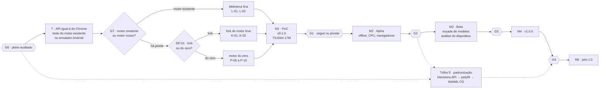
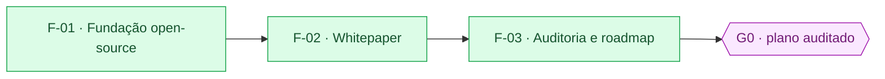
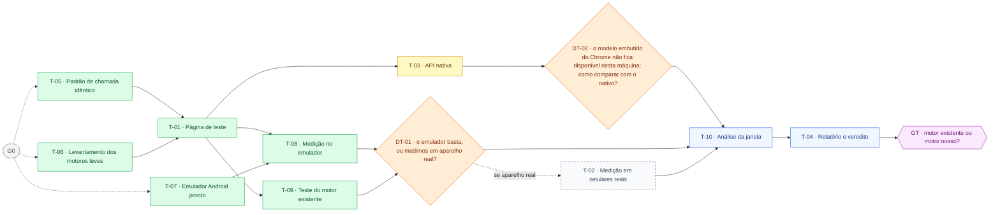
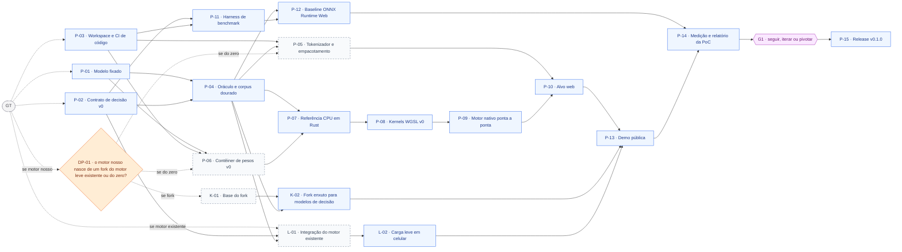
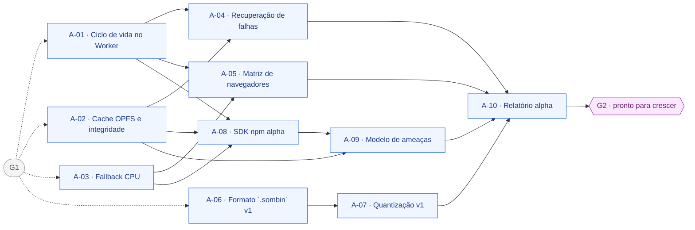
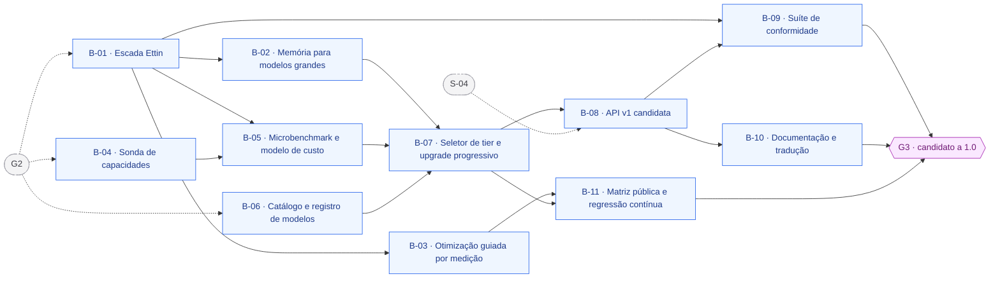

# Roadmap — SOM WebCore

> **Revisão de 2026-11-21.** Este documento é a fonte da verdade do planejamento e substitui o roadmap por semanas que existia na seção 8 do README.
> **Celular primeiro, API igual à do Chrome.** O plano começa por fixar a API idêntica à Decisions API e por testar, no Android, o motor leve que já existe ([marco T](#mt)). Um motor nosso em WebGPU — do zero ou como fork — só entra se o teste abrir essa janela, e cada bifurcação passa por [consulta ao usuário](#bifurcacoes).
> As atividades formam um **grafo acíclico dirigido (DAG)**: cada uma declara de quais depende, o que entrega e como se prova que terminou.
> As tabelas são a fonte; os grafos Mermaid, as ondas de execução e o caminho crítico são **gerados** por `python3 scripts/roadmap.py render` e validados na CI.

**Atalhos:** [Valor](#valor) · [Como ler](#como-ler) · [Marcos](#marcos) · [O que mudou no plano](#correcoes) · [M0](#m0) · [Padrão de chamada](#padrao-chamada) · [Ambiente](#ambiente) · [Bifurcações](#bifurcacoes) · [T — Teste](#mt) · [Prompts](#prompts) · [M1 — PoC](#m1) · [M2 — Alpha](#m2) · [M3 — Beta](#m3) · [M4 — v1.0.0](#m4) · [Trilha S — Padronização](#trilha-s) · [M5](#m5) · [Critérios globais](#dod) · [Riscos](#riscos-do-plano) · [Fora do roadmap](#fora) · [Manutenção](#manutencao)

Documentos irmãos: [metodologia](docs/METHODOLOGY.md) · [estrutura do repositório](docs/STRUCTURE.md) · [como contribuir](CONTRIBUTING.md) · [governança](GOVERNANCE.md) · [errata da pesquisa](research/ERRATA.md).

---

<a id="valor"></a>
## 1. Para que existimos

**Decidir é uma primitiva da web — e deve ser tão fácil quanto `fetch`.**

O SOM WebCore existe para provar, com software aberto e medições reproduzíveis, que decisões tipadas em passada única (`choice`, `score`, `noul`) rodam no dispositivo de quem navega — e para usar essa prova como argumento para que a capacidade passe a vir embutida em **todo motor de navegador**, acessível a **todo programador**.

O sucesso deste projeto é medido pela sua **dispensabilidade**: no dia em que `if (await decide(...))` funcionar nativamente em Chromium, WebKit e Gecko, a biblioteca vira um polyfill fino — e teremos cumprido a missão.

| Valor | O que significa na prática |
|---|---|
| **Padrão antes de produto** | A API pública é **idêntica** à Decisions API do Chrome ([padrão de chamada](#padrao-chamada)): o mesmo código roda sobre o nativo e sobre a nossa biblioteca. Nada na API prende alguém ao nosso motor ou ao nosso formato. |
| **Para todo programador** | Um import, uma chamada, resposta tipada, padrões sensatos. Dispositivo, modelo e backend ficam escondidos — mas inspecionáveis. |
| **Celular primeiro** | O celular é a prioridade: é onde a API nativa não está prevista e onde menos se mediu. Do aparelho de entrada ao desktop, com degradação explícita e honesta — nunca silenciosa. |
| **Evidência antes de afirmação** | Todo número é rotulado como medido, reportado, alvo ou hipótese. Erros de pesquisa viram errata pública, não rodapé. |
| **Privacidade por construção** | O estado do usuário não sai do dispositivo. Sem telemetria. Rede só para baixar pesos, e isso é visível. |
| **Abertura real** | Apache-2.0, governança pública, catálogo de modelos com licença declarada, neutralidade em relação a fornecedores. |

**Não estamos sozinhos — e isso muda o nosso papel.** Desde 30 de setembro de 2026 existe um explainer público da **Decisions API** (`window.DecisionModel`), escrito pelo time de Built-in AI do Chrome: perguntas tipadas `boolean`, `choice` e `score`, respondidas em passada única, com probabilidades por opção — a mesma tríade do JEV. Há um protótipo em Chromium e uma prévia no Edge Canary, atrás de flag. É um rascunho inicial: não está aprovado para lançamento, não tem posição de WebKit nem de Mozilla, e trata pesos fornecidos pelo desenvolvedor como não-objetivo (fontes e datas em [research/ERRATA.md](research/ERRATA.md#decisions-api)).

Portanto não vamos propor um padrão concorrente — nem fingir que somos os únicos: já existem um polyfill dessa API no npm e uma biblioteca (`crivo-web`) que roda esses modelos no navegador. O nosso papel é cobrir **o que falta**, com o celular em primeiro lugar:

- **Celular primeiro.** Nem a proposta nem a prévia do Edge falam de Android ou de iOS, muitos celulares não têm WebGPU, e o motor genérico que as bibliotecas usam não foi feito para eles. É onde a decisão local mais faz falta e onde menos se mediu.
- **Evidência.** Medições públicas em celulares reais: o que funciona, quanto pesa, quanto demora.
- **Escolha automática do modelo** para cada aparelho, com licença declarada e atenção ao português.
- **Conformidade.** Vetores de teste neutros e a mesma forma de API da proposta, para que o código de quem usa não mude quando o nativo chegar.

**Por que isso precisa virar padrão, e não só biblioteca.** Uma biblioteca resolve o problema de um site; só o navegador resolve o da web:

1. **Download duplicado.** O armazenamento do navegador é particionado por origem: cada site que usa o mesmo modelo baixa a sua própria cópia. Só o navegador pode guardar um modelo uma vez para todas as origens.
2. **Aceleradores fora de alcance.** NPUs e caminhos nativos de ML não estão expostos à WebGPU; o navegador pode usá-los.
3. **Energia e calor.** A página não vê temperatura nem bateria; o navegador vê e pode agendar.
4. **Custo de entrada.** Uma API nativa elimina o bundle, o Worker, o cache e a escolha de modelo — o programador só decide.

---

<a id="como-ler"></a>
## 2. Como ler este roadmap

- **Atividade** = um nó do DAG. Tem um ID estável, dependências, um entregável e um critério de aceite verificável. Nenhuma atividade começa antes de todas as suas dependências estarem feitas.
- **Portão** (`G0`, `GT`, `G1`…`G4`) = um nó de decisão no fim de cada marco. Fecha-se com evidência contra uma lista de critérios e fica registrado numa ADR. Um portão pode mandar **seguir**, **iterar** ou **pivotar**.
- **Bifurcação** (`DT-01`, `DP-01` e os próprios portões) = ponto em que o caminho se divide. Nenhuma atividade depois dela começa sem a [consulta ao usuário](#bifurcacoes). No grafo aparece como losango.
- **Ramo opcional** = atividade que só acontece se uma bifurcação escolher aquele caminho. Aparece com `(se …)` na coluna “Depende de” e com seta tracejada e rotulada no grafo. As atividades dos ramos não escolhidos passam ao estado `descartada`.
- **Prompt e validação** = toda atividade do marco em execução tem um prompt pronto para entregar ao agente e uma lista de validação ([seção de prompts](#prompts)). Atividade sem prompt não começa.
- **Prefixos:** `F` fundação · `T` teste · `P` prova de conceito · `L` biblioteca sobre o motor existente · `K` fork do motor existente · `DT` e `DP` bifurcações · `A` alpha · `B` beta · `V` v1.0.0 · `S` padronização · `X` pós-1.0.
- **Tamanho** (esforço ideal de uma pessoa): `S` até 2 dias · `M` até 1 semana · `L` até 3 semanas · `XL` mais que isso — tem de ser dividida antes de começar. Tamanho não é prazo: o projeto tem um mantenedor e não promete datas.
- **Estado:** `feito` · `em curso` · `a fazer` · `descartada` (ramo que uma bifurcação não escolheu).
- **Rótulos de evidência** (definidos na [metodologia](docs/METHODOLOGY.md#rotulos)): **[MEDIDO]** por este projeto, com relatório · **[REPORTADO]** por terceiros, com fonte e data · **[ALVO]** que queremos atingir · **[HIPÓTESE]** ainda sem dados.
- **Tolerâncias de paridade** usam “erro absoluto de probabilidade” (`Δp`): a maior diferença, em módulo, entre a probabilidade de uma opção no nosso motor e na implementação de referência.

**Números do grafo (gerado):**

<!-- dag:begin:critical -->
- **Nós:** 80 (11 feitos) · **arestas:** 124.
- **Esforço relativo:** 28/279 pontos concluídos (S=1, M=3, L=8, XL=13; portões=0).
- **Caminho mais longo possível até o último portão**, se cada bifurcação escolher o ramo mais caro (117 pontos): `F-01` → `F-02` → `F-03` → `G0` → `T-05` → `T-01` → `T-08` → `DT-01` → `T-02` → `T-10` → `T-04` → `GT` → `P-02` → `P-04` → `P-07` → `P-08` → `P-09` → `P-10` → `P-13` → `P-14` → `G1` → `A-03` → `A-05` → `A-10` → `G2` → `B-01` → `B-02` → `B-07` → `B-08` → `B-09` → `G3` → `V-01` → `V-05` → `G4`.
<!-- dag:end:critical -->

---

<a id="marcos"></a>
## 3. Visão geral dos marcos



| Marco | Versão | Pergunta que responde | Resultado para quem usa | Portão |
|---|---|---|---|---|
| **M0 — Fundação e auditoria** | documentação | O plano e a pesquisa estão corretos? | Whitepaper, errata e este roadmap | `G0` |
| **T — API igual à do Chrome e teste do motor existente** | — | Com a API idêntica à do Chrome, o motor leve que já existe serve no Android — ou há uma janela para um motor nosso? | Especificação da API, medições no emulador Android, veredito e análise da janela | `GT` |
| **M1 — Prova de conceito** | `v0.1.0` | A primeira versão decide certo com um modelo de 17M, sobre o motor que o teste escolher? | Demo pública: uma decisão local, verificada contra a referência | `G1` |
| **M2 — Alpha** | `v0.2`–`v0.4` | Funciona offline, sem WebGPU e nos três motores de navegador? | Pacote npm alpha, cache OPFS, fallback CPU | `G2` |
| **M3 — Beta** | `v0.5`–`v0.9` | O SDK escolhe sozinho o melhor modelo para cada máquina? | Escada de modelos, análise do dispositivo, API candidata | `G3` |
| **M4 — v1.0.0** | `v1.0.0` | É estável, auditado e pronto para produção? | API estável com SemVer, catálogo auditado | `G4` |
| **Trilha S — Padronização** | contínua | A decisão local chega a todos os motores? | Alinhamento com a Decisions API, polyfill, evidências e testes | — |
| **M5 — Pós-1.0** | `v1.x` | Para onde cresce? | WebNN, multilíngue, multimodal, SDKs nativos | — |

---

<a id="correcoes"></a>
## 4. O que esta revisão corrigiu no plano

A auditoria de 2026-11-21 conferiu os dois relatórios de pesquisa e o README contra fontes primárias (`config.json` e cartões dos modelos no Hugging Face, código de referência, documentação de APIs, repositórios e artigos citados). O detalhe, com fonte por item, está em [research/ERRATA.md](research/ERRATA.md). O que mudou no **plano**:

| # | O plano dizia | O que é verdade | Consequência no roadmap |
|---:|---|---|---|
| 1 | Começar por Ettin-150M, com formato binário, quantização Q8 e seis shaders fundidos ao mesmo tempo | Isso acumula cinco riscos novos antes da primeira passada correta | **PoC com TS-Ettin-17M**, kernels simples em f32, um risco de cada vez (`P-07` → `P-08` → `P-09`) |
| 2 | “Ettin-17M” como modelo semente | `jhu-clsp/ettin-encoder-17m` é só um encoder MLM; não decide nada | A semente é um **checkpoint de decisão**: `typestrict/TS-Ettin-17M` (Apache-2.0) — `P-01` |
| 3 | RoPE local com θ = 10.000 em toda a família | Só ModernBERT-base/large usa 10.000; **Ettin e mmBERT usam 160.000** nas camadas locais | θ vem sempre do manifesto do checkpoint; teste de paridade por camada (`P-07`) |
| 4 | Máscara bloco-diagonal e reset de posições para todos os modelos | É específico do Von (`independent_options`); TS-Ettin e Crivo usam atenção conjunta sobre as opções | A máscara é uma opção por modelo, desligada na PoC |
| 5 | Calibração, softmax e confiança dentro do shader | Cada família calibra de um jeito; ler K vetores de volta custa o mesmo que ler 64 bytes | **Cabeça e calibração no host** na PoC; versão in-shader só se medir ganho (`B-03`) |
| 6 | Cabeçalho `.sombin` de “256 bytes exatos” | O struct tem **264 bytes** em `repr(C)` (512 com `align(256)`) e não aceita `Pod` | Contêiner v0 mínimo na PoC (`P-06`); formato v1 por RFC, com offsets explícitos (`A-06`) |
| 7 | Tokenizador não aparece no plano | Sem IDs idênticos aos da referência, nenhuma paridade é possível | Atividade própria, com teste de identidade (`P-05`) |
| 8 | “Primeiro runtime aberto de decisão tipada no navegador” | `crivo-web` (npm, ONNX Runtime Web, Wasm e WebGPU) já faz `choice`/`noul`/`score` no navegador | O diferencial tem de ser **medido contra esse baseline** (`P-12`, `G1`); se não houver ganho, pivotamos |
| 9 | Catálogo priorizava Laya, Von e d1-omni-600M | No Decision Index 0.4 (2026-11-21) esses três pontuam como modelos de 17M; a família Ettin cobre 17M → 1B com **uma só arquitetura** | Escada de modelos sobre a família Ettin (`B-01`); d1-omni fica como trilha multimodal pós-1.0 |
| 10 | v0.1.0 em 12 semanas, incluindo matriz mobile | Um mantenedor, nenhum código | Marcos por portão, sem datas; mobile entra no alpha (`A-05`) |
| 11 | Nomes de API do wgpu de 2025 (`PUSH_CONSTANTS`, `SPIRV_SHADER_PASSTHROUGH`) | O wgpu está na versão 30 e renomeou esses recursos (`IMMEDIATES`, shaders em passthrough) | Fixar a versão e validar o blueprint contra ela (`P-03`) |
| 12 | Nada sobre análise do dispositivo | É o requisito central da v1.0.0 | Sonda, microbenchmark, catálogo e seletor de tier (`B-04`–`B-07`) |
| 13 | “Propor uma API de decisão ao W3C”, como se nada existisse | Já existe o explainer da Decisions API (time de Built-in AI do Chrome), com protótipo em Chromium e prévia no Edge Canary | A trilha S **alinha-se e contribui** com essa proposta; o SDK tem forma de polyfill dela (`S-02`, `S-05`) |
| 14 | “Probabilidades calibradas” como propriedade do runtime | Calibração é propriedade do **modelo**; o TS-Ettin-17M é publicado sem calibração | O runtime aplica fielmente a calibração do checkpoint; o catálogo declara o estado de calibração de cada modelo (`B-06`) |
| 15 | WebGPU “ativa por padrão no iOS 18.2” e disponível em “Chrome 121+ no Android” | No Safari, só a partir da versão 26, nos sistemas 26; no Chromium, depende do sistema e do fabricante da GPU | Detecção de recurso sempre; matriz de navegadores com hardware real (`A-05`) |
| 16 | Primeiro “o motor próprio é necessário”, depois “o motor pronto resolve” — as duas vezes sem nenhuma medição em celular | O celular é a prioridade, e todas as medições disponíveis são de desktop | **Marco T**: testar o motor existente no Android antes de escolher o motor (portão `GT`) |
| 17 | O projeto como “o polyfill aberto” da Decisions API | Já existe um polyfill no npm (`built-in-ai-task-apis-polyfills`) | O papel do projeto é cobrir o que falta, com o celular em primeiro lugar |
| 18 | API própria (`som.decide`, `som.eval`, `noul`), com um “mapeamento” para a do Chrome | Para mostrar o trabalho ao time do Chrome e a pares, a API tem de ser a **mesma** | [Padrão de chamada](#padrao-chamada) idêntico à Decisions API (`T-05`); os nomes do JEV saem da superfície pública |
| 19 | Um único caminho depois do teste, decidido pelo agente | O caminho depende do que o teste mostrar, e a escolha é do usuário | [Bifurcações](#bifurcacoes) `DT-01`, `GT` e `DP-01`, com ramos opcionais, prompt e validação por atividade e consulta ao usuário em cada uma |
| 20 | “A flag do Chrome ainda não foi conferida”; a prévia só existiria no Edge Canary | A API está no Chrome estável 157 e no Canary 160, atrás da flag `decisions-api`; a implementação tem o membro `preference`, que o explainer não descreve, e num perfil novo o modelo aparece como indisponível | [Ambiente verificado](#ambiente); `T-05` captura a superfície da implementação; nova bifurcação `DT-02` |

---

<a id="m0"></a>
## 5. Marco M0 — Fundação e auditoria

| ID | Atividade | Depende de | Entregável | Critério de aceite | Tam. | Estado |
|---|---|---|---|---|:---:|---|
| `F-01` | **Fundação open-source** — licença, governança como código e CI de documentação | — | `LICENSE`, `SECURITY.md`, rulesets, `scripts/check-docs.py` | CI `build` verde; `main` só recebe PR com squash merge | M | feito |
| `F-02` | **Whitepaper** — README que consolida os dois relatórios de pesquisa | `F-01` | `README.md`, `docs/figures/` | contrato de documentação sem erros; divergências entre os relatórios registradas | L | feito |
| `F-03` | **Auditoria e roadmap** — pesquisa conferida em fontes primárias; DAG, metodologia, estrutura e contribuição definidas | `F-02` | `ROADMAP.md`, `research/ERRATA.md`, `docs/METHODOLOGY.md`, `docs/STRUCTURE.md`, `GOVERNANCE.md` | `scripts/roadmap.py check` verde; cada correção com fonte primária e data | L | feito |
| `G0` | **Portão G0** — plano auditado | `F-03` | este roadmap em `main` | critérios de [G0](#g0) | — | feito |

<!-- dag:begin:M0 -->


**Ondas de execução** (atividades da mesma onda não dependem entre si):

1. `F-01`
2. `F-02`
3. `F-03`
4. `G0`
<!-- dag:end:M0 -->

<a id="g0"></a>
**Critérios do portão G0** — todos cumpridos nesta revisão:

- [x] Os dois relatórios foram conferidos contra fontes primárias e os erros estão em [research/ERRATA.md](research/ERRATA.md), com marcação no próprio texto dos relatórios.
- [x] O README não contém afirmação conhecida como falsa; o que não pôde ser verificado está rotulado.
- [x] Existe um modelo leve, com licença permissiva e implementação de referência, para a prova de conceito.
- [x] O roadmap é um DAG válido, com critério de aceite por atividade e por portão.

---

<a id="padrao-chamada"></a>
## Padrão de uso e de chamada: idêntico ao do Chrome

**Regra.** A API pública deste projeto é a **Decisions API** do Chrome, sem nomes próprios e sem variações. Quem escreve código para a nossa biblioteca escreve, linha por linha, o mesmo código que roda na implementação nativa. É isso que dá peso para mostrar o trabalho ao time do Chrome e a pares: não é “parecido com”, é o mesmo contrato.

**Referência.** A referência é a **implementação do Chrome**; o explainer é a documentação dela. Conferido nesta máquina em 2026-11-21 **[MEDIDO]**: no Chrome estável 157 e no Chrome Canary 160, com a flag `chrome://flags/#decisions-api` (recurso `AIDecisionModelAPI`), o navegador expõe `DecisionModel` com `availability()` e `create()` estáticos e, na instância, `decide()`, `destroy()` e `preference` — este último **não aparece no explainer**. Explainer fixado: `explainers-by-googlers/decisions-api`, commit `5ce6e10a81f766efaec670282696c0c57ba2de50` (2026-11-11). Quando os dois divergem, vale a implementação, e a divergência fica registrada (`T-05`, `T-03`). Os detalhes estão em [Ambiente verificado](#ambiente).

```js
const schema = {
  expectedInputs: [{ type: "text", languages: ["pt", "en"] }],
  questions: [
    { id: "quer_reembolso", type: "boolean", prompt: "O cliente pede reembolso?" },
    {
      id: "assunto",
      type: "choice",
      prompt: "Qual é o assunto da mensagem?",
      options: [
        { label: "pagamento", description: "Cobrança, fatura ou estorno" },
        { label: "entrega", description: "Prazo, rastreio ou extravio" },
        { label: "outro", description: "Qualquer outro assunto" }
      ]
    },
    { id: "urgencia", type: "score", prompt: "De 1 (baixa) a 5 (alta), qual a urgência?" }
  ]
};

const status = await DecisionModel.availability(schema);
if (status === "available" || status === "downloadable") {
  const model = await DecisionModel.create(schema);
  const result = await model.decide("Fui cobrado duas vezes e preciso disso resolvido hoje.");
  // result.assunto  -> { id, label, confidence, probabilities }
  // result.urgencia -> { id, label, confidence, probabilities, expectedScore }
  model.destroy();
}
```

| Aspecto | Regra |
|---|---|
| Ponto de entrada | `DecisionModel`, com `availability()`, `create()`, `decide()` e `destroy()` — mesmos nomes, mesmos argumentos, mesmos valores de retorno |
| Perguntas | `boolean`, `choice` e `score`, com `id`, `prompt` e `options` (`label`, `description`). Limites da implementação: até 16 perguntas por esquema; `choice` com 2 a 26 opções; `score` com 2 a 9 níveis no Chrome 157 e 2 a 11 no 160; `boolean` sem opções (conferido no código-fonte e em execução, `T-05`) |
| Resultado | objeto indexado pelo `id` da pergunta, com `label`, `probabilities`, `confidence` e, em `score`, `expectedScore` |
| Nomes do JEV | `som.decide`, `som.eval` e `noul` saem da superfície pública; `noul` é `boolean` |
| O que é só nosso | escolha do modelo, orçamento de download, política de licença e diagnóstico ficam **fora** da superfície padrão, num ponto de configuração separado, que a aplicação pode remover sem mudar nenhuma chamada |
| Quando o explainer mudar | a referência fixada é atualizada por PR e a nossa API muda junto, mesmo antes da 1.0 |
| Quando o nativo existir | a biblioteca não se instala por cima: a aplicação usa o `DecisionModel` do navegador |

**Validação do padrão.** Uma única página de conformidade, escrita só com a API acima, roda **sem alteração** (1) sobre a implementação nativa, no Chrome com a flag `decisions-api` ligada, e (2) sobre a nossa biblioteca, em qualquer navegador. Diferença de forma entre as duas é bug nosso.

---

<a id="ambiente"></a>
## Ambiente verificado

O que foi conferido na máquina de desenvolvimento em 2026-11-21, antes de qualquer atividade — tudo **[MEDIDO]** nela. Nada aqui é resultado de teste do roadmap: é só o ponto de partida.

| Item | O que há | O que isso significa |
|---|---|---|
| Chrome estável | 157.0.8103.79 | Com `chrome://flags/#decisions-api` (ou `--enable-features=AIDecisionModelAPI`) expõe `DecisionModel`; sem a flag, não |
| Chrome Canary | 160.0.8174.2, instalado nesta revisão | Mesmo comportamento; o binário cita dois backends para a API: `embedding_gemma_v1` e `language_model` |
| Superfície observada | estáticos `availability` e `create`; na instância `decide`, `destroy` e `preference` | `preference` não está no explainer: a referência é a implementação (`T-05`) |
| Limites lidos no binário | até 16 perguntas por esquema; `choice` com 2 a 26 opções; `score` com 2 a 11 níveis; `boolean` sem opções | Valem para o Canary 160; no estável 157 o `score` vai de 2 a 9 níveis (`T-05`, [especificação](docs/spec/decisions-api-surface.md)) |
| Modelo embutido | `availability()` devolveu `unavailable` num perfil novo, em modo headless | **[MEDIDO na `T-05`]** no Canary 160, num perfil de teste com o interruptor “On-device AI” ligado, fica `downloadable`; com um gesto do usuário o `create()` baixa o modelo do backend padrão (`embedding-gemma-v1`, só inglês) e passa a `available`. No estável 157 continua `unavailable` ([especificação](docs/spec/decisions-api-surface.md#5-availability)) |
| Edge estável | 158.0.4370.33; o binário contém a mesma API | Não testado em execução; o Edge Canary não está instalado |
| Emulador Android | aceleração WHPX utilizável; aparelhos virtuais `jev_playstore_36`, `jev_google_36` e `jev_atd_36` (Android 36, x86_64) | Usar o `jev_playstore_36`. Na `T-07` a imagem de sistema do Android 36 estava ausente e foi reinstalada; o Chrome é o 133 da imagem, porque a Play Store pede uma conta Google que o emulador não tem ([EMULADOR.md](bench/spike-mobile/EMULADOR.md)). A `T-08` rodou no emulador arm64 do Mac mini, com o mesmo Chrome 133 ([MACMINI.md](bench/spike-mobile/MACMINI.md#7-emulador-android-no-mac-t-08)) |
| GPU do emulador | `hw.gpu.mode=swiftshader_indirect` — por software | **[MEDIDO na `T-07`]** sem WebGPU no Chrome do emulador: `requestAdapter()` devolve `null` com GPU por software e com `-gpu host`, com e sem `--enable-unsafe-webgpu`. No emulador arm64 do Mac mini, com as flags inseguras, o Chrome entrega adaptador, mas nenhum dispositivo |
| Simulador de iOS (Mac mini) | Mac mini M1 de 16 GB, macOS 27.2, Xcode 27.1; iOS 27.0 (24A434) com Mobile Safari 27.0 | **[MEDIDO em 2026-11-21, no Mac mini]** `navigator.gpu` existe, mas `requestAdapter()` devolve `null`; Wasm com SIMD e JSPI, threads só com isolamento de origem. Serve para o WebKit do iOS, não como latência de iPhone ([MACMINI.md](bench/spike-mobile/MACMINI.md)) |
| Node, npm e bun | 22.23.1, 10.9.8 e 1.4.4 | Suficiente para a página de teste; TypeScript via `npx` |
| Python | 3.12.10, com `.venv` na raiz: torch 2.15.0 (CPU), transformers 5.24.0, onnxruntime 1.32.0 | Pronto para gerar as respostas de referência (`T-09`) |
| Rust | 1.99.1 | Só será usado se o portão `GT` escolher um motor nosso |
| GPU do computador | NVIDIA GeForce RTX 4070 Laptop e Intel UHD | É a família em que a pesquisa relata o travamento de driver em D3D12 — útil para reproduzi-lo, se o motor nosso existir |

**Como abrir o Chrome com a API ligada**, sem tocar no perfil do dia a dia:

```text
"%LOCALAPPDATA%\Google\Chrome SxS\Application\chrome.exe" --user-data-dir="%TEMP%\som-decisions" --enable-features=AIDecisionModelAPI http://localhost:8377/
```

A API só existe em contexto seguro: a página tem de ser servida em `http://localhost` ou em HTTPS.

---

<a id="bifurcacoes"></a>
## Bifurcações e consulta ao usuário

Uma **bifurcação** é um ponto em que o caminho se divide e a escolha é do usuário, não do agente. Os portões de marco (`GT`, `G1`…`G4`) também são bifurcações. Em todas vale o mesmo protocolo:

1. **Parar.** Ao chegar a uma bifurcação, o agente não inicia nenhuma atividade posterior — nem “para adiantar”.
2. **Reunir a evidência.** Um relatório com os dados brutos, todo número rotulado, e a lista do que **não** se sabe.
3. **Apresentar os ramos.** Para cada um: o que será feito, o esforço, o risco e o que se perde. E uma recomendação, com o motivo.
4. **Perguntar.** A consulta vai ao usuário num documento de decisão aberto no Plannotator (`plannotator annotate <arquivo> --gate`), com um bloco `:::question` por decisão. Sem Plannotator, pela ferramenta de perguntas do agente.
5. **Esperar.** Sem resposta, nada avança. Não existe ramo padrão por omissão, e uma resposta genérica como “vamos lá” não escolhe um ramo.
6. **Registrar.** A resposta vira ADR em `docs/adr/`. No mesmo PR, a bifurcação passa a `feito` e as atividades dos ramos não escolhidos passam a `descartada`.

| Bifurcação | Pergunta | Ramos | Evidência exigida |
|---|---|---|---|
| **DT-01** | Os resultados do emulador bastam para decidir? | (a) seguir só com o emulador · (b) medir também em aparelho real (`T-02`) | `T-08` e `T-09` |
| **DT-02** | O modelo embutido do Chrome não fica disponível nesta máquina: como comparar com o nativo? | (a) comparar só a forma da API · (b) instalar o Edge Canary e usar o modelo embutido dele · (c) deixar a comparação de respostas para outra máquina | `T-03`, com o valor de `availability()` num perfil real |
| **GT** | O motor existente serve, ou há uma janela para um motor nosso? | (a) motor existente, biblioteca fina (`L-01`, `L-02`) · (b) motor nosso em WebGPU (`DP-01`) · (c) só evidência e contribuições | `T-04`, com o veredito e a análise da janela |
| **DP-01** | O motor nosso nasce de um fork ou do zero? | (a) fork do motor leve existente (`K-01`, `K-02`) · (b) do zero (`P-05` a `P-10`) | `T-10` e as licenças levantadas em `T-06` |

---

<a id="mt"></a>
## Marco T — API igual à do Chrome e teste do motor existente

**Objetivo.** Antes de escrever qualquer código de produto, responder, nesta ordem:

1. **Qual é exatamente a API?** Fixar o padrão de chamada idêntico ao do Chrome (`T-05`).
2. **O motor leve que já existe roda no Android?** Levantar os candidatos (`T-06`) e medi-los no nosso emulador Android, com a skill `/android-agent-skill` (`T-07`, `T-01`, `T-08`).
3. **Ele é satisfatório?** Testar se responde certo e aguenta, e anotar o veredito (`T-09`, `T-04`).
4. **Há uma janela?** Analisar se alguma limitação do motor existente com modelos de decisão abre espaço para um motor nosso (`T-10`).
5. **Decidir** (`GT`): seguir com o motor existente, ou criar o nosso em WebGPU — do zero ou como fork do motor leve existente (`DP-01`).

É uma investigação de prazo fixo (ver [metodologia](docs/METHODOLOGY.md#portoes)): o entregável é uma resposta escrita, com dados, e não um produto.

**O que o emulador mede — e o que não mede.** O emulador roda no processador do computador, não num processador de celular, e a sua placa de vídeo é emulada; o Chrome dele pode nem oferecer WebGPU. Por isso ele serve para saber **se funciona** no Chrome para Android, **quanto baixa**, **quanta memória** usa e para **comparar motores entre si** no mesmo ambiente. Não serve como latência de celular real. É para isso que existe a bifurcação `DT-01`. Nos aparelhos virtuais desta máquina a GPU é por software, de modo que o caminho WebGPU provavelmente só poderá ser avaliado em aparelho real.

**Por que este marco vem primeiro.** O celular é a prioridade, e é onde não temos dados: os 12,6 ms do motor existente foram medidos num Apple M4 **[REPORTADO]**; muitos celulares não têm WebGPU; só o runtime do motor existente custa 3,2 MB (CPU) ou 4,8 MB (WebGPU) comprimidos **[MEDIDO nos arquivos publicados do `onnxruntime-web` 1.31.1, em 2026-11-21]**, e em WebGPU ele só atingiu paridade com pesos em precisão cheia **[REPORTADO pelo `crivo-web`]**; e nem o explainer nem a documentação do Edge mencionam Android ou iOS.

**Modelos fixados do marco T.** `typestrict/TS-Ettin-17M` na revisão `026af312e41d24a1126f8d927bb6314fc2d5f592` (a da [seção 6.1](#m1)) e `typestrict/TS-Ettin-32M` na revisão `a0f7b67dc8618365792896f46d52ec4013b899de` (Apache-2.0, conferida em 2026-11-21). O tamanho e o SHA-256 de cada arquivo estão em [`bench/spike-mobile/models.json`](bench/spike-mobile/models.json); `bench/spike-mobile/fetch-models.py` baixa só dessas revisões e recusa arquivo com hash diferente.

| ID | Atividade | Depende de | Entregável | Critério de aceite | Tam. | Estado |
|---|---|---|---|---|:---:|---|
| `T-05` | **Padrão de chamada idêntico** — fixar a superfície da Decisions API em uma especificação e em declarações de tipos | `G0` | `docs/spec/decisions-api-surface.md`, `bench/spike-mobile/decision-model.d.ts` | cada membro da API do explainer está nas declarações, com o commit de origem; nenhum nome próprio do projeto na superfície pública | S | feito |
| `T-06` | **Levantamento dos motores leves** — listar os motores que já rodam modelos de decisão no navegador e escolher os candidatos | `G0` | `docs/reports/motores-existentes.md` | por candidato: licença, tamanho do runtime, backends, modelos e precisões aceitos, estado de manutenção, com fonte primária e data; 1 ou 2 candidatos escolhidos, com o motivo | S | feito |
| `T-07` | **Emulador Android pronto** — subir um aparelho virtual com Chrome pela skill `/android-agent-skill` e deixar reproduzível como servir a página e recolher os resultados | `G0` | `bench/spike-mobile/EMULADOR.md` | o Chrome do emulador abre uma página servida pelo computador e devolve um arquivo de resultado; versões registradas; presença ou ausência de WebGPU registrada | S | feito |
| `T-01` | **Página de teste** — página estática que usa só a API de `T-05` e faz as mesmas perguntas, em português e em inglês, a cada motor candidato | `T-05`, `T-06` | `bench/spike-mobile/` | registra latência (p50 e p95), tempo até a primeira resposta, bytes baixados, memória e as respostas; exporta um JSON; o que não rodar fica registrado como resultado | S | feito |
| `T-08` | **Medição no emulador** — rodar a página no Chrome do emulador Android, em Wasm e, se houver, em WebGPU | `T-01`, `T-07` | `bench/results/` (arquivos marcados como emulador) | modelos de 17M e de 32M; cada medição repetida duas vezes; nenhuma latência de emulador apresentada como latência de celular | S | feito |
| `T-09` | **Teste do motor existente** — conferir se responde certo e aguenta: respostas contra a referência do modelo, forma da API e 200 decisões seguidas | `T-01` | seção do relatório, `bench/results/` | mesmas respostas da referência, dentro da tolerância da variante; forma do resultado idêntica à de `T-05`; nenhuma falha nem crescimento de memória nas 200 decisões | S | feito |
| `T-03` | **API nativa** — rodar a página de conformidade na Decisions API do Chrome (flag `decisions-api`) e comparar forma e respostas | `T-01` | seção do relatório | diferenças de forma listadas e corrigidas em `T-05`; valor de `availability()` num perfil real registrado | S | em curso |
| `DT-02` | **Bifurcação DT-02** — o modelo embutido do Chrome não fica disponível nesta máquina: como comparar com o nativo? | `T-03` | ADR com a decisão | [consulta ao usuário](#bifurcacoes) feita e respondida; se o modelo ficar disponível, fecha como “não se aplica” | — | a fazer |
| `DT-01` | **Bifurcação DT-01** — o emulador basta, ou medimos em aparelho real? | `T-08`, `T-09` | ADR com a decisão | [consulta ao usuário](#bifurcacoes) feita e respondida | — | a fazer |
| `T-02` | **Medição em celulares reais** — rodar a página em pelo menos um Android intermediário, um Android de entrada e um iPhone | `DT-01` (se aparelho real) | `bench/results/` | pelo menos 3 aparelhos; modelos de 17M e de 32M; cada medição repetida duas vezes; aparelho, sistema e navegador declarados | S | a fazer |
| `T-10` | **Análise da janela** — listar as limitações do motor existente com modelos de decisão, e as dos próprios modelos, e dizer quais um motor nosso resolveria | `DT-02`, `DT-01`, `T-02` | seção do relatório | cada limitação com evidência medida, causa provável e se um fork ou um motor próprio a resolve; limitações de modelo separadas das de motor | S | a fazer |
| `T-04` | **Relatório e veredito** — o motor existente é satisfatório? Anotar o veredito, os limites e a janela | `T-10` | `docs/reports/teste-mobile.md` | veredito explícito contra cada critério de GT; dados brutos publicados; todo número rotulado; o que não se sabe, listado | S | a fazer |
| `GT` | **Portão GT** — motor existente ou motor nosso? | `T-04` | ADR com a decisão | [consulta ao usuário](#bifurcacoes) feita e respondida; critérios de [GT](#gt) | — | a fazer |

<!-- dag:begin:T -->


**Ondas de execução** (atividades da mesma onda não dependem entre si):

1. `T-05` · `T-06` · `T-07`
2. `T-01`
3. `T-08` · `T-09` · `T-03`
4. `DT-01` · `DT-02`
5. `T-02`
6. `T-10`
7. `T-04`
8. `GT`
<!-- dag:end:T -->

<a id="gt"></a>
**Critérios do portão GT.** Limiares iniciais, **[ALVO]** — podem ser ajustados pelo mantenedor **antes** da medição, nunca depois. Medidos com o modelo de 17M, no melhor caminho que cada ambiente oferecer. O motor existente é **satisfatório** se cumprir os quatro:

| Pergunta | Limiar | Onde vale |
|---|---|---|
| Acerta igual? | mesmas respostas da implementação de referência do modelo, dentro da tolerância da variante usada | emulador e aparelho real |
| A primeira visita é leve? | runtime, pesos e tokenizador somam até 25 MB | emulador e aparelho real |
| Aguenta? | 200 decisões seguidas sem a aba recarregar nem travar | emulador e aparelho real |
| A decisão é rápida? | p95 de até 150 ms no Android intermediário e no iPhone; até 300 ms no Android de entrada | só aparelho real — no emulador é apenas indicativo |

Os ramos do portão:

| Ramo | Quando | O que vem depois |
|---|---|---|
| **Motor existente** | cumpre os critérios e a análise não encontra janela | biblioteca fina sobre o motor existente (`L-01`, `L-02`); as atividades do motor nosso (`DP-01`, `K-01`, `K-02`, `P-05` a `P-10`) passam a `descartada` |
| **Motor nosso em WebGPU** | há uma limitação **medida** que um motor nosso resolve | bifurcação `DP-01`: fork do motor leve existente (`K-01`, `K-02`) ou do zero (`P-05` a `P-10`) |
| **Só evidência** | nada serve no Android, ou a API nativa já o cobre | o roadmap encolhe para a trilha S; os marcos de produto passam a `descartada` |

---

<a id="prompts"></a>
## Prompts e validação

Cada bloco é o texto a entregar ao agente de código, dentro deste repositório, para executar **uma** atividade. A lista de validação diz como conferir que ela terminou. Nenhuma atividade começa sem os dois; os prompts dos marcos seguintes são escritos quando o marco é desbloqueado.

**Regras comuns a todos os prompts** — o agente as segue mesmo que o prompt não as repita:

- Ler antes de começar: a linha da atividade no `ROADMAP.md`, `docs/METHODOLOGY.md` e `research/ERRATA.md`.
- Fazer só esta atividade e parar. Não começar a seguinte.
- Todo número leva rótulo (medido, reportado, alvo ou hipótese) e fonte.
- Ao chegar a uma bifurcação, parar e seguir o [protocolo de consulta](#bifurcacoes).
- Ao terminar: rodar a validação, mudar o estado da atividade na tabela, rodar `python3 scripts/roadmap.py render` e `python3 scripts/check-docs.py`, e abrir o PR conforme o `AGENTS.md`.

<!-- prompt:T-05 -->
#### `T-05` — Padrão de chamada idêntico

```text
Atividade T-05 do ROADMAP.md: fixar o padrão de chamada idêntico à Decisions API do Chrome.
1. Capture a superfície REAL: abra o Chrome com a Decisions API ligada (chrome.exe --enable-features=AIDecisionModelAPI, com um --user-data-dir próprio) numa página servida em http://localhost e enumere os membros de DecisionModel e de uma instância, os valores de availability() e as mensagens de erro de validação. Já se sabe que existe o membro preference, ausente do explainer, e que os limites são: 16 perguntas por esquema, choice com 2 a 26 opções, score com 2 a 11 níveis, boolean sem opções.
2. Leia o explainer github.com/explainers-by-googlers/decisions-api no commit 5ce6e10a81f766efaec670282696c0c57ba2de50 (ou o mais novo; registre o hash) e marque cada diferença entre ele e a implementação. Quando divergirem, vale a implementação.
3. Escreva docs/spec/decisions-api-surface.md, em inglês: cada membro da API (DecisionModel.availability, DecisionModel.create, decide, destroy, preference, o formato do schema, os tipos boolean, choice e score, os limites e o formato do resultado), com a origem de cada um: a implementação (versão do Chrome) e o trecho do explainer.
4. Escreva bench/spike-mobile/decision-model.d.ts com as declarações TypeScript dessa superfície, sem nenhum nome próprio do projeto. Confira com: npx -p typescript tsc --noEmit.
5. Liste numa tabela o que o explainer deixa em aberto, o que marca como instável e o que só existe na implementação.
Não invente membros: o que nem a implementação nem o explainer definem fica como "não definido".
```

**Validação:** cada membro das declarações aponta para a implementação (versão do Chrome) ou para um trecho do explainer no commit registrado · o membro `preference` e os limites estão documentados · a busca por `noul`, `som.` e `jev` nas declarações não devolve nada · o exemplo de uso deste roadmap compila contra as declarações.

<!-- prompt:T-06 -->
#### `T-06` — Levantamento dos motores leves

```text
Atividade T-06 do ROADMAP.md: levantar os motores leves que já rodam modelos de decisão no navegador.
1. Avalie, no mínimo: ONNX Runtime Web (via crivo-web e via Transformers.js) e o pacote npm built-in-ai-task-apis-polyfills. Procure outros e inclua os que rodarem um modelo de decisão em passada única. Registre também o que o próprio Chrome usa: o binário do Canary 160 cita dois backends para a Decisions API, embedding_gemma_v1 e language_model.
2. Para cada um registre, com fonte primária e data: licença, tamanho do runtime (bruto e comprimido), backends (Wasm, WebGPU), modelos e precisões aceitos em cada backend, estado de manutenção e como se instala.
3. Escolha 1 ou 2 candidatos para medir e justifique. Critério: o mais leve que rode o TS-Ettin-17M ou um modelo da mesma arquitetura.
Entregável: docs/reports/motores-existentes.md. Não meça desempenho aqui; isso é a T-08.
```

**Validação:** todo dado tem link para fonte primária e data de consulta · os tamanhos de runtime foram conferidos nos arquivos publicados, não em texto de terceiros · há 1 ou 2 candidatos escolhidos, com o motivo e com o que ficou de fora.

<!-- prompt:T-07 -->
#### `T-07` — Emulador Android pronto

```text
Atividade T-07 do ROADMAP.md: deixar pronto o emulador Android para os testes.
Use a skill /android-agent-skill para tudo o que tocar no Android.
1. Reutilize o aparelho virtual jev_playstore_36 (Android 36, x86_64, com Google Play), que já existe nesta máquina; não crie outro. Atualize o Chrome dele pela Play Store e registre a imagem, a versão do Android e a do Chrome. A aceleração WHPX já está instalada e utilizável.
2. Sirva uma página estática do computador para o emulador e abra-a no Chrome do emulador.
3. Faça a página gravar um resultado e recolha-o no computador, de forma repetível.
4. Verifique no Chrome do emulador se navigator.gpu existe e se requestAdapter devolve um adaptador. Os aparelhos virtuais desta máquina usam GPU por software (hw.gpu.mode=swiftshader_indirect): teste assim e também iniciando o emulador com -gpu host, e registre os dois resultados, com e sem flags do Chrome.
Entregável: bench/spike-mobile/EMULADOR.md com os comandos exatos. Não instale nada fora do que a skill prevê.
```

**Validação:** seguindo só o `EMULADOR.md`, uma segunda execução chega ao mesmo resultado · um arquivo de resultado de exemplo foi recolhido do emulador · a presença ou ausência de WebGPU no emulador está registrada.

<!-- prompt:T-01 -->
#### `T-01` — Página de teste

```text
Atividade T-01 do ROADMAP.md: construir a página de teste.
1. Página estática em bench/spike-mobile/, sem framework, que usa SOMENTE a API de docs/spec/decisions-api-surface.md.
2. Atrás dessa API, um adaptador para cada motor candidato escolhido na T-06, e um adaptador para a API nativa quando window.DecisionModel existir.
3. Conjunto fixo de perguntas em bench/spike-mobile/corpus.json: pelo menos 30 em português e 30 em inglês, cobrindo boolean, choice (de 2 a 8 opções) e score.
4. Meça, por motor: tempo até a primeira resposta, latência quente (p50 e p95 de pelo menos 100 decisões), bytes baixados e memória; guarde todas as respostas.
5. Exporte um JSON por execução, com o ambiente (navegador, sistema, navigator.gpu) e os resultados.
Use o modelo fixado no ROADMAP (TS-Ettin-17M). Se o motor não o aceitar, registre o motivo e use o modelo da mesma arquitetura que ele aceitar.
Nesta máquina há Node 22, npm 10 e bun 1.4. Sirva a página em http://localhost: a API só existe em contexto seguro.
```

**Validação:** a página roda no Chrome de desktop e produz o JSON · trocar de motor não exige mudar nenhuma chamada da página · o que não rodar aparece no JSON como falha, com a mensagem de erro.

<!-- prompt:T-08 -->
#### `T-08` — Medição no emulador

```text
Atividade T-08 do ROADMAP.md: medir os motores candidatos no emulador Android.
Use a skill /android-agent-skill e o procedimento de bench/spike-mobile/EMULADOR.md.
1. Rode a página de teste no Chrome do emulador para cada motor candidato, em Wasm e, se houver adaptador, em WebGPU; modelos de 17M e de 32M.
2. Repita cada medição duas vezes; se o p50 variar mais de 10%, repita de novo.
3. Guarde os JSON em bench/results/ com "emulador" no nome.
4. Escreva um resumo: o que rodou, o que não rodou, bytes baixados, memória e latência.
Marque toda latência como medida em emulador: ela não vale como latência de celular real. Se o Chrome do emulador não oferecer WebGPU, registre isso como resultado e meça só em Wasm.
```

**Validação:** há dois JSON por configuração · o resumo separa “funciona ou não” de “quanto demora” · nenhuma frase apresenta latência de emulador como latência de celular.

<!-- prompt:T-09 -->
#### `T-09` — Teste do motor existente

```text
Atividade T-09 do ROADMAP.md: testar se o motor existente responde certo e aguenta.
1. Gere as respostas de referência do conjunto de perguntas com a implementação do próprio modelo (dinah.py do repositório do modelo, PyTorch FP32, em CPU). O ambiente já existe: .venv na raiz do repositório, com torch 2.15.0 (CPU), transformers 5.24.0, onnxruntime 1.32.0, safetensors, huggingface_hub e numpy; use .venv/Scripts/python.exe.
2. Compare, por motor e por precisão, as probabilidades da página com as de referência: maior diferença absoluta e concordância da opção vencedora.
3. Confira que a forma do resultado é idêntica à de docs/spec/decisions-api-surface.md.
4. Rode 200 decisões seguidas e registre falhas e memória no início e no fim.
Entregável: os arquivos em bench/results/ e uma seção no relatório. Diga com clareza: satisfatório ou não, e em quê.
```

**Validação:** as respostas de referência são regeneráveis com um comando · a diferença máxima de probabilidade e a concordância da vencedora estão reportadas por motor e precisão · o veredito de corretude é explícito.

<!-- prompt:T-03 -->
#### `T-03` — API nativa

```text
Atividade T-03 do ROADMAP.md: rodar a página de conformidade na API nativa.
1. Abra o Chrome (estável 157 ou Canary 160, ambos instalados) com a Decisions API ligada: chrome://flags/#decisions-api, ou chrome.exe --enable-features=AIDecisionModelAPI com um --user-data-dir próprio. Registre versões e flags.
2. Num perfil real, não headless, chame DecisionModel.availability(). Num perfil headless novo o valor foi "unavailable"; registre o valor obtido. Se for "downloadable", peça ao usuário para autorizar o download do modelo. Se continuar "unavailable", pare e siga a bifurcação DT-02.
3. Rode a página de teste com o adaptador nativo e guarde o JSON.
4. Compare a forma (nomes, tipos, valores de availability, erros) com docs/spec/decisions-api-surface.md e liste cada diferença.
5. Corrija a especificação e as declarações da T-05 para ficarem iguais ao que a implementação nativa faz.
Os navegadores já estão instalados nesta máquina. O download do modelo embutido, se for pedido, precisa de uma pessoa: peça ao usuário e espere.
```

**Validação:** as versões e as flags usadas estão registradas · cada diferença entre a nossa superfície e a nativa está resolvida ou justificada · o valor de `availability()` num perfil real está registrado.

<!-- prompt:DT-02 -->
#### `DT-02` — Bifurcação: o modelo nativo não fica disponível

```text
Bifurcação DT-02 do ROADMAP.md: o modelo embutido do Chrome não fica disponível nesta máquina. Como comparar com o nativo?
Se availability() chegou a "available", registre isso, feche a bifurcação como "não se aplica" e siga.
Caso contrário, não inicie nenhuma atividade posterior e siga o protocolo de consulta do ROADMAP.
1. Registre o que foi tentado: versões do Chrome, flags, o valor de availability() e a mensagem de erro de create().
2. Monte o documento de decisão com os três ramos: (a) comparar só a forma da API, sem respostas nativas; (b) instalar o Edge Canary e usar o modelo embutido dele; (c) deixar a comparação de respostas para outra máquina.
3. Abra-o no Plannotator com um bloco :::question e espere a resposta.
4. Registre a resposta em docs/adr/ e atualize o ROADMAP.
```

**Validação:** existe a ADR com o que foi tentado, os ramos e a resposta do usuário — ou o registro de que o modelo ficou disponível · o estado de `DT-02` corresponde à resposta.

<!-- prompt:DT-01 -->
#### `DT-01` — Bifurcação: emulador ou aparelho real

```text
Bifurcação DT-01 do ROADMAP.md: o emulador basta, ou medimos em aparelho real?
Não inicie nenhuma atividade posterior. Siga o protocolo de consulta do ROADMAP.
1. Resuma a T-08 e a T-09: o que rodou, o que não rodou, e o que o emulador não permite concluir.
2. Monte o documento de decisão com os dois ramos: (a) seguir só com o emulador; (b) medir também em aparelho real (T-02). Dê o esforço de cada um e a sua recomendação.
3. Abra-o no Plannotator com um bloco :::question e espere a resposta.
4. Registre a resposta em docs/adr/ e atualize o ROADMAP: DT-01 feito; se o ramo for (a), a T-02 passa a "descartada".
```

**Validação:** existe a ADR com a pergunta, os ramos, a evidência e a resposta do usuário · os estados de `DT-01` e de `T-02` correspondem à resposta.

<!-- prompt:T-02 -->
#### `T-02` — Medição em celulares reais (ramo opcional)

```text
Atividade T-02 do ROADMAP.md, só se a DT-01 escolher aparelho real: medir em celulares reais.
Use a skill /android-agent-skill para os aparelhos Android ligados ao computador; o iPhone é aberto pelo usuário.
1. Pergunte ao usuário quais aparelhos estão disponíveis. O mínimo é um Android intermediário, um Android de entrada e um iPhone.
2. Rode a página de teste em cada um, em Wasm e, onde houver, em WebGPU; modelos de 17M e de 32M; duas repetições.
3. Guarde os JSON em bench/results/ com o aparelho, o sistema e o navegador.
```

**Validação:** pelo menos 3 aparelhos, cada um com duas execuções por configuração · aparelho, sistema, navegador e estado de energia declarados em cada JSON.

<!-- prompt:T-10 -->
#### `T-10` — Análise da janela

```text
Atividade T-10 do ROADMAP.md: analisar se existe uma janela para um motor nosso.
1. Liste cada limitação observada do motor existente com modelos de decisão: precisões que não rodam em WebGPU, tamanho do runtime, memória, tempo de preparo, falta de WebGPU no aparelho, erros.
2. Para cada uma: a evidência (arquivo de resultado), a causa provável, e se um fork do motor existente ou um motor próprio em WebGPU a resolveria — e a que custo.
3. Liste em separado as limitações dos MODELOS disponíveis (licença, calibração, português, tamanho): essas um motor novo não resolve.
4. Conclua com uma das três: há janela, não há janela, ou os dados não permitem saber.
Não recomende construir nada aqui: a decisão é do portão GT.
```

**Validação:** cada limitação aponta para um dado medido, não para uma expectativa · limitações de motor e de modelo estão em listas separadas · a conclusão é uma das três previstas.

<!-- prompt:T-04 -->
#### `T-04` — Relatório e veredito

```text
Atividade T-04 do ROADMAP.md: escrever o relatório e o veredito.
1. Junte a T-06, a T-08, a T-09, a T-03, a T-02 (se houve) e a T-10 em docs/reports/teste-mobile.md.
2. Para cada critério do portão GT, diga: cumpre, não cumpre ou não medido — com o dado.
3. Escreva o veredito numa frase: o motor existente é satisfatório no Android, sim ou não, e com que ressalvas.
4. Liste o que continua sem resposta.
```

**Validação:** os quatro critérios de GT têm resposta explícita · os dados brutos citados existem em `bench/results/` · nenhum número sem rótulo.

<!-- prompt:GT -->
#### `GT` — Portão: motor existente ou motor nosso

```text
Portão GT do ROADMAP.md: motor existente ou motor nosso?
Não inicie nenhuma atividade posterior. Siga o protocolo de consulta do ROADMAP.
1. A partir de docs/reports/teste-mobile.md, monte o documento de decisão com os três ramos: (a) motor existente, biblioteca fina; (b) motor nosso em WebGPU; (c) só evidência e contribuições.
2. Para cada ramo: o que será feito, o esforço, o risco e o que se perde. Dê uma recomendação e o motivo.
3. Abra-o no Plannotator com um bloco :::question e espere a resposta.
4. Registre a resposta em docs/adr/ e atualize o ROADMAP: GT feito; as atividades dos ramos não escolhidos passam a "descartada".
```

**Validação:** ADR com a evidência, os ramos, a recomendação e a resposta do usuário · os estados das atividades dos três ramos correspondem à resposta.

<!-- prompt:DP-01 -->
#### `DP-01` — Bifurcação: fork ou do zero (só se GT escolher o motor nosso)

```text
Bifurcação DP-01 do ROADMAP.md: o motor nosso nasce de um fork do motor leve existente ou do zero?
Não inicie nenhuma atividade posterior. Siga o protocolo de consulta do ROADMAP.
1. Para o motor leve escolhido na T-06: a licença, o que precisaria ser removido, o que precisaria ser reescrito para fechar a janela da T-10, e o custo de acompanhar o projeto original.
2. Para o motor do zero: as atividades P-05 a P-10 e o esforço estimado.
3. Monte o documento de decisão com os dois ramos e a sua recomendação; abra-o no Plannotator e espere a resposta.
4. Registre a resposta em docs/adr/ e atualize o ROADMAP: DP-01 feito; o ramo não escolhido passa a "descartada".
```

**Validação:** ADR com os dois ramos, as licenças conferidas na fonte e a resposta do usuário · os estados de `K-01`, `K-02` e de `P-05` a `P-10` correspondem à resposta.

<!-- prompt:L-01 -->
#### `L-01` — Integração do motor existente (só se GT escolher o motor existente)

```text
Atividade L-01 do ROADMAP.md: integrar o motor existente atrás da API idêntica à do Chrome.
1. Em packages/core, exponha DecisionModel exatamente como em docs/spec/decisions-api-surface.md, com o motor escolhido por baixo.
2. Quando o DecisionModel nativo existir no navegador, não o substitua.
3. Rode o conjunto de perguntas de referência (P-04) e compare com a implementação de referência do modelo.
```

**Validação:** paridade com a referência, dentro da tolerância da variante · a página de conformidade roda sem alteração sobre a biblioteca e sobre a API nativa · nenhum nome próprio do projeto na superfície pública.

<!-- prompt:K-01 -->
#### `K-01` — Base do fork (só se DP-01 escolher o fork)

```text
Atividade K-01 do ROADMAP.md: definir a base do fork do motor leve existente.
1. Confirme a licença do motor escolhido e as obrigações de um fork: avisos, atribuição, uso do nome.
2. Liste os módulos que modelos de decisão em passada única não usam e que podem sair.
3. Liste o que precisa mudar para fechar a janela apontada na T-10.
4. Proponha como acompanhar o projeto original: o que se mantém igual para continuar recebendo correções.
Entregável: docs/reports/base-do-fork.md e uma ADR. Não faça o fork ainda.
```

**Validação:** a licença foi lida na fonte e permite o fork e a redistribuição · cada mudança proposta aponta para uma limitação medida na `T-10` · existe o plano para acompanhar o projeto original.

<!-- prompt:S-01 -->
#### `S-01` — Prior art e posicionamento

```text
Atividade S-01 do ROADMAP.md: levantar o prior art e dizer o papel do projeto frente a cada item.
1. Cubra, com fonte primária e data de consulta: a Decisions API (explainer, implementação no Chrome, prévia no Edge Canary, polyfill do GoogleChromeLabs); as demais APIs de IA embutidas (Prompt, Summarizer, Writer, Rewriter, Proofreader, Translator, Language Detector); a WebNN; a Cross-Origin Storage; e as bibliotecas que já rodam modelos de decisão no navegador (docs/reports/motores-existentes.md).
2. Para cada item: o que é, em que estado está (rascunho, trial, enviado; em quais motores de navegador) e o que cobre ou não cobre do problema do projeto.
3. Escreva o papel do projeto frente a cada item numa frase.
Reaproveite o que a T-05 e a T-06 já conferiram; o resto, abra na fonte. O que não puder ser aberto fica fora.
Entregável: docs/standards/prior-art.md, em inglês.
```

**Validação:** cada item tem fonte primária e data de consulta · o papel do projeto frente a cada item cabe numa frase · nenhuma afirmação sem fonte.

---

<a id="m1"></a>
## 6. Marco M1 — Prova de conceito (`v0.1.0`)

> **Condicionado ao portão `GT`.** Este marco tem um **tronco comum** e **três ramos**, e só um ramo acontece. Tronco comum: `P-01` a `P-04` e `P-11` a `P-15`. Ramos: **motor existente** (`L-01`, `L-02`), **fork do motor leve existente** (`K-01`, `K-02`) e **motor do zero** (`P-05` a `P-10`). Os dois últimos só existem se o portão `GT` encontrar uma janela, e a escolha entre eles é a bifurcação `DP-01`. As seções 6.1 e 6.2 descrevem o ramo do motor do zero.

**Objetivo.** Uma página estática, no Chrome de desktop, carrega um modelo de 17M de parâmetros e responde `choice`, `noul` e `score` **com as mesmas probabilidades da implementação de referência**, sem rede no caminho da decisão — e com medições lado a lado contra o ONNX Runtime Web rodando o mesmo modelo.

A PoC existe para responder a uma pergunta de engenharia, não para impressionar: *vale a pena manter um motor próprio?*

### 6.1 O modelo da PoC

| Campo | Valor | Fonte |
|---|---|---|
| Checkpoint | [`typestrict/TS-Ettin-17M`](https://huggingface.co/typestrict/TS-Ettin-17M), revisão `026af312e41d24a1126f8d927bb6314fc2d5f592` | Hugging Face, 2026-11-21 |
| Licença | Apache-2.0 (base: `cross-encoder/ettin-reranker-17m-v1`, Apache-2.0; encoder original `jhu-clsp/ettin-encoder-17m`, MIT) | cartões dos modelos |
| Arquitetura | ModernBERT/Ettin: 7 camadas, `H = 256`, `I = 384` (GeGLU), 4 cabeças de 64; camadas globais 0, 3 e 6; janela local 128; RoPE θ = 160.000 em todas as camadas | `config.json` |
| Vocabulário | 50.369 tokens (50.368 do Ettin + `[OPT]`, id 50368) | `config.json` |
| Parâmetros | ≈ 16,9M — dos quais ≈ 12,9M (76%) são a tabela de embeddings; o backbone tem ≈ 3,9M | `model.safetensors` (67.484.624 bytes em FP32) |
| Sequência | `[CLS] instruções [SEP] estado [SEP] [OPT] opção₁ [OPT] opção₂ …` | `dinah.py` |
| Cabeça | embedding do tipo de pergunta → em cada `[OPT]`: `LayerNorm → Linear → GELU → Linear → logit` | `dinah.py` |
| Calibração | temperatura por (tipo, número de opções 2–9) + confiança por MLP de 7 características + Platt; **hoje em valores-identidade** (o cartão avisa que a confiança ainda não é calibrada) | `config.json`, cartão |
| Qualidade | acurácia 0,529 (PyTorch) / 0,533 (ONNX int8) em decisões tipadas reservadas; índice público 15,76 no Decision Index 0.3 **[REPORTADO pelo autor]** | cartão |
| Arquivos de referência | `model.safetensors` (SHA-256 `c6a6876a8e7ad234454a7fe6ad44f5935c553f90968b828446ab6d4dddf57a76`), `onnx/model_int8.onnx` (17,2 MB), `dinah.py` | Hugging Face |

O modelo é fraco em qualidade — o próprio cartão diz que a menor base precisa de treino nos dados de quem usa. Isso é aceitável: a PoC prova o **runtime**, e o runtime só responde por **paridade** com a referência, não pela inteligência do checkpoint.

**Ponto de partida medido por terceiros [REPORTADO].** O projeto `crivo-web` publicou medições de um modelo com a mesma arquitetura (Crivo-17M) no ONNX Runtime Web 1.30.0, num Apple M4 com Chromium 154: **12,6 ms** de mediana em WebGPU/FP32 e **57,1 ms** em Wasm/FP32 de uma thread, por requisição de três perguntas; preparação da sessão a partir do cache em ≈ 0,2 s. É contra esse tipo de número que a PoC se mede.

### 6.2 Decisões de arquitetura da PoC

Cada decisão abaixo vira uma ADR em `docs/adr/` quando a atividade correspondente começar.

1. **Um risco de cada vez.** A ordem é: oráculo → referência CPU em Rust → kernels WGSL → motor nativo → navegador. Cada etapa só começa quando a anterior tem paridade.
2. **Pesos em FP16, aritmética em f32.** Os pesos são decodificados com `unpack2x16float`, que é WGSL core; a PoC não exige `shader-f16`. Nenhuma quantização de ativações.
3. **Kernels simples primeiro.** GEMM direto e atenção com a matriz de scores materializada (com `S ≤ 1.024` e 4 cabeças, são no máximo 16 MiB). Fusão de operadores, tiling, FlashAttention-2, `subgroups` e `dot4I8Packed` ficam para `B-03`, uma otimização por PR.
4. **Cabeça e calibração no host.** A GPU devolve os vetores ocultos nas posições `[OPT]` (`K × 256 × 4` bytes — 8 KiB para 8 opções). Softmax, temperatura e confiança rodam em Rust/Wasm, onde a calibração de cada família é testável. O readback continua micro.
5. **Sem slabs.** O backbone de 17M cabe em um buffer de ≈ 8 MB. Slabs e dynamic offsets entram em `B-02`, quando o degrau de 150M precisar.
6. **Embeddings no host.** A tabela fica na CPU; só as `S` linhas ativas sobem para a GPU.
7. **Contêiner v0 mínimo.** Preâmbulo, manifesto JSON e tensores alinhados. A especificação v1 só congela depois da PoC (`A-06`).
8. **Baseline obrigatório.** Nenhuma afirmação de desempenho sem a medição equivalente no ONNX Runtime Web, na mesma máquina.
9. **Rust + wgpu, com portão.** O mesmo motor roda nativo — o que permite testes de paridade na CI sem navegador — e em `wasm32`. Os kernels vivem em `shaders/` como WGSL puro: se `G1` mostrar que o caminho wgpu → web custa caro demais, o orquestrador web pode ser reescrito em TypeScript sem tocar nos kernels.
10. **Tokenizador upstream.** Usa-se a implementação de referência com teste de identidade de IDs; uma versão enxuta só entra com 100% de paridade.

**Fora do escopo da PoC:** cache OPFS, fallback CPU, Safari, Firefox e mobile, quantização int8, modelos acima de 17M, seleção automática, pacote npm, otimizações de kernel.

### 6.3 Atividades

| ID | Atividade | Depende de | Entregável | Critério de aceite | Tam. | Estado |
|---|---|---|---|---|:---:|---|
| `P-01` | **Modelo fixado** — fixar o TS-Ettin-17M por revisão e hash; registrar licença e atribuição | `GT` | `models/catalog.json` (uma entrada), `tools/fetch_model.py` | download verificado por SHA-256; licença e atribuição no `NOTICE`; a entrada valida contra o esquema do catálogo | S | a fazer |
| `P-02` | **Contrato de decisão v0** — RFC-0001: a superfície pública é a da Decisions API, idêntica à fixada em `T-05`; por dentro, a tradução para o formato de cada modelo | `GT` | `docs/rfcs/0001-decision-contract.md`, tipos e JSON Schema | a página de conformidade roda sem alteração sobre a biblioteca e sobre a API nativa; tradução documentada para o formato `decision-ai/option-reader@1` e para a API `/v1/systemone`; RFC aceita | M | a fazer |
| `P-03` | **Workspace e CI de código** — Cargo workspace, pacote TypeScript, toolchains fixadas, finais de linha normalizados | `GT` | `Cargo.toml`, `crates/`, `packages/core`, jobs de CI | `cargo fmt`, `clippy -D warnings` e `cargo test` verdes em Linux, macOS e Windows; build `wasm32-unknown-unknown` verde; `naga` valida todo WGSL; versão do wgpu fixada; o job obrigatório continua a se chamar `build` | M | a fazer |
| `P-04` | **Oráculo e corpus dourado** — rodar a referência upstream (PyTorch FP32, CPU) e exportar ativações por camada, logits e respostas | `P-01`, `P-02` | `tools/reference/`, `tests/fixtures/ts-ettin-17m/` | ≥ 300 requisições (choice com 2–16 opções, noul, score com 3–10 níveis, 8–1.024 tokens, texto em pt-BR e Unicode); duas execuções geram fixtures idênticas; comando único documentado | M | a fazer |
| `P-05` | **Tokenizador e empacotamento** — BPE do Ettin, token `[OPT]` e montagem da sequência | `P-03`, `P-04`, `DP-01` (se do zero) | crate `som-tokenizer` | IDs idênticos aos da referência em ≥ 10.000 textos (100%); posições `[OPT]` idênticas às das fixtures; erro tipado acima do limite de tokens — nada é truncado | M | a fazer |
| `P-06` | **Contêiner de pesos v0** — conversor de `safetensors` para `.sombin` v0 (FP16) e leitor | `P-01`, `P-03`, `DP-01` (se do zero) | `tools/convert/`, crate `som-format` (v0) | ida e volta de todos os tensores (FP32 exato; FP16 com erro de arredondamento ≤ 1 ULP); teste dourado com offsets explícitos em little-endian; arquivo truncado ou com assinatura errada é rejeitado | M | a fazer |
| `P-07` | **Referência CPU em Rust** — passada completa em f32, sem GPU: embeddings, normas, atenção global e local, GeGLU, cabeça, calibração e confiança | `P-04`, `P-06` | crate `som-ref` | erro máximo por camada ≤ 1e-4 e `Δp` ≤ 1e-5 contra o oráculo (pesos FP32); top-1 idêntico em 100% do corpus; compila para nativo e `wasm32` | L | a fazer |
| `P-08` | **Kernels WGSL v0** — normalização, GEMM, atenção com RoPE e janela local, GeGLU, residual e coleta dos `[OPT]` | `P-07` | `shaders/*.wgsl` e um teste de paridade por kernel | cada kernel com erro ≤ 1e-4 contra `som-ref`; aprovado em ≥ 2 backends nativos e num adaptador de software na CI; usa só WebGPU core | L | a fazer |
| `P-09` | **Motor nativo ponta a ponta** — device, buffers pré-alocados, pipelines, agendamento por camada, readback e CLI | `P-08` | crates `som-core` e `som-cli` | `Δp` ≤ 1e-4 contra `som-ref` em todo o corpus; nenhum buffer ou bind group criado por decisão depois do aquecimento; 100 execuções repetidas idênticas bit a bit no mesmo dispositivo | M | a fazer |
| `P-10` | **Alvo web** — `wasm32` + WebGPU em Web Worker; API mínima `load()` e `decide()` | `P-05`, `P-09` | crate `som-web`, `packages/core` (mínimo) | `Δp` ≤ 1e-3 contra a referência no Chrome estável; decisões não bloqueiam a thread principal; teste automatizado em navegador na CI | M | a fazer |
| `L-01` | **Integração do motor existente** — `DecisionModel` idêntico ao do Chrome, com o motor escolhido por baixo | `GT` (se motor existente), `P-02`, `P-04` | `packages/core` | paridade com a referência; a página de conformidade roda sem alteração; não substitui a API nativa quando ela existe | M | a fazer |
| `L-02` | **Carga leve em celular** — Worker, cache dos pesos e download mínimo sobre o motor existente | `L-01` | `packages/core` | primeira visita dentro do limite de download de GT; segunda visita sem rede; decisões fora da thread principal | M | a fazer |
| `DP-01` | **Bifurcação DP-01** — o motor nosso nasce de um fork do motor leve existente ou do zero? | `GT` (se motor nosso) | ADR com a decisão | [consulta ao usuário](#bifurcacoes) feita e respondida | — | a fazer |
| `K-01` | **Base do fork** — licença, o que sai e o que muda no motor leve existente | `DP-01` (se fork) | `docs/reports/base-do-fork.md` | a licença permite o fork e a redistribuição; lista do que será removido e do que fecha a janela de `T-10`; plano para acompanhar o projeto original | S | a fazer |
| `K-02` | **Fork enxuto para modelos de decisão** — remover o que esses modelos não usam e corrigir a limitação que abriu a janela | `K-01`, `P-04` | fork publicado, com testes de paridade | paridade com a referência nas tolerâncias de G1; a limitação apontada em `T-10` está resolvida e medida; os critérios de GT são cumpridos | L | a fazer |
| `P-11` | **Harness de benchmark** — protocolo, página de medição e esquema de relatório | `P-02`, `P-03` | `bench/harness/`, `bench/schema/report.schema.json` | mede arranque frio, latência quente (p50, p95 e p99 com N ≥ 200), tamanho do bundle, memória e pior frame; coeficiente de variação do p50 ≤ 10% entre execuções; relatórios validam contra o esquema | M | a fazer |
| `P-12` | **Baseline ONNX Runtime Web** — o mesmo checkpoint em ORT Web (Wasm e WebGPU), sob o mesmo protocolo | `P-04`, `P-11` | `bench/baseline-ort/` | reproduz as probabilidades da referência (`Δp` ≤ 1e-3 em FP32), exportando um ONNX de operadores padrão se o grafo publicado não rodar em WebGPU; relatório no esquema, com versões fixadas | M | a fazer |
| `P-13` | **Demo pública** — página estática com editor de estado, pergunta e opções, sobre o motor do ramo escolhido | `P-10`, `K-02`, `L-02` | `examples/decision-demo/` (GitHub Pages) | zero requisições de rede durante `decide()`, verificado por teste; pesos conferidos por hash; avisos de privacidade e de licença do modelo | S | a fazer |
| `P-14` | **Medição e relatório da PoC** — motor e baseline em ≥ 3 máquinas reais (D3D12, Metal e Vulkan) | `P-12`, `P-13` | `docs/reports/poc-v0.1.0.md`, `bench/results/*.json` | dados brutos publicados, ambiente declarado, todo número rotulado; conclusão explícita contra cada critério de G1 | M | a fazer |
| `G1` | **Portão G1** — seguir, iterar ou pivotar | `P-14` | ADR com a decisão | critérios de [G1](#g1) | — | a fazer |
| `P-15` | **Release v0.1.0** — primeira tag do runtime | `G1` | tag `v0.1.0`, notas de release, demo publicada | gate de release verde; changelog gerado; estado do README atualizado | S | a fazer |

<!-- dag:begin:M1 -->


**Ondas de execução** (atividades da mesma onda não dependem entre si):

1. `P-01` · `P-02` · `P-03` · `DP-01`
2. `P-04` · `P-11` · `P-06` · `K-01`
3. `P-05` · `L-01` · `P-12` · `P-07` · `K-02`
4. `L-02` · `P-08`
5. `P-09`
6. `P-10`
7. `P-13`
8. `P-14`
9. `G1`
10. `P-15`
<!-- dag:end:M1 -->

<a id="g1"></a>
### 6.4 Portão G1 — critérios de aceite da PoC

**Funcionais**

- [ ] `choice`, `noul` e `score` com TS-Ettin-17M, de 2 a 16 opções, em sequências de até 1.024 tokens, no Chrome estável de desktop com WebGPU.
- [ ] **Paridade:** no corpus dourado (≥ 300 requisições), `Δp` ≤ 1e-3; top-1 idêntico em 100% dos casos em que a margem da referência é ≥ 0,01; diferença do valor esperado de `score` ≤ 0,01; diferença de confiança ≤ 1e-3.
- [ ] **Local:** nenhuma requisição de rede durante `decide()`; pesos conferidos por SHA-256 antes do uso.

**Desempenho — sempre contra o baseline, na mesma máquina, com o mesmo modelo e corpus**

> No ramo do motor existente, o motor **é** o baseline: as comparações abaixo não se aplicam, e valem os limites do portão [GT](#gt).

- [ ] Relatório com p50, p95 e p99 de latência quente, arranque frio, tamanho do bundle e memória, para o motor e para o ONNX Runtime Web, em ≥ 3 máquinas.
- [ ] **Seguir** se: latência quente p50 ≤ 2× a do baseline em WebGPU/FP32 **e** pelo menos uma vantagem estrutural medida — bundle (JS + Wasm, comprimido) ≤ 50% do baseline **ou** tempo até a primeira decisão, com pesos em cache, ≤ o do baseline.
- [ ] **Iterar** (uma rodada de otimização de até 2 semanas, depois reavaliar) se o p50 ficar entre 2× e 4× o do baseline e o perfil apontar uma causa corrigível.
- [ ] **Pivotar** se a paridade não fechar ou se o p50 continuar acima de 2× depois da iteração: o projeto mantém contrato, catálogo, análise do dispositivo e trilha de padronização, e passa a usar um backend existente (ONNX Runtime Web ou WebNN) como motor. A decisão é registrada em ADR e o roadmap é refeito a partir de `G1`.

**Estabilidade e responsividade**

- [ ] 1.000 decisões consecutivas sem `device.lost`, sem crescimento de memória (heap JS e memória Wasm estáveis em ± 1 MiB depois do aquecimento) e sem criação de `GPUBuffer` ou bind group por decisão.
- [ ] Com o motor em Worker, o pior frame da página durante as decisões é ≤ 33 ms na máquina de referência.

**Engenharia**

- [ ] CI verde: formatação, lint sem avisos, testes nativos, build `wasm32`, validação de WGSL e contrato de documentação.
- [ ] Todo kernel tem teste de paridade; nenhum recurso opcional da WebGPU é exigido.
- [ ] Do clone à demo local em ≤ 15 minutos, seguindo apenas o README de `examples/decision-demo`; fixtures regeneráveis com um comando.
- [ ] Relatório da PoC publicado, com dados brutos e todos os números rotulados.

---

<a id="m2"></a>
## 7. Marco M2 — Alpha (`v0.2`–`v0.4`): robusto e portátil

**Objetivo.** O mesmo modelo de 17M, agora em condições reais: funciona offline na segunda visita, tem fallback quando não há WebGPU, recupera-se de falhas e roda nos três motores de navegador. Sai um pacote npm alpha.

| ID | Atividade | Depende de | Entregável | Critério de aceite | Tam. | Estado |
|---|---|---|---|---|:---:|---|
| `A-01` | **Ciclo de vida no Worker** — fila, cancelamento por `AbortSignal`, `timeoutMs` e `dispose()` | `G1` | `packages/core` | 10.000 decisões sem crescimento de memória; cancelar libera os recursos; nenhuma tarefa longa (> 50 ms) na thread principal atribuível ao SDK | M | a fazer |
| `A-02` | **Cache OPFS e integridade** — download em blocos e retomável, hash incremental, nomes versionados, verificação de quota | `G1` | módulo de cache em `packages/core` e `som-web` | segunda visita com zero bytes de rede para pesos; download interrompido retoma; arquivo corrompido é detectado e refeito; quota insuficiente gera erro tipado; fallback para memória onde não houver OPFS | L | a fazer |
| `A-03` | **Fallback CPU** — caminho Wasm SIMD derivado de `som-ref`, com threads quando a página for `crossOriginIsolated` | `G1` | backend `wasm` em `som-web` | paridade ≤ 1e-4; seleção automática na ausência de WebGPU; mesmo contrato e mesmas respostas; latência medida e publicada — alvo inicial: p50 ≤ 150 ms (17M, 128 tokens, 1 thread, notebook de referência) | L | a fazer |
| `A-04` | **Recuperação de falhas** — `device.lost`, falta de memória e aba em segundo plano | `A-01`, `A-02` | taxonomia de erros implementada | perda de dispositivo forçada → decisão seguinte em ≤ 1 s, sem rede; testes de injeção de falha na CI | M | a fazer |
| `A-05` | **Matriz de navegadores** — Chrome e Edge (D3D12, Metal, Vulkan no Android), Safari e Firefox | `A-01`, `A-03` | `docs/reports/compat-matrix.md` | suíte de paridade aprovada em cada combinação suportada; o WGSL compila em Tint, Naga e WebKit; problemas conhecidos documentados por navegador | L | a fazer |
| `A-06` | **Formato `.sombin` v1** — RFC-0002: little-endian com offsets explícitos, manifesto, seções, hashing e política de versões; conversor em Rust | `G1` | `docs/spec/sombin.md`, crate `som-format` v1, `som-convert` | vetores de conformidade publicados; um leitor independente em Python aprova os vetores usando só a especificação; 1 h de fuzzing sem pânico | L | a fazer |
| `A-07` | **Quantização v1** — embeddings Q8 no host, backbone FP16 por padrão, int8 opcional | `A-06` | variantes no catálogo e ADR do orçamento de paridade | download do modelo de 17M ≤ 22 MB; int8 só entra se `Δp` ≤ 0,03 e top-1 ≥ 99% no corpus | M | a fazer |
| `A-08` | **SDK npm alpha** — pacote ESM tipado, estratégia de Worker para bundlers e exemplos | `A-01`, `A-02`, `A-03` | pacote com a tag `alpha`, `examples/` (vanilla e React) | início rápido de até 10 linhas funciona em Vite, webpack e Next (cliente); orçamento de bundle verificado na CI; publicação com proveniência | M | a fazer |
| `A-09` | **Modelo de ameaças** — integridade do modelo, CSP e cadeia de suprimentos | `A-02`, `A-08` | `docs/guides/security.md`, `deny.toml` | auditoria de dependências Rust e npm na CI; guia de CSP, COOP e COEP; `SECURITY.md` revisto | M | a fazer |
| `A-10` | **Relatório alpha** — matriz de compatibilidade e de benchmark | `A-04`, `A-05`, `A-07`, `A-09` | `docs/reports/alpha.md`, `bench/results/` | ≥ 6 combinações de dispositivo e navegador com dados brutos; nenhum bug P0 aberto | M | a fazer |
| `G2` | **Portão G2** — pronto para crescer | `A-10` | ADR com a decisão | critérios de [G2](#g2) | — | a fazer |

<!-- dag:begin:M2 -->


**Ondas de execução** (atividades da mesma onda não dependem entre si):

1. `A-01` · `A-02` · `A-03` · `A-06`
2. `A-04` · `A-05` · `A-08` · `A-07`
3. `A-09`
4. `A-10`
5. `G2`
<!-- dag:end:M2 -->

<a id="g2"></a>
**Critérios do portão G2**

- [ ] Paridade aprovada em Chromium (Windows, macOS e Android), WebKit (macOS e iOS) e Gecko (onde a WebGPU estiver ativa por padrão); onde não houver WebGPU, o fallback CPU passa na mesma suíte.
- [ ] Segunda visita em modo avião: a primeira decisão sai sem nenhum byte de rede.
- [ ] `device.lost` forçado: a decisão seguinte sai em ≤ 1 s, sem novo download.
- [ ] Download do modelo de 17M ≤ 22 MB; pesos nunca materializados inteiros na memória linear do Wasm.
- [ ] Pacote npm alpha instalável; início rápido de até 10 linhas; orçamento de bundle na CI.
- [ ] ≥ 6 combinações na matriz de benchmark, com dados brutos; modelo de ameaças publicado; nenhum bug P0 aberto.

---

<a id="m3"></a>
## 8. Marco M3 — Beta (`v0.5`–`v0.9`): escada de modelos e análise do dispositivo

**Objetivo.** O SDK passa a **escolher sozinho** o modelo certo para cada máquina: carrega primeiro a semente de 17M, mede o dispositivo e, se couber no orçamento que o desenvolvedor declarou, baixa em segundo plano um modelo mais forte. É o que torna a v1.0.0 possível.

A escada usa a família Ettin porque ela cobre de 17M a 1B com **a mesma arquitetura** — os mesmos kernels servem todos os degraus. O desenho completo (sinais, microbenchmark, tiers, política de download e de licenças) está na [seção 4.5 do README](README.md#analise-dispositivo).

| ID | Atividade | Depende de | Entregável | Critério de aceite | Tam. | Estado |
|---|---|---|---|---|:---:|---|
| `B-01` | **Escada Ettin** — 32M, 68M e 150M com os mesmos kernels, parametrizados pelo manifesto | `G2` | entradas no catálogo e fixtures por degrau | paridade em cada degrau, com as tolerâncias de G1; nenhuma dimensão fixa no código dos shaders | L | a fazer |
| `B-02` | **Memória para modelos grandes** — negociação de limites, slabs com dynamic offsets e upload em streaming do OPFS para a GPU | `B-01` | gestor de memória em `som-core` | o modelo de 150M roda com os limites padrão da WebGPU (binding de 128 MiB); pico de memória linear do Wasm ≤ 32 MiB durante o carregamento; nenhuma alocação de GPU por decisão | L | a fazer |
| `B-03` | **Otimização guiada por medição** — fusão de operadores, GEMM em blocos, atenção sem matriz S×S, caminhos opcionais (`shader-f16`, `subgroups`, `dot4I8Packed`), submissão em blocos e calibração in-shader | `B-01` | um PR por otimização, com relatório antes e depois | paridade inalterada; ganho ≥ 10% no p50 em ≥ 2 classes de dispositivo — ou a mudança é revertida; nenhuma regressão acima de 5% | L | a fazer |
| `B-04` | **Sonda de capacidades** — `probe()` com sinais padrão da plataforma | `G2` | crate `som-device`, tipo `DeviceProfile` | responde em < 50 ms (p95), sem rede e sem download; campos documentados; nada é persistido fora da origem nem enviado | M | a fazer |
| `B-05` | **Microbenchmark e modelo de custo** — medir a semente e prever a latência de cada degrau | `B-01`, `B-04` | módulo de calibração em `som-device` | erro de predição do p50 ≤ 30% em ≥ 80% das combinações da matriz; custo total ≤ 300 ms, em tempo ocioso; resultado em cache por dispositivo e versão | M | a fazer |
| `B-06` | **Catálogo e registro de modelos** — esquema, hospedagem dos artefatos convertidos e política de licenças | `G2` | `models/catalog.json` com esquema; artefatos publicados | toda entrada com licença SPDX, revisão de origem, hashes, estado de calibração e fonte datada da métrica de qualidade; o filtro padrão só admite licenças permissivas; artefatos servidos com CORS e Range | M | a fazer |
| `B-07` | **Seletor de tier e upgrade progressivo** — escolher o degrau pelo orçamento declarado e pelo dispositivo; semente primeiro, upgrade em segundo plano | `B-02`, `B-05`, `B-06` | `SOM.recommend()` e `model: 'auto'` | escolha determinística para as mesmas entradas (tabela de ≥ 30 perfis em teste); nunca excede `maxDownloadMB`; respeita `saveData`; a troca de modelo não perde decisões em curso | L | a fazer |
| `B-08` | **API v1 candidata** — RFC-0003: superfície pública compatível com a Decisions API, eventos, erros e lote de perguntas | `B-07`, `S-04` | `docs/rfcs/0003-api-v1.md`, relatório de API | RFC aprovada após 14 dias de comentários; cada divergência em relação ao explainer vigente é justificada; relatório de API versionado; depois disso, mudança incompatível exige nova RFC | M | a fazer |
| `B-09` | **Suíte de conformidade** — vetores neutros de implementação e executor público | `B-01`, `B-08` | `conformance/` | o motor e o baseline ORT passam; tolerâncias documentadas; suíte versionada | M | a fazer |
| `B-10` | **Documentação e tradução** — site, guia, referência de API e versão em inglês | `B-08` | site de documentação | toda API pública tem exemplo executável; links verificados; pt-BR e inglês | M | a fazer |
| `B-11` | **Matriz pública e regressão contínua** — relatórios da comunidade e alarme de regressão | `B-03`, `B-07` | `bench/results/`, painel | ≥ 12 combinações, das quais ≥ 3 móveis; alarme a partir de 10% de regressão no p50 | M | a fazer |
| `G3` | **Portão G3** — candidato a 1.0 | `B-09`, `B-10`, `B-11` | ADR com a decisão | critérios de [G3](#g3) | — | a fazer |

<!-- dag:begin:M3 -->


**Ondas de execução** (atividades da mesma onda não dependem entre si):

1. `B-01` · `B-04` · `B-06`
2. `B-02` · `B-03` · `B-05`
3. `B-07`
4. `B-08` · `B-11`
5. `B-09` · `B-10`
6. `G3`
<!-- dag:end:M3 -->

<a id="g3"></a>
**Critérios do portão G3**

- [ ] Degraus de 17M, 32M, 68M e 150M com paridade aprovada; o de 150M roda com os limites padrão da WebGPU.
- [ ] **Seleção automática:** em ≥ 90% das combinações da matriz, o degrau escolhido cumpre o orçamento de latência declarado (p95); o erro de predição do microbenchmark é ≤ 30% em ≥ 80% delas.
- [ ] O SDK nunca excede `maxDownloadMB`, respeita `saveData` e só seleciona modelos cuja licença a política do desenvolvedor admite.
- [ ] API v1 candidata aprovada por RFC, compatível com a Decisions API e já discutida com quem mantém o explainer; suíte de conformidade pública aprovada pelo motor e pelo baseline.
- [ ] ≥ 12 combinações na matriz pública, das quais ≥ 3 móveis; alarme de regressão ativo.
- [ ] Documentação em pt-BR e inglês.

---

<a id="m4"></a>
## 9. Marco M4 — `v1.0.0`

**Objetivo.** Uma API estável, coberta por SemVer, que um site de produção pode adotar: `SOM.load({ model: 'auto' })` analisa o dispositivo, baixa a semente, recomenda e instala o melhor degrau, e responde com decisões cuja paridade e cujo desempenho estão publicados para a matriz de dispositivos.

| ID | Atividade | Depende de | Entregável | Critério de aceite | Tam. | Estado |
|---|---|---|---|---|:---:|---|
| `V-01` | **Endurecimento** — testes de 1 h, comportamento térmico, tetos de memória em mobile e fuzzing | `G3` | relatório de endurecimento | 1 h de decisões sem perda de dispositivo nem fuga de memória em Chromium, WebKit e Gecko; fuzzing do leitor de formato e do contrato sem falhas | L | a fazer |
| `V-02` | **Licenças e artefatos** — auditoria do catálogo, SBOM e builds reproduzíveis | `G3` | SBOM, `NOTICE` atualizado | cada modelo com a licença verificada na fonte; build reproduzível bit a bit; proveniência no npm | M | a fazer |
| `V-03` | **Revisão de segurança e privacidade** — revisão contra o modelo de ameaças | `G3` | relatório de revisão | nenhum achado de severidade alta em aberto; divulgação coordenada testada | M | a fazer |
| `V-04` | **Congelamento da API** — SemVer e política de depreciação | `G3` | `docs/spec/api-stability.md` | relatório de API congelado; política publicada | S | a fazer |
| `V-05` | **Candidatas a release** — `rc.N` e correções | `V-01`, `V-02`, `V-03`, `V-04` | tags `v1.0.0-rc.N` | duas semanas sem bug P0 ou P1 novo na última candidata | M | a fazer |
| `G4` | **Portão G4** — pronto para produção | `V-05`, `S-05` | ADR com a decisão | critérios de [G4](#g4) | — | a fazer |
| `V-06` | **Release v1.0.0** — versão estável | `G4` | tag `v1.0.0` | gate de release verde; release assinada; notas e guia de migração | S | a fazer |

<!-- dag:begin:M4 -->


**Ondas de execução** (atividades da mesma onda não dependem entre si):

1. `V-01` · `V-02` · `V-03` · `V-04`
2. `V-05`
3. `G4`
4. `V-06`
<!-- dag:end:M4 -->

<a id="g4"></a>
**Critérios do portão G4 — aceite da v1.0.0**

*Produto*

- [ ] `SOM.load({ model: 'auto' })` cumpre o fluxo completo — sonda, semente, microbenchmark, recomendação, upgrade — nos três motores de navegador.
- [ ] Primeira decisão com a semente em ≤ 1,5 s num desktop com rede de 20 Mbit/s e cache frio **[ALVO]**; decisão quente com p95 ≤ 50 ms no degrau recomendado, em ≥ 90% da matriz **[ALVO]**.
- [ ] Fallback CPU funcional em todo navegador com Wasm SIMD; nenhum caminho depende de servidor.
- [ ] Modo `local-only` verificável: zero rede depois do carregamento.

*Qualidade*

- [ ] Suíte de conformidade aprovada em toda a matriz; paridade dentro das tolerâncias publicadas por variante de quantização.
- [ ] 1 h de decisões sem falha em cada motor; memória de pico dentro do orçamento do tier.
- [ ] Nenhum bug P0 ou P1 aberto; duas semanas de candidata a release sem regressão.

*Confiança*

- [ ] API coberta por SemVer, com política de depreciação.
- [ ] Catálogo auditado: licença, revisão de origem e hashes de cada modelo; SBOM; proveniência no npm; release assinada.
- [ ] Revisão de segurança e privacidade concluída, sem achado alto em aberto.

*Missão*

- [ ] O SDK funciona como polyfill da Decisions API na superfície vigente do explainer, e delega para a implementação nativa quando ela existir (`S-05`).
- [ ] Evidências e lacunas levadas ao repositório do explainer e ao W3C WebML Community Group (`S-04`).

---

<a id="trilha-s"></a>
## 10. Trilha S — Padronização

**Objetivo.** Fazer a decisão local chegar a todos os motores de navegador. Já existe uma proposta — o explainer da **Decisions API**, do time de Built-in AI do Chrome — e a trilha trabalha **a favor dela**: alinha a nossa API, leva evidência e testes, e mostra que a mesma superfície funciona hoje, como polyfill, onde o nativo ainda não chegou. A trilha corre em paralelo aos marcos e começa cedo: a conversa com quem escreve o padrão tem de acontecer **antes** de a nossa API congelar.

O caminho usual da plataforma web é: *explainer* → incubação num Community Group → revisão de design do TAG → interesse de implementadores → protótipo ou origin trial → trilha de recomendação. A Decisions API está no primeiro degrau, com protótipo em Chromium. As etapas de implementação não dependem de nós; o que depende — evidência, clareza, um polyfill que funcione e testes de conformidade — está no DAG.

| ID | Atividade | Depende de | Entregável | Critério de aceite | Tam. | Estado |
|---|---|---|---|---|:---:|---|
| `S-01` | **Prior art e posicionamento** — Decisions API (explainer e protótipos), WebNN, APIs de IA embutidas e Cross-Origin Storage | `G0` | `docs/standards/prior-art.md` | cada item com fonte primária e data; o papel do projeto frente a cada um cabe em uma frase | M | feito |
| `S-02` | **Alinhamento com a Decisions API** — tabela de equivalência entre o nosso contrato e `DecisionModel`, e lista de lacunas | `P-02`, `S-01` | `docs/standards/decisions-api-alignment.md` (em inglês) | cada membro da API do explainer está mapeado; cada divergência tem justificativa; o documento é revisto a cada mudança do explainer | M | a fazer |
| `S-03` | **Pacote de evidências** — medições em hardware modesto, paridade entre motores e integrações reais | `G2`, `S-02` | `docs/standards/evidence.md` | dados reproduzíveis nos três motores de navegador; ≥ 3 integrações reais descritas | M | a fazer |
| `S-04` | **Contribuição ao explainer e ao WebML Community Group** — levar evidências e lacunas ao repositório do explainer e ao grupo | `S-03` | issues e PRs públicos | contribuições abertas no repositório do explainer; tema levado ao WebML Community Group; feedback acompanhado em issues públicas | M | a fazer |
| `S-05` | **Polyfill e testes de conformidade** — expor `DecisionModel` onde o nativo não existir, delegar onde existir, e derivar testes no estilo web-platform-tests | `B-08`, `B-09`, `S-04` | ponto de entrada de polyfill no SDK, testes | o mesmo código de aplicação roda sobre o nativo e sobre o polyfill; testes executáveis contra ambos | M | a fazer |
| `S-06` | **Posições dos motores e revisão do TAG** — apoiar, com dados, os pedidos de posição de WebKit e Mozilla e a revisão de design | `S-05` | pedidos e comentários registrados | participação registrada e acompanhada em issue pública | S | a fazer |
| `S-07` | **Incubação com implementadores** — iterar com quem implementa; apoiar origin trial quando houver | `S-06`, `G4` | iterações e atas públicas | critério de saída definido pelo grupo — fora do controle do projeto | L | a fazer |

<!-- dag:begin:S -->


**Ondas de execução** (atividades da mesma onda não dependem entre si):

1. `S-01`
2. `S-02`
3. `S-03`
4. `S-04`
5. `S-05`
6. `S-06`
7. `S-07`
<!-- dag:end:S -->

---

<a id="m5"></a>
## 11. Marco M5 — Pós-1.0

Direções, não compromissos. Cada uma só entra em execução com RFC própria.

| ID | Atividade | Depende de | Entregável | Critério de aceite | Tam. | Estado |
|---|---|---|---|---|:---:|---|
| `X-01` | **Backend WebNN** — NPUs e aceleradores nativos | `G4` | backend experimental | paridade e medição lado a lado com a WebGPU | L | a fazer |
| `X-02` | **Multilíngue** — degraus com vocabulário grande (mmBERT) e offload de 256 mil embeddings | `G4` | entradas no catálogo | paridade; download e memória dentro do tier | L | a fazer |
| `X-03` | **Multimodal** — tronco do d1-omni-600M (convolução curta e GQA) e torres de visão e áudio | `G4` | suporte à arquitetura LFM2 | paridade com a referência do modelo; licença compatível com a política do catálogo | XL | a fazer |
| `X-04` | **SDKs nativos** — o mesmo motor em aplicações nativas de desktop e mobile | `G4` | bindings | suíte de conformidade aprovada | L | a fazer |
| `X-05` | **Modelos próprios** — guia e ferramenta para converter e calibrar um modelo treinado por quem usa | `G4` | guia e CLI | um modelo de exemplo passa na suíte de conformidade | M | a fazer |

<!-- dag:begin:M5 -->


**Ondas de execução** (atividades da mesma onda não dependem entre si):

1. `X-01` · `X-02` · `X-03` · `X-04` · `X-05`
<!-- dag:end:M5 -->

---

<a id="dod"></a>
## 12. Critérios de aceite globais

Valem para **toda** atividade, além do critério da própria linha. São a *Definition of Done* do projeto; a versão comentada está na [metodologia](docs/METHODOLOGY.md#dod).

1. **Entregável no lugar certo** — no caminho previsto em [docs/STRUCTURE.md](docs/STRUCTURE.md).
2. **Critério da atividade demonstrado** — por teste automatizado sempre que possível; quando for medição manual, com dados brutos versionados.
3. **Paridade preservada** — nenhuma mudança em caminho numérico entra sem a suíte de paridade verde.
4. **Desempenho com evidência** — quem alega ganho anexa o relatório antes e depois; quem toca em caminho quente mostra que não regrediu.
5. **Sem recurso opcional obrigatório** — o caminho base roda só com WebGPU core ou só com Wasm SIMD.
6. **Documentação junto** — o que muda comportamento público muda a documentação no mesmo PR; números novos saem rotulados.
7. **Decisão registrada** — escolha de arquitetura vira ADR; mudança de superfície pública ou de formato vira RFC.
8. **CI verde e revisão feita** — PR com título Convencional, checks verdes, squash merge.
9. **Roadmap atualizado** — o estado da atividade muda no mesmo PR que a conclui, e `scripts/roadmap.py render` é executado.

---

<a id="riscos-do-plano"></a>
## 13. Riscos do plano e gatilhos de replanejamento

Os riscos técnicos do motor estão na [seção 7 do README](README.md#riscos). Aqui ficam os riscos do **plano**.

| # | Risco | Sinal de alerta | Resposta |
|---:|---|---|---|
| 1 | O motor próprio não supera o baseline | p50 acima de 2× o do ONNX Runtime Web em `P-14` | Portão `G1`: iterar uma vez; depois, pivotar para motor de terceiros, mantendo contrato, catálogo, tiers e padronização |
| 2 | A paridade não fecha em algum backend | `Δp` fora da tolerância só num driver ou navegador | Restringir a matriz suportada; cair para o fallback CPU nesse ambiente; registrar o problema conhecido |
| 3 | O modelo de referência some, muda ou troca de licença | repositório do checkpoint alterado | Revisão e hashes fixados; espelho permitido pela licença Apache-2.0; alternativas de mesma arquitetura no catálogo |
| 4 | Mantenedor único | atividades `L` paradas; PRs sem revisão | Atividades pequenas e paralelizáveis; decisões em ADR; recrutar revisores por área (ver [governança](GOVERNANCE.md)) |
| 5 | A plataforma muda sob os nossos pés | a Decisions API muda de forma ou é lançada; mudança na WebGPU ou no armazenamento partilhado | Trilha S acompanha o explainer; revisão trimestral deste roadmap; forma de polyfill desde a API v1 |
| 6 | Os degraus mais fortes só têm licença não comercial | 400M e 1B disponíveis apenas em CC BY-NC | Política de licenças no seletor; catálogo declara o uso permitido; `X-05` para pesos próprios |
| 7 | Cada site baixa a sua cópia do modelo | reclamações de consumo de dados e de disco | Semente pequena por padrão; limites de download; é o principal argumento da trilha S |
| 8 | Pesquisa assistida por IA com erros | afirmação sem fonte primária | Procedimento de verificação da [metodologia](docs/METHODOLOGY.md#pesquisa); errata pública |
| 9 | O motor pronto não serve no celular | latência, download ou memória fora dos critérios de `GT` | Motor próprio enxuto, só para o que o celular precisa; caminho de CPU primeiro |

**Gatilhos de replanejamento.** O roadmap é revisto — por PR, com ADR — quando um portão decide iterar ou pivotar, quando uma atividade `L` estoura em mais de 2× o seu tamanho, quando uma premissa da errata é derrubada por fonte primária nova, ou a cada três meses.

---

<a id="fora"></a>
## 14. Fora do roadmap

- Geração de texto, chat, RAG ou agentes autônomos.
- Treino ou fine-tuning no navegador.
- Modelos acima de 1B de parâmetros no navegador.
- Substituir ONNX Runtime Web ou Transformers.js como motor genérico de qualquer arquitetura.
- WebGL2 como fallback.
- Envio de qualquer dado do usuário a servidores: o fallback remoto que o blueprint original cogitava saiu do escopo até a v1.0.0.
- Datas. O projeto promete critérios, não prazos.

---

<a id="manutencao"></a>
## 15. Como manter este roadmap

1. **A tabela é a fonte.** Para criar, mudar ou concluir uma atividade, edite a linha dela. IDs nunca são reutilizados.
2. **Gere os blocos:** `python3 scripts/roadmap.py render` reescreve os grafos, as ondas e o caminho crítico.
3. **Valide:** `python3 scripts/roadmap.py check` (roda também dentro de `scripts/check-docs.py`, portanto na CI). O check falha com dependência inexistente, ciclo, ID duplicado, atividade feita com dependência pendente ou bloco gerado desatualizado.
4. **Uma issue por atividade**, com o ID no título (`[P-05] Tokenizador e empacotamento`) e o rótulo `dag`. Quem assume comenta na issue; ver [CONTRIBUTING.md](CONTRIBUTING.md#atividades).
5. **Mudar critério de portão exige ADR.** Critérios não se afrouxam para caber no resultado.
6. Exportar o grafo para outras ferramentas: `python3 scripts/roadmap.py json`.
7. **Prompt e validação.** Toda atividade do marco em execução e toda bifurcação têm um bloco `<!-- prompt:ID -->` na [seção de prompts](#prompts); o check falha se faltar. Os prompts de um marco são escritos quando ele é desbloqueado.
8. **Bifurcação.** Depois da consulta ao usuário, a bifurcação passa a `feito` e as atividades dos ramos não escolhidos passam a `descartada` — nunca são apagadas.
