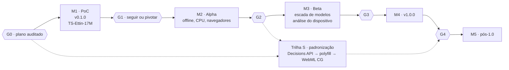
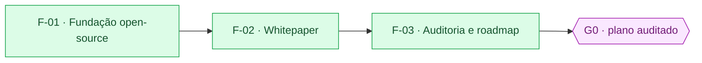
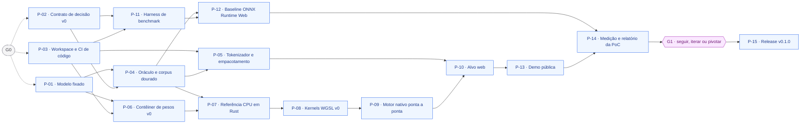
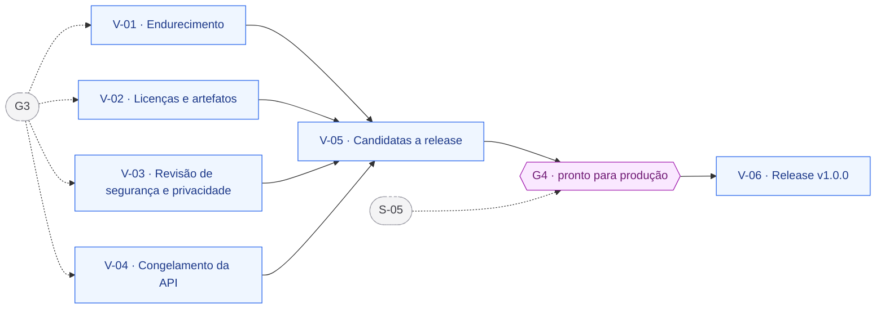
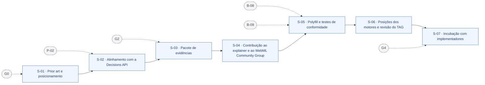

# Roadmap — SOM WebCore

> **Revisão de 2026-11-21.** Este documento é a fonte da verdade do planejamento e substitui o roadmap por semanas que existia na seção 8 do README.
> As atividades formam um **grafo acíclico dirigido (DAG)**: cada uma declara de quais depende, o que entrega e como se prova que terminou.
> As tabelas são a fonte; os grafos Mermaid, as ondas de execução e o caminho crítico são **gerados** por `python3 scripts/roadmap.py render` e validados na CI.

**Atalhos:** [Valor](#valor) · [Como ler](#como-ler) · [Marcos](#marcos) · [O que mudou no plano](#correcoes) · [M0](#m0) · [M1 — PoC](#m1) · [M2 — Alpha](#m2) · [M3 — Beta](#m3) · [M4 — v1.0.0](#m4) · [Trilha S — Padronização](#trilha-s) · [M5](#m5) · [Critérios globais](#dod) · [Riscos](#riscos-do-plano) · [Fora do roadmap](#fora) · [Manutenção](#manutencao)

Documentos irmãos: [metodologia](docs/METHODOLOGY.md) · [estrutura do repositório](docs/STRUCTURE.md) · [como contribuir](CONTRIBUTING.md) · [governança](GOVERNANCE.md) · [errata da pesquisa](research/ERRATA.md).

---

## 1. Para que existimos

**Decidir é uma primitiva da web — e deve ser tão fácil quanto `fetch`.**

O SOM WebCore existe para provar, com software aberto e medições reproduzíveis, que decisões tipadas em passada única (`choice`, `score`, `noul`) rodam no dispositivo de quem navega — e para usar essa prova como argumento para que a capacidade passe a vir embutida em **todo motor de navegador**, acessível a **todo programador**.

O sucesso deste projeto é medido pela sua **dispensabilidade**: no dia em que `if (await decide(...))` funcionar nativamente em Chromium, WebKit e Gecko, a biblioteca vira um polyfill fino — e teremos cumprido a missão.

| Valor | O que significa na prática |
|---|---|
| **Padrão antes de produto** | Toda superfície pública é desenhada como candidata a padrão: pequena, tipada, detectável e com forma de polyfill. Nada na API prende alguém ao nosso motor ou ao nosso formato. |
| **Para todo programador** | Um import, uma chamada, resposta tipada, padrões sensatos. Dispositivo, modelo e backend ficam escondidos — mas inspecionáveis. |
| **Para todo dispositivo** | Do celular de entrada ao desktop com GPU dedicada, com degradação explícita e honesta — nunca silenciosa. |
| **Evidência antes de afirmação** | Todo número é rotulado como medido, reportado, alvo ou hipótese. Erros de pesquisa viram errata pública, não rodapé. |
| **Privacidade por construção** | O estado do usuário não sai do dispositivo. Sem telemetria. Rede só para baixar pesos, e isso é visível. |
| **Abertura real** | Apache-2.0, governança pública, catálogo de modelos com licença declarada, neutralidade em relação a fornecedores. |

**Não estamos sozinhos — e isso muda o nosso papel.** Desde 30 de setembro de 2026 existe um explainer público da **Decisions API** (`window.DecisionModel`), escrito pelo time de Built-in AI do Chrome: perguntas tipadas `boolean`, `choice` e `score`, respondidas em passada única, com probabilidades por opção — a mesma tríade do JEV. Há um protótipo em Chromium e uma prévia no Edge Canary, atrás de flag. É um rascunho inicial: não está aprovado para lançamento, não tem posição de WebKit nem de Mozilla, e trata pesos fornecidos pelo desenvolvedor como não-objetivo (fontes e datas em [research/ERRATA.md](research/ERRATA.md#decisions-api)).

Portanto não vamos propor um padrão concorrente. O nosso papel é fazer esse padrão **dar certo em toda parte**:

- **Polyfill hoje.** A mesma superfície de API funcionando em Safari, Firefox e em qualquer dispositivo onde o modelo embutido não exista ou não caiba — e delegando para o nativo onde ele existir.
- **Evidência.** Medições públicas de que encoders compactos (17M a 150M) entregam essas decisões em hardware modesto, o que o explainer ainda lista como pergunta em aberto.
- **Conformidade.** Vetores de teste neutros, para que “decidir” signifique a mesma coisa em qualquer motor.
- **Abertura.** Catálogo de modelos com licença declarada e a possibilidade de trazer o próprio modelo — o que a API nativa, por desenho, não oferece.

**Por que isso precisa virar padrão, e não só biblioteca.** Uma biblioteca resolve o problema de um site; só o navegador resolve o da web:

1. **Download duplicado.** O armazenamento do navegador é particionado por origem: cada site que usa o mesmo modelo baixa a sua própria cópia. Só o navegador pode guardar um modelo uma vez para todas as origens.
2. **Aceleradores fora de alcance.** NPUs e caminhos nativos de ML não estão expostos à WebGPU; o navegador pode usá-los.
3. **Energia e calor.** A página não vê temperatura nem bateria; o navegador vê e pode agendar.
4. **Custo de entrada.** Uma API nativa elimina o bundle, o Worker, o cache e a escolha de modelo — o programador só decide.

---

## 2. Como ler este roadmap

- **Atividade** = um nó do DAG. Tem um ID estável, dependências, um entregável e um critério de aceite verificável. Nenhuma atividade começa antes de todas as suas dependências estarem feitas.
- **Portão** (`G0`…`G4`) = um nó de decisão no fim de cada marco. Fecha-se com evidência contra uma lista de critérios e fica registrado numa ADR. Um portão pode mandar **seguir**, **iterar** ou **pivotar**.
- **Prefixos:** `F` fundação · `P` prova de conceito · `A` alpha · `B` beta · `V` v1.0.0 · `S` padronização · `X` pós-1.0.
- **Tamanho** (esforço ideal de uma pessoa): `S` até 2 dias · `M` até 1 semana · `L` até 3 semanas · `XL` mais que isso — tem de ser dividida antes de começar. Tamanho não é prazo: o projeto tem um mantenedor e não promete datas.
- **Estado:** `feito` · `em curso` · `a fazer`.
- **Rótulos de evidência** (definidos na [metodologia](docs/METHODOLOGY.md#rotulos)): **[MEDIDO]** por este projeto, com relatório · **[REPORTADO]** por terceiros, com fonte e data · **[ALVO]** que queremos atingir · **[HIPÓTESE]** ainda sem dados.
- **Tolerâncias de paridade** usam “erro absoluto de probabilidade” (`Δp`): a maior diferença, em módulo, entre a probabilidade de uma opção no nosso motor e na implementação de referência.

**Números do grafo (gerado):**

<!-- dag:begin:critical -->
- **Nós:** 62 (4 feitos) · **arestas:** 94.
- **Esforço relativo:** 19/254 pontos concluídos (S=1, M=3, L=8, XL=13; portões=0).
- **Caminho crítico até o último portão** (111 pontos): `F-01` → `F-02` → `F-03` → `G0` → `P-02` → `P-04` → `P-07` → `P-08` → `P-09` → `P-10` → `P-13` → `P-14` → `G1` → `A-03` → `A-05` → `A-10` → `G2` → `B-01` → `B-02` → `B-07` → `B-08` → `B-09` → `G3` → `V-01` → `V-05` → `G4`.
<!-- dag:end:critical -->

---

## 3. Visão geral dos marcos

| Marco | Versão | Pergunta que responde | Resultado para quem usa | Portão |
|---|---|---|---|---|
| **M0 — Fundação e auditoria** | documentação | O plano e a pesquisa estão corretos? | Whitepaper, errata e este roadmap | `G0` |
| **M1 — Prova de conceito** | `v0.1.0` | Um motor próprio decide certo, no navegador, com um modelo de 17M — e vale a pena frente ao que já existe? | Demo pública: uma decisão local, verificada contra a referência | `G1` |
| **M2 — Alpha** | `v0.2`–`v0.4` | Funciona offline, sem WebGPU e nos três motores de navegador? | Pacote npm alpha, cache OPFS, fallback CPU | `G2` |
| **M3 — Beta** | `v0.5`–`v0.9` | O SDK escolhe sozinho o melhor modelo para cada máquina? | Escada de modelos, análise do dispositivo, API candidata | `G3` |
| **M4 — v1.0.0** | `v1.0.0` | É estável, auditado e pronto para produção? | API estável com SemVer, catálogo auditado | `G4` |
| **Trilha S — Padronização** | contínua | A decisão local chega a todos os motores? | Alinhamento com a Decisions API, polyfill, evidências e testes | — |
| **M5 — Pós-1.0** | `v1.x` | Para onde cresce? | WebNN, multilíngue, multimodal, SDKs nativos | — |

---

## 4. O que esta revisão corrigiu no plano

A auditoria de 2026-11-21 conferiu os dois relatórios de pesquisa e o README contra fontes primárias (`config.json` e cartões dos modelos no Hugging Face, código de referência, documentação de APIs, repositórios e artigos citados). O detalhe, com fonte por item, está em [research/ERRATA.md](research/ERRATA.md). O que mudou no **plano**:

| # | O plano dizia | O que é verdade | Consequência no roadmap |
|---:|---|---|---|
| 1 | Começar por Ettin-150M, com formato binário, quantização Q8 e seis shaders fundidos ao mesmo tempo | Isso acumula cinco riscos novos antes da primeira passada correta | **PoC com TS-Ettin-17M**, kernels simples em f32, um risco de cada vez (`P-07` → `P-08` → `P-09`) |
| 2 | “Ettin-17M” como modelo semente | `jhu-clsp/ettin-encoder-17m` é só um encoder MLM; não decide nada | A semente é um **checkpoint de decisão**: `typestrict/TS-Ettin-17M` (Apache-2.0) — `P-01` |
| 3 | RoPE local com θ = 10.000 em toda a família | Só ModernBERT-base/large usa 10.000; **Ettin e mmBERT usam 160.000** nas camadas locais | θ vem sempre do manifesto do checkpoint; teste de paridade por camada (`P-07`) |
| 4 | Máscara bloco-diagonal e reset de posições para todos os modelos | É específico do Von (`independent_options`); TS-Ettin e Crivo usam atenção conjunta sobre as opções | A máscara é uma opção por modelo, desligada na PoC |
| 5 | Calibração, softmax e confiança dentro do shader | Cada família calibra de um jeito; ler K vetores de volta custa o mesmo que ler 64 bytes | **Cabeça e calibração no host** na PoC; versão in-shader só se medir ganho (`B-03`) |
| 6 | Cabeçalho `.sombin` de “256 bytes exatos” | O struct tem **264 bytes** em `repr(C)` (512 com `align(256)`) e não aceita `Pod` | Contêiner v0 mínimo na PoC (`P-06`); formato v1 por RFC, com offsets explícitos (`A-06`) |
| 7 | Tokenizador não aparece no plano | Sem IDs idênticos aos da referência, nenhuma paridade é possível | Atividade própria, com teste de identidade (`P-05`) |
| 8 | “Primeiro runtime aberto de decisão tipada no navegador” | `crivo-web` (npm, ONNX Runtime Web, Wasm e WebGPU) já faz `choice`/`noul`/`score` no navegador | O diferencial tem de ser **medido contra esse baseline** (`P-12`, `G1`); se não houver ganho, pivotamos |
| 9 | Catálogo priorizava Laya, Von e d1-omni-600M | No Decision Index 0.4 (2026-11-21) esses três pontuam como modelos de 17M; a família Ettin cobre 17M → 1B com **uma só arquitetura** | Escada de modelos sobre a família Ettin (`B-01`); d1-omni fica como trilha multimodal pós-1.0 |
| 10 | v0.1.0 em 12 semanas, incluindo matriz mobile | Um mantenedor, nenhum código | Marcos por portão, sem datas; mobile entra no alpha (`A-05`) |
| 11 | Nomes de API do wgpu de 2025 (`PUSH_CONSTANTS`, `SPIRV_SHADER_PASSTHROUGH`) | O wgpu está na versão 30 e renomeou esses recursos (`IMMEDIATES`, shaders em passthrough) | Fixar a versão e validar o blueprint contra ela (`P-03`) |
| 12 | Nada sobre análise do dispositivo | É o requisito central da v1.0.0 | Sonda, microbenchmark, catálogo e seletor de tier (`B-04`–`B-07`) |
| 13 | “Propor uma API de decisão ao W3C”, como se nada existisse | Já existe o explainer da Decisions API (time de Built-in AI do Chrome), com protótipo em Chromium e prévia no Edge Canary | A trilha S **alinha-se e contribui** com essa proposta; o SDK tem forma de polyfill dela (`S-02`, `S-05`) |
| 14 | “Probabilidades calibradas” como propriedade do runtime | Calibração é propriedade do **modelo**; o TS-Ettin-17M é publicado sem calibração | O runtime aplica fielmente a calibração do checkpoint; o catálogo declara o estado de calibração de cada modelo (`B-06`) |
| 15 | WebGPU “ativa por padrão no iOS 18.2” e disponível em “Chrome 121+ no Android” | No Safari, só a partir da versão 26, nos sistemas 26; no Chromium, depende do sistema e do fabricante da GPU | Detecção de recurso sempre; matriz de navegadores com hardware real (`A-05`) |

---

## 5. Marco M0 — Fundação e auditoria

| ID | Atividade | Depende de | Entregável | Critério de aceite | Tam. | Estado |
|---|---|---|---|---|:---:|---|
| `F-01` | **Fundação open-source** — licença, governança como código e CI de documentação | — | `LICENSE`, `SECURITY.md`, rulesets, `scripts/check-docs.py` | CI `build` verde; `main` só recebe PR com squash merge | M | feito |
| `F-02` | **Whitepaper** — README que consolida os dois relatórios de pesquisa | `F-01` | `README.md`, `docs/figures/` | contrato de documentação sem erros; divergências entre os relatórios registradas | L | feito |
| `F-03` | **Auditoria e roadmap** — pesquisa conferida em fontes primárias; DAG, metodologia, estrutura e contribuição definidas | `F-02` | `ROADMAP.md`, `research/ERRATA.md`, `docs/METHODOLOGY.md`, `docs/STRUCTURE.md`, `GOVERNANCE.md` | `scripts/roadmap.py check` verde; cada correção com fonte primária e data | L | feito |
| `G0` | **Portão G0** — plano auditado | `F-03` | este roadmap em `main` | critérios de [G0](#g0) | — | feito |

<!-- dag:begin:M0 -->

**Ondas de execução** (atividades da mesma onda não dependem entre si):

1. `F-01`
2. `F-02`
3. `F-03`
4. `G0`
<!-- dag:end:M0 -->

**Critérios do portão G0** — todos cumpridos nesta revisão:

- [x] Os dois relatórios foram conferidos contra fontes primárias e os erros estão em [research/ERRATA.md](research/ERRATA.md), com marcação no próprio texto dos relatórios.
- [x] O README não contém afirmação conhecida como falsa; o que não pôde ser verificado está rotulado.
- [x] Existe um modelo leve, com licença permissiva e implementação de referência, para a prova de conceito.
- [x] O roadmap é um DAG válido, com critério de aceite por atividade e por portão.

---

## 6. Marco M1 — Prova de conceito (`v0.1.0`)

**Objetivo.** Uma página estática, no Chrome de desktop, carrega um modelo de 17M de parâmetros e responde `choice`, `noul` e `score` **com as mesmas probabilidades da implementação de referência**, sem rede no caminho da decisão — e com medições lado a lado contra o ONNX Runtime Web rodando o mesmo modelo.

A PoC existe para responder a uma pergunta de engenharia, não para impressionar: *vale a pena manter um motor próprio?*

### 6.1 O modelo da PoC

| Campo | Valor | Fonte |
|---|---|---|
| Checkpoint | [`typestrict/TS-Ettin-17M`](https://huggingface.co/typestrict/TS-Ettin-17M), revisão `026af312e41d24a1126f8d927bb6314fc2d5f592` | Hugging Face, 2026-11-21 |
| Licença | Apache-2.0 (base: `cross-encoder/ettin-reranker-17m-v1`, Apache-2.0; encoder original `jhu-clsp/ettin-encoder-17m`, MIT) | cartões dos modelos |
| Arquitetura | ModernBERT/Ettin: 7 camadas, `H = 256`, `I = 384` (GeGLU), 4 cabeças de 64; camadas globais 0, 3 e 6; janela local 128; RoPE θ = 160.000 em todas as camadas | `config.json` |
| Vocabulário | 50.369 tokens (50.368 do Ettin + `[OPT]`, id 50368) | `config.json` |
| Parâmetros | ≈ 16,9M — dos quais ≈ 12,9M (76%) são a tabela de embeddings; o backbone tem ≈ 3,9M | `model.safetensors` (67.484.624 bytes em FP32) |
| Sequência | `[CLS] instruções [SEP] estado [SEP] [OPT] opção₁ [OPT] opção₂ …` | `dinah.py` |
| Cabeça | embedding do tipo de pergunta → em cada `[OPT]`: `LayerNorm → Linear → GELU → Linear → logit` | `dinah.py` |
| Calibração | temperatura por (tipo, número de opções 2–9) + confiança por MLP de 7 características + Platt; **hoje em valores-identidade** (o cartão avisa que a confiança ainda não é calibrada) | `config.json`, cartão |
| Qualidade | acurácia 0,529 (PyTorch) / 0,533 (ONNX int8) em decisões tipadas reservadas; índice público 15,76 no Decision Index 0.3 **[REPORTADO pelo autor]** | cartão |
| Arquivos de referência | `model.safetensors` (SHA-256 `c6a6876a8e7ad234454a7fe6ad44f5935c553f90968b828446ab6d4dddf57a76`), `onnx/model_int8.onnx` (17,2 MB), `dinah.py` | Hugging Face |

O modelo é fraco em qualidade — o próprio cartão diz que a menor base precisa de treino nos dados de quem usa. Isso é aceitável: a PoC prova o **runtime**, e o runtime só responde por **paridade** com a referência, não pela inteligência do checkpoint.

**Ponto de partida medido por terceiros [REPORTADO].** O projeto `crivo-web` publicou medições de um modelo com a mesma arquitetura (Crivo-17M) no ONNX Runtime Web 1.30.0, num Apple M4 com Chromium 154: **12,6 ms** de mediana em WebGPU/FP32 e **57,1 ms** em Wasm/FP32 de uma thread, por requisição de três perguntas; preparação da sessão a partir do cache em ≈ 0,2 s. É contra esse tipo de número que a PoC se mede.

### 6.2 Decisões de arquitetura da PoC

Cada decisão abaixo vira uma ADR em `docs/adr/` quando a atividade correspondente começar.

1. **Um risco de cada vez.** A ordem é: oráculo → referência CPU em Rust → kernels WGSL → motor nativo → navegador. Cada etapa só começa quando a anterior tem paridade.
2. **Pesos em FP16, aritmética em f32.** Os pesos são decodificados com `unpack2x16float`, que é WGSL core; a PoC não exige `shader-f16`. Nenhuma quantização de ativações.
3. **Kernels simples primeiro.** GEMM direto e atenção com a matriz de scores materializada (com `S ≤ 1.024` e 4 cabeças, são no máximo 16 MiB). Fusão de operadores, tiling, FlashAttention-2, `subgroups` e `dot4I8Packed` ficam para `B-03`, uma otimização por PR.
4. **Cabeça e calibração no host.** A GPU devolve os vetores ocultos nas posições `[OPT]` (`K × 256 × 4` bytes — 8 KiB para 8 opções). Softmax, temperatura e confiança rodam em Rust/Wasm, onde a calibração de cada família é testável. O readback continua micro.
5. **Sem slabs.** O backbone de 17M cabe em um buffer de ≈ 8 MB. Slabs e dynamic offsets entram em `B-02`, quando o degrau de 150M precisar.
6. **Embeddings no host.** A tabela fica na CPU; só as `S` linhas ativas sobem para a GPU.
7. **Contêiner v0 mínimo.** Preâmbulo, manifesto JSON e tensores alinhados. A especificação v1 só congela depois da PoC (`A-06`).
8. **Baseline obrigatório.** Nenhuma afirmação de desempenho sem a medição equivalente no ONNX Runtime Web, na mesma máquina.
9. **Rust + wgpu, com portão.** O mesmo motor roda nativo — o que permite testes de paridade na CI sem navegador — e em `wasm32`. Os kernels vivem em `shaders/` como WGSL puro: se `G1` mostrar que o caminho wgpu → web custa caro demais, o orquestrador web pode ser reescrito em TypeScript sem tocar nos kernels.
10. **Tokenizador upstream.** Usa-se a implementação de referência com teste de identidade de IDs; uma versão enxuta só entra com 100% de paridade.

**Fora do escopo da PoC:** cache OPFS, fallback CPU, Safari, Firefox e mobile, quantização int8, modelos acima de 17M, seleção automática, pacote npm, otimizações de kernel.

### 6.3 Atividades

| ID | Atividade | Depende de | Entregável | Critério de aceite | Tam. | Estado |
|---|---|---|---|---|:---:|---|
| `P-01` | **Modelo fixado** — fixar o TS-Ettin-17M por revisão e hash; registrar licença e atribuição | `G0` | `models/catalog.json` (uma entrada), `tools/fetch_model.py` | download verificado por SHA-256; licença e atribuição no `NOTICE`; a entrada valida contra o esquema do catálogo | S | a fazer |
| `P-02` | **Contrato de decisão v0** — RFC-0001: tipos de `choice`, `noul` e `score`, renderização do estado, erros e limites | `G0` | `docs/rfcs/0001-decision-contract.md`, crate `som-contract`, JSON Schema | o esquema valida as requisições e respostas do corpus; mapeamento documentado para a superfície `DecisionModel` do explainer da Decisions API, para o formato `decision-ai/option-reader@1` e para a API `/v1/systemone`; RFC aceita | M | a fazer |
| `P-03` | **Workspace e CI de código** — Cargo workspace, pacote TypeScript, toolchains fixadas, finais de linha normalizados | `G0` | `Cargo.toml`, `crates/`, `packages/core`, jobs de CI | `cargo fmt`, `clippy -D warnings` e `cargo test` verdes em Linux, macOS e Windows; build `wasm32-unknown-unknown` verde; `naga` valida todo WGSL; versão do wgpu fixada; o job obrigatório continua a se chamar `build` | M | a fazer |
| `P-04` | **Oráculo e corpus dourado** — rodar a referência upstream (PyTorch FP32, CPU) e exportar ativações por camada, logits e respostas | `P-01`, `P-02` | `tools/reference/`, `tests/fixtures/ts-ettin-17m/` | ≥ 300 requisições (choice com 2–16 opções, noul, score com 3–10 níveis, 8–1.024 tokens, texto em pt-BR e Unicode); duas execuções geram fixtures idênticas; comando único documentado | M | a fazer |
| `P-05` | **Tokenizador e empacotamento** — BPE do Ettin, token `[OPT]` e montagem da sequência | `P-03`, `P-04` | crate `som-tokenizer` | IDs idênticos aos da referência em ≥ 10.000 textos (100%); posições `[OPT]` idênticas às das fixtures; erro tipado acima do limite de tokens — nada é truncado | M | a fazer |
| `P-06` | **Contêiner de pesos v0** — conversor de `safetensors` para `.sombin` v0 (FP16) e leitor | `P-01`, `P-03` | `tools/convert/`, crate `som-format` (v0) | ida e volta de todos os tensores (FP32 exato; FP16 com erro de arredondamento ≤ 1 ULP); teste dourado com offsets explícitos em little-endian; arquivo truncado ou com assinatura errada é rejeitado | M | a fazer |
| `P-07` | **Referência CPU em Rust** — passada completa em f32, sem GPU: embeddings, normas, atenção global e local, GeGLU, cabeça, calibração e confiança | `P-04`, `P-06` | crate `som-ref` | erro máximo por camada ≤ 1e-4 e `Δp` ≤ 1e-5 contra o oráculo (pesos FP32); top-1 idêntico em 100% do corpus; compila para nativo e `wasm32` | L | a fazer |
| `P-08` | **Kernels WGSL v0** — normalização, GEMM, atenção com RoPE e janela local, GeGLU, residual e coleta dos `[OPT]` | `P-07` | `shaders/*.wgsl` e um teste de paridade por kernel | cada kernel com erro ≤ 1e-4 contra `som-ref`; aprovado em ≥ 2 backends nativos e num adaptador de software na CI; usa só WebGPU core | L | a fazer |
| `P-09` | **Motor nativo ponta a ponta** — device, buffers pré-alocados, pipelines, agendamento por camada, readback e CLI | `P-08` | crates `som-core` e `som-cli` | `Δp` ≤ 1e-4 contra `som-ref` em todo o corpus; nenhum buffer ou bind group criado por decisão depois do aquecimento; 100 execuções repetidas idênticas bit a bit no mesmo dispositivo | M | a fazer |
| `P-10` | **Alvo web** — `wasm32` + WebGPU em Web Worker; API mínima `load()` e `decide()` | `P-05`, `P-09` | crate `som-web`, `packages/core` (mínimo) | `Δp` ≤ 1e-3 contra a referência no Chrome estável; decisões não bloqueiam a thread principal; teste automatizado em navegador na CI | M | a fazer |
| `P-11` | **Harness de benchmark** — protocolo, página de medição e esquema de relatório | `P-02`, `P-03` | `bench/harness/`, `bench/schema/report.schema.json` | mede arranque frio, latência quente (p50, p95 e p99 com N ≥ 200), tamanho do bundle, memória e pior frame; coeficiente de variação do p50 ≤ 10% entre execuções; relatórios validam contra o esquema | M | a fazer |
| `P-12` | **Baseline ONNX Runtime Web** — o mesmo checkpoint em ORT Web (Wasm e WebGPU), sob o mesmo protocolo | `P-04`, `P-11` | `bench/baseline-ort/` | reproduz as probabilidades da referência (`Δp` ≤ 1e-3 em FP32), exportando um ONNX de operadores padrão se o grafo publicado não rodar em WebGPU; relatório no esquema, com versões fixadas | M | a fazer |
| `P-13` | **Demo pública** — página estática com editor de estado, pergunta e opções | `P-10` | `examples/decision-demo/` (GitHub Pages) | zero requisições de rede durante `decide()`, verificado por teste; pesos conferidos por hash; avisos de privacidade e de licença do modelo | S | a fazer |
| `P-14` | **Medição e relatório da PoC** — motor e baseline em ≥ 3 máquinas reais (D3D12, Metal e Vulkan) | `P-12`, `P-13` | `docs/reports/poc-v0.1.0.md`, `bench/results/*.json` | dados brutos publicados, ambiente declarado, todo número rotulado; conclusão explícita contra cada critério de G1 | M | a fazer |
| `G1` | **Portão G1** — seguir, iterar ou pivotar | `P-14` | ADR com a decisão | critérios de [G1](#g1) | — | a fazer |
| `P-15` | **Release v0.1.0** — primeira tag do runtime | `G1` | tag `v0.1.0`, notas de release, demo publicada | gate de release verde; changelog gerado; estado do README atualizado | S | a fazer |

<!-- dag:begin:M1 -->

**Ondas de execução** (atividades da mesma onda não dependem entre si):

1. `P-01` · `P-02` · `P-03`
2. `P-04` · `P-06` · `P-11`
3. `P-05` · `P-07` · `P-12`
4. `P-08`
5. `P-09`
6. `P-10`
7. `P-13`
8. `P-14`
9. `G1`
10. `P-15`
<!-- dag:end:M1 -->

### 6.4 Portão G1 — critérios de aceite da PoC

**Funcionais**

- [ ] `choice`, `noul` e `score` com TS-Ettin-17M, de 2 a 16 opções, em sequências de até 1.024 tokens, no Chrome estável de desktop com WebGPU.
- [ ] **Paridade:** no corpus dourado (≥ 300 requisições), `Δp` ≤ 1e-3; top-1 idêntico em 100% dos casos em que a margem da referência é ≥ 0,01; diferença do valor esperado de `score` ≤ 0,01; diferença de confiança ≤ 1e-3.
- [ ] **Local:** nenhuma requisição de rede durante `decide()`; pesos conferidos por SHA-256 antes do uso.

**Desempenho — sempre contra o baseline, na mesma máquina, com o mesmo modelo e corpus**

- [ ] Relatório com p50, p95 e p99 de latência quente, arranque frio, tamanho do bundle e memória, para o motor e para o ONNX Runtime Web, em ≥ 3 máquinas.
- [ ] **Seguir** se: latência quente p50 ≤ 2× a do baseline em WebGPU/FP32 **e** pelo menos uma vantagem estrutural medida — bundle (JS + Wasm, comprimido) ≤ 50% do baseline **ou** tempo até a primeira decisão, com pesos em cache, ≤ o do baseline.
- [ ] **Iterar** (uma rodada de otimização de até 2 semanas, depois reavaliar) se o p50 ficar entre 2× e 4× o do baseline e o perfil apontar uma causa corrigível.
- [ ] **Pivotar** se a paridade não fechar ou se o p50 continuar acima de 2× depois da iteração: o projeto mantém contrato, catálogo, análise do dispositivo e trilha de padronização, e passa a usar um backend existente (ONNX Runtime Web ou WebNN) como motor. A decisão é registrada em ADR e o roadmap é refeito a partir de `G1`.

**Estabilidade e responsividade**

- [ ] 1.000 decisões consecutivas sem `device.lost`, sem crescimento de memória (heap JS e memória Wasm estáveis em ± 1 MiB depois do aquecimento) e sem criação de `GPUBuffer` ou bind group por decisão.
- [ ] Com o motor em Worker, o pior frame da página durante as decisões é ≤ 33 ms na máquina de referência.

**Engenharia**

- [ ] CI verde: formatação, lint sem avisos, testes nativos, build `wasm32`, validação de WGSL e contrato de documentação.
- [ ] Todo kernel tem teste de paridade; nenhum recurso opcional da WebGPU é exigido.
- [ ] Do clone à demo local em ≤ 15 minutos, seguindo apenas o README de `examples/decision-demo`; fixtures regeneráveis com um comando.
- [ ] Relatório da PoC publicado, com dados brutos e todos os números rotulados.

---

## 7. Marco M2 — Alpha (`v0.2`–`v0.4`): robusto e portátil

**Objetivo.** O mesmo modelo de 17M, agora em condições reais: funciona offline na segunda visita, tem fallback quando não há WebGPU, recupera-se de falhas e roda nos três motores de navegador. Sai um pacote npm alpha.

| ID | Atividade | Depende de | Entregável | Critério de aceite | Tam. | Estado |
|---|---|---|---|---|:---:|---|
| `A-01` | **Ciclo de vida no Worker** — fila, cancelamento por `AbortSignal`, `timeoutMs` e `dispose()` | `G1` | `packages/core` | 10.000 decisões sem crescimento de memória; cancelar libera os recursos; nenhuma tarefa longa (> 50 ms) na thread principal atribuível ao SDK | M | a fazer |
| `A-02` | **Cache OPFS e integridade** — download em blocos e retomável, hash incremental, nomes versionados, verificação de quota | `G1` | módulo de cache em `packages/core` e `som-web` | segunda visita com zero bytes de rede para pesos; download interrompido retoma; arquivo corrompido é detectado e refeito; quota insuficiente gera erro tipado; fallback para memória onde não houver OPFS | L | a fazer |
| `A-03` | **Fallback CPU** — caminho Wasm SIMD derivado de `som-ref`, com threads quando a página for `crossOriginIsolated` | `G1` | backend `wasm` em `som-web` | paridade ≤ 1e-4; seleção automática na ausência de WebGPU; mesmo contrato e mesmas respostas; latência medida e publicada — alvo inicial: p50 ≤ 150 ms (17M, 128 tokens, 1 thread, notebook de referência) | L | a fazer |
| `A-04` | **Recuperação de falhas** — `device.lost`, falta de memória e aba em segundo plano | `A-01`, `A-02` | taxonomia de erros implementada | perda de dispositivo forçada → decisão seguinte em ≤ 1 s, sem rede; testes de injeção de falha na CI | M | a fazer |
| `A-05` | **Matriz de navegadores** — Chrome e Edge (D3D12, Metal, Vulkan no Android), Safari e Firefox | `A-01`, `A-03` | `docs/reports/compat-matrix.md` | suíte de paridade aprovada em cada combinação suportada; o WGSL compila em Tint, Naga e WebKit; problemas conhecidos documentados por navegador | L | a fazer |
| `A-06` | **Formato `.sombin` v1** — RFC-0002: little-endian com offsets explícitos, manifesto, seções, hashing e política de versões; conversor em Rust | `G1` | `docs/spec/sombin.md`, crate `som-format` v1, `som-convert` | vetores de conformidade publicados; um leitor independente em Python aprova os vetores usando só a especificação; 1 h de fuzzing sem pânico | L | a fazer |
| `A-07` | **Quantização v1** — embeddings Q8 no host, backbone FP16 por padrão, int8 opcional | `A-06` | variantes no catálogo e ADR do orçamento de paridade | download do modelo de 17M ≤ 22 MB; int8 só entra se `Δp` ≤ 0,03 e top-1 ≥ 99% no corpus | M | a fazer |
| `A-08` | **SDK npm alpha** — pacote ESM tipado, estratégia de Worker para bundlers e exemplos | `A-01`, `A-02`, `A-03` | pacote com a tag `alpha`, `examples/` (vanilla e React) | início rápido de até 10 linhas funciona em Vite, webpack e Next (cliente); orçamento de bundle verificado na CI; publicação com proveniência | M | a fazer |
| `A-09` | **Modelo de ameaças** — integridade do modelo, CSP e cadeia de suprimentos | `A-02`, `A-08` | `docs/guides/security.md`, `deny.toml` | auditoria de dependências Rust e npm na CI; guia de CSP, COOP e COEP; `SECURITY.md` revisto | M | a fazer |
| `A-10` | **Relatório alpha** — matriz de compatibilidade e de benchmark | `A-04`, `A-05`, `A-07`, `A-09` | `docs/reports/alpha.md`, `bench/results/` | ≥ 6 combinações de dispositivo e navegador com dados brutos; nenhum bug P0 aberto | M | a fazer |
| `G2` | **Portão G2** — pronto para crescer | `A-10` | ADR com a decisão | critérios de [G2](#g2) | — | a fazer |

<!-- dag:begin:M2 -->

**Ondas de execução** (atividades da mesma onda não dependem entre si):

1. `A-01` · `A-02` · `A-03` · `A-06`
2. `A-04` · `A-05` · `A-08` · `A-07`
3. `A-09`
4. `A-10`
5. `G2`
<!-- dag:end:M2 -->

**Critérios do portão G2**

- [ ] Paridade aprovada em Chromium (Windows, macOS e Android), WebKit (macOS e iOS) e Gecko (onde a WebGPU estiver ativa por padrão); onde não houver WebGPU, o fallback CPU passa na mesma suíte.
- [ ] Segunda visita em modo avião: a primeira decisão sai sem nenhum byte de rede.
- [ ] `device.lost` forçado: a decisão seguinte sai em ≤ 1 s, sem novo download.
- [ ] Download do modelo de 17M ≤ 22 MB; pesos nunca materializados inteiros na memória linear do Wasm.
- [ ] Pacote npm alpha instalável; início rápido de até 10 linhas; orçamento de bundle na CI.
- [ ] ≥ 6 combinações na matriz de benchmark, com dados brutos; modelo de ameaças publicado; nenhum bug P0 aberto.

---

## 8. Marco M3 — Beta (`v0.5`–`v0.9`): escada de modelos e análise do dispositivo

**Objetivo.** O SDK passa a **escolher sozinho** o modelo certo para cada máquina: carrega primeiro a semente de 17M, mede o dispositivo e, se couber no orçamento que o desenvolvedor declarou, baixa em segundo plano um modelo mais forte. É o que torna a v1.0.0 possível.

A escada usa a família Ettin porque ela cobre de 17M a 1B com **a mesma arquitetura** — os mesmos kernels servem todos os degraus. O desenho completo (sinais, microbenchmark, tiers, política de download e de licenças) está na [seção 4.5 do README](README.md#analise-dispositivo).

| ID | Atividade | Depende de | Entregável | Critério de aceite | Tam. | Estado |
|---|---|---|---|---|:---:|---|
| `B-01` | **Escada Ettin** — 32M, 68M e 150M com os mesmos kernels, parametrizados pelo manifesto | `G2` | entradas no catálogo e fixtures por degrau | paridade em cada degrau, com as tolerâncias de G1; nenhuma dimensão fixa no código dos shaders | L | a fazer |
| `B-02` | **Memória para modelos grandes** — negociação de limites, slabs com dynamic offsets e upload em streaming do OPFS para a GPU | `B-01` | gestor de memória em `som-core` | o modelo de 150M roda com os limites padrão da WebGPU (binding de 128 MiB); pico de memória linear do Wasm ≤ 32 MiB durante o carregamento; nenhuma alocação de GPU por decisão | L | a fazer |
| `B-03` | **Otimização guiada por medição** — fusão de operadores, GEMM em blocos, atenção sem matriz S×S, caminhos opcionais (`shader-f16`, `subgroups`, `dot4I8Packed`), submissão em blocos e calibração in-shader | `B-01` | um PR por otimização, com relatório antes e depois | paridade inalterada; ganho ≥ 10% no p50 em ≥ 2 classes de dispositivo — ou a mudança é revertida; nenhuma regressão acima de 5% | L | a fazer |
| `B-04` | **Sonda de capacidades** — `probe()` com sinais padrão da plataforma | `G2` | crate `som-device`, tipo `DeviceProfile` | responde em < 50 ms (p95), sem rede e sem download; campos documentados; nada é persistido fora da origem nem enviado | M | a fazer |
| `B-05` | **Microbenchmark e modelo de custo** — medir a semente e prever a latência de cada degrau | `B-01`, `B-04` | módulo de calibração em `som-device` | erro de predição do p50 ≤ 30% em ≥ 80% das combinações da matriz; custo total ≤ 300 ms, em tempo ocioso; resultado em cache por dispositivo e versão | M | a fazer |
| `B-06` | **Catálogo e registro de modelos** — esquema, hospedagem dos artefatos convertidos e política de licenças | `G2` | `models/catalog.json` com esquema; artefatos publicados | toda entrada com licença SPDX, revisão de origem, hashes, estado de calibração e fonte datada da métrica de qualidade; o filtro padrão só admite licenças permissivas; artefatos servidos com CORS e Range | M | a fazer |
| `B-07` | **Seletor de tier e upgrade progressivo** — escolher o degrau pelo orçamento declarado e pelo dispositivo; semente primeiro, upgrade em segundo plano | `B-02`, `B-05`, `B-06` | `SOM.recommend()` e `model: 'auto'` | escolha determinística para as mesmas entradas (tabela de ≥ 30 perfis em teste); nunca excede `maxDownloadMB`; respeita `saveData`; a troca de modelo não perde decisões em curso | L | a fazer |
| `B-08` | **API v1 candidata** — RFC-0003: superfície pública compatível com a Decisions API, eventos, erros e lote de perguntas | `B-07`, `S-04` | `docs/rfcs/0003-api-v1.md`, relatório de API | RFC aprovada após 14 dias de comentários; cada divergência em relação ao explainer vigente é justificada; relatório de API versionado; depois disso, mudança incompatível exige nova RFC | M | a fazer |
| `B-09` | **Suíte de conformidade** — vetores neutros de implementação e executor público | `B-01`, `B-08` | `conformance/` | o motor e o baseline ORT passam; tolerâncias documentadas; suíte versionada | M | a fazer |
| `B-10` | **Documentação e tradução** — site, guia, referência de API e versão em inglês | `B-08` | site de documentação | toda API pública tem exemplo executável; links verificados; pt-BR e inglês | M | a fazer |
| `B-11` | **Matriz pública e regressão contínua** — relatórios da comunidade e alarme de regressão | `B-03`, `B-07` | `bench/results/`, painel | ≥ 12 combinações, das quais ≥ 3 móveis; alarme a partir de 10% de regressão no p50 | M | a fazer |
| `G3` | **Portão G3** — candidato a 1.0 | `B-09`, `B-10`, `B-11` | ADR com a decisão | critérios de [G3](#g3) | — | a fazer |

<!-- dag:begin:M3 -->

**Ondas de execução** (atividades da mesma onda não dependem entre si):

1. `B-01` · `B-04` · `B-06`
2. `B-02` · `B-03` · `B-05`
3. `B-07`
4. `B-08` · `B-11`
5. `B-09` · `B-10`
6. `G3`
<!-- dag:end:M3 -->

**Critérios do portão G3**

- [ ] Degraus de 17M, 32M, 68M e 150M com paridade aprovada; o de 150M roda com os limites padrão da WebGPU.
- [ ] **Seleção automática:** em ≥ 90% das combinações da matriz, o degrau escolhido cumpre o orçamento de latência declarado (p95); o erro de predição do microbenchmark é ≤ 30% em ≥ 80% delas.
- [ ] O SDK nunca excede `maxDownloadMB`, respeita `saveData` e só seleciona modelos cuja licença a política do desenvolvedor admite.
- [ ] API v1 candidata aprovada por RFC, compatível com a Decisions API e já discutida com quem mantém o explainer; suíte de conformidade pública aprovada pelo motor e pelo baseline.
- [ ] ≥ 12 combinações na matriz pública, das quais ≥ 3 móveis; alarme de regressão ativo.
- [ ] Documentação em pt-BR e inglês.

---

## 9. Marco M4 — `v1.0.0`

**Objetivo.** Uma API estável, coberta por SemVer, que um site de produção pode adotar: `SOM.load({ model: 'auto' })` analisa o dispositivo, baixa a semente, recomenda e instala o melhor degrau, e responde com decisões cuja paridade e cujo desempenho estão publicados para a matriz de dispositivos.

| ID | Atividade | Depende de | Entregável | Critério de aceite | Tam. | Estado |
|---|---|---|---|---|:---:|---|
| `V-01` | **Endurecimento** — testes de 1 h, comportamento térmico, tetos de memória em mobile e fuzzing | `G3` | relatório de endurecimento | 1 h de decisões sem perda de dispositivo nem fuga de memória em Chromium, WebKit e Gecko; fuzzing do leitor de formato e do contrato sem falhas | L | a fazer |
| `V-02` | **Licenças e artefatos** — auditoria do catálogo, SBOM e builds reproduzíveis | `G3` | SBOM, `NOTICE` atualizado | cada modelo com a licença verificada na fonte; build reproduzível bit a bit; proveniência no npm | M | a fazer |
| `V-03` | **Revisão de segurança e privacidade** — revisão contra o modelo de ameaças | `G3` | relatório de revisão | nenhum achado de severidade alta em aberto; divulgação coordenada testada | M | a fazer |
| `V-04` | **Congelamento da API** — SemVer e política de depreciação | `G3` | `docs/spec/api-stability.md` | relatório de API congelado; política publicada | S | a fazer |
| `V-05` | **Candidatas a release** — `rc.N` e correções | `V-01`, `V-02`, `V-03`, `V-04` | tags `v1.0.0-rc.N` | duas semanas sem bug P0 ou P1 novo na última candidata | M | a fazer |
| `G4` | **Portão G4** — pronto para produção | `V-05`, `S-05` | ADR com a decisão | critérios de [G4](#g4) | — | a fazer |
| `V-06` | **Release v1.0.0** — versão estável | `G4` | tag `v1.0.0` | gate de release verde; release assinada; notas e guia de migração | S | a fazer |

<!-- dag:begin:M4 -->

**Ondas de execução** (atividades da mesma onda não dependem entre si):

1. `V-01` · `V-02` · `V-03` · `V-04`
2. `V-05`
3. `G4`
4. `V-06`
<!-- dag:end:M4 -->

**Critérios do portão G4 — aceite da v1.0.0**

*Produto*

- [ ] `SOM.load({ model: 'auto' })` cumpre o fluxo completo — sonda, semente, microbenchmark, recomendação, upgrade — nos três motores de navegador.
- [ ] Primeira decisão com a semente em ≤ 1,5 s num desktop com rede de 20 Mbit/s e cache frio **[ALVO]**; decisão quente com p95 ≤ 50 ms no degrau recomendado, em ≥ 90% da matriz **[ALVO]**.
- [ ] Fallback CPU funcional em todo navegador com Wasm SIMD; nenhum caminho depende de servidor.
- [ ] Modo `local-only` verificável: zero rede depois do carregamento.

*Qualidade*

- [ ] Suíte de conformidade aprovada em toda a matriz; paridade dentro das tolerâncias publicadas por variante de quantização.
- [ ] 1 h de decisões sem falha em cada motor; memória de pico dentro do orçamento do tier.
- [ ] Nenhum bug P0 ou P1 aberto; duas semanas de candidata a release sem regressão.

*Confiança*

- [ ] API coberta por SemVer, com política de depreciação.
- [ ] Catálogo auditado: licença, revisão de origem e hashes de cada modelo; SBOM; proveniência no npm; release assinada.
- [ ] Revisão de segurança e privacidade concluída, sem achado alto em aberto.

*Missão*

- [ ] O SDK funciona como polyfill da Decisions API na superfície vigente do explainer, e delega para a implementação nativa quando ela existir (`S-05`).
- [ ] Evidências e lacunas levadas ao repositório do explainer e ao W3C WebML Community Group (`S-04`).

---

## 10. Trilha S — Padronização

**Objetivo.** Fazer a decisão local chegar a todos os motores de navegador. Já existe uma proposta — o explainer da **Decisions API**, do time de Built-in AI do Chrome — e a trilha trabalha **a favor dela**: alinha a nossa API, leva evidência e testes, e mostra que a mesma superfície funciona hoje, como polyfill, onde o nativo ainda não chegou. A trilha corre em paralelo aos marcos e começa cedo: a conversa com quem escreve o padrão tem de acontecer **antes** de a nossa API congelar.

O caminho usual da plataforma web é: *explainer* → incubação num Community Group → revisão de design do TAG → interesse de implementadores → protótipo ou origin trial → trilha de recomendação. A Decisions API está no primeiro degrau, com protótipo em Chromium. As etapas de implementação não dependem de nós; o que depende — evidência, clareza, um polyfill que funcione e testes de conformidade — está no DAG.

| ID | Atividade | Depende de | Entregável | Critério de aceite | Tam. | Estado |
|---|---|---|---|---|:---:|---|
| `S-01` | **Prior art e posicionamento** — Decisions API (explainer e protótipos), WebNN, APIs de IA embutidas e Cross-Origin Storage | `G0` | `docs/standards/prior-art.md` | cada item com fonte primária e data; o papel do projeto frente a cada um cabe em uma frase | M | a fazer |
| `S-02` | **Alinhamento com a Decisions API** — tabela de equivalência entre o nosso contrato e `DecisionModel`, e lista de lacunas | `P-02`, `S-01` | `docs/standards/decisions-api-alignment.md` (em inglês) | cada membro da API do explainer está mapeado; cada divergência tem justificativa; o documento é revisto a cada mudança do explainer | M | a fazer |
| `S-03` | **Pacote de evidências** — medições em hardware modesto, paridade entre motores e integrações reais | `G2`, `S-02` | `docs/standards/evidence.md` | dados reproduzíveis nos três motores de navegador; ≥ 3 integrações reais descritas | M | a fazer |
| `S-04` | **Contribuição ao explainer e ao WebML Community Group** — levar evidências e lacunas ao repositório do explainer e ao grupo | `S-03` | issues e PRs públicos | contribuições abertas no repositório do explainer; tema levado ao WebML Community Group; feedback acompanhado em issues públicas | M | a fazer |
| `S-05` | **Polyfill e testes de conformidade** — expor `DecisionModel` onde o nativo não existir, delegar onde existir, e derivar testes no estilo web-platform-tests | `B-08`, `B-09`, `S-04` | ponto de entrada de polyfill no SDK, testes | o mesmo código de aplicação roda sobre o nativo e sobre o polyfill; testes executáveis contra ambos | M | a fazer |
| `S-06` | **Posições dos motores e revisão do TAG** — apoiar, com dados, os pedidos de posição de WebKit e Mozilla e a revisão de design | `S-05` | pedidos e comentários registrados | participação registrada e acompanhada em issue pública | S | a fazer |
| `S-07` | **Incubação com implementadores** — iterar com quem implementa; apoiar origin trial quando houver | `S-06`, `G4` | iterações e atas públicas | critério de saída definido pelo grupo — fora do controle do projeto | L | a fazer |

<!-- dag:begin:S -->

**Ondas de execução** (atividades da mesma onda não dependem entre si):

1. `S-01`
2. `S-02`
3. `S-03`
4. `S-04`
5. `S-05`
6. `S-06`
7. `S-07`
<!-- dag:end:S -->

---

## 11. Marco M5 — Pós-1.0

Direções, não compromissos. Cada uma só entra em execução com RFC própria.

| ID | Atividade | Depende de | Entregável | Critério de aceite | Tam. | Estado |
|---|---|---|---|---|:---:|---|
| `X-01` | **Backend WebNN** — NPUs e aceleradores nativos | `G4` | backend experimental | paridade e medição lado a lado com a WebGPU | L | a fazer |
| `X-02` | **Multilíngue** — degraus com vocabulário grande (mmBERT) e offload de 256 mil embeddings | `G4` | entradas no catálogo | paridade; download e memória dentro do tier | L | a fazer |
| `X-03` | **Multimodal** — tronco do d1-omni-600M (convolução curta e GQA) e torres de visão e áudio | `G4` | suporte à arquitetura LFM2 | paridade com a referência do modelo; licença compatível com a política do catálogo | XL | a fazer |
| `X-04` | **SDKs nativos** — o mesmo motor em aplicações nativas de desktop e mobile | `G4` | bindings | suíte de conformidade aprovada | L | a fazer |
| `X-05` | **Modelos próprios** — guia e ferramenta para converter e calibrar um modelo treinado por quem usa | `G4` | guia e CLI | um modelo de exemplo passa na suíte de conformidade | M | a fazer |

<!-- dag:begin:M5 -->

**Ondas de execução** (atividades da mesma onda não dependem entre si):

1. `X-01` · `X-02` · `X-03` · `X-04` · `X-05`
<!-- dag:end:M5 -->

---

## 12. Critérios de aceite globais

Valem para **toda** atividade, além do critério da própria linha. São a *Definition of Done* do projeto; a versão comentada está na [metodologia](docs/METHODOLOGY.md#dod).

1. **Entregável no lugar certo** — no caminho previsto em [docs/STRUCTURE.md](docs/STRUCTURE.md).
2. **Critério da atividade demonstrado** — por teste automatizado sempre que possível; quando for medição manual, com dados brutos versionados.
3. **Paridade preservada** — nenhuma mudança em caminho numérico entra sem a suíte de paridade verde.
4. **Desempenho com evidência** — quem alega ganho anexa o relatório antes e depois; quem toca em caminho quente mostra que não regrediu.
5. **Sem recurso opcional obrigatório** — o caminho base roda só com WebGPU core ou só com Wasm SIMD.
6. **Documentação junto** — o que muda comportamento público muda a documentação no mesmo PR; números novos saem rotulados.
7. **Decisão registrada** — escolha de arquitetura vira ADR; mudança de superfície pública ou de formato vira RFC.
8. **CI verde e revisão feita** — PR com título Convencional, checks verdes, squash merge.
9. **Roadmap atualizado** — o estado da atividade muda no mesmo PR que a conclui, e `scripts/roadmap.py render` é executado.

---

## 13. Riscos do plano e gatilhos de replanejamento

Os riscos técnicos do motor estão na [seção 7 do README](README.md#riscos). Aqui ficam os riscos do **plano**.

| # | Risco | Sinal de alerta | Resposta |
|---:|---|---|---|
| 1 | O motor próprio não supera o baseline | p50 acima de 2× o do ONNX Runtime Web em `P-14` | Portão `G1`: iterar uma vez; depois, pivotar para motor de terceiros, mantendo contrato, catálogo, tiers e padronização |
| 2 | A paridade não fecha em algum backend | `Δp` fora da tolerância só num driver ou navegador | Restringir a matriz suportada; cair para o fallback CPU nesse ambiente; registrar o problema conhecido |
| 3 | O modelo de referência some, muda ou troca de licença | repositório do checkpoint alterado | Revisão e hashes fixados; espelho permitido pela licença Apache-2.0; alternativas de mesma arquitetura no catálogo |
| 4 | Mantenedor único | atividades `L` paradas; PRs sem revisão | Atividades pequenas e paralelizáveis; decisões em ADR; recrutar revisores por área (ver [governança](GOVERNANCE.md)) |
| 5 | A plataforma muda sob os nossos pés | a Decisions API muda de forma ou é lançada; mudança na WebGPU ou no armazenamento partilhado | Trilha S acompanha o explainer; revisão trimestral deste roadmap; forma de polyfill desde a API v1 |
| 6 | Os degraus mais fortes só têm licença não comercial | 400M e 1B disponíveis apenas em CC BY-NC | Política de licenças no seletor; catálogo declara o uso permitido; `X-05` para pesos próprios |
| 7 | Cada site baixa a sua cópia do modelo | reclamações de consumo de dados e de disco | Semente pequena por padrão; limites de download; é o principal argumento da trilha S |
| 8 | Pesquisa assistida por IA com erros | afirmação sem fonte primária | Procedimento de verificação da [metodologia](docs/METHODOLOGY.md#pesquisa); errata pública |

**Gatilhos de replanejamento.** O roadmap é revisto — por PR, com ADR — quando um portão decide iterar ou pivotar, quando uma atividade `L` estoura em mais de 2× o seu tamanho, quando uma premissa da errata é derrubada por fonte primária nova, ou a cada três meses.

---

## 14. Fora do roadmap

- Geração de texto, chat, RAG ou agentes autônomos.
- Treino ou fine-tuning no navegador.
- Modelos acima de 1B de parâmetros no navegador.
- Substituir ONNX Runtime Web ou Transformers.js como motor genérico de qualquer arquitetura.
- WebGL2 como fallback.
- Envio de qualquer dado do usuário a servidores: o fallback remoto que o blueprint original cogitava saiu do escopo até a v1.0.0.
- Datas. O projeto promete critérios, não prazos.

---

## 15. Como manter este roadmap

1. **A tabela é a fonte.** Para criar, mudar ou concluir uma atividade, edite a linha dela. IDs nunca são reutilizados.
2. **Gere os blocos:** `python3 scripts/roadmap.py render` reescreve os grafos, as ondas e o caminho crítico.
3. **Valide:** `python3 scripts/roadmap.py check` (roda também dentro de `scripts/check-docs.py`, portanto na CI). O check falha com dependência inexistente, ciclo, ID duplicado, atividade feita com dependência pendente ou bloco gerado desatualizado.
4. **Uma issue por atividade**, com o ID no título (`[P-05] Tokenizador e empacotamento`) e o rótulo `dag`. Quem assume comenta na issue; ver [CONTRIBUTING.md](CONTRIBUTING.md#atividades).
5. **Mudar critério de portão exige ADR.** Critérios não se afrouxam para caber no resultado.
6. Exportar o grafo para outras ferramentas: `python3 scripts/roadmap.py json`.
