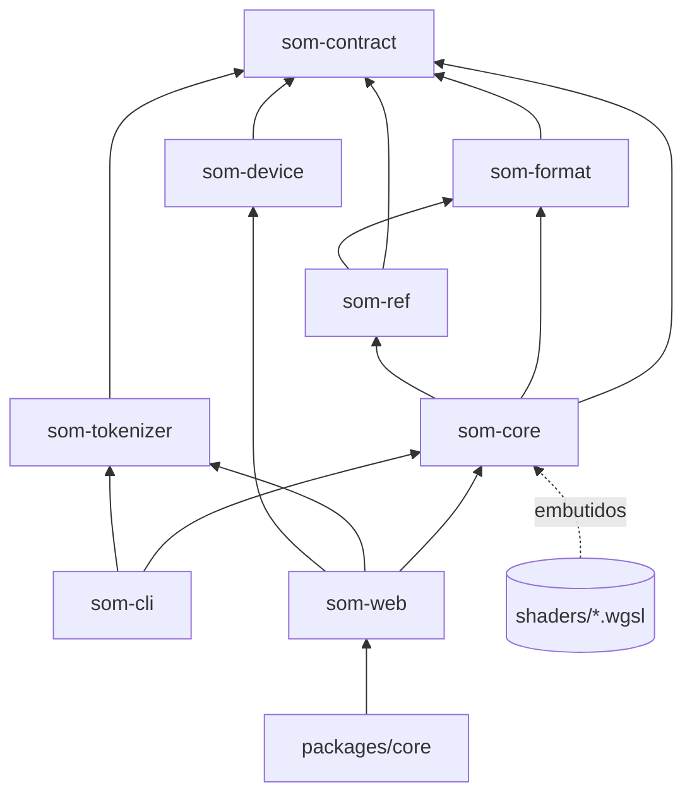

# Estrutura do repositório — SOM WebCore

> O mapa de onde cada coisa vive e por quê. Esta é a estrutura-**alvo**: os diretórios nascem junto com a atividade do [roadmap](../ROADMAP.md) que os preenche — nenhum é criado vazio.
> A coluna “Nasce em” diz qual atividade cria cada caminho. Hoje existe o que está marcado com ✅.

**Atalhos:** [Árvore](#arvore) · [Crates](#crates) · [Pacotes npm](#pacotes) · [Regras de dependência](#dependencias) · [Onde colocar cada coisa](#onde) · [Convenções de nomes](#nomes) · [O que não entra no git](#fora-do-git)

---

<a id="arvore"></a>
## 1. Árvore

```text
som-webcore/
│
├── README.md                    ✅ whitepaper: visão, arquitetura-alvo da v1.0.0, catálogo, riscos
├── ROADMAP.md                   ✅ planejamento em DAG, critérios de aceite, portões
├── CONTRIBUTING.md              ✅ como contribuir
├── GOVERNANCE.md                ✅ papéis e processo de decisão
├── CODE_OF_CONDUCT.md           ✅
├── SECURITY.md                  ✅ política de divulgação
├── CHANGELOG.md                 ✅ gerado a partir dos commits
├── LICENSE · NOTICE             ✅ Apache-2.0 e atribuições
├── CODEOWNERS                   ✅ donos por caminho
├── AGENTS.md · CLAUDE.md        ✅ contrato operacional para agentes de código
│
├── Cargo.toml · Cargo.lock          workspace Rust                                  P-03
├── rust-toolchain.toml              versão do Rust e alvo wasm32 fixados             P-03
├── deny.toml                        licenças e avisos de dependências Rust           A-09
├── package.json · pnpm-workspace.yaml · pnpm-lock.yaml   workspace JavaScript        P-03
│
├── crates/                          código Rust — ver seção 2
│   ├── som-contract/                tipos do contrato de decisão                     P-02
│   ├── som-format/                  leitor e escritor do .sombin e do manifesto      P-06 → A-06
│   ├── som-tokenizer/               tokenização e montagem da sequência              P-05
│   ├── som-ref/                     referência CPU em f32 (oráculo e fallback)       P-07
│   ├── som-core/                    motor: device, buffers, agendador, readback      P-09
│   ├── som-device/                  sonda, microbenchmark e seletor de tier          B-04
│   ├── som-convert/                 conversor de checkpoints em Rust                 A-06
│   ├── som-cli/                     CLI nativa: decide, bench, inspect               P-09
│   └── som-web/                     bindings wasm-bindgen (cdylib)                   P-10
│
├── shaders/                         kernels WGSL puros, um arquivo por kernel        P-08
│
├── packages/                        código TypeScript — ver seção 3
│   ├── core/                        SDK: API pública, Worker, cache, carregador      P-10 → A-08
│   └── react/                       hook opcional                                    A-08
│
├── models/
│   ├── catalog.json                 catálogo de modelos (uma entrada na PoC)         P-01 → B-06
│   └── schema/catalog.schema.json   esquema versionado do catálogo                   P-01
│
├── tools/                           ferramentas offline (Python)
│   ├── reference/                   roda a referência upstream e gera fixtures       P-04
│   ├── convert/                     conversor da PoC: safetensors → .sombin v0       P-06
│   └── fetch_model.py               baixa um modelo fixado e confere os hashes       P-01
│
├── tests/
│   ├── fixtures/                    vetores dourados pequenos, versionados           P-04
│   ├── parity/                      paridade ponta a ponta                           P-09
│   └── e2e/                         testes em navegador automatizado                 P-10
│
├── conformance/                     vetores e executor públicos, neutros de motor    B-09
│
├── bench/
│   ├── harness/                     página e scripts de medição                      P-11
│   ├── baseline-ort/                o mesmo modelo no ONNX Runtime Web               P-12
│   ├── schema/report.schema.json    formato dos relatórios                           P-11
│   └── results/                     relatórios JSON por dispositivo e data           P-14
│
├── examples/
│   ├── decision-demo/               demo estática publicada                          P-13
│   ├── vanilla/ · react/            integrações mínimas                              A-08
│
├── docs/
│   ├── METHODOLOGY.md               ✅ como decidimos, medimos e afirmamos
│   ├── STRUCTURE.md                 ✅ este arquivo
│   ├── adr/                         registros de decisão de arquitetura              P-01
│   ├── rfcs/                        propostas de superfície pública e de formato     P-02
│   ├── spec/                        especificações normativas, em inglês             A-06
│   ├── standards/                   explainer, prior art e evidências, em inglês     S-01
│   ├── reports/                     relatórios de marco e de portão                  P-14
│   ├── guides/                      guias de uso e de segurança                      A-09
│   ├── assets/                      ✅ banner e imagens da documentação
│   └── figures/                     ✅ figuras dos relatórios de pesquisa
│
├── research/                        ✅ fontes brutas da pesquisa — não normativas
│   ├── ERRATA.md                    ✅ auditoria: o que está errado e a correção
│   ├── 01-arquitetura-webgpu-wasm32.txt
│   └── 02-runtime-bare-metal-wgpu.txt
│
├── scripts/                         ✅ automação do repositório
│   ├── check-docs.py                ✅ contrato de documentação (CI)
│   └── roadmap.py                   ✅ valida e desenha o DAG do roadmap (CI)
│
├── .github/                         ✅ workflows, modelos de issue e PR, rulesets
└── .agents/ · .claude/              ✅ memória CoALA local e skills de agentes
```

---

<a id="crates"></a>
## 2. Crates Rust

Cada crate tem uma responsabilidade e uma razão para ser separada. Se uma crate nova não tiver as duas, ela é um módulo.

| Crate | Responsabilidade | Por que é separada | Depende de |
|---|---|---|---|
| `som-contract` | Tipos de requisição e resposta (`choice`, `noul`, `score`), erros, renderização do estado, JSON Schema | É a superfície que todas as outras partes e o SDK partilham; não pode puxar GPU nem I/O | — |
| `som-format` | Ler e escrever `.sombin` e o manifesto; validação; hashing | Precisa ser pequena, sem `std` obrigatório e testável por fuzzing; é o que um terceiro reimplementa a partir da especificação | `som-contract` |
| `som-tokenizer` | Texto → IDs; montagem da sequência com marcadores | Paridade de IDs é um contrato próprio, com corpus e testes próprios | `som-contract` |
| `som-ref` | Passada completa em f32 na CPU, cabeça, calibração | É o oráculo interno: **não pode depender de GPU**. Vira a base do fallback Wasm SIMD | `som-contract`, `som-format` |
| `som-core` | Motor em wgpu: device, pool de buffers, pipelines, agendador, readback | Roda igual em nativo e em `wasm32`; concentra tudo o que toca a GPU | `som-contract`, `som-format`, `som-ref` (cabeça e calibração) |
| `som-device` | Sonda de capacidades, microbenchmark, modelo de custo, seletor de tier | Lógica pura e determinística, testável com perfis simulados | `som-contract` |
| `som-convert` | Checkpoint → `.sombin` v1 | Ferramenta offline; pode ter dependências pesadas que o runtime não pode | `som-format` |
| `som-cli` | `decide`, `bench`, `inspect` em nativo | Dá paridade e benchmark sem navegador | `som-core`, `som-ref`, `som-tokenizer` |
| `som-web` | Bindings `wasm-bindgen`; ponte com o Worker | Único lugar com `web-sys`/`js-sys`; mantém o resto portável | `som-core`, `som-ref`, `som-tokenizer`, `som-device` |

Os kernels ficam em `shaders/`, **fora** das crates, como WGSL puro: `som-core` os embute na compilação, e qualquer outro orquestrador (por exemplo, um em TypeScript) pode reutilizá-los sem tocar em Rust.

---

<a id="pacotes"></a>
## 3. Pacotes npm

| Pacote | Conteúdo | Observações |
|---|---|---|
| `packages/core` | API pública em TypeScript, Worker, cache OPFS, carregador de modelos, binário Wasm de `som-web` | O nome publicado no npm é decidido na atividade `A-08`; `@som-web/core`, usado nos exemplos do README, é provisório |
| `packages/react` | Hook `useSom` | Opcional; nunca dependência de `core` |

Regras: ESM apenas; tipos gerados e verificados; nenhum pacote baixa pesos na instalação; o Worker é empacotado de forma que funcione em Vite, webpack e Next sem configuração extra.

---

<a id="dependencias"></a>
## 4. Regras de dependência



1. **As setas só apontam para baixo.** `som-contract` não depende de nada do projeto; nada depende de `som-web` exceto o SDK.
2. **`som-ref` nunca importa `wgpu`.** Se importar, deixa de ser oráculo.
3. **Só `som-web` conhece o navegador** (`web-sys`, `js-sys`, `wasm-bindgen`).
4. **Nenhum framework de ML no runtime.** ONNX Runtime, Transformers.js e PyTorch aparecem apenas em `bench/baseline-ort/` e `tools/`, nunca em `crates/` ou `packages/`.
5. **Dependência nova no runtime exige justificativa no PR**: tamanho no binário, licença e alternativa considerada. `deny.toml` barra licenças incompatíveis.
6. **Ferramentas offline são Python** enquanto a referência dos modelos for PyTorch; não são importadas pelo runtime.

---

<a id="onde"></a>
## 5. Onde colocar cada coisa

| Você tem… | Vai para… |
|---|---|
| Um kernel novo ou uma variante otimizada | `shaders/`, com teste de paridade em `crates/som-core/tests/` |
| Um teste de um módulo | ao lado do módulo (`#[cfg(test)]` ou `tests/` da crate) |
| Um vetor dourado | `tests/fixtures/<modelo>/` se for pequeno; se for grande, um comando em `tools/reference/` que o gera |
| Um resultado de benchmark | `bench/results/<data>-<maquina>-<navegador>.json`, validado pelo esquema |
| Um relatório de marco ou portão | `docs/reports/` |
| Uma decisão de arquitetura | `docs/adr/NNNN-titulo.md` |
| Uma proposta de API ou de formato | `docs/rfcs/NNNN-titulo.md` |
| Uma especificação aceita | `docs/spec/` |
| Material para grupos de padronização | `docs/standards/` |
| Um erro encontrado na pesquisa | `research/ERRATA.md` e marcação no relatório |
| Um modelo novo para o catálogo | entrada em `models/catalog.json` com licença, revisão, hashes e fonte da métrica |
| Um exemplo de integração | `examples/<nome>/`, com README próprio e teste de fumaça |
| Um script de manutenção do repositório | `scripts/` |
| Uma ferramenta de conversão ou de geração de dados | `tools/` |

---

<a id="nomes"></a>
## 6. Convenções de nomes

| Item | Convenção | Exemplo |
|---|---|---|
| Crates | `som-<papel>`, kebab-case | `som-format` |
| Shaders | `<operacao>[_<variante>].wgsl`, snake_case | `gemm.wgsl`, `attention_local.wgsl` |
| ADR e RFC | `NNNN-titulo-em-kebab-case.md`, numeração contínua | `0003-cabeca-no-host.md` |
| IDs de modelo no catálogo | `<familia>-<tamanho>[-<variante>]`, minúsculas | `ts-ettin-17m`, `ts-ettin-17m-q8` |
| Fixtures | `<modelo>/<caso>.{json,bin}` | `ts-ettin-17m/choice-k4-s128.json` |
| Relatórios de benchmark | `AAAA-MM-DD-<maquina>-<navegador>.json` | `2027-01-15-m1-air-chrome.json` |
| Branches | `<tipo>/<slug>` | `feat/gemm-kernel` |
| Commits e títulos de PR | Commits Convencionais | `feat(core): add gemm kernel` |
| IDs de atividade | prefixo do marco + dois dígitos, nunca reutilizados | `P-08` |

---

<a id="fora-do-git"></a>
## 7. O que não entra no git

- **Pesos de modelos** (`*.safetensors`, `*.onnx`, `*.sombin`, `*.gguf`, `*.pt`): o repositório não distribui pesos. Vêm do repositório de origem, por revisão fixada e hash, ou do registro de modelos do projeto.
- **PDFs originais da pesquisa.**
- **A base da memória CoALA** (`.agents/**/memory/`).
- **Artefatos de build** (`target/`, `node_modules/`, `dist/`).
- **Fixtures grandes**: geram-se por comando; no git ficam o comando, a revisão do modelo e o hash esperado.
