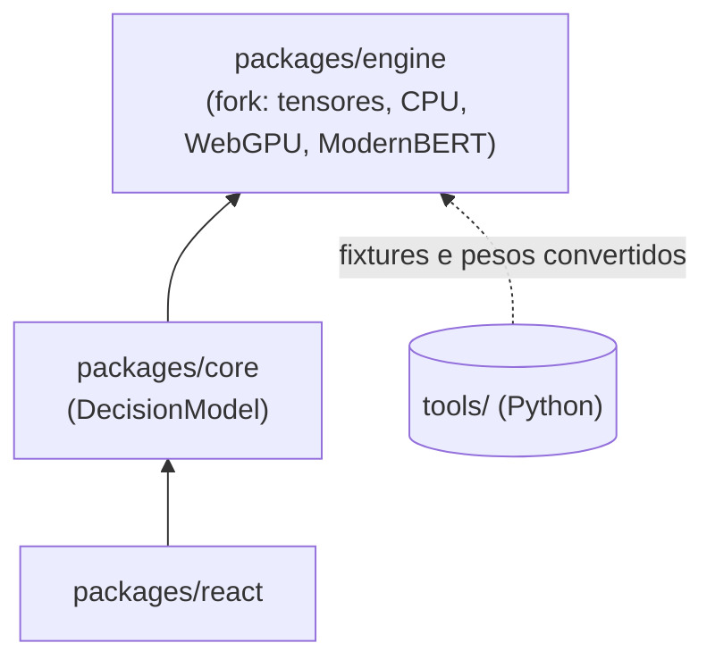

# Estrutura do repositório — SOM WebCore

> O mapa de onde cada coisa vive e por quê, no **ramo do fork** escolhido na `DP-01` ([ADR 0004](adr/0004-dp-01-fork-do-motor-leve.md)): o motor é um fork do motor leve em JavaScript + WGSL, e a API é a Decisions API do Chrome. Esta é a estrutura-**alvo**: os diretórios nascem junto com a atividade do [roadmap](../ROADMAP.md) que os preenche — nenhum é criado vazio.
> A coluna “Nasce em” diz qual atividade cria cada caminho. Hoje existe o que está marcado com ✅. Revista na `P-03` (2026-11-23): saíram os caminhos do motor do zero em Rust, descartado na `DP-01`.

**Atalhos:** [Árvore](#arvore) · [Pacotes npm](#pacotes) · [Regras de dependência](#dependencias) · [Toolchains e CI](#toolchains) · [Onde colocar cada coisa](#onde) · [Convenções de nomes](#nomes) · [O que não entra no git](#fora-do-git)

---

<a id="arvore"></a>
## 1. Árvore

```text
som-webcore/
│
├── README.md                    ✅ whitepaper: visão, arquitetura-alvo da v1.0.0, catálogo, riscos
├── ROADMAP.md                   ✅ planejamento em DAG, critérios de aceite, portões
├── CONTRIBUTING.md              ✅ como contribuir
├── GOVERNANCE.md                ✅ papéis e processo de decisão
├── CODE_OF_CONDUCT.md           ✅
├── SECURITY.md                  ✅ política de divulgação
├── CHANGELOG.md                 ✅ gerado a partir dos commits
├── LICENSE · NOTICE             ✅ Apache-2.0 e atribuições
├── CODEOWNERS                   ✅ donos por caminho
├── AGENTS.md · CLAUDE.md        ✅ contrato operacional para agentes de código
│
├── package.json · package-lock.json  ✅ workspace npm (packages/*) e lockfile versionado        P-03
├── .nvmrc                       ✅ versão do Node fixada (22)                                     P-03
├── eslint.config.js · tsconfig.json  ✅ lint e verificação de tipos do JavaScript             P-03
│
├── packages/                    ✅ código JavaScript — ver seção 2
│   ├── core/                    ✅ a API pública: DecisionModel idêntico ao do Chrome            P-03 → P-02 → K-05
│   │   ├── src/                 ✅ conversão e validação do Chrome, decodificador, ciclo de vida, configuração  P-02
│   │   ├── types/               ✅ tipos TypeScript da superfície, da configuração e do backend    P-02
│   │   ├── types-check/         ✅ exemplos do explainer e do roadmap, compilados contra os tipos  P-02
│   │   └── schema/              ✅ JSON Schema do esquema de perguntas                             P-02
│   └── engine/                  ✅ o motor: o fork do motor leve, JavaScript + WGSL             P-03 → K-02
│
├── models/
│   ├── catalog.json             ✅ catálogo de modelos (uma entrada na PoC)                       P-01 → B-06
│   └── catalog.schema.json      ✅ esquema versionado do catálogo                                 P-01
│
├── tools/                       ✅ ferramentas offline (Python)
│   ├── fetch_model.py           ✅ baixa um modelo fixado e confere os hashes                     P-01
│   ├── reference/               roda a referência upstream (PyTorch) e gera fixtures             P-04
│   └── convert/                 conversor de pesos: embeddings de 8 bits, resto em FP16          K-02
│
├── tests/
│   ├── tools/                   ✅ testes das ferramentas Python                                  P-01
│   └── fixtures/                vetores dourados pequenos, versionados                           P-04
│
├── conformance/                 vetores e executor públicos, neutros de motor                    B-09
│
├── bench/
│   ├── spike-mobile/            ✅ página de teste do marco T, tipos da API e laboratório         T-05
│   ├── harness/                 página e scripts de medição                                      P-11
│   ├── baseline-ort/            o mesmo modelo no ONNX Runtime Web                               P-12
│   ├── schema/report.schema.json  formato dos relatórios                                         P-11
│   └── results/                 ✅ relatórios JSON por dispositivo e data                         T-07
│
├── examples/
│   ├── decision-demo/           demo estática publicada                                          P-13
│   └── vanilla/ · react/        integrações mínimas                                              A-08
│
├── docs/
│   ├── METHODOLOGY.md           ✅ como decidimos, medimos e afirmamos
│   ├── STRUCTURE.md             ✅ este arquivo
│   ├── adr/                     ✅ registros de decisão de arquitetura                             DT-02
│   ├── rfcs/                    ✅ propostas de superfície pública e de formato                     P-02
│   ├── spec/                    ✅ especificações normativas, em inglês                            T-05
│   ├── standards/               explainer, prior art e evidências, em inglês                     S-01
│   ├── reports/                 ✅ relatórios de marco e de portão                                 T-06
│   ├── guides/                  guias de uso e de segurança                                      A-09
│   ├── assets/                  ✅ banner e imagens da documentação
│   └── figures/                 ✅ figuras dos relatórios de pesquisa
│
├── research/                    ✅ fontes brutas da pesquisa — não normativas
│   └── ERRATA.md                ✅ auditoria: o que está errado e a correção
│
├── scripts/                     ✅ automação do repositório
│   ├── check-docs.py            ✅ contrato de documentação (CI)
│   ├── roadmap.py               ✅ valida e desenha o DAG do roadmap (CI)
│   └── validate-wgsl.mjs        ✅ compila todo WGSL com o Tint, via Dawn (CI)                    P-03
│
├── .github/                     ✅ workflows, modelos de issue e PR, rulesets
└── .agents/ · .claude/          ✅ memória CoALA local e skills de agentes
```

Os textos de pesquisa numerados em `research/` descrevem o desenho do motor do zero; ficam como fonte bruta, não como plano.

---

<a id="pacotes"></a>
## 2. Pacotes npm

O workspace é npm (`workspaces` no `package.json` da raiz), com um lockfile só. Os dois pacotes são privados: nada é publicado no npm até a `A-08`, e publicar é decisão do dono.

| Pacote | Conteúdo | Observações |
|---|---|---|
| `packages/core` (`@som-web/core`) | a API pública — `DecisionModel` com a superfície e o comportamento do Chrome ([`decisions-api-surface.md`](spec/decisions-api-surface.md)): validação, `availability()`, `create()` com `monitor`, `preference`, `decide()`, `destroy()`; o Worker, o carregador e o ponto de configuração separado (catálogo, orçamento, política de licenças) | contrato na RFC-0001 (`P-02`), implementação sobre o motor na `K-05`; nunca substitui o `DecisionModel` nativo quando ele existe. O nome publicado é decidido na `A-08`; `@som-web/core` é provisório |
| `packages/engine` (`@som-web/engine`) | o fork do motor leve (`@johnhenry`, ver [base do fork](reports/base-do-fork.md)): backend de tensores, backend CPU (a referência em f32), backend WebGPU com os kernels WGSL e o grafo do ModernBERT | preenchido na `K-02`, com o arquivo de origem (repositório, tag, commit e integridade de cada pacote trazido), os avisos de licença (MIT e Apache-2.0, `NOTICE`) e as mudanças marcadas. Até lá só tem a infraestrutura de teste da `P-03` |
| `packages/react` | hook opcional | `A-08`; nunca dependência de `core` |

Regras: ESM apenas; JavaScript com tipos em JSDoc e declarações `.d.ts`, verificados por `tsc`; nenhum pacote baixa pesos na instalação; o Worker é empacotado de forma que funcione em Vite, webpack e Next sem configuração extra.

Cada pacote tem `src/` (código) e `test/` (testes): `*.test.js` roda em Node sem GPU (`npm test`); `*.webgpu.js` precisa de WebGPU e roda no Dawn (`npm run test:webgpu`). WGSL fica em arquivos `.wgsl` sempre que puder; o que o motor monta em tempo de execução é compilado pelo mesmo Tint nos testes WebGPU.

---

<a id="dependencias"></a>
## 3. Regras de dependência



1. **As setas só apontam para baixo.** `engine` não conhece `core` nem a Decisions API: recebe tensores e IDs de tokens e devolve vetores. A tradução de cada tipo de pergunta para o formato do modelo vive em `core`.
2. **O backend CPU do fork nunca importa WebGPU.** Ele é o oráculo interno, em f32, contra o qual os kernels são comparados (cadeia de oráculos, [metodologia, seção 6](METHODOLOGY.md#6-paridade-numérica)).
3. **Só `core` conhece o navegador** (Worker, OPFS, ativação do usuário); o `engine` roda igual em Node (Dawn) e no navegador.
4. **Nenhum framework de ML no runtime.** ONNX Runtime, Transformers.js e PyTorch aparecem apenas em `bench/` e `tools/`, nunca em `packages/`. O `webgpu` (Dawn em Node) é dependência de desenvolvimento, só para os testes.
5. **Dependência nova no runtime exige justificativa no PR**: tamanho no bundle, licença e alternativa considerada.
6. **Ferramentas offline são Python** enquanto a referência dos modelos for PyTorch; não são importadas pelo runtime.

---

<a id="toolchains"></a>
## 4. Toolchains e CI

| O quê | Versão | Onde está fixada |
|---|---|---|
| Node | 22 (22.23.1 na CI) | `.nvmrc` e `engines` dos `package.json` |
| npm e dependências | as do lockfile | `package-lock.json`, instalado com `npm ci` |
| Dawn em Node | `webgpu` 0.6.2 | `devDependencies` da raiz |
| ESLint · TypeScript | 10.15.0 · 7.0.2 | `devDependencies` da raiz |
| Python | 3 do runner | ferramentas em `tools/` e `scripts/`, sem dependências de terceiros na CI |

O workflow `.github/workflows/ci.yml` tem três jobs:

| Job | Onde | O que faz |
|---|---|---|
| `code` | Linux, macOS e Windows | `npm ci`, `npm run lint` (ESLint e `tsc`) e `npm test` (testes em Node, sem GPU) |
| `webgpu` | Linux, com o lavapipe (Vulkan na CPU) como adaptador de software | `npm run validate:wgsl` (todo `.wgsl` compilado pelo Tint) e `npm run test:webgpu` (paridade WebGPU × CPU); sem adaptador, falha em vez de pular (`SOM_REQUIRE_WEBGPU=1`) |
| `build` | Linux | o check obrigatório do ruleset: contrato de documentação, catálogo de modelos, mensagens de commit, e só passa se `code` e `webgpu` passarem |

---

<a id="onde"></a>
## 5. Onde colocar cada coisa

| Você tem… | Vai para… |
|---|---|
| Um kernel novo ou uma variante otimizada | `packages/engine/`, em arquivo `.wgsl`, com teste de paridade WebGPU × backend CPU em `packages/engine/test/*.webgpu.js` |
| Um teste de um módulo | `test/` do pacote: `*.test.js` sem GPU, `*.webgpu.js` com GPU |
| Um vetor dourado | `tests/fixtures/<modelo>/` se for pequeno; se for grande, um comando em `tools/reference/` que o gera |
| Um resultado de benchmark | `bench/results/<data>-<maquina>-<navegador>.json`, validado pelo esquema |
| Um relatório de marco ou portão | `docs/reports/` |
| Uma decisão de arquitetura | `docs/adr/NNNN-titulo.md` |
| Uma proposta de API ou de formato | `docs/rfcs/NNNN-titulo.md` |
| Uma especificação aceita | `docs/spec/` |
| Material para grupos de padronização | `docs/standards/` |
| Um erro encontrado na pesquisa | `research/ERRATA.md` e marcação no relatório |
| Um modelo novo para o catálogo | entrada em `models/catalog.json` com licença, revisão, hashes e fonte da métrica |
| Um exemplo de integração | `examples/<nome>/`, com README próprio e teste de fumaça |
| Um script de manutenção do repositório | `scripts/` |
| Uma ferramenta de conversão ou de geração de dados | `tools/` |

---

<a id="nomes"></a>
## 6. Convenções de nomes

| Item | Convenção | Exemplo |
|---|---|---|
| Pacotes | `packages/<papel>`, nome npm `@som-web/<papel>` (provisório até a `A-08`) | `packages/engine` |
| Módulos JavaScript | kebab-case, `.js` (ESM) | `weight-loader.js` |
| Testes | `<assunto>.test.js` (Node) · `<assunto>.webgpu.js` (WebGPU) | `gemv-f16.webgpu.js` |
| Shaders | `<operacao>[_<variante>].wgsl`, snake_case | `gemm.wgsl`, `gemv_f16.wgsl` |
| ADR e RFC | `NNNN-titulo-em-kebab-case.md`, numeração contínua | `0003-cabeca-no-host.md` |
| IDs de modelo no catálogo | `<familia>-<tamanho>[-<variante>]`, minúsculas | `ts-ettin-17m`, `ts-ettin-17m-q8` |
| Fixtures | `<modelo>/<caso>.{json,bin}` | `ts-ettin-17m/choice-k4-s128.json` |
| Relatórios de benchmark | `AAAA-MM-DD-<maquina>-<navegador>.json` | `2027-01-15-m1-air-chrome.json` |
| Branches | `<tipo>/<slug>` | `feat/gemm-kernel` |
| Commits e títulos de PR | Commits Convencionais | `feat(engine): add gemm kernel` |
| IDs de atividade | prefixo do marco + dois dígitos, nunca reutilizados | `P-08` |

---

<a id="fora-do-git"></a>
## 7. O que não entra no git

- **Pesos de modelos** (`*.safetensors`, `*.onnx`, `*.sombin`, `*.gguf`, `*.pt`): o repositório não distribui pesos. Vêm do repositório de origem, por revisão fixada e hash (`tools/fetch_model.py`), ou do registro de modelos do projeto.
- **PDFs originais da pesquisa.**
- **A base da memória CoALA** (`.agents/**/memory/`).
- **Dependências e artefatos de build** (`node_modules/`, `dist/`, `.venv/`).
- **Fixtures grandes**: geram-se por comando; no git ficam o comando, a revisão do modelo e o hash esperado.
